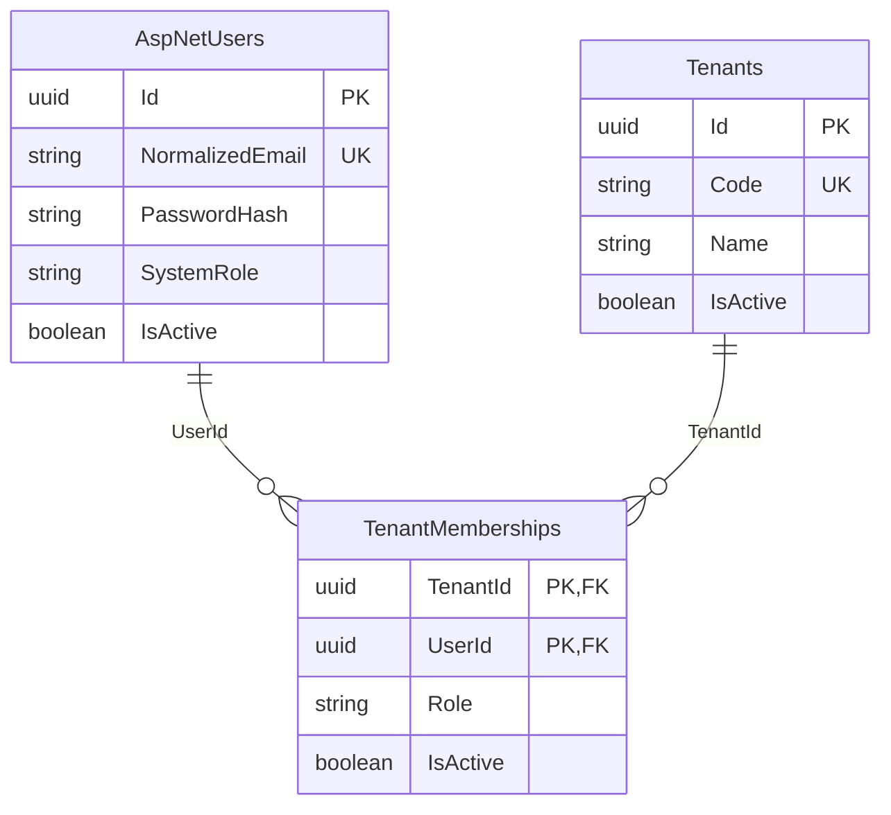

# 기업 및 사용자 데이터 구조

> 현재 요금 정책은 **가입 월 무료 + 다음 달 정기결제**, 최신 가입·로그인 흐름은 마지막 **기업 자동 접속 개선** 절을 따른다. 앞의 승인·반려 및 선택 화면 관련 내용은 과거 구현 이력이다.

## 모델과 권한



- `ApplicationUser`: 공통 사이트의 전역 계정. Identity의 사용자명, 이메일 정규화, 비밀번호 해시, 보안 스탬프, 잠금 필드 및 클레임/외부 로그인/토큰 테이블을 사용한다.
- `SystemRole.None` / `IebleAdministrator`: 아이블 운영·지원 권한. 기업 역할과 독립적이다. 기업 마스터라도 다른 기업이나 시스템 관리 권한을 얻지 않는다.
- `TenantMembership.Role`: `Master`(기업 마스터), `Administrator`(기업 관리자), `Employee`(일반 직원). 사용자별로 기업마다 다른 역할을 가질 수 있다. Identity 전역 역할 테이블에 기업 역할을 저장하지 않는다.
- `(TenantId, UserId)`가 소속의 복합 PK이므로 중복 가입이 불가능하다. 비활성 소속도 같은 행을 재활성화한다. 기업당 마스터 수 제한은 별도 요구가 없어 두지 않았다.
- 기업 코드는 공백 없는 양 끝과 대문자 형식을 요구하며 유일하다. 기업명은 중복 가능하다. 이메일은 Identity 정규화 값을 기준으로 전역 유일하다.
- enum은 문자열로 저장하고 DB CHECK로 유효한 값만 허용한다. 기업·사용자 삭제 시 소속이 있으면 RESTRICT로 차단하며, 운영상 비활성화를 사용한다.
- 사용자별 활성 소속 및 기업별 역할/활성 상태 조회에 복합 인덱스를 둔다.

## 접근 범위

`MembershipAccessService.GetTenantRoleAsync`는 사용자 ID와 기업 ID를 동시에 제한하고 사용자·기업·소속이 모두 활성일 때만 역할을 반환한다. 아이블 관리자는 자동으로 기업 역할을 받지 않는다. 시스템 운영·지원 권한은 별도 `IsIebleAdministratorAsync`로 확인한다.

이 DbContext는 로그인 전 전역 사용자 조회와 기업 운영을 위한 관리 데이터 저장소다. 전역 tenant query filter나 PostgreSQL RLS는 이번 구조에 포함하지 않는다. 향후 기업 업무 테이블과 API 구현 시 검증된 현재 기업 ID로 모든 조회와 쓰기를 제한하고, 서버에서 확인한 사용자 ID로 위 권한 검사를 적용해야 한다. 임의로 전달받은 사용자/기업 ID만으로 권한을 부여하면 안 된다. 지원 작업의 허용 범위와 감사 기록도 별도 서비스에서 명시적으로 구현해야 한다.

Identity Core와 EF Store 위에 쿠키 인증 및 기업 가입/로그인 UI를 추가했다. 구체적인 설정은 아래 기업 가입 및 공통 로그인 절을 참고한다. 비밀번호 생성/변경은 `UserManager`를 사용하고 `PasswordHash`에 직접 평문을 넣지 않는다.

## 감사와 동시성

주요 3개 모델에 `CreatedAt`, `UpdatedAt`, `CreatedByUserId`, `UpdatedByUserId`를 둔다. SaveChanges 동기/비동기 경로에서 서버 UTC 시간과 `IAuditActor`를 사용한다. 수정 시 생성 메타데이터는 보존한다. 감사 사용자 FK는 RESTRICT다. 인증된 HTTP 요청은 `HttpAuditActor`가 검증된 사용자 ID를 제공하며, 익명 가입·디자인 타임·시스템 작업은 null이다.

기업과 소속의 `Version`, Identity 사용자의 `ConcurrencyStamp`로 낙관적 동시성을 검사한다. 직접 SQL/ExecuteUpdate는 이 SaveChanges 감사 처리를 통과하지 않으므로 별도 처리가 필요하다. 감사 필드는 전체 변경 이력 저장소를 대체하지 않는다.

## 설정과 마이그레이션

런타임 DbContext와 기존 `/api/health/db`는 동일한 `ConnectionStrings:DefaultConnection` 설정을 사용한다. 환경 변수 `ConnectionStrings__DefaultConnection` 또는 .NET user-secrets 등 외부 설정으로 공급한다. 루트 `.env`의 값은 출력하거나 소스에 포함하지 않는다. ASP.NET Core는 `.env`를 자동 로드하지 않으며, 기존 실행 환경에서 연결 문자열을 공급하는 방식을 유지했다. Docker용 `POSTGRES_*` 변수만으로 API 연결 문자열이 자동 생성되지는 않는다.

`WmsDbContextFactory`는 연결 문자열 없이 Npgsql 모델만 구성한다. 최초 마이그레이션과 SQL 생성은 DB 연결 없이 가능하며, 이 팩토리는 의도적으로 실제 DB 업데이트용 설정을 제공하지 않는다. 이후 DB 적용 시 별도 검토 후 보안 설정을 사용하는 적용 절차를 준비해야 한다.

```sh
dotnet build
dotnet test
dotnet ef migrations has-pending-model-changes --project backend/IebleWms.Api --no-build
dotnet ef migrations script --project backend/IebleWms.Api --no-build --output /private/tmp/ieble-wms-initial.sql
```

최초 마이그레이션 `20261028063248_InitialIdentityAndTenancy`는 2026-10-28 개발 DB `127.0.0.1:5435 / ieble_wms_dev`에 적용했다. 시작 시 `Migrate`나 `EnsureCreated`를 호출하지 않는다. 기존 Docker, DB 데이터, React, DB 연결 테스트 라우트는 유지한다.

테스트는 메모리 SQLite에서 실제 FK/고유/CHECK 제약, 권한 분리, 비활성 상태, 감사, 동시성 및 Identity 해시 저장을 검증한다. Npgsql 마이그레이션 SQL 생성과 모델 스냅샷 일치도 검증한다. 개발 PostgreSQL 16에 최초 마이그레이션을 적용하고 실제 카탈로그의 테이블·인덱스·외래 키·CHECK 제약 및 API 연결을 확인했다. 기존 16개 자동 테스트는 SQLite 기반이며 PostgreSQL에서의 업무 동작 통합 테스트와는 구분한다.

참고: [Identity 모델 구성](https://learn.microsoft.com/en-us/aspnet/core/security/authentication/customize-identity-model?view=aspnetcore-10.0), [EF Core 멀티테넌시](https://learn.microsoft.com/en-us/ef/core/miscellaneous/multitenancy), [SQLite 테스트 번들](https://www.nuget.org/packages/SQLitePCLRaw.bundle_e_sqlite3/3.0.5).


## 개발 DB 적용 기록 (2026-10-28)

- 적용 전: PostgreSQL 16, `ieble_wms_dev`, public 스키마, 기존 사용자 테이블 및 마이그레이션 이력 없음.
- 안전성: Up의 테이블 생성 6개와 인덱스 생성 13개를 확인했다. Drop/Delete/Truncate/초기화 작업은 실행하지 않았다. Down은 실행하지 않았다.
- 적용 방법: 저장소 밖의 임시 .NET 실행 도구에서 루트 `.env`를 읽고 Npgsql 연결 문자열을 메모리에서 구성했다. 대상 이름과 버전, 빈 스키마, 마이그레이션 목록과 모델 일치를 검사한 후 EF Core `IMigrator.MigrateAsync`로 해당 마이그레이션만 적용했다. 디자인 타임 팩토리와 API 시작 코드는 변경하지 않았다.
- 생성 테이블: `AspNetUsers`, `AspNetUserClaims`, `AspNetUserLogins`, `AspNetUserTokens`, `Tenants`, `TenantMemberships`, `__EFMigrationsHistory`.
- 실제 카탈로그 검증: 인덱스 20개(PK 7개 포함), 외래 키 11개, CHECK 4개. 고유 인덱스와 소속 복합 PK, FK의 RESTRICT/CASCADE 정의를 확인했다. EF 이력 1건, 미적용 마이그레이션 0건. 업무 테이블은 모두 0행이며 시드 계정은 생성하지 않았다.
- 연결 검증: 임시 API를 `127.0.0.1:15435`에서 실행하여 `/api/health/db`가 HTTP 200, `status=connected`, `database=ieble_wms_dev`를 반환함을 확인하고 종료했다. 기존 실행 중인 서버의 설정은 변경하지 않았다.
- 빌드: `dotnet build IebleWms.slnx --no-restore --nologo -m:1` 성공, 경고 0개·오류 0개.
- 테스트: `dotnet test backend/IebleWms.Api.Tests/IebleWms.Api.Tests.csproj --no-build --no-restore --nologo -m:1`, 16개 통과·실패 0개.
- 다른 DB, Docker 컨테이너, 볼륨은 변경하지 않았다. 비밀번호와 전체 연결 문자열은 출력하거나 파일에 저장하지 않았다. Git commit/push는 실행하지 않았다.

## 기업 가입 및 공통 로그인 (2026-10-28)

기존 모델 위에 기업 가입·쿠키 인증·기업 선택을 추가했다. 아래 내용은 앞 절의 인증 미구현 상태를 대체한다.

### API

| 메서드·경로 | 용도 | 접근 조건 |
| --- | --- | --- |
| GET `/api/auth/csrf` | CSRF 요청 토큰 발급 | 공개, 캐시 금지 |
| POST `/api/auth/register` | 기업과 기업 마스터 계정 생성 | 비로그인, CSRF, IP별 분당 3회 |
| POST `/api/auth/login` | 이메일·비밀번호 로그인 | CSRF, IP별 분당 10회 |
| GET `/api/auth/me` | 현재 사용자·활성 소속·선택 기업 | 로그인 |
| POST `/api/auth/select-tenant` | 현재 업무 기업 선택 | 로그인, CSRF, 활성 사용자·기업·소속 |
| POST `/api/auth/logout` | 쿠키 삭제 및 모든 로그인 세션 무효화 | 로그인, CSRF |
| GET `/api/admin/overview` | 전체 기업·사용자·활성화 대기 건수 | 현재 DB의 아이블 관리자 권한 |
| GET `/api/tenants/{tenantId}/workspace` | 선택 기업의 기본 정보 | 현재 DB의 소속 + 쿠키의 선택 기업 일치 |

가입 입력은 기업명, 사업자등록번호, 담당자 이름·연락처, 이메일, 비밀번호다. 담당자 이름은 `ApplicationUser.DisplayName`, 연락처는 Identity `PhoneNumber`에 저장한다. 사업자등록번호는 숫자 10자리 또는 `000-00-00000` 형식을 받아 하이픈을 제거해 저장한다. 실제 사업자 진위 조회 및 이메일 소유 확인은 아직 연동하지 않았다.

`CompanyRegistrationService`는 Identity 사용자 생성부터 기업·Master 소속 저장까지 단일 DB 트랜잭션을 사용한다. 정규화 이메일 및 사업자등록번호를 사전 검사하고 고유 인덱스로 동시 가입도 보호한다. 실패하면 사용자까지 롤백한다. 공개 요청에 역할 값을 추가해도 `SystemRole.None`과 `TenantRole.Master`만 서버에서 지정한다. 첫 아이블 관리자 계정은 생성하지 않았다. 관리자 프로비저닝은 추후 별도 승인된 비공개 운영 절차에서 Identity UserManager를 통해 수행해야 하며, 공개 API에서 역할을 승격하는 경로는 없다.

### 인증과 접근 제어

- Identity 암호 정책: 12~128자, 영문 대·소문자, 숫자, 특수문자. 로그인에는 기존 계정 비밀번호 길이 하한을 강제하지 않는다.
- 계정별 5회 실패 시 15분 잠금. 로그인 오류는 계정 존재 여부·잠금 여부를 구분하지 않는 메시지를 사용한다. IP 요청 제한은 단일 API 프로세스 기준이며 다중 인스턴스 운영 시 게이트웨이/공유 저장소 기반 제한이 추가로 필요하다.
- 쿠키는 브라우저 세션 쿠키이며 티켓 유효기간은 8시간, sliding renewal은 사용하지 않는다. HttpOnly, SameSite=Strict, Path=/, Domain 미지정. 운영 환경은 Secure 및 `__Host-` 접두어를 강제한다. Development에서만 로컬 HTTP를 허용한다.
- 쿠키 암호화·서명은 ASP.NET Core Data Protection을 사용한다. 운영 배포 시 키 링을 지속 저장하고 접근 권한/저장 시 암호화를 적용하며, 다중 인스턴스는 동일한 키 링과 앱 구성을 공유해야 한다. 비밀키를 코드·Git에 저장하지 않는다.
- 모든 컨트롤러의 상태 변경 요청에 `ApiAntiforgeryFilter`를 적용한다. 프런트엔드는 POST 직전에 GET `/csrf`로 토큰을 받아 `X-CSRF-TOKEN` 헤더로 보낸다. 토큰이나 인증 정보를 localStorage에 저장하지 않는다. 익명 로그인/가입도 CSRF 검사 대상이다. 새 Minimal API의 상태 변경 경로를 추가할 때는 별도로 같은 검증을 적용해야 한다.
- 각 요청에서 사용자 활성 상태와 SecurityStamp를 검증한다. 로그아웃은 스탬프를 갱신하므로 다른 기기를 포함한 기존 쿠키도 무효화된다. 기업 선택은 원래 티켓의 만료 시간을 유지한다.
- `IebleAdministrator` 정책은 DB의 시스템 권한을, `TenantMember`는 사용자·기업·소속 활성 상태와 선택 기업을 확인한다. `TenantAdministrator`는 추가로 Master/Administrator만 허용한다. `ActiveTenant`는 서비스 상태가 Active여야 한다. 향후 실제 물류 업무 API에는 ActiveTenant와 필요한 역할 정책을 함께 적용한다. 현재 workspace는 가입/활성화 안내용으로 PendingActivation 기업도 접근한다.
- 서버의 401/403은 로그인 페이지로 리다이렉트하지 않는다. 프런트엔드 `/admin` 화면도 시스템 관리자만 렌더링하며, 실제 관리자 데이터 API는 별도로 서버 인가를 거친다.
- 쿠키·비밀번호·요청 본문·전체 연결 문자열 로깅은 추가하지 않았다. EF sensitive data logging을 켜지 않는다. 오류 응답에 DB 예외/SQL을 전달하지 않는다.

### 서비스 활성화와 스키마

`20261028070819_AddCompanyRegistration`은 기존 Tenants에 다음만 추가한다.

- nullable `BusinessRegistrationNumber`(최대 10자), 고유 인덱스, 길이 CHECK. 기존 기업의 번호는 null로 보존된다.
- `ServiceStatus`: PendingActivation / Active / Suspended 문자열 및 CHECK. 마이그레이션 시 기존 행은 Active로 채우며 기존 IsActive 값을 변경하지 않는다. 신규 공개 가입은 반드시 PendingActivation이다.

이 변경은 적용 전에 보고했고 개발 DB `ieble_wms_dev`에 적용했다. 기존 업무 테이블의 행 수와 기존 컬럼 내용 해시가 전후 동일함을 확인했다. 초기 마이그레이션은 수정하지 않았고 테이블 재생성·삭제·초기화도 하지 않았다. 미적용 마이그레이션은 없다.

가입 완료 상태와 실제 서비스 활성화를 분리했다. 카드 등록 단계는 화면의 추후 안내만 제공하며 카드 정보 저장·청구·자동 활성화 기능은 없다. 활성화나 결제 제공자가 연동될 때 검증된 서버 작업으로 상태 전이를 처리해야 한다.

### 로컬 실행과 UI

API는 기존 외부 `ConnectionStrings__DefaultConnection` 설정을 사용한다. `.env`를 화면이나 명령줄에 출력하지 말고 실행 환경에서 안전하게 주입한다. `.env` 자동 로딩은 하지 않는다.

```sh
dotnet run --project backend/IebleWms.Api --launch-profile http
npm run dev --prefix frontend
```

백엔드 HTTP 프로필 포트는 5080이며 Vite `/api` 프록시도 5080으로 맞췄다. 브라우저에서는 Vite 주소로 접속한다. 운영은 프런트엔드와 `/api`를 동일 HTTPS origin으로 제공하고 SPA 경로(`/login`, `/register`, `/app`, `/admin`)를 index.html로 폴백해야 한다. TLS를 프록시에서 종료할 경우 신뢰할 프록시만 지정해 forwarded headers를 구성해야 한다. 광범위한 CORS 허용은 추가하지 않았다.

UI는 로그인, 기업 가입, 기업 선택, 서비스 활성화 상태, 아이블 관리자 개요를 제공한다. 새로고침 시 `/me`로 상태를 복구한다. 기존 DB 연결 확인 기능은 하단 상태 표시로 유지했다.

### 검증

- 백엔드 빌드 경고/오류 0개. 기존 16개 + 신규 14개 = 자동 테스트 30개 통과.
- 프런트엔드 `npm run build --prefix frontend`, `npm run lint --prefix frontend` 모두 통과.
- HTTP 통합 테스트: 가입/해시, 중복 이메일·사업자번호, 실패 시 전체 롤백, 입력 검증, CSRF, 운영 쿠키 속성, 로그아웃 후 쿠키 재사용 차단, 계정 잠금·429, 다중 소속 선택, 타 기업 접근 차단, 시스템 권한 변경/사용자 비활성화 즉시 반영, 기업 역할 3종 및 활성화 정책.
- Chrome 브라우저 + 실제 API 코드 + 격리 SQLite: 가입 폼/비밀번호 확인, 가입·로그인, 기업 선택, 새로고침 후 세션 유지, 일반 사용자 `/admin` 차단, 다중 기업 전환, 관리자 화면, 로그아웃, 모바일 가로 넘침 및 JavaScript 오류 없음 확인. DB 연결 UI 응답만 격리 테스트에서 대체했다.
- 실제 개발 PostgreSQL은 별도로 신규 스키마 및 `/api/health/db` HTTP 200을 확인했다. 테스트 계정은 개발 DB에 생성하지 않았다.
- 참고: [ASP.NET Core CSRF](https://learn.microsoft.com/aspnet/core/security/anti-request-forgery?view=aspnetcore-10.0), [요청 제한](https://learn.microsoft.com/en-us/aspnet/core/performance/rate-limit?view=aspnetcore-10.0).

## 최초 관리자 및 기업 승인 관리 (2026-10-28)

### 최초 관리자 실행 방법

프로젝트 루트에서 직접 터미널로 실행한다. API 서버를 띄우지 않고 생성 명령만 수행한 뒤 종료한다.

```sh
dotnet run --project backend/IebleWms.Api --launch-profile http -- --bootstrap-admin
```

- 관리자 이메일, 표시 이름, 비밀번호와 확인 값을 대화형으로 입력한다. 비밀번호는 `Console.ReadKey(intercept: true)`로 읽으므로 화면에 표시되지 않는다. 비밀번호를 명령 인자·환경 변수·파일에 넣지 않는다. 추가 명령 인자 및 파이프 입력은 거부한다.
- `Development` 환경에서만 동작하며 `127.0.0.1` 또는 `localhost`, 포트 5435, DB `ieble_wms_dev`만 허용한다. 실행 직전에 실제 DB 이름과 미적용 마이그레이션 유무도 확인한다. 자동 마이그레이션은 하지 않는다.
- 이 명령에 한해 기존 `ConnectionStrings:DefaultConnection`이 없으면 프로젝트의 상위 디렉터리에서 루트 `.env`를 찾아 `POSTGRES_DB`, `POSTGRES_USER`, `POSTGRES_PASSWORD`로 메모리에서 연결 문자열을 구성한다. `.env`는 단순 KEY=value 및 양끝 따옴표 형식을 지원하며 셸 변수 치환이나 명령 실행을 하지 않는다. 웹 서버의 기존 연결 설정 방식은 유지한다.
- 명령 실행 중 로깅 공급자를 제거하고, 실패 시 예외 원문·연결 문자열·비밀번호를 출력하지 않는다. 운영 환경에서는 계정 생성 전에 중단한다.
- Identity UserManager가 암호를 해시한다. 계정과 `AdministratorBootstraps`의 단일 완료 기록을 같은 트랜잭션에 저장한다. PK=1/CHECK=1 제약으로 동시 초기화의 중복도 막으며 실패한 시도의 사용자 생성은 롤백된다.
- 초기화 기록은 계정이 정지되거나 시스템 역할이 변경되어도 남는다. 이미 관리자가 있으면 새 계정을 생성하지 않고 기존 관리자에 대한 완료 기록만 남긴다. 이미 등록된 일반 기업 이메일을 관리자 계정으로 승격하지 않는다.
- 공개 초기화 API와 공개 역할 승격 경로는 없다. 생성한 관리자는 공통 `/login`에서 로그인해 `/admin`으로 이동한다. 기업 소속은 부여하지 않으며 고객사의 WMS 업무 데이터 접근 권한도 자동 부여하지 않는다.
- 실제 개발 DB의 관리자 계정은 이번 작업에서 임의 생성하지 않았다. 위 명령으로 운영자가 본인의 정보를 직접 입력해야 한다. 관리자 자격 증명 복구·추가 운영자 초대는 별도 작업이며, 초기화 기록 삭제를 통한 우회는 지원하지 않는다.

### 기업 관리 API 및 상태 전이

| 경로 | 내용 |
| --- | --- |
| GET `/api/admin/tenants?status=PendingActivation&search=...&page=1&pageSize=20` | 기업명·사업자번호 검색, 상태 필터, 기업명순 페이지 조회. 기업명/번호/가입일/활성 기업 마스터의 이름·이메일·연락처/현재 상태/버전을 제공한다. |
| GET `/api/admin/tenants/{tenantId}/history` | 최근 상태 변경 100건. 관리자 ID·이름, UTC 시각, 이전·이후 상태, 사유를 제공한다. |
| POST `/api/admin/tenants/{tenantId}/status` | `action`, 현재 `version`, 필수 `reason`(공백 제외 1~1000자)을 받는다. 아이블 관리자 정책과 CSRF 검사를 적용한다. |
| GET `/api/tenants/{tenantId}/workspace` | 소속 구성원의 기업 상태 안내. 최신 변경 시각·사유도 제공한다. 업무 데이터는 제공하지 않는다. |
| GET `/api/tenants/{tenantId}/dashboard` | WMS 업무 진입. 선택 기업·활성 사용자/기업/소속·서비스 Active 상태를 서버에서 확인한다. 현재는 업무 진입 확인만 제공하며 재고/입출고 기능은 별도 개발 범위다. |

허용되는 변경은 다음과 같다. 이외 전이 및 같은 요청 재실행은 409다.

| 현재 상태 | action | 이후 상태 |
| --- | --- | --- |
| PendingActivation (승인 대기) | approve | Active |
| PendingActivation | reject | Rejected |
| Active | suspend | Suspended |
| Suspended | reactivate | Active |

Rejected 상태에서의 재신청은 아직 제공하지 않는다. `IsActive=false` 기업을 이 화면에서 복구하거나 소속을 자동 생성하지 않는다. 서비스 승인·정지는 `ServiceStatus`를 변경하고 IsActive는 보존하므로 승인 대기·반려·정지 기업의 구성원도 상태 안내를 확인할 수 있다. 업무 API는 반드시 ActiveTenant 정책을 적용하며, 역할 제한이 필요하면 TenantAdministrator 등과 함께 적용한다. 기존 로그인 쿠키가 있어도 업무 API는 매 요청 DB의 현재 상태를 검사한다.

변경 시 `Tenant.Version`으로 오래된 화면 및 동시 변경을 차단하고, 기업 상태와 `TenantStatusChanges` 이력 행을 하나의 SaveChanges 트랜잭션에 저장한다. 변경 관리자와 시각은 서버가 결정하며 요청 본문의 사용자 ID나 시각은 받지 않는다. 이력 및 초기화 완료 기록은 EF SaveChanges에서 수정/삭제를 거부하고, 관련 FK는 RESTRICT다. DB 운영자의 직접 SQL까지 막는 외부 감사 시스템을 대체하지는 않는다.

### 화면

`/admin`은 기본적으로 승인 대기 기업을 보여 준다. 검색·상태 필터·페이지 이동·변경 이력을 제공한다. 승인/반려/이용정지/재활성화는 확인 팝업에서 사유를 입력하고 확정한다. 네트워크 처리 중 중복 클릭을 막고, 409 충돌이면 새 목록을 받은 뒤 다시 선택해야 한다. 사유가 기업 구성원에게 표시된다는 점을 팝업에 안내한다.

`/app`은 승인 대기·반려·이용정지와 최근 사유를 표시하고 상태 새로고침을 제공한다. 활성 기업에만 WMS 업무 시작 버튼을 보여 주며 버튼을 누르면 서버의 최신 접근 검사를 다시 거친다. 오래된 활성 화면에서도 정지된 기업의 업무 API는 차단된다.

### 스키마 적용 및 검증

`20261028073734_AddTenantApprovalAndAdminBootstrap`을 사전 검토 후 개발 DB에 적용했다.

- 새 테이블 `AdministratorBootstraps`, `TenantStatusChanges`와 FK 3개, 인덱스 3개(PK 제외)를 추가했다.
- 기존 `CK_Tenants_ServiceStatus`만 교체해 Rejected를 허용했다. 기존 테이블·컬럼·데이터 삭제 또는 재생성은 없으며 이전 마이그레이션을 수정하지 않았다.
- 기존 업무 데이터의 행 수·내용 해시가 적용 전후 동일함을 확인했다. 이력 총 3개, 미적용 마이그레이션 0개. 실제 DB의 관리자 계정이나 고객사 상태를 테스트 목적으로 변경하지 않았다.
- 백엔드 빌드 경고·오류 0개. 기존 30개와 신규 7개를 포함해 자동 테스트 37개 통과. 생성/해시/중복 방지/운영 환경 차단/기존 고객 승격 금지, 승인·반려·정지·재활성화, 사유와 관리자 감사 기록, 버전 충돌, CSRF, 일반 사용자 관리 API 차단 및 타 기업 접근 차단을 검증했다.
- 실제 Production 명령은 계정 생성 전에 종료 코드 1로 차단됨을 확인했다.
- 프런트엔드 build 및 lint 통과. Chrome과 격리 API/SQLite에서 확인 팝업 취소·승인·이용정지·재활성화·이력·사업자번호 검색·모바일 레이아웃, 오래된 활성 화면의 업무 요청 차단을 확인했다. 개발 DB에 테스트 계정은 남기지 않았다.
- 실제 개발 PostgreSQL의 신규 테이블·FK·상태 CHECK 및 기존 `/api/health/db` HTTP 200을 확인했다. Docker와 볼륨은 변경하지 않았다. Git commit/push는 하지 않았다.

참고: [EF Core 트랜잭션 및 저장](https://learn.microsoft.com/en-us/ef/core/saving/), [동시성 제어](https://learn.microsoft.com/en-us/ef/core/saving/concurrency), [Console.ReadKey](https://learn.microsoft.com/en-US/dotnet/api/System.Console.ReadKey).

## 이전 정책 이력: 자유 가입 → 카드 등록·결제 → WMS (2026-10-28 변경)

이 절은 이전 정책 구현 기록이다. 현재 최종 정책은 문서 마지막 절을 따른다. 위의 기업 가입 승인·반려 절도 이전 구현 및 적용 이력이다. 기존 마이그레이션과 감사 이력을 삭제하지 않고 정책을 전환했다.

- 공개 가입은 승인 없이 `ServiceStatus.Active`(등록)와 `BillingStatus.CardRequired`로 완료된다. Active는 기업 등록/운영 상태이며, 단독으로 업무 이용 권한을 뜻하지 않는다.
- `approve` / `reject` 요청은 API 입력 검증에서 400으로 거부한다. 관리자 화면의 승인·반려 버튼과 필터를 제거했다. 기존 정지·재활성화, 버전 충돌 검사 및 감사 기록은 유지했다. 재활성화는 Paid 기업에만 가능하다.
- 결제 상태는 `CardRequired` → `PaymentRequired` → `Paid`로 구분한다. 현재는 상태 저장 구조만 제공하며 이 상태를 변경하는 공개·관리자·개발 API는 없다. 카드 등록만으로 WMS가 열리지 않는다.
- `ActiveTenant`는 활성 사용자·기업·소속, 선택 기업 일치, 기업 상태 Active, 결제 상태 Paid를 모두 서버에서 검사한다. 미결제 기업은 로그인·기업 선택·결제 안내를 볼 수 있지만 `/dashboard` 등 WMS 업무 API는 403이다.
- 최초 관리자 명령 `--bootstrap-admin` 및 기업별 권한 격리는 그대로 유지한다. 최초 관리자에게 고객사 업무 소속이나 결제 조건 우회 권한을 부여하지 않는다.

### 확정 요금과 미확정 사항

| 항목 | 정책 |
| --- | --- |
| 기본 이용료 | 0원 |
| 기본 포함 인원 | 0명 |
| 사용자 요금 | 사용자 1명당 월 1,000원 |
| 추가 직원 | 다음 달부터 과금 |
| 결제 서비스/방식 | 토스페이먼츠 카드 자동결제 예정 |
| 과금 취소·환불 | 기업 직접 처리 불가. 아이블 관리자 처리 예정 |
| 최초 기업 마스터 과금 여부 | 미확정 |
| 최초 결제 시점 | 미확정 |

`BillingPolicy`는 확정 값과 미확정 값(null)을 구분한다. 마스터를 포함/제외해 임의 총액을 계산하거나 가입 즉시 결제를 예약하지 않는다. 요금 계산, 카드 자동결제 스케줄, 영수증, 취소·환불 API는 이후 결제 연동 범위다. 현재 안내 화면은 이 정책과 미확정 항목을 표시한다.

### 토스페이먼츠 설정 준비

`Billing:TossPayments` 설정과 `TossPaymentsOptions`를 준비했다. appsettings의 ClientKey/SecretKey는 빈 값이다. 추후 외부 설정 `Billing__TossPayments__ClientKey`, `Billing__TossPayments__SecretKey` 또는 user-secrets를 사용한다. 실제 비밀키를 Git/명령 인자/로그/프런트엔드 환경 변수에 넣지 않는다.

현재 SDK 로딩, 카드 입력 수집, 빌링키 발급, 결제 요청, 웹훅, 결제 완료 처리, 취소·환불 HTTP 호출은 구현하지 않았다. 키를 설정해도 결제 기능이나 이용 권한이 자동으로 활성화되지 않는다. `/workspace`의 `billingProviderConfigured=false`는 실제 연동이 아직 미구현이라는 뜻이다. 화면에는 토스 연동 준비 중임을 안내하며 실행되지 않는 결제 버튼은 제공하지 않는다.

향후 [토스 자동결제 가이드](https://docs.tosspayments.com/guides/v2/billing/integration)에 맞춰 인증된 기업·서버 상품/금액·중복 결제 방지·결제 결과 검증·안전한 빌링키 보관을 구현한 뒤에만 결제 상태를 갱신한다. 브라우저 리다이렉트, 클라이언트가 보낸 Paid 값, 단순 카드 등록으로 업무 권한을 열면 안 된다.

### 안전한 개발 검증

```sh
dotnet test backend/IebleWms.Api.Tests/IebleWms.Api.Tests.csproj --no-restore -m:1
npm run build --prefix frontend
npm run lint --prefix frontend
```

자동 테스트는 격리된 메모리 SQLite를 사용한다. 권한 테스트의 Paid 데이터는 테스트 전용 DB fixture로만 구성하며 실제 개발 PostgreSQL에 저장하거나 외부 결제 성공으로 처리하지 않는다. 실제 브라우저 검증은 미결제 상태만 사용해 안내·접근 차단을 확인한다. 운영/개발 웹 서버에는 결제 우회 플래그, 가짜 성공 API, 상태 수동 설정 화면을 추가하지 않았다. 개발 DB에서 Paid를 직접 만드는 SQL을 테스트 방법으로 제공하지 않는다.

### 적용 및 검증 기록

- `20261028080817_ReplaceApprovalWithBillingGate`를 검토 후 개발 DB에 적용했다. BillingStatus 컬럼/검증 제약을 추가하고 모든 기존 기업은 CardRequired로 둔다. 기존 PendingActivation/Rejected는 Active(등록)로 정규화하며 Suspended는 보존한다. 이전 상태 변경 이력은 그대로 남는다.
- 데이터 행과 이력을 삭제하지 않았으며 의도한 상태 정규화 외 기존 데이터의 해시가 동일함을 확인했다. 실제 결제 호출이나 임의 Paid 행은 생성하지 않았다. 미적용 마이그레이션은 없다.
- 자동 테스트 40개 통과: 기존 Identity·최초 관리자·소속 격리, 승인/반려 요청 제거, 자유 가입 시 결제 상태 주입 차단, 미결제 접근 차단, Paid fixture의 정지·재활성화, 운영 환경의 CardRequired/PaymentRequired 차단 및 가짜 결제 확인 경로 부재.
- 백엔드 빌드 경고·오류 0개, 프런트엔드 build/lint 통과. 실제 `/api/health/db` HTTP 200 확인. Git commit/push와 Docker 변경은 하지 않았다.

## 현재 최종 정책: 가입 월 무료 + 다음 달 정기결제

이 절이 이전 요금·접근 정책을 대체한다. 마스터 과금 여부와 최초 결제 시점도 이제 확정되었다.

- 신규 기업의 가입 월은 무료다. 가입 시 카드 등록을 진행하며, 서버에서 카드 등록이 확인된 경우에만 해당 월 WMS를 이용할 수 있다.
- 첫 결제는 가입 다음 달 1일 00:00, 이후 정기결제도 매월 1일 기준이다. 기본 정책의 월 판단은 `Asia/Seoul`이다. 월말 가입도 30일 무료가 아니라 가입한 달까지만 무료다.
- 기업 마스터를 포함해 사용자 1명당 월 1,000원, 기본료 0원·기본 포함 인원 0명이다. 추가 직원은 추가한 달 무료이고 다음 달 정기결제일부터 과금 대상이다.
- 실제 토스 연동·카드 등록·청구·스케줄러·환불·영수증은 아직 구현하지 않았다. 첫 결제일과 직원별 과금 시작일을 계산하는 구조만 제공하며 실제 청구나 요금 총액 계산은 하지 않는다.

### 정책 설정

`Billing:Policy`를 `appsettings.json` 또는 외부 설정으로 변경할 수 있다. 환경 변수 이름은 예를 들어 `Billing__Policy__MonthlyPerUserKrw`다.

| 설정 | 기본값 | 의미 |
| --- | --- | --- |
| MonthlyPerUserKrw | 1000 | 사용자 월 요금(원) |
| MonthlyBaseKrw | 0 | 기업 기본 월 이용료 |
| IncludedUsers | 0 | 기본 포함 사용자 수 |
| BillMasterAccounts | true | 기업 마스터도 과금 대상 |
| RegistrationMonthFree | true | 기업 가입 월 무료 |
| NewMembersStartFollowingMonth | true | 추가 사용자는 다음 달부터 과금 |
| BillingDayOfMonth | 1 | 매월 기준일 (모든 달에 존재하는 1~28일 허용) |
| TimeZoneId | Asia/Seoul | 가입 월과 정기결제일 계산 시간대 |

값의 범위와 시간대를 시작 시 검증하며 잘못된 정책으로 서버가 실행되지 않게 했다. 요금·마스터 포함 여부·직원 정책·첫 결제일 안내는 서버의 `/workspace` 응답을 사용한다. 설정 변경 후 서버를 재시작한다. 카드 등록 상태 검사와 사용자·기업·소속 검사는 정책 값으로 해제할 수 없다. 정기결제일을 다른 날짜로 변경해도 무료 기간은 가입 월까지만이며, 무료 종료 후 결제 전의 공백 기간을 임의로 무료 연장하지 않는다.

### 서버 접근 판단

`BillingAccessService`가 `TimeProvider`의 서버 UTC 시각과 기업 `CreatedAt`을 정책 시간대로 변환해 판단한다. 클라이언트가 보내는 날짜나 무료 플래그는 사용하지 않는다. 기존 BillingStatus의 의미를 재사용하므로 새 컬럼이나 마이그레이션은 필요하지 않다.

| 기존 저장 상태·조건 | 서버 계산 상태 | WMS |
| --- | --- | --- |
| CardRequired | CardRequired | 차단, 결제 수단 등록 안내 |
| PaymentRequired + 가입 월 + 무료 정책 활성 | RegistrationMonthFree | 허용, 가입 월 무료 이용 표시 |
| PaymentRequired + 가입 월 종료 | PaymentRequired | 결제 확인 전 차단 |
| Paid | Paid | 기존 서버 결제 확인 상태에 따라 허용 |
| 기업 정지/비활성 또는 소속/사용자 비활성 | 접근 불가 | 카드·무료·결제 여부와 무관하게 차단 |

PaymentRequired는 신뢰할 수 있는 서버 측 카드 등록 절차가 끝났지만 결제를 기다리는 저장 상태다. 현재 실제 연동이 없어 이 상태를 만들어 주는 카드 등록 API는 없다. 무료 이용은 이 상태를 Paid로 바꾸지 않고 매 요청 계산한다. 다음 달 1일이 되면 이전 로그인 쿠키도 무료 권한을 유지하지 못한다. 가입일이 미래이거나 없는 경우에도 차단한다.

기업 정지 해제는 결제 완료 기업뿐 아니라 서버가 판단한 가입 월 무료 기업에도 허용된다. 그 후에도 업무 API가 최신 시각과 상태를 다시 검사한다. 관리자 화면은 등록된 카드 상태와 무료 이용 상태를 구분해서 표시한다.

### 검증 및 데이터 보존

- 백엔드 빌드 경고·오류 0개. 자동 테스트 50개 통과(기존 40개 + 신규 10개).
- 월초·월말·윤년 2월·연말 전환과 한국 시간 경계, 카드 미등록 차단, 미래 가입일 차단, 기업 정지·비활성 차단, 설정 변경, 마스터 포함 및 직원 추가 후 다음 달 과금 시작일을 검증했다.
- Production 환경의 실제 HTTP 테스트에서 카드 등록 상태의 가입 월 무료 접근을 확인한 뒤 서버 시각을 다음 달 1일로 이동했을 때 같은 쿠키의 업무 요청이 403으로 바뀜을 검증했다. 저장 상태가 Paid로 변경되지 않음도 확인했다.
- 카드 등록 상태는 격리된 메모리 DB 테스트 fixture에서만 사용했다. 실제 개발 PostgreSQL에는 카드 등록 성공·결제 성공을 생성하지 않았고 데이터나 스키마도 변경하지 않았다. 개발 서버의 우회 API나 환경 플래그를 추가하지 않았다.
- 프런트엔드 build/lint 통과. Chrome과 격리 서버에서 카드 미등록 안내·새 요금 표시·업무 API 403·세션 유지·권한 격리·모바일 레이아웃을 확인했다.
- 기존 DB·Docker·마이그레이션은 보존했고 Git commit/push는 하지 않았다.

## localhost CSRF 연결 오류 수정

2026-10-28 실제 개발 서버와 Chrome Network에서 확인한 오류는 CSRF 검증 실패가 아니라 API 연결/실행 버전 문제였다.

| 확인 단계 | `/api/auth/csrf` 결과 | 원인/조치 |
| --- | --- | --- |
| 수정 전 localhost:5173 | 502 | Vite가 API 실행 포트 5080 대신 리스너가 없는 5143으로 전달 |
| 프록시만 5080으로 수정 | 404 | 기존 5080 프로세스가 최신 인증 경로를 제공하지 않음 |
| 최신 API를 Development로 재시작 | 200 | 브라우저와 직접 API 요청 모두 정상 |

기존 API는 인증 개발 이전에 시작된 프로세스였고 작업 경로와 실행 바이너리를 확인한 후 해당 프로세스만 교체했다. 수정된 프록시 및 http/https launch profile의 HTTP 포트는 모두 5080이다. API 소스를 빌드해도 이미 실행 중인 프로세스는 자동으로 새 코드를 로드하지 않으므로 재시작이 필요하다.

React는 상대 경로 `/api/auth/csrf`에 credentials=same-origin으로 요청해 HttpOnly CSRF 쿠키와 JSON 요청 토큰을 받고, POST에 동일 쿠키 및 `X-CSRF-TOKEN` 헤더를 전송한다. 로그인 등 사용자 상태 변경 후에도 POST마다 새 요청 토큰을 발급받는다. 브라우저에서 HttpOnly 쿠키 값을 직접 읽을 필요는 없다. CSRF HTTP 404/5xx는 인증 서비스 연결 오류로 구분하며, 네트워크 실패나 잘못된 토큰 응답에서는 POST를 보내지 않는다.

Development HTTP는 CookieSecurePolicy.SameAsRequest, HttpOnly, SameSite=Strict, Path=/를 유지한다. Production은 Secure 강제 및 __Host- 이름을 유지한다. CSRF 필터·인증·인가·잠금·요청 제한은 제거하거나 완화하지 않았다. 로그와 진단 결과에는 토큰·쿠키·비밀번호 값을 출력하지 않는다.

검증 결과:

- 실제 Chrome `http://localhost:5173/api/auth/csrf` 200.
- 최신 API의 요청 완료 로그에서 `/api/auth/csrf`, `/api/health/db` 200 확인. 기존 API의 출력은 사용자 터미널에 연결되어 있어 과거 로그를 임의로 읽지 않았다.
- 격리 SQLite 및 실제 Vite 설정을 사용한 Chrome: 기업 가입 201, 로그인 200, 로그아웃 204, CSRF 없는 로그아웃 400, 로그아웃 후 me 401. HTTP 쿠키의 HttpOnly/Strict와 CSRF 헤더 전달도 검증했다. 테스트 사용자는 실제 개발 DB에 생성하지 않았다.
- 백엔드 전체 51개 테스트 통과. 신규 테스트는 Development HTTP의 가입/로그인/로그아웃 및 CSRF 거부를 검증하며 기존 운영 Secure 쿠키 테스트도 통과했다.
- 프런트엔드 `npm run test --prefix frontend` 7개 통과(Node 24 기준). 404/502/연결 실패/잘못된 토큰 응답 시 POST 차단, 정상 토큰·credentials 전달을 검증한다.
- dotnet build 경고·오류 0개, 프런트엔드 build 및 lint 통과.

개발 서버는 아래 포트 구성을 사용한다. 연결 문자열은 기존 외부 설정으로 제공하고 출력하지 않는다.

```sh
dotnet run --project backend/IebleWms.Api --launch-profile http
npm run dev --prefix frontend
```

API는 localhost:5080, 브라우저는 localhost:5173으로 접속한다. 다른 포트로 실행한다면 Vite 프록시도 일치시켜야 한다. 이번 수정에는 DB 스키마 변경·마이그레이션·삭제·초기화·Git commit/push가 없다.

## 최신 가입·비밀번호·기업 자동 접속 개선

### 기업 중복 기준

기업명은 앞뒤 공백을 제거해 저장하고 동일 이름 자체는 중복 제한하지 않는다. 사업자등록번호는 하이픈과 공백을 제거한 ASCII 숫자 10자리로 검증·저장하며 기존 기업의 활성/비활성 여부와 관계없이 중복을 차단한다. React에서 정규화·형식을 검사하고 실제 기존 번호와의 비교는 서버 및 PostgreSQL 고유 인덱스가 수행한다. 별도의 기업 상세 정보 조회/중복 조회 공개 API를 만들지 않았다.

사업자번호 중복 응답은 HTTP 409, `code=duplicate_company` 및 아래 문구만 제공한다. 다른 기업의 이름, 사용자 이메일, 기업 ID는 반환하지 않는다. 가입 화면에서는 같은 문구와 로그인 이동 링크를 표시한다.

> 이미 등록된 기업입니다. 기존 기업 계정으로 로그인하거나, 계정 등록이 필요한 경우 기업 관리자에게 문의해 주세요.

`BusinessRegistrationNumber` 정규화 유틸리티, DTO 검증 및 기존 `IX_Tenants_BusinessRegistrationNumber` UNIQUE 인덱스를 함께 사용한다. CHECK를 강화해 비정규화 값이 직접 저장되는 것도 막는다. 트랜잭션 중 고유 충돌은 안전하게 롤백하고 동일한 중복 안내로 변환하므로 동시 요청에서 부분 계정이 남지 않는다. 동일 이메일/동일 번호의 경합도 기업 중복 검사를 우선한다.

### 공통 비밀번호 정책

Identity 공통 `PasswordOptions.RequireUppercase=false`를 설정했다. 12~128자, 영문 소문자, 숫자, 특수문자는 유지하며 대문자는 선택이다. React의 검증·안내도 같은 조건을 사용한다. UserManager의 가입·ChangePasswordAsync·ResetPasswordAsync 공통 검증에 적용되며 기존 해시나 비밀번호를 다시 쓰지 않는다. 변경/재설정 API와 UI를 이번 작업에서 새로 공개한 것은 아니다. CSRF, HttpOnly/Secure 쿠키, 잠금·요청 제한은 그대로다.

### 로그인과 기본 기업

- 기업 가입 시 마스터 소속을 만들고 그 소속을 기본 기업으로 기록한다.
- 로그인 시 서버가 활성 사용자·기업·소속을 조회한다. 활성 소속이 1개면 그 기업을 자동 연결하고, 여러 개면 그 중 유효한 기본 기업만 연결한다. 클라이언트가 보낸 TenantId로 로그인 기업을 결정하지 않는다.
- 기업 ID는 암호화/서명된 인증 쿠키의 claim에 넣는다. `/me`도 현재 소속을 다시 확인하며 기존 세션에서 소속이나 기본 기업이 달라졌으면 기존 만료 시간을 보존해 쿠키를 갱신한다.
- 단일 기업 사용자: 로그인 → `/app` 기업 화면 또는 카드 등록 안내. 기업 선택 폼은 렌더링하지 않는다. 사이드바와 화면에 접속 기업명을 표시한다.
- 다중 기업 + 기본 기업 있음: 로그인 → 해당 기업 `/app`.
- 다중 기업 + 기본 기업 없음: 자동으로 첫 기업을 고르지 않고 소속 확인/기본 기업 지정 안내를 제공한다. `POST /api/auth/default-tenant`는 인증·CSRF·본인 활성 소속을 검증하고 기본 기업을 저장한다. 다음 로그인부터 바로 접속한다. 이전 `select-tenant` 경로는 호환용으로 같은 기본 기업 지정 동작에 연결했다.
- 기본 기업이 비활성 소속이면 이를 자동 접속에 사용하지 않는다. 남은 활성 소속이 하나면 그 기업, 여러 개면 안내 화면으로 간다. 소속이 없으면 기업 관리자에게 확인하도록 안내한다.
- 아이블 관리자는 기존처럼 `/admin`으로 이동한다. 기업 업무 접근에는 별도 소속이 필요하다.

결제/가입 월 무료 정책은 동일하다. 자동 기업 연결은 결제 권한을 부여하지 않는다. 카드 미등록은 안내 화면, 등록 카드가 있는 가입 월 무료 기업은 서버가 검증한 무료 이용 화면, 정지·결제 미완료 기업의 업무 API는 차단된다. 각 업무 요청에서 쿠키 기업 ID와 요청 경로 및 DB 소속을 다시 검증한다.

### 마이그레이션과 검증

`20261028091617_NormalizeBusinessNumbersAndDefaultMembership`을 생성·적용했다.

- 정규화 기준 기존 중복 그룹 0개, 잘못된 번호 0개임을 먼저 확인했다. 마이그레이션 자체에도 중복/잘못된 번호 발견 시 예외로 전체 중단하는 검사를 넣었다. 삭제·병합은 하지 않는다.
- 기존 사업자번호를 정규화하고 10자리 숫자 CHECK를 강화했다. 기존 사업자번호 UNIQUE 인덱스는 유지한다.
- TenantMemberships에 `IsDefault=false` 컬럼과 `UserId WHERE IsDefault=TRUE` 고유 인덱스를 추가했다. 사용자당 기본 기업은 하나이며, 기존 다중 소속에 기본 기업을 임의로 지정하지 않는다. 기존 단일 기업은 플래그 없이도 자동 접속된다.
- 기존 행 수와 기존 컬럼 내용 해시가 적용 전후 동일함을 확인했다. 기존 기업·사용자·권한·결제·이력을 보존했고 미적용 마이그레이션은 없다.
- PostgreSQL의 별도 임시 테스트 스키마에서 두 가입을 사용자 저장 직전에 동기화해 동시 실행했다. 하나만 기업/사용자/소속을 생성하고 다른 요청은 중복 안내로 종료됐으며 부분 생성 계정이 없었다. 해당 테스트 스키마만 제거했고 public 데이터는 건드리지 않았다.
- 백엔드 자동 테스트 67개, 프런트엔드 14개 통과. 동일/다른 이름과 번호 조합, 비활성 기업 중복, 정규화, 대문자 선택, 변경/재설정 검증, 3개 기업 역할의 단일 기업 자동 로그인, 다중 소속 기본 기업, 중복 기본 기업 제약, 결제 제한과 기존 보안 테스트를 포함한다.
- Chrome과 격리 API/SQLite에서 소문자 가입, 중복 안내와 로그인 링크, 같은 이름/다른 번호 허용, 기업 선택 없는 `/app`, 기업명 표시, 다중 소속 기본 지정과 재로그인, `/admin` 이동을 확인했다.
- dotnet build 경고·오류 0개, 프런트엔드 build/lint 통과. 5080 개발 API를 최신 코드로 재시작하고 CSRF/DB health 200을 확인했다. 실제 개발 DB에 테스트 사용자를 남기지 않았다. Docker 변경이나 Git commit/push는 하지 않았다.

## 기업 사용자 공통 WMS 레이아웃

기업 사용자의 `/app` 및 `/app/*`를 `CompanyWorkspace`로 분리했다. 로그인·가입 폼과 관리자 `/admin`은 기존 화면을 유지한다. 고정 사이드바(248px/접은 상태 76px), 상단 기업명·로그인 이름·권한·로그아웃, 경로 표시, 중앙 콘텐츠, 기존 DB 연결 상태를 제공한다. 기업명/사용자/역할은 `/auth/me`와 현재 기업 `/workspace` 응답을 사용한다. 화면 폭에 따라 통계 카드를 재배치하고 좁은 화면에서는 아이콘 사이드바와 펼침 패널을 사용한다.

| 메뉴 | 경로 |
| --- | --- |
| 대시보드 | /app |
| 창고관리 | /app/warehouses |
| 상품관리 | /app/products |
| 입고관리 | /app/receipts |
| 출고관리 | /app/shipments |
| 재고관리 → 재고 이동 및 조정 | /app/inventory/adjustments |
| 재고관리 → 재고 실사 | /app/inventory/counts |
| 거래처관리 | /app/partners |
| 통계 및 보고서 → 재고 현황 | /app/reports/stock |
| 통계 및 보고서 → 입출고 통계 | /app/reports/movements |
| 통계 및 보고서 → 재고 변동 이력 | /app/reports/history |
| 문의하기 | /app/support |
| 환경설정 → 기업 정보 관리 | /app/settings/company |
| 환경설정 → 사용자 및 권한 관리 | /app/settings/users |
| 환경설정 → 요금제 및 결제 관리 | /app/settings/billing |

환경설정 3개는 기업 마스터/기업 관리자에게만 표시하고 직접 URL 및 서버 호출도 동일 권한을 요구한다. 나머지 업무 메뉴는 기업 구성원에게 표시하되, 현재 소속/선택 기업·결제/가입 월 무료·정지 상태를 매 메뉴 이동마다 다시 검증한다. 문의하기 및 관리용 빈 화면은 업무 데이터가 없는 안내용이다. 요금제/결제 메뉴는 기존 안내를 재사용하고 실제 결제는 실행하지 않는다. 카드 미등록/기타 접근 제한 기업의 기본 대시보드는 기존 결제·상태 안내를 표시한다.

`GET /api/tenants/{tenantId}/pages/{page}`는 페이지 접근 메타데이터만 제공한다. 모든 호출에 TenantMember를, 관리 메뉴에는 TenantAdministrator를, 업무 메뉴에는 ActiveTenant를 추가 검사한다. 다른 기업 ID, 일반 직원의 관리 경로, 미결제 업무 경로는 403이다. 새 창고·상품·입출고·재고 CRUD나 실제 데이터 집계 API는 추가하지 않았다.

대시보드는 전체 창고/상품, 재고, 오늘 입고/출고 카드와 최근 내역 테이블을 갖추되 집계 값은 `—`, 내역은 빈 상태를 표시한다. 실제 데이터와 API가 없으므로 0이나 임의 활동 내역을 생성하지 않는다. 나머지 메뉴는 준비 중 빈 화면이다. PageHeading/EmptyState, 사이드바, 메뉴 정의, 결제 안내를 별도 컴포넌트로 재사용하고 Lucide 아이콘을 사용한다. 스타일은 workspace.css의 wms 범위로 한정해 기존 가입·로그인 화면에 영향을 주지 않는다.

검증 결과:

- 백엔드 build 경고·오류 0개, 전체 70개 테스트 통과. 새 테스트는 3가지 기업 역할의 모든 메뉴, 관리 메뉴, 타 기업, 카드 미등록 상태와 로그아웃 후 API 접근을 확인한다.
- 프런트엔드 build/lint 및 16개 자동 테스트 통과. 확정 메뉴 계층/고유 URL/역할별 노출도 확인한다.
- 실제 Chrome + 격리 API/SQLite: 인증 전 로그인 이동, 기업명/사용자/역할 표시, 전체 메뉴/빈 페이지, 하이라이트, 접기/펼치기, 경로 새로고침/뒤로 가기, 좁은 화면 가로 넘침 없음, 직원 관리 메뉴 숨김 및 서버403, 관리자 /admin 분리, 로그아웃, 기존 가입 및 카드 미등록 안내를 확인했다.
- 업무 대시보드 검증용 카드 상태는 격리 메모리 DB fixture에서만 사용했다. 개발 PostgreSQL에는 카드 등록 성공/결제 성공이나 테스트 사용자를 생성하지 않았다. 새 API를 반영해 5080 개발 프로세스를 재시작하고 CSRF/DB health 200을 확인했다.
- 이번 작업에는 DB 스키마·마이그레이션·Docker 변경이 없으며 기존 데이터를 초기화/삭제하지 않았다. Git commit/push도 하지 않았다.

## 아이디 저장 및 자동 로그인

기존 회원가입·로그인 UI를 유지하면서 로그인 버튼 바로 아래에 독립적인 아이디 저장/자동 로그인 체크박스를 추가했다. 새 브라우저에서는 두 옵션 모두 해제이며, 이미 아이디 저장을 선택한 경우 이메일과 해당 선택만 복원한다. 자동 로그인 체크 상태 자체는 브라우저 저장소에 보관하지 않는다.

### 아이디 저장

`remembered-email.ts`가 `ieble.savedEmail`, `ieble.rememberEmail` 두 localStorage 키만 관리한다. 로그인 성공 후 선택한 이메일만 저장하고 체크 해제 시 즉시 두 키를 삭제한다. 로그인 실패 시 이메일을 새로 저장하지 않는다. 다른 앱의 저장소 항목을 지우지 않으며 저장소가 차단되어도 인증은 계속 동작한다. 비밀번호·인증 토큰·세션 ID는 localStorage/sessionStorage에 저장하지 않는다. 로그아웃 후 이메일은 아이디 저장을 선택한 경우에만 복원한다.

### 인증 쿠키 및 만료 설정

로그인 요청에 `rememberMe` boolean을 추가했다. 생략/false는 기존 세션 쿠키, true는 영속 쿠키를 발급한다. 성공한 Identity 비밀번호 검증 뒤에만 서버가 발급하며, 클라이언트의 만료 시각은 받지 않는다.

| 설정 | 기본값 | 용도 |
| --- | --- | --- |
| Authentication:LoginSession:PersistentDays | 30 | 자동 로그인 티켓/영속 쿠키 기간, 1~365일 |
| Authentication:LoginSession:SessionHours | 8 | 미선택 세션 티켓 유효기간, 1~168시간 |

appsettings 또는 예를 들어 `Authentication__LoginSession__PersistentDays` 외부 설정으로 변경하고 서버를 재시작한다. 잘못된 범위는 시작 시 검증한다. 세션 쿠키에는 Expires/Max-Age가 없고, 영속 쿠키에는 서버가 계산한 Expires를 지정한다. 두 방식 모두 서버 티켓 만료가 적용된다. 슬라이딩 갱신을 사용하지 않으며 기본 기업 선택/소속 재검증에 따른 쿠키 재발급도 원래 만료와 영속 여부를 보존한다. UI에는 유지 기간을 하드코딩하지 않는다.

HttpOnly, SameSite=Strict, 운영 Secure 및 __Host- 접두어를 유지한다. Development HTTP localhost에서만 SameAsRequest를 사용한다. 암호화/서명은 기존 Data Protection을 사용한다. 서버/다중 인스턴스 재시작까지 티켓을 유지하려면 기존 운영 지침대로 영속적이고 보호된 동일 키 링이 필요하다.

유효한 쿠키가 있으면 `/me` 결과로 기업 사용자는 `/app`, 아이블 관리자는 `/admin`으로 이동한다. 기존 단일 소속 자동 연결 및 안전한 다중 소속 기본 기업 처리를 유지한다. 가입 월 무료·카드/결제·기업 정지·역할·소속은 계속 서버에서 확인한다. 계정 비활성화나 SecurityStamp 변경은 쿠키를 거부하며, 권한 회수/기업 정지는 해당 관리·업무 API 접근을 차단한다. 기업 상태 안내는 기존처럼 볼 수 있다.

로그아웃은 쿠키를 삭제하고 사용자 SecurityStamp를 갱신해 다른 기기와 복사된 기존 티켓도 무효화한다. 로그아웃 후 자동 로그인 체크는 해제하며 아이디 저장만 별도 설정에 따라 남긴다. CSRF·로그인 실패 잠금·IP 요청 제한·기업 격리를 유지한다.

### 검증

- 백엔드 build 경고·오류 0개, 기존/신규 76개 자동 테스트 통과. 쿠키 영속 여부/서버 만료/설정값, 소속 claim 재발급 시 만료 보존, 만료 티켓, 실패 로그인 쿠키 미발급, 로그아웃 후 복사 티켓, 비활성 사용자, 권한 회수, 기업 정지, 무료 월 종료를 검증했다.
- 프런트엔드 20개 자동 테스트와 build/lint 통과. 이메일/선택 플래그만 저장되는지, 재방문, 체크 해제, 저장소 차단을 포함한다.
- 실제 Chrome의 임시 영속 프로필로 브라우저 프로세스를 종료하고 다시 열어 기업 `/app` 및 관리자 `/admin` 자동 접속을 확인했다. 로그인 옵션 독립성, 영속/세션 쿠키 속성, 로그아웃 후 재실행 로그인 화면, 이메일 복원/즉시 삭제, 실패 시 저장 안 함, 비밀번호/세션스토리지 미사용을 확인했다. 테스트 종료 후 새로 만든 임시 프로필만 정리했다.
- 검증 계정·카드 상태는 격리된 메모리 DB fixture에서만 사용했다. 5080 개발 API를 최신 코드로 재시작하고 CSRF/DB health 200을 확인했다. DB 마이그레이션·기존 데이터/Docker 변경·Git commit/push는 없다.

## 마스터 관리 및 기업별 기능 권한 (2026-10-29)

이 절은 앞의 환경설정 메뉴와 관리자 결제 접근 설명을 대체한다. 기업 사용자의 기존 로그인·자동 로그인·단일 소속 자동 접속 흐름과 물류 준비 중 화면은 유지한다.

### 메뉴와 경로

| 상위 메뉴 | 하위 메뉴 | 경로 | 접근 조건 |
| --- | --- | --- | --- |
| 조직관리 | 기업 관리 | `/app/settings/company` | 해당 기업 역할의 메뉴·조회 권한 |
| 조직관리 | 사용자 관리 | `/app/settings/users` | 해당 기업 역할의 메뉴·조회 권한 |
| 마스터 관리 (Shield) | 요금제 및 결제 관리 | `/app/master/billing` | 현재 기업 Master만 |
| 마스터 관리 (Shield) | 권한 설정 | `/app/master/permissions` | 현재 기업 Master만 |

기존 `/app/settings/billing`은 브라우저 이력을 replace하여 `/app/master/billing`으로 연결한다. 직접 방문에도 같은 서버 권한 검사를 수행한다. 기업 관리자/직원은 마스터 관리 메뉴를 볼 수 없으며 권한 설정으로 이를 위임할 수도 없다. 아이블 관리자의 지원·결제 관리는 기존 `/admin`에서 유지한다. 아이블 관리자에게 기업 Master 권한을 자동 부여하지 않는다. 다른 업무 메뉴의 구조와 경로는 유지한다.

### 저장 및 접근 검사

- `GET /api/tenants/{tenantId}/permissions`: 현재 버전, Administrator/Employee별 전체 권한, 서버 기본값, 기능별 지원 작업 목록 반환.
- `POST /api/tenants/{tenantId}/permissions`: CSRF와 `TenantMaster` 정책 검사 후 전체 권한 및 읽어 온 Version을 받아 저장. 현재 쿠키의 선택 기업, 활성 사용자·기업·소속, DB의 최신 Master 역할을 검증한다. 타 기업 조회/수정은 403이다.
- `PermissionCatalog`는 14개 기능의 메뉴/조회/등록/수정/삭제/입출고 확정/재고 이동/재고 조정/실사/사용자 관리 작업을 정의한다. 기능별로 지원하는 작업만 설정할 수 있다.
- 기본값: Administrator는 전체 기능 허용, Employee는 업무·문의 메뉴와 조회만 허용하며 기업/사용자 관리는 차단한다. 저장된 기업 설정이 없으면 이 기본값을 사용한다.
- Master는 설정 문서와 무관하게 모든 기능 권한을 유지한다. 입력에는 Administrator/Employee만 허용하며 Master·결제·권한 설정·알 수 없는 기능/작업을 추가하면 400이다. 권한 설정은 소속이나 사용자 역할을 수정하지 않는다.
- 메뉴 또는 조회가 없으면 해당 기능의 작업 권한을 저장할 수 없다. 사용자 등록/수정/삭제에는 사용자 관리 권한도 필요하다. UI에서 작업을 켜면 선행 권한도 켜지고 메뉴/조회를 끄면 종속 권한을 모두 해제한다.
- `WmsAuthorizationHandler`의 `Permission:{feature}:{action}` 정책은 매 요청 DB의 소속·역할과 기업별 설정을 읽는다. 쿠키에 기능 권한을 넣거나 캐시하지 않아 로그인 중인 사용자도 다음 요청부터 변경이 반영된다. 업무 기능에는 기존 결제·가입 월 무료·기업 정지 게이트도 유지한다.
- 현재 페이지 메타데이터 API와 별도 `/dashboard` API에 기능별 메뉴·조회 검사를 적용했다. 실제 물류/사용자 CRUD API는 기존에 없으며 이번에도 허위 작업 성공 API를 추가하지 않았다. 향후 실제 작업 API는 대응하는 `Permission:{feature}:{action}` 정책을 지정하고 모든 데이터를 검증된 tenantId로 제한해야 한다. 마스터의 역할/소속을 바꾸는 사용자 관리 기능을 추가한다면 별도로 마스터 보호를 적용해야 한다.

### DB와 감사

마이그레이션 `20261029001523_AddTenantPermissions`는 다음 두 테이블과 인덱스 3개, FK 4개(RESTRICT)를 추가한다. 기존 테이블과 기존 행은 수정하지 않는다.

| 테이블 | 주요 데이터 |
| --- | --- |
| `TenantPermissionSettings` | TenantId PK/FK, RolesJson, 동시성 Version, UpdatedAt, UpdatedByUserId FK |
| `TenantPermissionChanges` | Id, TenantId FK, ChangedByUserId FK, ChangedAt, BeforeJson, AfterJson, Version |

현재 설정과 변경 전후 로그는 하나의 `SaveChanges` 트랜잭션으로 저장한다. 변경자/UTC 시각은 인증 정보와 서버 시계에서 정한다. 감사 행 수정·삭제는 DbContext에서 거부한다. 감사 저장 실패나 설정 동시성 충돌 시 설정과 이력을 함께 롤백한다. 같은 버전의 동시 최초 저장은 기업 PK로 보호하며 PostgreSQL 고유 제약 충돌과 오래된 버전은 409로 안내한다. 동일한 값 저장은 이력을 늘리지 않는다.

개발 DB `127.0.0.1:5435 / ieble_wms_dev`에 위 마이그레이션을 적용했다. 적용 전후 기존 8개 업무/Identity 테이블의 전체 행 수와 내용 해시가 같음을 확인했다. 미적용 마이그레이션은 0개이며 시작 시 자동 Migrate/EnsureCreated는 추가하지 않았다. 테스트 계정과 테스트 결제 상태는 격리 메모리 DB에만 생성했다.

### 화면과 검증

권한 화면은 두 역할 선택, 기능별 체크박스 테이블, 저장 전 변경 전후 확인, 저장 성공/오류/409 안내, 최신 설정 재조회, 기본값 복원을 제공한다. 기본값 복원도 초안에만 적용되고 확인 후 저장해야 반영된다. 모바일에서는 테이블 내부 가로 스크롤을 제공하며 로그아웃 아이콘의 접근성 이름도 유지한다.

기존 월 인당 1,000원·가입 월 무료·추가 직원 다음 달 과금·카드 등록 필요 정책은 그대로다. 결제 공급자 미연동 안내를 유지하며 카드 입력이나 임의 결제 성공 처리는 추가하지 않았다.

검증 결과:

- 백엔드 전체 빌드: 경고 0, 오류 0. 전체 93개 테스트 통과. 역할별 접근, 현재 선택 기업/타 기업 차단, Master 설정 변조 거부, 플랫폼 관리자 분리, CSRF, 로그인 중 권한 반영, 모든 기능/작업 정책, 결제 게이트, 감사 전후 값·변경자·시각·불변성, 초기화, 동시성 충돌, 감사 저장 실패 시 롤백 및 기존 로그인·자동 로그인 회귀를 포함한다.
- 프런트엔드 build/lint 통과, 21개 테스트 통과. 메뉴 계층/고유 경로, 마스터 메뉴 보호, 설정 기반 메뉴 차단·위임, 기존 가입/아이디 저장/CSRF 처리를 검증한다.
- 실제 Google Chrome + 격리 SQLite API에서 마스터/관리자/직원/다른 기업 마스터/아이블 관리자/카드 미등록 계정으로 메뉴, Shield, 펼침·접힘, 직접 URL 및 GET/POST 차단, 저장 전 확인, 새로고침 후 영속성, 기존 세션 권한 회수, 기업 격리, 기본값 복원, 409 충돌 및 재조회, 구 결제 URL 연결, 결제 안내, 390px 화면 스크롤 및 로그아웃을 검증했다. 페이지 JavaScript 오류는 0건이다. 검증용 임시 서버는 종료했고 이미지는 `/private/tmp/ieble-wms-permission-browser/screenshots/`에 보관한다.
- 개발 API(5080)를 최신 빌드로 재시작하고 DB health/CSRF 200, 비로그인 권한 API 401을 확인했다. 기존 데이터·Docker 컨테이너·볼륨 삭제/초기화 및 Git commit/push는 실행하지 않았다.

### 변경 파일

- 서버: `Auth/AuthConfiguration.cs`, `Controllers/WorkspaceController.cs`, `Controllers/WorkspacePagesController.cs`, 신규 `Controllers/TenantPermissionsController.cs`, `Permissions/PermissionCatalog.cs`, `Permissions/TenantPermissionService.cs`, `Models/TenantPermissionSettings.cs`, `Data/WmsDbContext.cs`.
- DB: 위 마이그레이션의 `.cs`/`.Designer.cs`, `Data/Migrations/WmsDbContextModelSnapshot.cs`.
- 프런트엔드: `App.tsx`, `types/workspace.ts`, `components/workspace/navigation.ts`, `WorkspaceSidebar.tsx`, `CompanyWorkspace.tsx`, `BillingNotice.tsx`, 신규 `PermissionSettings.tsx`, `workspace.css`.
- 검증/문서: `backend/IebleWms.Api.Tests/TenantPermissionTests.cs`, `WorkspacePageTests.cs`, `frontend/tests/navigation.test.mjs`, 이 문서.

## 조직관리 및 직원 직접 등록·필수 비밀번호 변경 (2026-10-29)

이 절은 앞의 조직관리 준비 중 상태와 직원 등록 관련 설명을 대체한다. 직원 등록은 관리자가 계정을 직접 생성하는 방식이며 이메일 초대·SMTP는 구현 범위에서 제외했다. 기존 조직관리 메뉴 두 개를 사용하고 별도 메뉴는 추가하지 않았다.

### 기업 관리

기존 `Tenants` 테이블의 기업명과 사업자등록번호를 그대로 사용하고 대표자명·주소·담당자명·연락처를 추가했다. 신규 기업 가입 시 담당자/연락처를 기업에도 저장하며, 기존 기업은 마이그레이션에서 최초 Master의 기존 등록 정보를 새 담당자 열에 복사한다. 대표자와 주소는 근거 없이 채우지 않는다.

`GET/POST /api/tenants/{tenantId}/company`는 현재 기업 소속/선택 기업 일치를 검증하고 `Permission:company:read/update`를 각각 요구한다. 일반 수정 DTO에는 사업자등록번호가 없으며 알 수 없는 입력 필드를 거부한다. `POST .../company/business-number`는 `TenantMaster`만 사용할 수 있다. 기존 정규화·형식 검사와 전역 고유 인덱스를 재사용하며, 비활성 기업에 등록된 번호와의 중복도 거부한다. 변경 사유와 변경 전후 번호, 변경자·시각을 감사 이력에 저장한다. Version으로 오래된 정보 덮어쓰기를 409로 차단한다.

화면에는 기업 정보 조회/수정 폼, Master 전용 사업자번호 변경 폼, 최근 번호 변경 이력, 저장/오류/재조회 안내를 제공한다.

### 사용자 관리

| API | 권한 및 동작 |
| --- | --- |
| GET `.../users` | `Permission:users:read`. 현재 기업 목록, 이름/아이디/이메일 검색, 역할/활성 상태 필터와 페이지 처리 |
| POST `.../users` | Master 또는 Administrator + `Permission:users:create`. 직원 직접 생성, 현재 기업 자동 소속 |
| POST `.../users/{userId}` | Master 또는 Administrator + `Permission:users:update`. 기업별 이름·역할·활성 상태 수정 |
| POST `.../users/{userId}/reset-password` | Master 또는 Administrator + `Permission:users:update`. 임시 비밀번호 재발급과 기존 세션 폐기 |

기존 `users` 작업 권한의 선행 조건인 메뉴·조회·`manageUsers`도 서버에서 계속 적용한다. Employee에 관련 작업 권한을 체크해도 계정 생성/수정/초기화는 관리자 역할 검사를 추가로 통과해야 한다. 타 기업의 경로는 403, 현재 기업에 없는 대상 사용자 ID는 404다.

등록 입력은 이름, 로그인 아이디, 이메일, Administrator/Employee 역할이다. 로그인 아이디는 영문·숫자로 시작하는 3~64자의 영문/숫자/점/밑줄/하이픈이며, 기존 Identity의 정규화 사용자명·이메일 고유 인덱스로 대소문자 중복과 동시 등록을 보호한다. 이미 존재하는 계정은 중복 생성하거나 다른 기업에 자동 연결하지 않는다. 관리자 입력으로 비밀번호·Master·SystemRole·MustChangePassword 등을 덮어쓸 수 없다.

기업별 이름은 `TenantMemberships.DisplayName`에 저장하고 전역 계정 이름은 수정하지 않는다. 로그인 후 이름 표시도 선택 기업의 소속 이름을 사용한다. 비활성화는 해당 소속만 변경하여 다른 기업 소속과 과거 기록을 보존한다. 사용 가능한 소속이 모두 비활성화되면 로그인과 기존 세션을 차단한다. 다른 활성 소속이 있는 사용자는 그 기업을 계속 이용할 수 있다. 기업 관리자가 전역 계정 상태를 활성화하거나 타 기업 소속까지 변경하지 않는다. 계정/소속의 물리 삭제 기능은 제공하지 않는다.

Master와 플랫폼 관리자 계정은 이 사용자 관리 경로에서 변경/초기화할 수 없다. 관리자 자신의 역할·활성 상태 변경과 자기 비밀번호 초기화도 차단한다. 여러 기업 소속을 가진 계정은 한 기업의 관리자가 전역 비밀번호를 바꿔 다른 기업에도 영향을 주지 않도록 초기화를 거부한다.

화면은 검색/역할·상태 필터, 목록/페이지 처리, 등록·수정 dialog, 비활성화 및 비밀번호 초기화 기능을 제공한다. 최근 로그인 시각은 기존에 수집하지 않았으므로 `미수집`으로 표시한다. 권한 없는 작업 버튼을 숨기고, 서버에서도 같은 요청을 거부한다.

### 임시 비밀번호와 첫 로그인

- 임시 비밀번호는 암호학적 난수 24바이트에서 생성한다. Identity 비밀번호 정책에 맞는 소문자/숫자/특수문자를 포함하며 아이디에서 유추하지 않는다.
- 성공한 생성/초기화 응답에 한 번만 포함한다. 관리자가 표시 창을 닫으면 UI 상태에서도 지우고 다시 조회하는 API는 제공하지 않는다. DB에는 Identity PasswordHash만 저장하며 로그·감사 이력·브라우저 저장소에 임시/개인 비밀번호를 저장하지 않는다.
- 새 직원과 초기화한 직원은 `ApplicationUser.MustChangePassword=true`다. 기존 사용자와 공개 기업 가입 Master는 기본값 false로 유지한다.
- 공통 로그인은 기존 이메일과 신규 직원 아이디를 모두 받는다. 기존 요청 필드 `email`은 호환성을 위해 이름을 유지하되 값으로 아이디도 허용한다. 아이디 저장/자동 로그인과 회사 선택 없는 접속 흐름을 유지한다.
- `/api/auth/me`가 MustChangePassword를 반환하면 업무 화면을 렌더링하지 않고 필수 변경 dialog를 표시한다. Escape로 닫을 수 없고 새로고침해도 서버 상태로 복원된다. 로그아웃은 가능하다.
- `PasswordChangeGate` 전역 MVC 필터와 WMS 정책 핸들러가 DB의 현재 플래그를 검사한다. 변경 완료 전에는 업무·조직·권한·관리 API를 차단한다. 인증 확인/CSRF/로그인/로그아웃/개인 비밀번호 변경만 명시적으로 허용한다.
- `POST /api/auth/change-password`는 현재/새 비밀번호/확인을 받고 Identity의 기존 길이·소문자·숫자·특수문자 정책을 적용한다. 대문자는 필수가 아니다. 현재 비밀번호와 같거나 확인이 다르면 거부한다. 잘못된 현재 비밀번호에는 기존 로그인 잠금과 별도 요청 제한도 적용한다.
- 성공 시 플래그 해제와 감사 이력을 트랜잭션으로 저장한다. Identity SecurityStamp를 갱신해 이전 티켓을 폐기하고 현재 쿠키만 원래 영속 여부/만료를 보존해 재발급한다. 관리자 초기화도 SecurityStamp를 갱신해 기존 로그인 세션을 폐기한다.
- 감사 이력에는 생성/수정/초기화/개인 비밀번호 변경의 담당자·대상·시각과 안전한 상태 값만 저장한다. 비밀번호/PasswordHash/SecurityStamp/재설정 토큰은 포함하지 않는다. 감사 이력은 수정·삭제할 수 없다.

### 직원 과금과 DB

직원 및 Master 모두 기존 월 인당 1,000원 정책을 유지한다. 신규 가입/직원 생성에서 등록 시각과 과금 시작 시각을 저장한다. 추가한 달은 무료이며 다음 달 첫 과금일을 기존 BillingAccessService/Asia/Seoul 정책으로 계산한다. 직원 비활성화 시 등록일·과금 시작일을 바꾸지 않으며 `BillingEndsAt`는 미확정 정책을 위한 null 값으로 둔다. 비활성화에 따른 과금 종료 규칙이나 실제 카드 결제·청구는 실행하지 않는다.

마이그레이션 `20261029005125_AddOrganizationAndRequiredPasswordChange`:

- `Tenants`: RepresentativeName, Address, ContactName, ContactPhone (nullable).
- `TenantMemberships`: DisplayName, BillingStartsAt, BillingEndsAt, DeactivatedAt (nullable). 기존 이름을 새 소속 이름으로 복사하고 기존 CreatedAt 기준 다음 달 시작일을 새 BillingStartsAt에 기록한다. 기존 열은 수정하지 않는다.
- `AspNetUsers`: MustChangePassword (NOT NULL, 기존/기본 false).
- 신규 `OrganizationChanges`: 기업/대상/변경자 FK(RESTRICT), 변경 시각·종류·변경 전후 JSON·사유 및 조회 인덱스.

개발 PostgreSQL `ieble_wms_dev`에 적용했다. 적용 전 기존 10개 테이블의 열 목록·행 수·내용 해시를 기록하고 동일한 원래 열만 비교하여 적용 후 모두 일치함을 확인했다. 기존 계정의 비밀번호 변경 의무는 0건이며 미적용 마이그레이션도 없다. API 시작 시 자동 마이그레이션이나 EnsureCreated는 추가하지 않았다. 기존 DB/Docker/볼륨 삭제·초기화는 하지 않았다.

### 검증

- 백엔드 자동 테스트 113개 통과: 기업 조회/수정·번호 정규화/중복/이력/동시성, 역할·기업 격리, 직접 등록/중복/입력 검증, 일회성 임시 비밀번호·Identity 해시, 최초 로그인→변경→업무→재로그인, 쿠키 만료 보존과 이전 티켓 폐기, 비활성화·재활성화, 과금 날짜 보존, 실시간 권한 회수, 감사 저장 실패 시 새 계정·소속 전체 롤백, 기존 가입·자동 로그인 회귀를 포함한다.
- PostgreSQL의 별도 임시 스키마에서 두 요청을 Identity/회사 저장 직전에 동기화해 실제 경합을 발생시켰다. 동일 정규화 아이디/이메일은 201/409, 비밀번호 초기화·사업자번호 경합은 200/409로 한 요청만 성공했다. 중복/부분 생성 계정과 실패한 감사 이력이 없었다. 만든 경합 테스트 스키마만 정리했다.
- 프런트엔드 build/lint 통과, 22개 자동 테스트 통과. 직원 아이디 저장도 기존 저장 키를 유지하며 비밀번호는 저장하지 않는다.
- 실제 Google Chrome + 별도 PostgreSQL 스키마에서 기업 정보 저장/번호 변경 이력, 직접 등록/중복 안내, 임시 비밀번호 한 번 표시, 필수 변경 팝업의 Escape/새로고침 유지와 API 차단, 소문자 비밀번호 변경/재로그인, 관리자 초기화/기존 세션 폐기/마스터 보호, 비활성화/재활성화, 권한 회수, 기업 격리, 390px 모바일 테이블·모달을 검증했다. 페이지 JavaScript 오류는 0건이다.
- Chrome 검증 이미지는 `/private/tmp/ieble-wms-organization-review/screenshots/`에 보관한다. 테스트 사용자와 결제 이용 상태는 public 데이터와 분리된 새 PostgreSQL 테스트 스키마에만 생성했다. 검증 후 임시 서버와 만든 테스트 스키마만 정리했으며, public 조직 감사 행/비밀번호 변경 의무 계정은 모두 0건이다. 최종 재검사에서도 기존 10개 테이블의 원래 열/행 해시가 동일했다.
- 개발 API 5080을 최신 빌드로 재시작하고 DB health/CSRF 200을 확인했다. SMTP·토스페이먼츠 API 호출, Git commit/push는 하지 않았다.

### 수정 파일 (38개)

- `backend/IebleWms.Api.Tests/AuthTests.cs`
- `backend/IebleWms.Api.Tests/OrganizationTests.cs`
- `backend/IebleWms.Api.Tests/PersistentLoginTests.cs`
- `backend/IebleWms.Api/Auth/AuthConfiguration.cs`
- `backend/IebleWms.Api/Auth/PasswordChangeGate.cs`
- `backend/IebleWms.Api/Contracts/AuthContracts.cs`
- `backend/IebleWms.Api/Contracts/OrganizationContracts.cs`
- `backend/IebleWms.Api/Controllers/AuthController.cs`
- `backend/IebleWms.Api/Controllers/OrganizationController.cs`
- `backend/IebleWms.Api/Data/DataServiceCollectionExtensions.cs`
- `backend/IebleWms.Api/Data/Migrations/20261029005125_AddOrganizationAndRequiredPasswordChange.Designer.cs`
- `backend/IebleWms.Api/Data/Migrations/20261029005125_AddOrganizationAndRequiredPasswordChange.cs`
- `backend/IebleWms.Api/Data/Migrations/WmsDbContextModelSnapshot.cs`
- `backend/IebleWms.Api/Data/WmsDbContext.cs`
- `backend/IebleWms.Api/Models/ApplicationUser.cs`
- `backend/IebleWms.Api/Models/OrganizationChange.cs`
- `backend/IebleWms.Api/Models/Tenant.cs`
- `backend/IebleWms.Api/Models/TenantMembership.cs`
- `backend/IebleWms.Api/Organization/CompanyService.cs`
- `backend/IebleWms.Api/Organization/EmployeeService.cs`
- `backend/IebleWms.Api/Organization/EmployeeView.cs`
- `backend/IebleWms.Api/Organization/OrganizationAudit.cs`
- `backend/IebleWms.Api/Program.cs`
- `backend/IebleWms.Api/Services/CompanyRegistrationService.cs`
- `backend/IebleWms.Api/Services/MembershipAccessService.cs`
- `docs/identity-and-tenancy.md`
- `frontend/src/index.css`
- `frontend/src/App.tsx`
- `frontend/src/api.ts`
- `frontend/src/components/PasswordChangeGate.tsx`
- `frontend/src/components/workspace/CompanyManagement.tsx`
- `frontend/src/components/workspace/CompanyWorkspace.tsx`
- `frontend/src/components/workspace/OrganizationDialog.tsx`
- `frontend/src/components/workspace/UserManagement.tsx`
- `frontend/src/components/workspace/workspace.css`
- `frontend/src/form-values.ts`
- `frontend/src/types/organization.ts`
- `frontend/tests/remembered-email.test.mjs`

## 직원 초기 비밀번호를 로그인 아이디로 설정 (2026-10-29 정책 변경)

이 절이 위의 무작위 임시 비밀번호 생성/일회성 표시 설명을 대체한다. 직원 직접 등록과 관리자 초기화 시 초기 비밀번호를 저장된 로그인 아이디와 동일하게 설정한다. 대소문자는 등록한 값 그대로 적용한다. 기존 직원의 비밀번호나 MustChangePassword 상태는 자동으로 바꾸지 않는다. 기존 계정에 새 초기화 정책을 적용하려면 권한 있는 관리자가 명시적으로 초기화해야 한다.

### 구현

- `EmployeeService`의 직원 생성/초기화 경로에서만 `UserManager.PasswordHasher.HashPassword`로 로그인 아이디를 해시하고 `UserManager.UpdateSecurityStampAsync`로 저장·세션 폐기를 처리한다. 생성 시에도 기존 트랜잭션 안에서 계정/해시/소속/감사 기록을 함께 확정한다. 실패하면 모두 롤백한다. 공유 Identity 비밀번호 옵션이나 PasswordValidators를 일시적으로 낮추지 않는다.
- 초기 비밀번호 입력 필드, 무작위 생성기, 평문 비밀번호 응답, 일회성 비밀번호 표시 창을 없앴다. 생성/초기화 응답에는 안전한 사용자 DTO만 반환하고, 화면에는 로그인 아이디와 초기 비밀번호 정책을 안내한다.
- 로그인 아이디는 계정 식별자로서 기존 UserName에 저장한다. 별도 평문 비밀번호 열이나 로그는 만들지 않는다. 직원 생성 감사 이력에는 사용자 ID·역할·과금 시작일만 남기고 초기 비밀번호와 같은 문자열이 될 수 있는 로그인 아이디/이메일은 기록하지 않는다. 초기화 감사 기록에도 비밀번호/해시/보안 스탬프를 넣지 않는다.
- 신규 생성·명시적 초기화 대상은 항상 `MustChangePassword=true`다. 기존 전역 MVC 필터 및 WMS 정책의 DB 상태 검사, 필수 변경 dialog, CSRF, 로그인 잠금과 요청 제한을 유지한다. API 접근은 개인 비밀번호 변경 전까지 차단한다.
- `DifferentFromLoginIdPasswordValidator`를 일반 Identity 비밀번호 검증에 추가했다. 개인 비밀번호는 기존 12~128자·소문자·숫자·특수문자 조건을 지키고 로그인 아이디와 같거나 대소문자만 달라서는 안 된다. 대문자는 필수가 아니다. 현재 비밀번호 재사용도 기존 변경 API에서 거부한다. 최초 변경 후 다시 아이디/초기 비밀번호로 되돌리는 요청도 거부한다.
- 프런트엔드 `validPersonalPassword`가 같은 규칙을 검사하고 서버에서도 독립적으로 검증한다. 정상 변경 시 MustChangePassword 해제, SecurityStamp 갱신, 기존 티켓 폐기와 현재 쿠키의 영속 여부/원래 만료 보존을 유지한다.
- 기존 관리자 권한 검사, Master/플랫폼 관리자 보호, 다른 기업 사용자 접근 차단, 중복 아이디/이메일 보호, 과금 시작일과 기존 데이터를 유지한다. SMTP/메일 초대와 실제 결제 API는 추가하지 않는다.

### 추가 보호 수단 검토

아이디를 아는 제3자가 최초 비밀번호도 알 수 있으므로, 비밀번호 변경 강제와 잠금만으로 최초 사용자의 신원을 증명할 수는 없다. SMTP 없이 추가할 수 있는 후보는 관리자 비밀번호 재확인(직원 생성·초기화 시)과 대면 확인 후 직원 최초 사용 승인/별도 1회용 승인 코드다. 이메일 소유 확인은 별도 전달 수단과 운영 절차가 필요하다. 이번 요청에서는 후보 검토만 기록하며 이러한 승인 단계를 등록 흐름에 추가하거나 보호가 이미 적용된 것으로 표시하지 않는다.

### 이번 변경의 검증 및 파일

- 백엔드 전체 118개 테스트: 아이디/초기 비밀번호 일치(`ieble001`, 3자리 ID, 대소문자 ID), Identity 해시·응답/감사 비밀번호 미포함, 일반 비밀번호 정책 유지, 아이디/대소문자 변형 재사용 차단, 로그인 잠금·CSRF, 기존 계정 해시 보존, 기존 인증·자동 로그인과 조직/권한 테스트.
- 프런트엔드 build/lint 및 30개 테스트: 개인 비밀번호의 아이디/현재 비밀번호 재사용 차단, 소문자 비밀번호 허용, 기존 복잡도·로그인 저장·메뉴·CSRF 회귀.
- 실제 PostgreSQL 임시 스키마에서 동일 아이디/이메일 생성 경합은 201/409, 비밀번호 초기화와 사업자번호 경합은 200/409로 한 요청만 성공했다. 부분 계정과 실패한 감사 이력이 없었으며 만든 경합 스키마만 정리했다.
- 실제 Chrome + PostgreSQL 임시 스키마: 입력 비밀번호 없이 직접 등록, 아이디 초기 비밀번호 로그인, Escape/새로고침 후 변경 의무 유지, API 차단, 소문자 개인 비밀번호 변경·재로그인, 이전 쿠키 폐기, 아이디/대소문자 변형 거부, 관리자 초기화와 Master/타 기업 보호, 자동 로그인·모바일 dialog를 검증했다. 페이지 JavaScript 오류는 0건이다. 이미지는 `/private/tmp/ieble-wms-organization-review/login-id-password-screenshots/`에 보관한다.
- 기존 MustChangePassword와 해시 열을 사용하므로 이번 정책 변경에는 추가 DB 마이그레이션이 없다. 이전 작업 이후 정상적으로 추가된 직원/이력을 포함한 현재 public 11개 테이블의 모든 열·행 수·해시가 이번 단계의 비교 기준과 동일함을 확인했다. 임시 검증 서버와 만든 Chrome 테스트 스키마만 정리했다. 개발 API를 최신 빌드로 재시작하고 DB health/CSRF를 확인했다. 기존 데이터·Docker 초기화, Git commit/push는 하지 않았다.

이번 정책 변경에서 수정/추가한 파일 13개:

- `backend/IebleWms.Api/Auth/DifferentFromLoginIdPasswordValidator.cs`
- `backend/IebleWms.Api/Controllers/AuthController.cs`
- `backend/IebleWms.Api/Data/DataServiceCollectionExtensions.cs`
- `backend/IebleWms.Api/Organization/EmployeeService.cs`
- `backend/IebleWms.Api.Tests/OrganizationTests.cs`
- `frontend/src/App.tsx`
- `frontend/src/components/PasswordChangeGate.tsx`
- `frontend/src/components/workspace/UserManagement.tsx`
- `frontend/src/components/workspace/workspace.css`
- `frontend/src/types/organization.ts`
- `frontend/src/personal-password.ts`
- `frontend/tests/personal-password.test.mjs`
- `docs/identity-and-tenancy.md`

## 프로필 메뉴에서 본인 비밀번호 변경 (2026-10-29)

로그인한 아이블 관리자, 기업 마스터, 기업 관리자, 일반 직원 모두 우측 상단 사용자 프로필 메뉴에서 `비밀번호 변경`을 열 수 있다. 별도 사이드바 메뉴는 추가하지 않았다. 로그아웃도 같은 프로필 메뉴에서 실행한다.

`PasswordChangeDialog`는 일반 변경과 최초 로그인 강제 변경에 공통으로 사용된다. 일반 변경은 취소 또는 Escape로 닫을 수 있으며, 닫으면 입력값을 폐기한다. 새 비밀번호 확인 불일치, 현재 비밀번호/로그인 아이디 재사용 및 기존 복잡도 오류는 제출 전에 안내한다. 변경 성공 시 입력 폼을 제거하고 성공 및 다른 기기 로그아웃 안내를 표시한다. 최초 변경에서는 기존 `PasswordChangeGate`가 업무 화면을 대체하며, Escape·새로고침으로 변경 의무를 해제할 수 없다.

서버는 기존 `POST /api/auth/change-password`를 그대로 재사용한다. 세션의 사용자만 대상으로 처리하며 사용자 ID를 받지 않는다. 현재 비밀번호는 Identity로 확인하고 로그인 실패 제한·잠금을 적용한다. 새 비밀번호/확인 비교, 현재 비밀번호 재사용 금지, 12~128자·소문자·숫자·특수문자 정책과 대문자 선택 정책을 유지한다. CSRF 검증 및 분당 요청 제한도 유지한다. 성공 시 Identity security stamp를 변경하여 다른 로그인/자동 로그인 세션을 다음 요청부터 거부하고 현재 쿠키만 기존 지속성·만료 시각을 유지하여 재발급한다. 감사 이력에는 변경자·대상·시각·변경 의무 상태만 기록하며 비밀번호/해시는 기록하지 않는다. 비밀번호는 프론트엔드 저장소에 보관하지 않는다.

이번 작업의 변경 파일(이전 조직관리/초기 비밀번호 작업의 미커밋 파일은 별도):

- `frontend/src/components/UserProfileMenu.tsx`: 공통 프로필 메뉴 및 일반 변경 팝업 연결(신규).
- `frontend/src/components/PasswordChangeDialog.tsx`: 공통 입력·검증·오류·성공 UI(신규).
- `frontend/src/components/PasswordChangeGate.tsx`: 공통 팝업을 강제 변경 모드로 사용.
- `frontend/src/components/workspace/CompanyWorkspace.tsx`: 기업 화면 우측 상단 메뉴 연결.
- `frontend/src/App.tsx`: 아이블 관리자 및 공통 헤더 메뉴 연결.
- `frontend/src/index.css`: 공통 프로필 메뉴 스타일.
- `backend/IebleWms.Api.Tests/PasswordChangeTests.cs`: 네 등급×일반/자동 로그인, 본인 변경 및 다른 세션 무효화, 현재 비밀번호 오류·확인 불일치·재사용·타 사용자 지정 차단, CSRF·요청 제한·잠금·감사 로그 회귀 테스트(신규).
- `docs/identity-and-tenancy.md`: 구현 및 검증 기록.

검증 결과:

- `dotnet build IebleWms.slnx --no-restore --nologo -m:1`: 성공, 경고/오류 0.
- 백엔드 전체 테스트: **129개 통과**(이번 작업 11개 추가), 실패/건너뜀 0.
- 프론트엔드 `npm run build`, `npm run lint`, `npm test`: 성공, **30개 테스트 통과**.
- 실제 Google Chrome + 별도 PostgreSQL 테스트 스키마: 네 등급의 프로필 메뉴 및 변경 성공, 일반 팝업 Escape/재열기 시 입력값 초기화, 오류 안내, 다른 세션 401 및 현재 자동 로그인 만료 시각 유지, 새로고침, 이전 비밀번호 거부/새 비밀번호 로그인, 아이디 저장 유지, 브라우저 저장소 비밀번호 미기록, 390px 모바일 UI 확인. JavaScript 오류 0.
- 직원 직접 생성 → 아이디와 같은 초기 비밀번호 로그인 → 강제 팝업/Escape/새로고침 및 API 403 → 개인 비밀번호 변경 → WMS 진입 → 일반 변경 메뉴 사용까지 Chrome에서 확인.
- 검증 스크립트: `/private/tmp/ieble-wms-permission-browser/personal-password-check.mjs`; 화면: `/private/tmp/ieble-wms-organization-review/personal-password-screenshots/`.
- 기존 public 스키마 11개 테이블의 모든 기존 열·행 지문 비교 결과 변경 없음. 신규 마이그레이션 없음, 미적용 마이그레이션 없음. 기존 DB/Docker 데이터 삭제·초기화 및 Git commit/push를 수행하지 않음.
- 누적 작업 파일 44개 민감정보 검사: `.env` 추적 파일 및 탐지 결과 없음. `git diff --check` 통과.

## 비밀번호 표시/숨김 및 최소 8자 정책 (2026-10-29)

이 절은 이전 기록의 개인 비밀번호 최소 12자 정책을 대체한다. 새 비밀번호는 **8~128자**, 영문 소문자·숫자·특수문자 필수, 대문자는 선택이다. Identity `RequiredLength`, 회원가입/변경 DTO, 개발용 관리자 생성, 프론트엔드 검증·안내를 함께 변경했다. 기존 계정의 해시와 변경 의무 상태를 일괄 변경하지 않았다.

공통 `PasswordInput`을 로그인, 기업 회원가입 및 확인, 최초/일반 비밀번호 변경의 현재/새/확인 입력에 적용했다. Lucide `Eye`/`EyeOff` 버튼으로 각 입력의 숨김/표시를 독립 전환하며 기본값은 숨김이다. 버튼은 `type="button"`, 설명 레이블, `aria-pressed`, `aria-controls`, 키보드 포커스 표시를 제공하고 Enter/Space로 조작할 수 있다. 기존 입력 높이 47px을 유지하며 오른쪽 버튼은 44×44px이다. 향후 비밀번호 재설정 화면에서도 재사용할 수 있다(별도 재설정 화면은 이번 작업에서 신설하지 않음).

길이가 부족하면 `비밀번호는 최소 8자 이상 입력해 주세요.`를 표시한다. 확인 값 불일치와 보안 조건 검증은 기존 흐름을 유지한다. 비밀번호는 브라우저 저장소/로그에 추가로 기록하지 않는다. 로그인/회원가입 전환 시 비밀번호 입력 컴포넌트를 다시 생성하여 이전 값과 표시 상태를 넘기지 않는다.

로그인과 현재 비밀번호 입력에는 새 최소 길이를 적용하지 않는다. 직원 초기 비밀번호는 기존처럼 로그인 아이디를 Identity PasswordHasher로 해시하고 `MustChangePassword = true`로 설정하는 제한된 초기화 경로를 유지한다. 3~64자 로그인 아이디 규칙에 따라 짧거나 일반 복잡도에 미달하는 초기 비밀번호가 가능하지만, 일반 비밀번호 생성/변경 검증은 완화하지 않는다. Chrome에서 `abc / abc` → 업무 API 403 → 8자 개인 비밀번호 변경 → 정상 진입을 확인했다. 로그인 아이디와 같은 개인 비밀번호(대소문자 변형 포함)는 계속 거부한다.

이번 작업 변경 파일 17개(이전 작업의 미커밋 변경은 별도):

- `frontend/src/components/PasswordInput.tsx` 신규
- `frontend/src/components/PasswordChangeDialog.tsx`
- `frontend/src/App.tsx`
- `frontend/src/index.css`
- `frontend/src/registration-validation.ts`
- `frontend/tests/registration.test.mjs`
- `frontend/tests/personal-password.test.mjs`
- `backend/IebleWms.Api/Data/DataServiceCollectionExtensions.cs`
- `backend/IebleWms.Api/Contracts/AuthContracts.cs`
- `backend/IebleWms.Api/Contracts/OrganizationContracts.cs`
- `backend/IebleWms.Api/Controllers/AuthController.cs`
- `backend/IebleWms.Api/Services/CompanyRegistrationService.cs`
- `backend/IebleWms.Api/Administration/BootstrapAdminService.cs`
- `backend/IebleWms.Api.Tests/RegistrationAndRoutingTests.cs`
- `backend/IebleWms.Api.Tests/OrganizationTests.cs`
- `backend/IebleWms.Api.Tests/PasswordChangeTests.cs`
- `docs/identity-and-tenancy.md`

검증 결과:

- 백엔드 build: 경고/오류 0. 전체 **135개 테스트 통과**. 회원가입 7/8자 경계값, 8자 보안 조건, 네 등급의 일반/자동 로그인 상태에서 8자 비밀번호 변경, 다른 세션 무효화, CSRF·잠금·요청 제한·권한/기업 격리 회귀 검증 포함.
- 프론트엔드 build/lint 성공, **36개 테스트 통과**.
- 실제 Google Chrome + 별도 PostgreSQL 테스트 스키마: 모든 비밀번호 입력의 기본 숨김/독립 토글/Enter/Space/44px 버튼, 7자 안내·제출 차단, 확인 불일치 및 복잡도 오류, 대문자 없는 8자 회원가입/로그인/일반·최초 변경, 초기 아이디 비밀번호 예외 및 새 비밀번호 재사용 거부, 기존 세션 무효화·자동 로그인 만료 유지, 새 비밀번호 재로그인, 390px 모바일 UI 확인. JavaScript 오류 0.
- 검증 스크립트 `/private/tmp/ieble-wms-permission-browser/password-ui-check.mjs`; 스크린샷 `/private/tmp/ieble-wms-organization-review/password-ui-screenshots/`.
- 기존 public 11개 테이블의 열/행 지문이 작업 전과 일치. 스키마 변경/신규 마이그레이션 없음. 실행 중 API에 정책 반영 후 DB 연결/CSRF 정상 확인.
- 누적 작업 파일 49개 민감정보 검사에서 추적 `.env` 및 탐지 결과 없음. `git diff --check` 통과. 기존 DB/Docker 데이터 삭제·초기화 및 Git commit/push 없음.

## 기업 마스터 비밀번호 변경 오류 진단 및 잠금 안내 수정 (2026-10-29)

확인된 사실과 진단 한계:

- 기존 public DB 마스터를 읽기 전용으로 검사했다. 활성 계정/소속이며 `MustChangePassword = false`, 해시가 로그인 아이디와 일치하지 않았다. 직원 초기 비밀번호 정책이 적용된 증거는 없었다. 마스터의 기존 비밀번호 변경 이력 1건과 과거 잠금 종료 시각이 있었으며, 진단 시점에는 잠금이 이미 해제되어 있었다. 실제 비밀번호/해시는 출력하지 않았다.
- 회원가입은 `UserManager.CreateAsync(user, request.Password)`로 선택한 비밀번호를 해시한다. 직원 전용 초기 비밀번호 경로와 분리돼 있고 사용자 관리에서 마스터 초기화/수정도 거부한다. 이번 수정에서는 회원가입의 `MustChangePassword = false`를 명시했다. 기존 사용자 플래그나 해시는 변경하지 않았다.
- 로그인과 비밀번호 변경의 현재 비밀번호 검증은 모두 `CheckPasswordSignInAsync(..., lockoutOnFailure: true)`를 사용한다. 비밀번호 변경은 이어서 `UserManager.ChangePasswordAsync`를 호출한다. 새 비밀번호의 8자 정책은 기존 비밀번호 확인에 적용되지 않는다.
- 재현된 결함: 로그인 쿠키가 유효한 상태에서 비밀번호 확인 실패가 누적되어 잠기면, Identity의 사전 잠금 검사가 올바른 비밀번호도 거부한다. 기존 API는 `IsLockedOut`와 `IsNotAllowed`를 모두 현재 비밀번호 확인 오류로 안내했다. 수정 전 회귀 테스트의 잠금 오류 코드 검증이 실패했고 수정 후 통과했다.
- 쿠키 사용자 ID는 `UserManager.GetUserAsync(User)`로만 선택하며 요청에서 대상 ID를 받지 않는다. 테스트 계정의 `/me` ID·소속 DB 사용자 ID 및 변경 후 ID가 일치함을 확인했다. 사용자 본인의 브라우저 쿠키나 실제 입력값은 열람하지 않았으므로, 이번 신고 시도의 원인을 잠금 또는 이전 비밀번호 입력으로 확정하지 않는다. 로그인 방식에 대해 추가 확인을 요청했다.

수정 내용:

- 잠금: `password_change_locked`, 잠금 안내, `Retry-After`와 `retryAfterSeconds` 반환. 기존 15분/5회 잠금 정책 유지. 올바른 비밀번호라도 활성 잠금을 우회하지 않는다.
- 계정 로그인 제한: `password_change_not_allowed`로 구분.
- 비밀번호 불일치: `invalid_current_password` 및 마지막으로 설정한 비밀번호 확인 안내.
- 일반 변경 팝업에 대상 이름과 마지막으로 설정한 비밀번호를 사용해야 한다는 설명 추가. 비밀번호가 이미 정상 변경된 경우 가입 당시 비밀번호를 다시 유효하게 만들지 않는다.
- 비밀번호 변경 성공 시 기존 Identity 보안 스탬프 교체·다른 세션 무효화·현재 자동 로그인 만료 유지 로직을 그대로 사용한다.

이번 작업 변경 파일 5개:

- `backend/IebleWms.Api/Controllers/AuthController.cs`
- `backend/IebleWms.Api/Services/CompanyRegistrationService.cs`
- `backend/IebleWms.Api.Tests/PasswordChangeTests.cs`
- `frontend/src/components/PasswordChangeDialog.tsx`
- `docs/identity-and-tenancy.md`

검증:

- 백엔드 build 성공, 경고/오류 0. 전체 **136개 테스트 통과**. 신규 회귀 테스트는 가입 비밀번호의 해시 확인, 이메일/아이디 비밀번호 불일치, 마스터 변경 의무 없음, 정상 쿠키/DB ID 연결, 오류 5회 후 올바른 비밀번호의 잠금 안내, 테스트 계정의 잠금 만료 후 변경 성공, 쿠키 만료 유지, 이전/새 비밀번호 로그인 결과를 검증한다.
- 프론트엔드 build/lint 성공, **36개 테스트 통과**.
- 실제 Google Chrome + 별도 PostgreSQL 테스트 스키마: 마스터 회원가입 → 로그인 → 변경, 기존 마스터 형태의 테스트 계정 변경, 이전 비밀번호/쿠키 거부 및 새 비밀번호 재로그인, 자동 로그인 유지, 관리자·직원 초기 비밀번호 강제 변경/Escape·새로고침/API 차단, 잠금과 불일치 코드 구분 및 잠금 팝업 검증. JavaScript 오류 0.
- 스크립트 `/private/tmp/ieble-wms-permission-browser/master-password-check.mjs`; 화면 `/private/tmp/ieble-wms-organization-review/master-password-screenshots/locked-feedback.png`.
- 기존 DB 11개 테이블의 열·행 지문 불변 확인. 신규 마이그레이션 및 기존 계정 초기화/잠금 해제 없음. 기존 DB/Docker 데이터 삭제·초기화 및 Git commit/push 없음.

## 조직관리 완성 및 QA (2026-10-29)

현행 코드와 PostgreSQL 스키마를 먼저 점검했다. 중복 테이블·인증·직원 등록 흐름을 신설하지 않고 기존 기능을 재사용했다.

| 항목 | 점검 결과 및 이번 처리 |
| --- | --- |
| 기업 정보 조회/수정 | 기존 Tenant 및 CompanyService 사용. 기업명·대표자·주소·담당자·연락처 저장 구현됨. 저장 전 확인 추가. |
| 사업자등록번호 | 마스터 전용 서버 정책, 정규화·전역 중복 검증·동시 변경 충돌·변경 사유 기록 구현됨. 그대로 유지하고 QA. |
| 기업 변경 이력 | 일반 변경도 DB에 저장됐으나 기존 화면은 사업자번호 변경만 표시. 일반 변경과 사업자번호 변경의 수정자·수정일·필드별 전후 값·사유를 통합 표시하도록 보완. |
| 직원 목록/검색 | 이름·로그인 아이디·이메일 검색, 역할·활성 상태 필터, 페이지 조회 구현됨. 그대로 검증. |
| 등록/수정/비활성화 | 기업 관리자/직원 역할, 마스터 및 본인 권한 보호, 중복·동시 요청 방어 구현됨. 실행 전 확인 추가, 비활성화 결과를 구체적으로 안내. 취소하면 API 호출하지 않음. |
| 직원 초기 비밀번호 | 로그인 아이디를 Identity 해시로 저장, MustChangePassword 및 서버 업무 API 차단 구현됨. SMTP 없음. 8자 개인 비밀번호 변경/확인·로그인 제한 유지. |
| 권한/기업 격리 | 서버가 기업 소속·설정 권한을 매 요청 검증. 조회/등록/수정 분리 및 권한 철회가 재로그인 없이 반영됨. |
| 과금 정보 | 마스터 포함 월 1,000원, 등록 월 무료/다음 달 과금 시작월 기록 구현됨. 비활성화/재활성화로 등록일·과금 시작일·종료일을 변경하지 않음. 실제 결제/청구 없음. |

추가된 회사 이력 조회는 기존 `OrganizationChanges`에서 현재 기업의 `CompanyUpdated`와 `BusinessNumberChanged`만 최대 20건 반환한다. 비밀번호·직원·권한 이벤트와 타 기업 이벤트는 포함하지 않는다. 수정자 이름은 같은 기업의 소속 표시 이름으로 조회하며 원본 변경자 ID와 시각은 기존 감사 이력에 유지된다. 기존 `businessNumberHistory` 응답도 보존했다. 변경 없는 저장에서는 이력이나 버전을 새로 만들지 않는다.

이번 변경 파일 6개:

- `backend/IebleWms.Api/Organization/CompanyService.cs`: 일반 기업 변경 이력과 수정자 이름 조회.
- `backend/IebleWms.Api.Tests/OrganizationTests.cs`: 이력 범위·수정자·시각·다른 이벤트 격리 및 변경 없는 저장 회귀 테스트.
- `frontend/src/components/workspace/CompanyManagement.tsx`: 일반 저장 확인 및 통합 이력 테이블, 저장 후 최신 이력 갱신.
- `frontend/src/components/workspace/UserManagement.tsx`: 직원 등록/수정/비활성화 확인 및 비활성화 결과 안내.
- `frontend/src/components/workspace/workspace.css`: 변경 이력의 긴 값 줄바꿈.
- `docs/identity-and-tenancy.md`: 분석·구현·QA 보고.

DB 변경사항: **없음**. 기존 Tenant/TenantMembership/Identity/OrganizationChanges 구조와 이전 마이그레이션을 그대로 사용했다. 모델과 DB가 일치하며 미적용 마이그레이션이 없다. 기존 public 11개 테이블의 열/행 지문이 작업 전과 동일함을 확인했다. 검증은 별도 생성한 테스트 스키마에서만 수행했다.

검증 결과:

- 백엔드 build 성공, 경고/오류 0. 전체 **137개 테스트 통과**, 실패/건너뜀 0.
- 프론트엔드 build/lint 성공, **36개 테스트 통과**.
- 실제 PostgreSQL 동시 요청: 동일 로그인 아이디/이메일 생성은 각각 201/409, 비밀번호 초기화 및 사업자번호 동시 변경은 각각 200/409. 중간 사용자/소속 잔존 없음, 실패 요청의 감사 기록 롤백 확인.
- 실제 Google Chrome: 기업 조회/수정·마스터 전용 사업자번호 변경/중복 차단·이력, 검색/역할/상태 필터, 직원 등록/중복 차단, 최초 변경 전 Escape·새로고침·업무 API 차단, 대문자 없는 유효한 8자 변경/재로그인, 관리자 초기화·마스터 보호, 직원 수정/역할 변경/비활성화/재활성화 및 로그인 차단, 등록일·과금 시작월 유지, 기업 격리, 실시간 권한 철회 및 버튼 숨김 확인.
- 기업 저장/직원 생성/비활성화 확인에서 취소하면 DB가 바뀌지 않음. 390px 모바일 테이블/팝업 가로 넘침 없음. JavaScript 오류 0.
- Chrome 스크립트: `/private/tmp/ieble-wms-permission-browser/organization-qa-check.mjs`. 화면: `/private/tmp/ieble-wms-organization-review/qa-screenshots/`.
- 누적 작업 파일 민감정보 검사에서 추적 `.env` 및 탐지 결과 없음. `git diff --check` 통과. 기존 로그인·자동 로그인·아이디 저장·CSRF·비밀번호 변경 회귀 테스트 유지.
- 실행 중인 개발 API에 최신 빌드를 반영하고 DB 연결/CSRF 정상 확인. 기존 DB/Docker 데이터 삭제·초기화 및 Git commit/push 없음.

## 조직도 및 부서·직급 항목 관리 (2026-10-29)

기존 기업/사용자 관리, Identity 계정 생성, 권한 설정과 감사 테이블을 재사용했다. 조직관리 하위 메뉴만 **조직도 → 사용자 관리 → 항목 관리 → 기업 관리** 순서로 변경했다. 다른 메뉴와 기존 인증·과금 정책은 유지한다.

구현 동작:

- `/app/settings/organization`: 실제 부서 계층과 활성 소속 직원의 트리, 부서별 직속 인원수·이름·직급, 미지정 직원, 선택 상세, 50–150% 확대/축소, 개별/전체 접기·펼치기, 빈 상태 안내, 새로고침 및 창 복귀 시 갱신. 조직도 응답에는 이메일·로그인 아이디·시스템 권한을 포함하지 않는다.
- `/app/settings/items`: 부서/직급 탭, 등록·수정·정렬·사용 중지 및 미사용 항목 삭제. 이름을 공백 제거/NFKC/대문자로 정규화하여 기업별 중복을 차단한다. 하위 부서·직원이 있으면 삭제할 수 없으며 비활성 직원도 삭제 보호에 포함한다. 사용 중지 시 기존 소속과 이력을 유지하고 새 배정을 막는다.
- 사용자 등록/수정에 선택적 부서·직급을 추가했다. 미지정으로 되돌릴 수 있으며 기존 비활성 항목은 변경하지 않는 경우 보존된다. 기업 마스터는 본인의 부서·직급만 전용 경로로 설정할 수 있고 이름·역할·활성 상태 보호는 유지한다. 조직 직급과 시스템 접근 권한을 별도 열/입력으로 표시한다.
- `org-chart`(메뉴/조회), `organization-items`(메뉴/조회/등록/수정/삭제) 권한을 추가했다. 기업 마스터는 전체 허용하며 관리자/직원의 새 기능 기본값은 거부다. 기존 저장 권한은 보존하고 없는 키만 조회 시 빈 권한으로 보완한다. 관리자는 부여받은 작업만 가능하고 일반 직원은 신규 조직 기능 중 허용된 조직도만 조회할 수 있다. 일반 직원에게 항목 관리 권한을 저장하거나 직접 API로 접근할 수 없다. 기존 다른 기능의 위임 권한은 바꾸지 않는다.
- 모든 조직 API는 TenantId·현재 소속·현재 권한을 서버에서 확인한다. 변경 API에 기존 CSRF 및 최초 비밀번호 변경 게이트를 적용한다. 부서/직급과 직원 소속 변경은 기존 `OrganizationChanges`에 변경자·시각·전후 값을 기록하고 실패 트랜잭션은 감사 기록도 롤백한다. Version 충돌은 409로 반환한다.

DB 마이그레이션: `20261029043323_AddOrganizationStructure`

- `Departments`, `JobPositions` 신설: `(TenantId, Id)` 복합 기본키, 기업별 정규화 이름 유일 인덱스, 정렬/이름 제약, 활성 상태, 생성/수정자·일시, 동시성 Version.
- `TenantMemberships.DepartmentId`, `PositionId` nullable 추가. 기존 사용자 소속은 NULL로 유지한다. 기존 가입/등록/과금 시작 정보는 변경하지 않는다.
- 기업을 포함한 복합 외래 키로 다른 기업의 상위 부서/사용자 소속 연결을 DB에서도 차단하고 사용 중인 항목의 삭제를 Restrict한다.
- API의 순환 검증과 기업별 트랜잭션 advisory lock으로 동시 요청을 직렬화한다. PostgreSQL `TR_Departments_NoCycle`/`ValidateDepartmentHierarchy` 트리거로 직접 DB 변경도 순환을 검사한다. 재귀 조회는 트리거가 속한 스키마로 한정한다.
- 생성된 SQL의 파괴적 명령 부재와 모델 일치를 검토한 뒤 개발 DB에 적용했다. 작업 시작 전 기존 public **11개 테이블의 모든 원래 열·행 지문이 적용 후 동일**하며 미적용 마이그레이션이 없다. 기존 감사 이력 6건과 비밀번호 변경 의무 계정 1개도 그대로다. 검증 데이터는 public과 분리된 새 테스트 스키마에만 만들었다.

이번 작업의 변경 파일(기존 누적 미커밋 작업과 구분):

- `backend/IebleWms.Api/Models/OrganizationStructure.cs`, `Models/TenantMembership.cs`
- `backend/IebleWms.Api/Data/WmsDbContext.cs`, `Data/Migrations/20261029043323_AddOrganizationStructure.cs`, 해당 `.Designer.cs`, `WmsDbContextModelSnapshot.cs`
- `backend/IebleWms.Api/Organization/OrganizationStructureService.cs`, `EmployeeService.cs`, `EmployeeView.cs`
- `backend/IebleWms.Api/Contracts/OrganizationContracts.cs`, `Controllers/OrganizationStructureController.cs`, `Controllers/OrganizationController.cs`, `Auth/AuthConfiguration.cs`
- `backend/IebleWms.Api/Permissions/PermissionCatalog.cs`, `TenantPermissionService.cs`
- `backend/IebleWms.Api.Tests/OrganizationStructureTests.cs`, `TenantPermissionTests.cs`
- `frontend/src/components/workspace/OrganizationChart.tsx`, `OrganizationItems.tsx`, `UserManagement.tsx`, `CompanyWorkspace.tsx`, `PermissionSettings.tsx`, `navigation.ts`, `workspace.css`
- `frontend/src/types/organization-structure.ts`, `organization.ts`, `frontend/tests/navigation.test.mjs`
- `docs/identity-and-tenancy.md`

검증 결과:

- 백엔드 build 성공, 경고/오류 0. 전체 **141개 테스트 통과**, 실패/건너뜀 0. 부서 계층·중복·순환·Version 충돌·삭제 보호·감사 기록, 부서/직급 선택·사용 중지·미지정·기업 외래 키, 새 권한 기본 거부/기존 권한 보존/실시간 적용, 마스터 보호를 추가 검증했다. 기존 로그인·자동 로그인·비밀번호 변경·CSRF·과금/기업 격리 테스트도 통과했다.
- 프론트엔드 build/lint 성공, **36개 테스트 통과**. 메뉴 순서와 직원 항목 관리 차단, 조직도 권한을 검증했다.
- 실제 PostgreSQL 동시 요청: 같은 부서명 등록 **201/409**, 서로 상대를 상위 부서로 변경 **200/400**. 직접 DB 순환은 23514, 타 기업 소속 FK는 23503으로 거부. 성공한 변경만 감사 기록에 남았다.
- 실제 Google Chrome + PostgreSQL: 빈 조직도, 메뉴 순서, 부서 등록/상하 구조/미사용 삭제, 직급 등록/수정/정렬, 직원 생성 시 부서·직급 지정, 마스터 본인 소속 변경 및 권한 고정, 인원수·직원 상세·확대/축소·개별/전체 접기·펼치기, 관리자 작업 권한/직원 조회 권한/기업 격리, 직원 아이디 초기 비밀번호·강제 변경·새로고침 후 API 차단·8자 개인 비밀번호·자동 로그인·재로그인, 사용 중인 항목 삭제 방지·사용 중지·소속 해제 반영을 확인했다. 페이지 JavaScript 오류 **0건**. 시각 점검 후 하위 부서 들여쓰기도 보정/재검증했다.
- Chrome 스크립트: `/private/tmp/ieble-wms-permission-browser/structure-check.mjs`. 화면: `/private/tmp/ieble-wms-structure-review/screenshots/`. DB 검증 도구: `/private/tmp/ieble-wms-structure-review/`.
- 개발 API에 반영 후 DB 연결/CSRF 정상. 누적 변경 파일 64개 민감정보 검사에서 탐지 결과 및 추적 `.env` 없음. `git diff --check` 통과. 기존 DB/Docker 데이터 삭제·초기화 및 Git commit/push 없음.
- 검증 완료 후 이번 작업에서 생성한 `org_ui_*` 스키마와 포트 15436/15173 임시 서버만 정리했다. 기존 개발 서버 5080/5173과 public 데이터는 유지했다.

## 가로형 조직도 UI/UX 개선 (2026-10-29)

이번 변경은 기존 조직도 조회 API와 부서·직급·사용자 소속 정보를 그대로 사용하는 프론트엔드 개선이다. DB 스키마, 마이그레이션, 서버 권한 정책, 사용자 등록/비밀번호 정책 및 사이드바 메뉴는 변경하지 않았다.

- 고정 폭 280px 카드와 64px 계층 간격으로 왼쪽 부모 → 오른쪽 자식 트리를 구성한다. 동일 깊이의 X축은 같고, 자식은 세로로 분기한다. 각 하위 트리는 직원 목록 전체 높이에 따라 공간을 확보하여 카드/연결선이 겹치지 않는다. 여러 최상위 부서도 같은 깊이에서 표시한다.
- 오른쪽 선택 상세 패널을 제거하고 모든 부서 카드에 부서명, 활성 계정 기준 직속 인원수, 직원 이름/직급 전체를 표시한다. 직원이 없으면 `소속 직원 없음`, 직급이 없으면 `직급 미지정`을 표시한다. 미지정 부서 직원도 별도 카드로 표시한다. 카드 내부에서 직원을 생략하거나 목록을 잘라내지 않는다.
- 개별/전체 하위 조직 접기·펼치기는 부모 카드의 직원 목록을 유지한다. 클릭할 때 별도의 직원 조회 요청은 없다.
- 마우스 포인터 캡처를 이용한 양방향 드래그 이동, 스크롤, 키보드 방향키 이동, 확대·축소(1–200%), 100% 보기, 전체 화면 맞춤을 지원한다. 맞춤은 최대 100%로 전체 트리를 뷰포트에 넣고, CSS zoom의 글자/행 높이 반올림을 실제 렌더링 치수로 재측정하여 보정한다. 아주 큰 조직은 전체 구조를 맞춰 본 뒤 확대하여 읽을 수 있다.
- 보이는 화면에서 15초마다 조회하고 창 포커스/다시 표시/화면 재진입 때도 갱신한다. 부서 추가·수정·삭제 및 직원 소속/직급 변경이 별도 새로고침 없이 반영되며 접힘·배율 상태는 유지한다. 중복 진행 요청을 방지하고 언마운트 시 타이머/리스너를 정리한다. 권한 철회·세션 만료로 조회가 거부되면 기존 카드 데이터를 제거하고 오류를 표시한다.
- 부서/직원 그룹을 조회 데이터 변경 때 한 번 구성하여 각 카드에서 전체 직원 목록을 반복 검색하지 않는다. 개인정보를 브라우저 저장소에 기록하지 않는다.

이번 작업의 변경 파일:

- `frontend/src/components/workspace/OrganizationChart.tsx`: 가로 트리/직원 카드/자동 갱신/화면 맞춤·드래그·키보드 이동.
- `frontend/src/components/workspace/workspace.css`: 가로 트리 연결선, 카드·직원 목록, 스크롤 뷰포트, 포커스/드래그 상태와 반응형 스타일.
- `docs/identity-and-tenancy.md`: 구현 및 검증 결과.

검증 결과:

- React production build 및 lint 성공. 프론트엔드 기존 테스트 **36개 통과**.
- 백엔드 build 및 기존 전체 테스트 **141개 통과**, 실패/건너뜀 0. 이번 작업에서 백엔드 코드를 변경하지 않았다.
- 실제 Chrome + 격리된 PostgreSQL 테스트 데이터로 **4단계·30개 부서·46명** 검증. 같은 깊이 카드의 X 좌표 일치, 부모 오른쪽 자식 배치, 모든 카드 쌍의 겹침 없음, 직원 행 전체 표시/카드 내부 잘림 없음, 빈 부서, 부모 접기 후 직원 유지, 개별/전체 펼치기 확인.
- 부서 추가·이름 수정·삭제가 수동 새로고침 없이 반영됨을 확인. 대규모 조직 전체 맞춤 후 실제 scrollWidth/scrollHeight가 뷰포트 이내인 것을 검사했다. 양축 마우스 드래그, 포인터 해제, 키보드 스크롤, 100%/확대/축소, 마지막 행 접근, 390px 모바일 페이지 가로 넘침 없음 확인.
- 기업 간 조회 차단 및 직원 조회 권한 유지. 화면을 열어 둔 직원의 조회 권한을 철회하면 다음 자동 조회에서 기존 데이터가 제거됨을 확인. JavaScript 오류 **0건**.
- 화면 맞춤에서 CSS zoom 반올림에 따른 높이 오차를 발견하여 실제 렌더링 치수로 반복 보정한 뒤 전체 Chrome 검증을 통과했다.
- Chrome 스크립트: `/private/tmp/ieble-wms-permission-browser/horizontal-check.mjs`. 화면: `/private/tmp/ieble-wms-structure-review/horizontal-screenshots/`.
- DB 스키마/기존 데이터에 대한 변경·마이그레이션 적용 없음. 기존 개발 DB의 부서 3개/직급 2개를 유지하며 public 영역에 이번 `horizontal_` 테스트 계정은 0개다. 이전 작업 당시의 지문은 이후 실제 조직 설정 변경으로 달라져 이번 작업의 보존 검증 기준으로 사용하지 않았다.
- `git diff --check` 및 민감정보 검사 통과. 추적 `.env` 없음. Git commit/push 없음.
- 검증 완료 후 이번 작업에서 생성한 테스트 스키마와 로컬 15436/15173 검증 서버만 정리했다. 기존 개발 서버·Docker는 유지했다.
