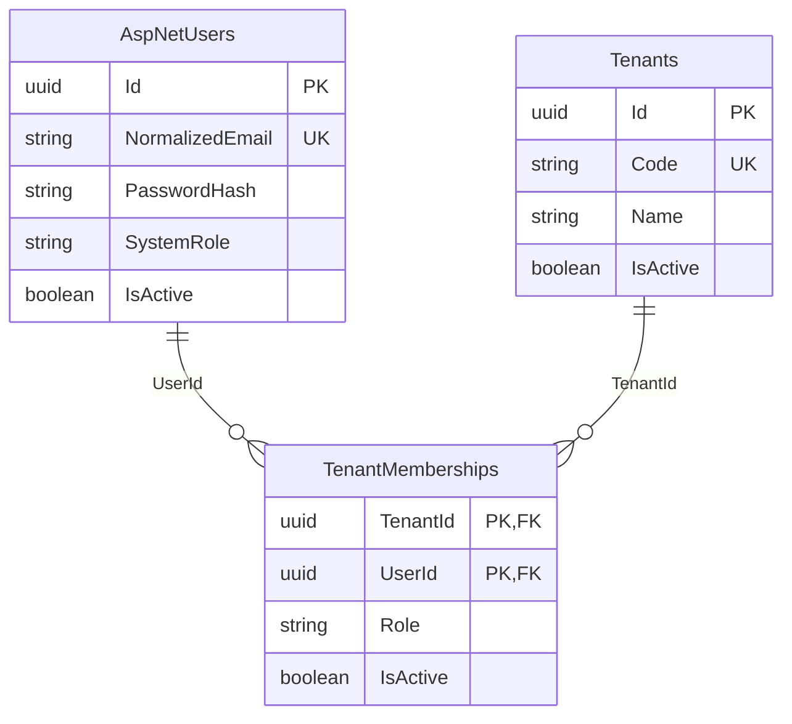

# 기업 및 사용자 데이터 구조

## 모델과 권한



- `ApplicationUser`: 공통 사이트의 전역 계정. Identity의 사용자명, 이메일 정규화, 비밀번호 해시, 보안 스탬프, 잠금 필드 및 클레임/외부 로그인/토큰 테이블을 사용한다.
- `SystemRole.None` / `IebleAdministrator`: 아이블 운영·지원 권한. 기업 역할과 독립적이다. 기업 마스터라도 다른 기업이나 시스템 관리 권한을 얻지 않는다.
- `TenantMembership.Role`: `Master`(기업 마스터), `Administrator`(기업 관리자), `Employee`(일반 직원). 사용자별로 기업마다 다른 역할을 가질 수 있다. Identity 전역 역할 테이블에 기업 역할을 저장하지 않는다.
- `(TenantId, UserId)`가 소속의 복합 PK이므로 중복 가입이 불가능하다. 비활성 소속도 같은 행을 재활성화한다. 기업당 마스터 수 제한은 별도 요구가 없어 두지 않았다.
- 기업 코드는 공백 없는 양 끝과 대문자 형식을 요구하며 유일하다. 기업명은 중복 가능하다. 이메일은 Identity 정규화 값을 기준으로 전역 유일하다.
- enum은 문자열로 저장하고 DB CHECK로 유효한 값만 허용한다. 기업·사용자 삭제 시 소속이 있으면 RESTRICT로 차단하며, 운영상 비활성화를 사용한다.
- 사용자별 활성 소속 및 기업별 역할/활성 상태 조회에 복합 인덱스를 둔다.

## 접근 범위

`MembershipAccessService.GetTenantRoleAsync`는 사용자 ID와 기업 ID를 동시에 제한하고 사용자·기업·소속이 모두 활성일 때만 역할을 반환한다. 아이블 관리자는 자동으로 기업 역할을 받지 않는다. 시스템 운영·지원 권한은 별도 `IsIebleAdministratorAsync`로 확인한다.

이 DbContext는 로그인 전 전역 사용자 조회와 기업 운영을 위한 관리 데이터 저장소다. 전역 tenant query filter나 PostgreSQL RLS는 이번 구조에 포함하지 않는다. 향후 기업 업무 테이블과 API 구현 시 검증된 현재 기업 ID로 모든 조회와 쓰기를 제한하고, 서버에서 확인한 사용자 ID로 위 권한 검사를 적용해야 한다. 임의로 전달받은 사용자/기업 ID만으로 권한을 부여하면 안 된다. 지원 작업의 허용 범위와 감사 기록도 별도 서비스에서 명시적으로 구현해야 한다.

현재 `AddIdentityCore`와 EF Store만 등록한다. 인증 스킴, 회원가입/로그인 API, 쿠키/JWT, UI는 추가하지 않았다. 향후 로그인 구현 시 `IsActive`를 확인해야 한다. 비밀번호 검증 자체는 활성 상태를 확인하는 인가 기능이 아니다. 비밀번호 생성/변경은 `UserManager`를 사용하고 `PasswordHash`에 직접 평문을 넣지 않는다.

## 감사와 동시성

주요 3개 모델에 `CreatedAt`, `UpdatedAt`, `CreatedByUserId`, `UpdatedByUserId`를 둔다. SaveChanges 동기/비동기 경로에서 서버 UTC 시간과 `IAuditActor`를 사용한다. 수정 시 생성 메타데이터는 보존한다. 감사 사용자 FK는 RESTRICT다. 현재 인증이 없어 기본 감사 주체는 null(시스템 작업)이며, 인증 도입 시 신뢰 가능한 현재 사용자 구현으로 교체한다.

기업과 소속의 `Version`, Identity 사용자의 `ConcurrencyStamp`로 낙관적 동시성을 검사한다. 직접 SQL/ExecuteUpdate는 이 SaveChanges 감사 처리를 통과하지 않으므로 별도 처리가 필요하다. 감사 필드는 전체 변경 이력 저장소를 대체하지 않는다.

## 설정과 마이그레이션

런타임 DbContext와 기존 `/api/health/db`는 동일한 `ConnectionStrings:DefaultConnection` 설정을 사용한다. 환경 변수 `ConnectionStrings__DefaultConnection` 또는 .NET user-secrets 등 외부 설정으로 공급한다. 루트 `.env`의 값은 출력하거나 소스에 포함하지 않는다. ASP.NET Core는 `.env`를 자동 로드하지 않으며, 기존 실행 환경에서 연결 문자열을 공급하는 방식을 유지했다. Docker용 `POSTGRES_*` 변수만으로 API 연결 문자열이 자동 생성되지는 않는다.

`WmsDbContextFactory`는 연결 문자열 없이 Npgsql 모델만 구성한다. 최초 마이그레이션과 SQL 생성은 DB 연결 없이 가능하며, 이 팩토리는 의도적으로 실제 DB 업데이트용 설정을 제공하지 않는다. 이후 DB 적용 시 별도 검토 후 보안 설정을 사용하는 적용 절차를 준비해야 한다.

```sh
dotnet build
dotnet test
dotnet ef migrations has-pending-model-changes --project backend/IebleWms.Api --no-build
dotnet ef migrations script --project backend/IebleWms.Api --no-build --output /private/tmp/ieble-wms-initial.sql
```

최초 마이그레이션 `20261028063248_InitialIdentityAndTenancy`는 2026-10-28 개발 DB `127.0.0.1:5435 / ieble_wms_dev`에 적용했다. 시작 시 `Migrate`나 `EnsureCreated`를 호출하지 않는다. 기존 Docker, DB 데이터, React, DB 연결 테스트 라우트는 유지한다.

테스트는 메모리 SQLite에서 실제 FK/고유/CHECK 제약, 권한 분리, 비활성 상태, 감사, 동시성 및 Identity 해시 저장을 검증한다. Npgsql 마이그레이션 SQL 생성과 모델 스냅샷 일치도 검증한다. 개발 PostgreSQL 16에 최초 마이그레이션을 적용하고 실제 카탈로그의 테이블·인덱스·외래 키·CHECK 제약 및 API 연결을 확인했다. 기존 16개 자동 테스트는 SQLite 기반이며 PostgreSQL에서의 업무 동작 통합 테스트와는 구분한다.

참고: [Identity 모델 구성](https://learn.microsoft.com/en-us/aspnet/core/security/authentication/customize-identity-model?view=aspnetcore-10.0), [EF Core 멀티테넌시](https://learn.microsoft.com/en-us/ef/core/miscellaneous/multitenancy), [SQLite 테스트 번들](https://www.nuget.org/packages/SQLitePCLRaw.bundle_e_sqlite3/3.0.5).


## 개발 DB 적용 기록 (2026-10-28)

- 적용 전: PostgreSQL 16, `ieble_wms_dev`, public 스키마, 기존 사용자 테이블 및 마이그레이션 이력 없음.
- 안전성: Up의 테이블 생성 6개와 인덱스 생성 13개를 확인했다. Drop/Delete/Truncate/초기화 작업은 실행하지 않았다. Down은 실행하지 않았다.
- 적용 방법: 저장소 밖의 임시 .NET 실행 도구에서 루트 `.env`를 읽고 Npgsql 연결 문자열을 메모리에서 구성했다. 대상 이름과 버전, 빈 스키마, 마이그레이션 목록과 모델 일치를 검사한 후 EF Core `IMigrator.MigrateAsync`로 해당 마이그레이션만 적용했다. 디자인 타임 팩토리와 API 시작 코드는 변경하지 않았다.
- 생성 테이블: `AspNetUsers`, `AspNetUserClaims`, `AspNetUserLogins`, `AspNetUserTokens`, `Tenants`, `TenantMemberships`, `__EFMigrationsHistory`.
- 실제 카탈로그 검증: 인덱스 20개(PK 7개 포함), 외래 키 11개, CHECK 4개. 고유 인덱스와 소속 복합 PK, FK의 RESTRICT/CASCADE 정의를 확인했다. EF 이력 1건, 미적용 마이그레이션 0건. 업무 테이블은 모두 0행이며 시드 계정은 생성하지 않았다.
- 연결 검증: 임시 API를 `127.0.0.1:15435`에서 실행하여 `/api/health/db`가 HTTP 200, `status=connected`, `database=ieble_wms_dev`를 반환함을 확인하고 종료했다. 기존 실행 중인 서버의 설정은 변경하지 않았다.
- 빌드: `dotnet build IebleWms.slnx --no-restore --nologo -m:1` 성공, 경고 0개·오류 0개.
- 테스트: `dotnet test backend/IebleWms.Api.Tests/IebleWms.Api.Tests.csproj --no-build --no-restore --nologo -m:1`, 16개 통과·실패 0개.
- 다른 DB, Docker 컨테이너, 볼륨은 변경하지 않았다. 비밀번호와 전체 연결 문자열은 출력하거나 파일에 저장하지 않았다. Git commit/push는 실행하지 않았다.
