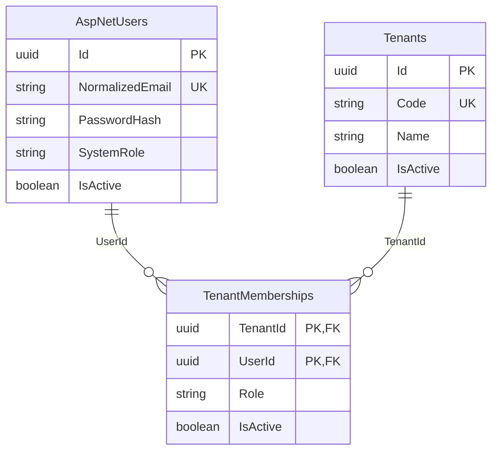

# 기업 및 사용자 데이터 구조

> 현재 요금 정책은 **가입 월 무료 + 다음 달 정기결제**, 최신 가입·로그인 흐름은 마지막 **기업 자동 접속 개선** 절을 따른다. 앞의 승인·반려 및 선택 화면 관련 내용은 과거 구현 이력이다.

## 모델과 권한



- `ApplicationUser`: 공통 사이트의 전역 계정. Identity의 사용자명, 이메일 정규화, 비밀번호 해시, 보안 스탬프, 잠금 필드 및 클레임/외부 로그인/토큰 테이블을 사용한다.
- `SystemRole.None` / `IebleAdministrator`: 아이블 운영·지원 권한. 기업 역할과 독립적이다. 기업 마스터라도 다른 기업이나 시스템 관리 권한을 얻지 않는다.
- `TenantMembership.Role`: `Master`(기업 마스터), `Administrator`(기업 관리자), `Employee`(일반 직원). 사용자별로 기업마다 다른 역할을 가질 수 있다. Identity 전역 역할 테이블에 기업 역할을 저장하지 않는다.
- `(TenantId, UserId)`가 소속의 복합 PK이므로 중복 가입이 불가능하다. 비활성 소속도 같은 행을 재활성화한다. 기업당 마스터 수 제한은 별도 요구가 없어 두지 않았다.
- 기업 코드는 공백 없는 양 끝과 대문자 형식을 요구하며 유일하다. 기업명은 중복 가능하다. 이메일은 Identity 정규화 값을 기준으로 전역 유일하다.
- enum은 문자열로 저장하고 DB CHECK로 유효한 값만 허용한다. 기업·사용자 삭제 시 소속이 있으면 RESTRICT로 차단하며, 운영상 비활성화를 사용한다.
- 사용자별 활성 소속 및 기업별 역할/활성 상태 조회에 복합 인덱스를 둔다.

## 접근 범위

`MembershipAccessService.GetTenantRoleAsync`는 사용자 ID와 기업 ID를 동시에 제한하고 사용자·기업·소속이 모두 활성일 때만 역할을 반환한다. 아이블 관리자는 자동으로 기업 역할을 받지 않는다. 시스템 운영·지원 권한은 별도 `IsIebleAdministratorAsync`로 확인한다.

이 DbContext는 로그인 전 전역 사용자 조회와 기업 운영을 위한 관리 데이터 저장소다. 전역 tenant query filter나 PostgreSQL RLS는 이번 구조에 포함하지 않는다. 향후 기업 업무 테이블과 API 구현 시 검증된 현재 기업 ID로 모든 조회와 쓰기를 제한하고, 서버에서 확인한 사용자 ID로 위 권한 검사를 적용해야 한다. 임의로 전달받은 사용자/기업 ID만으로 권한을 부여하면 안 된다. 지원 작업의 허용 범위와 감사 기록도 별도 서비스에서 명시적으로 구현해야 한다.

Identity Core와 EF Store 위에 쿠키 인증 및 기업 가입/로그인 UI를 추가했다. 구체적인 설정은 아래 기업 가입 및 공통 로그인 절을 참고한다. 비밀번호 생성/변경은 `UserManager`를 사용하고 `PasswordHash`에 직접 평문을 넣지 않는다.

## 감사와 동시성

주요 3개 모델에 `CreatedAt`, `UpdatedAt`, `CreatedByUserId`, `UpdatedByUserId`를 둔다. SaveChanges 동기/비동기 경로에서 서버 UTC 시간과 `IAuditActor`를 사용한다. 수정 시 생성 메타데이터는 보존한다. 감사 사용자 FK는 RESTRICT다. 인증된 HTTP 요청은 `HttpAuditActor`가 검증된 사용자 ID를 제공하며, 익명 가입·디자인 타임·시스템 작업은 null이다.

기업과 소속의 `Version`, Identity 사용자의 `ConcurrencyStamp`로 낙관적 동시성을 검사한다. 직접 SQL/ExecuteUpdate는 이 SaveChanges 감사 처리를 통과하지 않으므로 별도 처리가 필요하다. 감사 필드는 전체 변경 이력 저장소를 대체하지 않는다.

## 설정과 마이그레이션

런타임 DbContext와 기존 `/api/health/db`는 동일한 `ConnectionStrings:DefaultConnection` 설정을 사용한다. 환경 변수 `ConnectionStrings__DefaultConnection` 또는 .NET user-secrets 등 외부 설정으로 공급한다. 루트 `.env`의 값은 출력하거나 소스에 포함하지 않는다. ASP.NET Core는 `.env`를 자동 로드하지 않으며, 기존 실행 환경에서 연결 문자열을 공급하는 방식을 유지했다. Docker용 `POSTGRES_*` 변수만으로 API 연결 문자열이 자동 생성되지는 않는다.

`WmsDbContextFactory`는 연결 문자열 없이 Npgsql 모델만 구성한다. 최초 마이그레이션과 SQL 생성은 DB 연결 없이 가능하며, 이 팩토리는 의도적으로 실제 DB 업데이트용 설정을 제공하지 않는다. 이후 DB 적용 시 별도 검토 후 보안 설정을 사용하는 적용 절차를 준비해야 한다.

```sh
dotnet build
dotnet test
dotnet ef migrations has-pending-model-changes --project backend/IebleWms.Api --no-build
dotnet ef migrations script --project backend/IebleWms.Api --no-build --output /private/tmp/ieble-wms-initial.sql
```

최초 마이그레이션 `20261028063248_InitialIdentityAndTenancy`는 2026-10-28 개발 DB `127.0.0.1:5435 / ieble_wms_dev`에 적용했다. 시작 시 `Migrate`나 `EnsureCreated`를 호출하지 않는다. 기존 Docker, DB 데이터, React, DB 연결 테스트 라우트는 유지한다.

테스트는 메모리 SQLite에서 실제 FK/고유/CHECK 제약, 권한 분리, 비활성 상태, 감사, 동시성 및 Identity 해시 저장을 검증한다. Npgsql 마이그레이션 SQL 생성과 모델 스냅샷 일치도 검증한다. 개발 PostgreSQL 16에 최초 마이그레이션을 적용하고 실제 카탈로그의 테이블·인덱스·외래 키·CHECK 제약 및 API 연결을 확인했다. 기존 16개 자동 테스트는 SQLite 기반이며 PostgreSQL에서의 업무 동작 통합 테스트와는 구분한다.

참고: [Identity 모델 구성](https://learn.microsoft.com/en-us/aspnet/core/security/authentication/customize-identity-model?view=aspnetcore-10.0), [EF Core 멀티테넌시](https://learn.microsoft.com/en-us/ef/core/miscellaneous/multitenancy), [SQLite 테스트 번들](https://www.nuget.org/packages/SQLitePCLRaw.bundle_e_sqlite3/3.0.5).


## 개발 DB 적용 기록 (2026-10-28)

- 적용 전: PostgreSQL 16, `ieble_wms_dev`, public 스키마, 기존 사용자 테이블 및 마이그레이션 이력 없음.
- 안전성: Up의 테이블 생성 6개와 인덱스 생성 13개를 확인했다. Drop/Delete/Truncate/초기화 작업은 실행하지 않았다. Down은 실행하지 않았다.
- 적용 방법: 저장소 밖의 임시 .NET 실행 도구에서 루트 `.env`를 읽고 Npgsql 연결 문자열을 메모리에서 구성했다. 대상 이름과 버전, 빈 스키마, 마이그레이션 목록과 모델 일치를 검사한 후 EF Core `IMigrator.MigrateAsync`로 해당 마이그레이션만 적용했다. 디자인 타임 팩토리와 API 시작 코드는 변경하지 않았다.
- 생성 테이블: `AspNetUsers`, `AspNetUserClaims`, `AspNetUserLogins`, `AspNetUserTokens`, `Tenants`, `TenantMemberships`, `__EFMigrationsHistory`.
- 실제 카탈로그 검증: 인덱스 20개(PK 7개 포함), 외래 키 11개, CHECK 4개. 고유 인덱스와 소속 복합 PK, FK의 RESTRICT/CASCADE 정의를 확인했다. EF 이력 1건, 미적용 마이그레이션 0건. 업무 테이블은 모두 0행이며 시드 계정은 생성하지 않았다.
- 연결 검증: 임시 API를 `127.0.0.1:15435`에서 실행하여 `/api/health/db`가 HTTP 200, `status=connected`, `database=ieble_wms_dev`를 반환함을 확인하고 종료했다. 기존 실행 중인 서버의 설정은 변경하지 않았다.
- 빌드: `dotnet build IebleWms.slnx --no-restore --nologo -m:1` 성공, 경고 0개·오류 0개.
- 테스트: `dotnet test backend/IebleWms.Api.Tests/IebleWms.Api.Tests.csproj --no-build --no-restore --nologo -m:1`, 16개 통과·실패 0개.
- 다른 DB, Docker 컨테이너, 볼륨은 변경하지 않았다. 비밀번호와 전체 연결 문자열은 출력하거나 파일에 저장하지 않았다. Git commit/push는 실행하지 않았다.

## 기업 가입 및 공통 로그인 (2026-10-28)

기존 모델 위에 기업 가입·쿠키 인증·기업 선택을 추가했다. 아래 내용은 앞 절의 인증 미구현 상태를 대체한다.

### API

| 메서드·경로 | 용도 | 접근 조건 |
| --- | --- | --- |
| GET `/api/auth/csrf` | CSRF 요청 토큰 발급 | 공개, 캐시 금지 |
| POST `/api/auth/register` | 기업과 기업 마스터 계정 생성 | 비로그인, CSRF, IP별 분당 3회 |
| POST `/api/auth/login` | 이메일·비밀번호 로그인 | CSRF, IP별 분당 10회 |
| GET `/api/auth/me` | 현재 사용자·활성 소속·선택 기업 | 로그인 |
| POST `/api/auth/select-tenant` | 현재 업무 기업 선택 | 로그인, CSRF, 활성 사용자·기업·소속 |
| POST `/api/auth/logout` | 쿠키 삭제 및 모든 로그인 세션 무효화 | 로그인, CSRF |
| GET `/api/admin/overview` | 전체 기업·사용자·활성화 대기 건수 | 현재 DB의 아이블 관리자 권한 |
| GET `/api/tenants/{tenantId}/workspace` | 선택 기업의 기본 정보 | 현재 DB의 소속 + 쿠키의 선택 기업 일치 |

가입 입력은 기업명, 사업자등록번호, 담당자 이름·연락처, 이메일, 비밀번호다. 담당자 이름은 `ApplicationUser.DisplayName`, 연락처는 Identity `PhoneNumber`에 저장한다. 사업자등록번호는 숫자 10자리 또는 `000-00-00000` 형식을 받아 하이픈을 제거해 저장한다. 실제 사업자 진위 조회 및 이메일 소유 확인은 아직 연동하지 않았다.

`CompanyRegistrationService`는 Identity 사용자 생성부터 기업·Master 소속 저장까지 단일 DB 트랜잭션을 사용한다. 정규화 이메일 및 사업자등록번호를 사전 검사하고 고유 인덱스로 동시 가입도 보호한다. 실패하면 사용자까지 롤백한다. 공개 요청에 역할 값을 추가해도 `SystemRole.None`과 `TenantRole.Master`만 서버에서 지정한다. 첫 아이블 관리자 계정은 생성하지 않았다. 관리자 프로비저닝은 추후 별도 승인된 비공개 운영 절차에서 Identity UserManager를 통해 수행해야 하며, 공개 API에서 역할을 승격하는 경로는 없다.

### 인증과 접근 제어

- Identity 암호 정책: 12~128자, 영문 대·소문자, 숫자, 특수문자. 로그인에는 기존 계정 비밀번호 길이 하한을 강제하지 않는다.
- 계정별 5회 실패 시 15분 잠금. 로그인 오류는 계정 존재 여부·잠금 여부를 구분하지 않는 메시지를 사용한다. IP 요청 제한은 단일 API 프로세스 기준이며 다중 인스턴스 운영 시 게이트웨이/공유 저장소 기반 제한이 추가로 필요하다.
- 쿠키는 브라우저 세션 쿠키이며 티켓 유효기간은 8시간, sliding renewal은 사용하지 않는다. HttpOnly, SameSite=Strict, Path=/, Domain 미지정. 운영 환경은 Secure 및 `__Host-` 접두어를 강제한다. Development에서만 로컬 HTTP를 허용한다.
- 쿠키 암호화·서명은 ASP.NET Core Data Protection을 사용한다. 운영 배포 시 키 링을 지속 저장하고 접근 권한/저장 시 암호화를 적용하며, 다중 인스턴스는 동일한 키 링과 앱 구성을 공유해야 한다. 비밀키를 코드·Git에 저장하지 않는다.
- 모든 컨트롤러의 상태 변경 요청에 `ApiAntiforgeryFilter`를 적용한다. 프런트엔드는 POST 직전에 GET `/csrf`로 토큰을 받아 `X-CSRF-TOKEN` 헤더로 보낸다. 토큰이나 인증 정보를 localStorage에 저장하지 않는다. 익명 로그인/가입도 CSRF 검사 대상이다. 새 Minimal API의 상태 변경 경로를 추가할 때는 별도로 같은 검증을 적용해야 한다.
- 각 요청에서 사용자 활성 상태와 SecurityStamp를 검증한다. 로그아웃은 스탬프를 갱신하므로 다른 기기를 포함한 기존 쿠키도 무효화된다. 기업 선택은 원래 티켓의 만료 시간을 유지한다.
- `IebleAdministrator` 정책은 DB의 시스템 권한을, `TenantMember`는 사용자·기업·소속 활성 상태와 선택 기업을 확인한다. `TenantAdministrator`는 추가로 Master/Administrator만 허용한다. `ActiveTenant`는 서비스 상태가 Active여야 한다. 향후 실제 물류 업무 API에는 ActiveTenant와 필요한 역할 정책을 함께 적용한다. 현재 workspace는 가입/활성화 안내용으로 PendingActivation 기업도 접근한다.
- 서버의 401/403은 로그인 페이지로 리다이렉트하지 않는다. 프런트엔드 `/admin` 화면도 시스템 관리자만 렌더링하며, 실제 관리자 데이터 API는 별도로 서버 인가를 거친다.
- 쿠키·비밀번호·요청 본문·전체 연결 문자열 로깅은 추가하지 않았다. EF sensitive data logging을 켜지 않는다. 오류 응답에 DB 예외/SQL을 전달하지 않는다.

### 서비스 활성화와 스키마

`20261028070819_AddCompanyRegistration`은 기존 Tenants에 다음만 추가한다.

- nullable `BusinessRegistrationNumber`(최대 10자), 고유 인덱스, 길이 CHECK. 기존 기업의 번호는 null로 보존된다.
- `ServiceStatus`: PendingActivation / Active / Suspended 문자열 및 CHECK. 마이그레이션 시 기존 행은 Active로 채우며 기존 IsActive 값을 변경하지 않는다. 신규 공개 가입은 반드시 PendingActivation이다.

이 변경은 적용 전에 보고했고 개발 DB `ieble_wms_dev`에 적용했다. 기존 업무 테이블의 행 수와 기존 컬럼 내용 해시가 전후 동일함을 확인했다. 초기 마이그레이션은 수정하지 않았고 테이블 재생성·삭제·초기화도 하지 않았다. 미적용 마이그레이션은 없다.

가입 완료 상태와 실제 서비스 활성화를 분리했다. 카드 등록 단계는 화면의 추후 안내만 제공하며 카드 정보 저장·청구·자동 활성화 기능은 없다. 활성화나 결제 제공자가 연동될 때 검증된 서버 작업으로 상태 전이를 처리해야 한다.

### 로컬 실행과 UI

API는 기존 외부 `ConnectionStrings__DefaultConnection` 설정을 사용한다. `.env`를 화면이나 명령줄에 출력하지 말고 실행 환경에서 안전하게 주입한다. `.env` 자동 로딩은 하지 않는다.

```sh
dotnet run --project backend/IebleWms.Api --launch-profile http
npm run dev --prefix frontend
```

백엔드 HTTP 프로필 포트는 5080이며 Vite `/api` 프록시도 5080으로 맞췄다. 브라우저에서는 Vite 주소로 접속한다. 운영은 프런트엔드와 `/api`를 동일 HTTPS origin으로 제공하고 SPA 경로(`/login`, `/register`, `/app`, `/admin`)를 index.html로 폴백해야 한다. TLS를 프록시에서 종료할 경우 신뢰할 프록시만 지정해 forwarded headers를 구성해야 한다. 광범위한 CORS 허용은 추가하지 않았다.

UI는 로그인, 기업 가입, 기업 선택, 서비스 활성화 상태, 아이블 관리자 개요를 제공한다. 새로고침 시 `/me`로 상태를 복구한다. 기존 DB 연결 확인 기능은 하단 상태 표시로 유지했다.

### 검증

- 백엔드 빌드 경고/오류 0개. 기존 16개 + 신규 14개 = 자동 테스트 30개 통과.
- 프런트엔드 `npm run build --prefix frontend`, `npm run lint --prefix frontend` 모두 통과.
- HTTP 통합 테스트: 가입/해시, 중복 이메일·사업자번호, 실패 시 전체 롤백, 입력 검증, CSRF, 운영 쿠키 속성, 로그아웃 후 쿠키 재사용 차단, 계정 잠금·429, 다중 소속 선택, 타 기업 접근 차단, 시스템 권한 변경/사용자 비활성화 즉시 반영, 기업 역할 3종 및 활성화 정책.
- Chrome 브라우저 + 실제 API 코드 + 격리 SQLite: 가입 폼/비밀번호 확인, 가입·로그인, 기업 선택, 새로고침 후 세션 유지, 일반 사용자 `/admin` 차단, 다중 기업 전환, 관리자 화면, 로그아웃, 모바일 가로 넘침 및 JavaScript 오류 없음 확인. DB 연결 UI 응답만 격리 테스트에서 대체했다.
- 실제 개발 PostgreSQL은 별도로 신규 스키마 및 `/api/health/db` HTTP 200을 확인했다. 테스트 계정은 개발 DB에 생성하지 않았다.
- 참고: [ASP.NET Core CSRF](https://learn.microsoft.com/aspnet/core/security/anti-request-forgery?view=aspnetcore-10.0), [요청 제한](https://learn.microsoft.com/en-us/aspnet/core/performance/rate-limit?view=aspnetcore-10.0).

## 최초 관리자 및 기업 승인 관리 (2026-10-28)

### 최초 관리자 실행 방법

프로젝트 루트에서 직접 터미널로 실행한다. API 서버를 띄우지 않고 생성 명령만 수행한 뒤 종료한다.

```sh
dotnet run --project backend/IebleWms.Api --launch-profile http -- --bootstrap-admin
```

- 관리자 이메일, 표시 이름, 비밀번호와 확인 값을 대화형으로 입력한다. 비밀번호는 `Console.ReadKey(intercept: true)`로 읽으므로 화면에 표시되지 않는다. 비밀번호를 명령 인자·환경 변수·파일에 넣지 않는다. 추가 명령 인자 및 파이프 입력은 거부한다.
- `Development` 환경에서만 동작하며 `127.0.0.1` 또는 `localhost`, 포트 5435, DB `ieble_wms_dev`만 허용한다. 실행 직전에 실제 DB 이름과 미적용 마이그레이션 유무도 확인한다. 자동 마이그레이션은 하지 않는다.
- 이 명령에 한해 기존 `ConnectionStrings:DefaultConnection`이 없으면 프로젝트의 상위 디렉터리에서 루트 `.env`를 찾아 `POSTGRES_DB`, `POSTGRES_USER`, `POSTGRES_PASSWORD`로 메모리에서 연결 문자열을 구성한다. `.env`는 단순 KEY=value 및 양끝 따옴표 형식을 지원하며 셸 변수 치환이나 명령 실행을 하지 않는다. 웹 서버의 기존 연결 설정 방식은 유지한다.
- 명령 실행 중 로깅 공급자를 제거하고, 실패 시 예외 원문·연결 문자열·비밀번호를 출력하지 않는다. 운영 환경에서는 계정 생성 전에 중단한다.
- Identity UserManager가 암호를 해시한다. 계정과 `AdministratorBootstraps`의 단일 완료 기록을 같은 트랜잭션에 저장한다. PK=1/CHECK=1 제약으로 동시 초기화의 중복도 막으며 실패한 시도의 사용자 생성은 롤백된다.
- 초기화 기록은 계정이 정지되거나 시스템 역할이 변경되어도 남는다. 이미 관리자가 있으면 새 계정을 생성하지 않고 기존 관리자에 대한 완료 기록만 남긴다. 이미 등록된 일반 기업 이메일을 관리자 계정으로 승격하지 않는다.
- 공개 초기화 API와 공개 역할 승격 경로는 없다. 생성한 관리자는 공통 `/login`에서 로그인해 `/admin`으로 이동한다. 기업 소속은 부여하지 않으며 고객사의 WMS 업무 데이터 접근 권한도 자동 부여하지 않는다.
- 실제 개발 DB의 관리자 계정은 이번 작업에서 임의 생성하지 않았다. 위 명령으로 운영자가 본인의 정보를 직접 입력해야 한다. 관리자 자격 증명 복구·추가 운영자 초대는 별도 작업이며, 초기화 기록 삭제를 통한 우회는 지원하지 않는다.

### 기업 관리 API 및 상태 전이

| 경로 | 내용 |
| --- | --- |
| GET `/api/admin/tenants?status=PendingActivation&search=...&page=1&pageSize=20` | 기업명·사업자번호 검색, 상태 필터, 기업명순 페이지 조회. 기업명/번호/가입일/활성 기업 마스터의 이름·이메일·연락처/현재 상태/버전을 제공한다. |
| GET `/api/admin/tenants/{tenantId}/history` | 최근 상태 변경 100건. 관리자 ID·이름, UTC 시각, 이전·이후 상태, 사유를 제공한다. |
| POST `/api/admin/tenants/{tenantId}/status` | `action`, 현재 `version`, 필수 `reason`(공백 제외 1~1000자)을 받는다. 아이블 관리자 정책과 CSRF 검사를 적용한다. |
| GET `/api/tenants/{tenantId}/workspace` | 소속 구성원의 기업 상태 안내. 최신 변경 시각·사유도 제공한다. 업무 데이터는 제공하지 않는다. |
| GET `/api/tenants/{tenantId}/dashboard` | WMS 업무 진입. 선택 기업·활성 사용자/기업/소속·서비스 Active 상태를 서버에서 확인한다. 현재는 업무 진입 확인만 제공하며 재고/입출고 기능은 별도 개발 범위다. |

허용되는 변경은 다음과 같다. 이외 전이 및 같은 요청 재실행은 409다.

| 현재 상태 | action | 이후 상태 |
| --- | --- | --- |
| PendingActivation (승인 대기) | approve | Active |
| PendingActivation | reject | Rejected |
| Active | suspend | Suspended |
| Suspended | reactivate | Active |

Rejected 상태에서의 재신청은 아직 제공하지 않는다. `IsActive=false` 기업을 이 화면에서 복구하거나 소속을 자동 생성하지 않는다. 서비스 승인·정지는 `ServiceStatus`를 변경하고 IsActive는 보존하므로 승인 대기·반려·정지 기업의 구성원도 상태 안내를 확인할 수 있다. 업무 API는 반드시 ActiveTenant 정책을 적용하며, 역할 제한이 필요하면 TenantAdministrator 등과 함께 적용한다. 기존 로그인 쿠키가 있어도 업무 API는 매 요청 DB의 현재 상태를 검사한다.

변경 시 `Tenant.Version`으로 오래된 화면 및 동시 변경을 차단하고, 기업 상태와 `TenantStatusChanges` 이력 행을 하나의 SaveChanges 트랜잭션에 저장한다. 변경 관리자와 시각은 서버가 결정하며 요청 본문의 사용자 ID나 시각은 받지 않는다. 이력 및 초기화 완료 기록은 EF SaveChanges에서 수정/삭제를 거부하고, 관련 FK는 RESTRICT다. DB 운영자의 직접 SQL까지 막는 외부 감사 시스템을 대체하지는 않는다.

### 화면

`/admin`은 기본적으로 승인 대기 기업을 보여 준다. 검색·상태 필터·페이지 이동·변경 이력을 제공한다. 승인/반려/이용정지/재활성화는 확인 팝업에서 사유를 입력하고 확정한다. 네트워크 처리 중 중복 클릭을 막고, 409 충돌이면 새 목록을 받은 뒤 다시 선택해야 한다. 사유가 기업 구성원에게 표시된다는 점을 팝업에 안내한다.

`/app`은 승인 대기·반려·이용정지와 최근 사유를 표시하고 상태 새로고침을 제공한다. 활성 기업에만 WMS 업무 시작 버튼을 보여 주며 버튼을 누르면 서버의 최신 접근 검사를 다시 거친다. 오래된 활성 화면에서도 정지된 기업의 업무 API는 차단된다.

### 스키마 적용 및 검증

`20261028073734_AddTenantApprovalAndAdminBootstrap`을 사전 검토 후 개발 DB에 적용했다.

- 새 테이블 `AdministratorBootstraps`, `TenantStatusChanges`와 FK 3개, 인덱스 3개(PK 제외)를 추가했다.
- 기존 `CK_Tenants_ServiceStatus`만 교체해 Rejected를 허용했다. 기존 테이블·컬럼·데이터 삭제 또는 재생성은 없으며 이전 마이그레이션을 수정하지 않았다.
- 기존 업무 데이터의 행 수·내용 해시가 적용 전후 동일함을 확인했다. 이력 총 3개, 미적용 마이그레이션 0개. 실제 DB의 관리자 계정이나 고객사 상태를 테스트 목적으로 변경하지 않았다.
- 백엔드 빌드 경고·오류 0개. 기존 30개와 신규 7개를 포함해 자동 테스트 37개 통과. 생성/해시/중복 방지/운영 환경 차단/기존 고객 승격 금지, 승인·반려·정지·재활성화, 사유와 관리자 감사 기록, 버전 충돌, CSRF, 일반 사용자 관리 API 차단 및 타 기업 접근 차단을 검증했다.
- 실제 Production 명령은 계정 생성 전에 종료 코드 1로 차단됨을 확인했다.
- 프런트엔드 build 및 lint 통과. Chrome과 격리 API/SQLite에서 확인 팝업 취소·승인·이용정지·재활성화·이력·사업자번호 검색·모바일 레이아웃, 오래된 활성 화면의 업무 요청 차단을 확인했다. 개발 DB에 테스트 계정은 남기지 않았다.
- 실제 개발 PostgreSQL의 신규 테이블·FK·상태 CHECK 및 기존 `/api/health/db` HTTP 200을 확인했다. Docker와 볼륨은 변경하지 않았다. Git commit/push는 하지 않았다.

참고: [EF Core 트랜잭션 및 저장](https://learn.microsoft.com/en-us/ef/core/saving/), [동시성 제어](https://learn.microsoft.com/en-us/ef/core/saving/concurrency), [Console.ReadKey](https://learn.microsoft.com/en-US/dotnet/api/System.Console.ReadKey).

## 이전 정책 이력: 자유 가입 → 카드 등록·결제 → WMS (2026-10-28 변경)

이 절은 이전 정책 구현 기록이다. 현재 최종 정책은 문서 마지막 절을 따른다. 위의 기업 가입 승인·반려 절도 이전 구현 및 적용 이력이다. 기존 마이그레이션과 감사 이력을 삭제하지 않고 정책을 전환했다.

- 공개 가입은 승인 없이 `ServiceStatus.Active`(등록)와 `BillingStatus.CardRequired`로 완료된다. Active는 기업 등록/운영 상태이며, 단독으로 업무 이용 권한을 뜻하지 않는다.
- `approve` / `reject` 요청은 API 입력 검증에서 400으로 거부한다. 관리자 화면의 승인·반려 버튼과 필터를 제거했다. 기존 정지·재활성화, 버전 충돌 검사 및 감사 기록은 유지했다. 재활성화는 Paid 기업에만 가능하다.
- 결제 상태는 `CardRequired` → `PaymentRequired` → `Paid`로 구분한다. 현재는 상태 저장 구조만 제공하며 이 상태를 변경하는 공개·관리자·개발 API는 없다. 카드 등록만으로 WMS가 열리지 않는다.
- `ActiveTenant`는 활성 사용자·기업·소속, 선택 기업 일치, 기업 상태 Active, 결제 상태 Paid를 모두 서버에서 검사한다. 미결제 기업은 로그인·기업 선택·결제 안내를 볼 수 있지만 `/dashboard` 등 WMS 업무 API는 403이다.
- 최초 관리자 명령 `--bootstrap-admin` 및 기업별 권한 격리는 그대로 유지한다. 최초 관리자에게 고객사 업무 소속이나 결제 조건 우회 권한을 부여하지 않는다.

### 확정 요금과 미확정 사항

| 항목 | 정책 |
| --- | --- |
| 기본 이용료 | 0원 |
| 기본 포함 인원 | 0명 |
| 사용자 요금 | 사용자 1명당 월 1,000원 |
| 추가 직원 | 다음 달부터 과금 |
| 결제 서비스/방식 | 토스페이먼츠 카드 자동결제 예정 |
| 과금 취소·환불 | 기업 직접 처리 불가. 아이블 관리자 처리 예정 |
| 최초 기업 마스터 과금 여부 | 미확정 |
| 최초 결제 시점 | 미확정 |

`BillingPolicy`는 확정 값과 미확정 값(null)을 구분한다. 마스터를 포함/제외해 임의 총액을 계산하거나 가입 즉시 결제를 예약하지 않는다. 요금 계산, 카드 자동결제 스케줄, 영수증, 취소·환불 API는 이후 결제 연동 범위다. 현재 안내 화면은 이 정책과 미확정 항목을 표시한다.

### 토스페이먼츠 설정 준비

`Billing:TossPayments` 설정과 `TossPaymentsOptions`를 준비했다. appsettings의 ClientKey/SecretKey는 빈 값이다. 추후 외부 설정 `Billing__TossPayments__ClientKey`, `Billing__TossPayments__SecretKey` 또는 user-secrets를 사용한다. 실제 비밀키를 Git/명령 인자/로그/프런트엔드 환경 변수에 넣지 않는다.

현재 SDK 로딩, 카드 입력 수집, 빌링키 발급, 결제 요청, 웹훅, 결제 완료 처리, 취소·환불 HTTP 호출은 구현하지 않았다. 키를 설정해도 결제 기능이나 이용 권한이 자동으로 활성화되지 않는다. `/workspace`의 `billingProviderConfigured=false`는 실제 연동이 아직 미구현이라는 뜻이다. 화면에는 토스 연동 준비 중임을 안내하며 실행되지 않는 결제 버튼은 제공하지 않는다.

향후 [토스 자동결제 가이드](https://docs.tosspayments.com/guides/v2/billing/integration)에 맞춰 인증된 기업·서버 상품/금액·중복 결제 방지·결제 결과 검증·안전한 빌링키 보관을 구현한 뒤에만 결제 상태를 갱신한다. 브라우저 리다이렉트, 클라이언트가 보낸 Paid 값, 단순 카드 등록으로 업무 권한을 열면 안 된다.

### 안전한 개발 검증

```sh
dotnet test backend/IebleWms.Api.Tests/IebleWms.Api.Tests.csproj --no-restore -m:1
npm run build --prefix frontend
npm run lint --prefix frontend
```

자동 테스트는 격리된 메모리 SQLite를 사용한다. 권한 테스트의 Paid 데이터는 테스트 전용 DB fixture로만 구성하며 실제 개발 PostgreSQL에 저장하거나 외부 결제 성공으로 처리하지 않는다. 실제 브라우저 검증은 미결제 상태만 사용해 안내·접근 차단을 확인한다. 운영/개발 웹 서버에는 결제 우회 플래그, 가짜 성공 API, 상태 수동 설정 화면을 추가하지 않았다. 개발 DB에서 Paid를 직접 만드는 SQL을 테스트 방법으로 제공하지 않는다.

### 적용 및 검증 기록

- `20261028080817_ReplaceApprovalWithBillingGate`를 검토 후 개발 DB에 적용했다. BillingStatus 컬럼/검증 제약을 추가하고 모든 기존 기업은 CardRequired로 둔다. 기존 PendingActivation/Rejected는 Active(등록)로 정규화하며 Suspended는 보존한다. 이전 상태 변경 이력은 그대로 남는다.
- 데이터 행과 이력을 삭제하지 않았으며 의도한 상태 정규화 외 기존 데이터의 해시가 동일함을 확인했다. 실제 결제 호출이나 임의 Paid 행은 생성하지 않았다. 미적용 마이그레이션은 없다.
- 자동 테스트 40개 통과: 기존 Identity·최초 관리자·소속 격리, 승인/반려 요청 제거, 자유 가입 시 결제 상태 주입 차단, 미결제 접근 차단, Paid fixture의 정지·재활성화, 운영 환경의 CardRequired/PaymentRequired 차단 및 가짜 결제 확인 경로 부재.
- 백엔드 빌드 경고·오류 0개, 프런트엔드 build/lint 통과. 실제 `/api/health/db` HTTP 200 확인. Git commit/push와 Docker 변경은 하지 않았다.

## 현재 최종 정책: 가입 월 무료 + 다음 달 정기결제

이 절이 이전 요금·접근 정책을 대체한다. 마스터 과금 여부와 최초 결제 시점도 이제 확정되었다.

- 신규 기업의 가입 월은 무료다. 가입 시 카드 등록을 진행하며, 서버에서 카드 등록이 확인된 경우에만 해당 월 WMS를 이용할 수 있다.
- 첫 결제는 가입 다음 달 1일 00:00, 이후 정기결제도 매월 1일 기준이다. 기본 정책의 월 판단은 `Asia/Seoul`이다. 월말 가입도 30일 무료가 아니라 가입한 달까지만 무료다.
- 기업 마스터를 포함해 사용자 1명당 월 1,000원, 기본료 0원·기본 포함 인원 0명이다. 추가 직원은 추가한 달 무료이고 다음 달 정기결제일부터 과금 대상이다.
- 실제 토스 연동·카드 등록·청구·스케줄러·환불·영수증은 아직 구현하지 않았다. 첫 결제일과 직원별 과금 시작일을 계산하는 구조만 제공하며 실제 청구나 요금 총액 계산은 하지 않는다.

### 정책 설정

`Billing:Policy`를 `appsettings.json` 또는 외부 설정으로 변경할 수 있다. 환경 변수 이름은 예를 들어 `Billing__Policy__MonthlyPerUserKrw`다.

| 설정 | 기본값 | 의미 |
| --- | --- | --- |
| MonthlyPerUserKrw | 1000 | 사용자 월 요금(원) |
| MonthlyBaseKrw | 0 | 기업 기본 월 이용료 |
| IncludedUsers | 0 | 기본 포함 사용자 수 |
| BillMasterAccounts | true | 기업 마스터도 과금 대상 |
| RegistrationMonthFree | true | 기업 가입 월 무료 |
| NewMembersStartFollowingMonth | true | 추가 사용자는 다음 달부터 과금 |
| BillingDayOfMonth | 1 | 매월 기준일 (모든 달에 존재하는 1~28일 허용) |
| TimeZoneId | Asia/Seoul | 가입 월과 정기결제일 계산 시간대 |

값의 범위와 시간대를 시작 시 검증하며 잘못된 정책으로 서버가 실행되지 않게 했다. 요금·마스터 포함 여부·직원 정책·첫 결제일 안내는 서버의 `/workspace` 응답을 사용한다. 설정 변경 후 서버를 재시작한다. 카드 등록 상태 검사와 사용자·기업·소속 검사는 정책 값으로 해제할 수 없다. 정기결제일을 다른 날짜로 변경해도 무료 기간은 가입 월까지만이며, 무료 종료 후 결제 전의 공백 기간을 임의로 무료 연장하지 않는다.

### 서버 접근 판단

`BillingAccessService`가 `TimeProvider`의 서버 UTC 시각과 기업 `CreatedAt`을 정책 시간대로 변환해 판단한다. 클라이언트가 보내는 날짜나 무료 플래그는 사용하지 않는다. 기존 BillingStatus의 의미를 재사용하므로 새 컬럼이나 마이그레이션은 필요하지 않다.

| 기존 저장 상태·조건 | 서버 계산 상태 | WMS |
| --- | --- | --- |
| CardRequired | CardRequired | 차단, 결제 수단 등록 안내 |
| PaymentRequired + 가입 월 + 무료 정책 활성 | RegistrationMonthFree | 허용, 가입 월 무료 이용 표시 |
| PaymentRequired + 가입 월 종료 | PaymentRequired | 결제 확인 전 차단 |
| Paid | Paid | 기존 서버 결제 확인 상태에 따라 허용 |
| 기업 정지/비활성 또는 소속/사용자 비활성 | 접근 불가 | 카드·무료·결제 여부와 무관하게 차단 |

PaymentRequired는 신뢰할 수 있는 서버 측 카드 등록 절차가 끝났지만 결제를 기다리는 저장 상태다. 현재 실제 연동이 없어 이 상태를 만들어 주는 카드 등록 API는 없다. 무료 이용은 이 상태를 Paid로 바꾸지 않고 매 요청 계산한다. 다음 달 1일이 되면 이전 로그인 쿠키도 무료 권한을 유지하지 못한다. 가입일이 미래이거나 없는 경우에도 차단한다.

기업 정지 해제는 결제 완료 기업뿐 아니라 서버가 판단한 가입 월 무료 기업에도 허용된다. 그 후에도 업무 API가 최신 시각과 상태를 다시 검사한다. 관리자 화면은 등록된 카드 상태와 무료 이용 상태를 구분해서 표시한다.

### 검증 및 데이터 보존

- 백엔드 빌드 경고·오류 0개. 자동 테스트 50개 통과(기존 40개 + 신규 10개).
- 월초·월말·윤년 2월·연말 전환과 한국 시간 경계, 카드 미등록 차단, 미래 가입일 차단, 기업 정지·비활성 차단, 설정 변경, 마스터 포함 및 직원 추가 후 다음 달 과금 시작일을 검증했다.
- Production 환경의 실제 HTTP 테스트에서 카드 등록 상태의 가입 월 무료 접근을 확인한 뒤 서버 시각을 다음 달 1일로 이동했을 때 같은 쿠키의 업무 요청이 403으로 바뀜을 검증했다. 저장 상태가 Paid로 변경되지 않음도 확인했다.
- 카드 등록 상태는 격리된 메모리 DB 테스트 fixture에서만 사용했다. 실제 개발 PostgreSQL에는 카드 등록 성공·결제 성공을 생성하지 않았고 데이터나 스키마도 변경하지 않았다. 개발 서버의 우회 API나 환경 플래그를 추가하지 않았다.
- 프런트엔드 build/lint 통과. Chrome과 격리 서버에서 카드 미등록 안내·새 요금 표시·업무 API 403·세션 유지·권한 격리·모바일 레이아웃을 확인했다.
- 기존 DB·Docker·마이그레이션은 보존했고 Git commit/push는 하지 않았다.

## localhost CSRF 연결 오류 수정

2026-10-28 실제 개발 서버와 Chrome Network에서 확인한 오류는 CSRF 검증 실패가 아니라 API 연결/실행 버전 문제였다.

| 확인 단계 | `/api/auth/csrf` 결과 | 원인/조치 |
| --- | --- | --- |
| 수정 전 localhost:5173 | 502 | Vite가 API 실행 포트 5080 대신 리스너가 없는 5143으로 전달 |
| 프록시만 5080으로 수정 | 404 | 기존 5080 프로세스가 최신 인증 경로를 제공하지 않음 |
| 최신 API를 Development로 재시작 | 200 | 브라우저와 직접 API 요청 모두 정상 |

기존 API는 인증 개발 이전에 시작된 프로세스였고 작업 경로와 실행 바이너리를 확인한 후 해당 프로세스만 교체했다. 수정된 프록시 및 http/https launch profile의 HTTP 포트는 모두 5080이다. API 소스를 빌드해도 이미 실행 중인 프로세스는 자동으로 새 코드를 로드하지 않으므로 재시작이 필요하다.

React는 상대 경로 `/api/auth/csrf`에 credentials=same-origin으로 요청해 HttpOnly CSRF 쿠키와 JSON 요청 토큰을 받고, POST에 동일 쿠키 및 `X-CSRF-TOKEN` 헤더를 전송한다. 로그인 등 사용자 상태 변경 후에도 POST마다 새 요청 토큰을 발급받는다. 브라우저에서 HttpOnly 쿠키 값을 직접 읽을 필요는 없다. CSRF HTTP 404/5xx는 인증 서비스 연결 오류로 구분하며, 네트워크 실패나 잘못된 토큰 응답에서는 POST를 보내지 않는다.

Development HTTP는 CookieSecurePolicy.SameAsRequest, HttpOnly, SameSite=Strict, Path=/를 유지한다. Production은 Secure 강제 및 __Host- 이름을 유지한다. CSRF 필터·인증·인가·잠금·요청 제한은 제거하거나 완화하지 않았다. 로그와 진단 결과에는 토큰·쿠키·비밀번호 값을 출력하지 않는다.

검증 결과:

- 실제 Chrome `http://localhost:5173/api/auth/csrf` 200.
- 최신 API의 요청 완료 로그에서 `/api/auth/csrf`, `/api/health/db` 200 확인. 기존 API의 출력은 사용자 터미널에 연결되어 있어 과거 로그를 임의로 읽지 않았다.
- 격리 SQLite 및 실제 Vite 설정을 사용한 Chrome: 기업 가입 201, 로그인 200, 로그아웃 204, CSRF 없는 로그아웃 400, 로그아웃 후 me 401. HTTP 쿠키의 HttpOnly/Strict와 CSRF 헤더 전달도 검증했다. 테스트 사용자는 실제 개발 DB에 생성하지 않았다.
- 백엔드 전체 51개 테스트 통과. 신규 테스트는 Development HTTP의 가입/로그인/로그아웃 및 CSRF 거부를 검증하며 기존 운영 Secure 쿠키 테스트도 통과했다.
- 프런트엔드 `npm run test --prefix frontend` 7개 통과(Node 24 기준). 404/502/연결 실패/잘못된 토큰 응답 시 POST 차단, 정상 토큰·credentials 전달을 검증한다.
- dotnet build 경고·오류 0개, 프런트엔드 build 및 lint 통과.

개발 서버는 아래 포트 구성을 사용한다. 연결 문자열은 기존 외부 설정으로 제공하고 출력하지 않는다.

```sh
dotnet run --project backend/IebleWms.Api --launch-profile http
npm run dev --prefix frontend
```

API는 localhost:5080, 브라우저는 localhost:5173으로 접속한다. 다른 포트로 실행한다면 Vite 프록시도 일치시켜야 한다. 이번 수정에는 DB 스키마 변경·마이그레이션·삭제·초기화·Git commit/push가 없다.

## 최신 가입·비밀번호·기업 자동 접속 개선

### 기업 중복 기준

기업명은 앞뒤 공백을 제거해 저장하고 동일 이름 자체는 중복 제한하지 않는다. 사업자등록번호는 하이픈과 공백을 제거한 ASCII 숫자 10자리로 검증·저장하며 기존 기업의 활성/비활성 여부와 관계없이 중복을 차단한다. React에서 정규화·형식을 검사하고 실제 기존 번호와의 비교는 서버 및 PostgreSQL 고유 인덱스가 수행한다. 별도의 기업 상세 정보 조회/중복 조회 공개 API를 만들지 않았다.

사업자번호 중복 응답은 HTTP 409, `code=duplicate_company` 및 아래 문구만 제공한다. 다른 기업의 이름, 사용자 이메일, 기업 ID는 반환하지 않는다. 가입 화면에서는 같은 문구와 로그인 이동 링크를 표시한다.

> 이미 등록된 기업입니다. 기존 기업 계정으로 로그인하거나, 계정 등록이 필요한 경우 기업 관리자에게 문의해 주세요.

`BusinessRegistrationNumber` 정규화 유틸리티, DTO 검증 및 기존 `IX_Tenants_BusinessRegistrationNumber` UNIQUE 인덱스를 함께 사용한다. CHECK를 강화해 비정규화 값이 직접 저장되는 것도 막는다. 트랜잭션 중 고유 충돌은 안전하게 롤백하고 동일한 중복 안내로 변환하므로 동시 요청에서 부분 계정이 남지 않는다. 동일 이메일/동일 번호의 경합도 기업 중복 검사를 우선한다.

### 공통 비밀번호 정책

Identity 공통 `PasswordOptions.RequireUppercase=false`를 설정했다. 12~128자, 영문 소문자, 숫자, 특수문자는 유지하며 대문자는 선택이다. React의 검증·안내도 같은 조건을 사용한다. UserManager의 가입·ChangePasswordAsync·ResetPasswordAsync 공통 검증에 적용되며 기존 해시나 비밀번호를 다시 쓰지 않는다. 변경/재설정 API와 UI를 이번 작업에서 새로 공개한 것은 아니다. CSRF, HttpOnly/Secure 쿠키, 잠금·요청 제한은 그대로다.

### 로그인과 기본 기업

- 기업 가입 시 마스터 소속을 만들고 그 소속을 기본 기업으로 기록한다.
- 로그인 시 서버가 활성 사용자·기업·소속을 조회한다. 활성 소속이 1개면 그 기업을 자동 연결하고, 여러 개면 그 중 유효한 기본 기업만 연결한다. 클라이언트가 보낸 TenantId로 로그인 기업을 결정하지 않는다.
- 기업 ID는 암호화/서명된 인증 쿠키의 claim에 넣는다. `/me`도 현재 소속을 다시 확인하며 기존 세션에서 소속이나 기본 기업이 달라졌으면 기존 만료 시간을 보존해 쿠키를 갱신한다.
- 단일 기업 사용자: 로그인 → `/app` 기업 화면 또는 카드 등록 안내. 기업 선택 폼은 렌더링하지 않는다. 사이드바와 화면에 접속 기업명을 표시한다.
- 다중 기업 + 기본 기업 있음: 로그인 → 해당 기업 `/app`.
- 다중 기업 + 기본 기업 없음: 자동으로 첫 기업을 고르지 않고 소속 확인/기본 기업 지정 안내를 제공한다. `POST /api/auth/default-tenant`는 인증·CSRF·본인 활성 소속을 검증하고 기본 기업을 저장한다. 다음 로그인부터 바로 접속한다. 이전 `select-tenant` 경로는 호환용으로 같은 기본 기업 지정 동작에 연결했다.
- 기본 기업이 비활성 소속이면 이를 자동 접속에 사용하지 않는다. 남은 활성 소속이 하나면 그 기업, 여러 개면 안내 화면으로 간다. 소속이 없으면 기업 관리자에게 확인하도록 안내한다.
- 아이블 관리자는 기존처럼 `/admin`으로 이동한다. 기업 업무 접근에는 별도 소속이 필요하다.

결제/가입 월 무료 정책은 동일하다. 자동 기업 연결은 결제 권한을 부여하지 않는다. 카드 미등록은 안내 화면, 등록 카드가 있는 가입 월 무료 기업은 서버가 검증한 무료 이용 화면, 정지·결제 미완료 기업의 업무 API는 차단된다. 각 업무 요청에서 쿠키 기업 ID와 요청 경로 및 DB 소속을 다시 검증한다.

### 마이그레이션과 검증

`20261028091617_NormalizeBusinessNumbersAndDefaultMembership`을 생성·적용했다.

- 정규화 기준 기존 중복 그룹 0개, 잘못된 번호 0개임을 먼저 확인했다. 마이그레이션 자체에도 중복/잘못된 번호 발견 시 예외로 전체 중단하는 검사를 넣었다. 삭제·병합은 하지 않는다.
- 기존 사업자번호를 정규화하고 10자리 숫자 CHECK를 강화했다. 기존 사업자번호 UNIQUE 인덱스는 유지한다.
- TenantMemberships에 `IsDefault=false` 컬럼과 `UserId WHERE IsDefault=TRUE` 고유 인덱스를 추가했다. 사용자당 기본 기업은 하나이며, 기존 다중 소속에 기본 기업을 임의로 지정하지 않는다. 기존 단일 기업은 플래그 없이도 자동 접속된다.
- 기존 행 수와 기존 컬럼 내용 해시가 적용 전후 동일함을 확인했다. 기존 기업·사용자·권한·결제·이력을 보존했고 미적용 마이그레이션은 없다.
- PostgreSQL의 별도 임시 테스트 스키마에서 두 가입을 사용자 저장 직전에 동기화해 동시 실행했다. 하나만 기업/사용자/소속을 생성하고 다른 요청은 중복 안내로 종료됐으며 부분 생성 계정이 없었다. 해당 테스트 스키마만 제거했고 public 데이터는 건드리지 않았다.
- 백엔드 자동 테스트 67개, 프런트엔드 14개 통과. 동일/다른 이름과 번호 조합, 비활성 기업 중복, 정규화, 대문자 선택, 변경/재설정 검증, 3개 기업 역할의 단일 기업 자동 로그인, 다중 소속 기본 기업, 중복 기본 기업 제약, 결제 제한과 기존 보안 테스트를 포함한다.
- Chrome과 격리 API/SQLite에서 소문자 가입, 중복 안내와 로그인 링크, 같은 이름/다른 번호 허용, 기업 선택 없는 `/app`, 기업명 표시, 다중 소속 기본 지정과 재로그인, `/admin` 이동을 확인했다.
- dotnet build 경고·오류 0개, 프런트엔드 build/lint 통과. 5080 개발 API를 최신 코드로 재시작하고 CSRF/DB health 200을 확인했다. 실제 개발 DB에 테스트 사용자를 남기지 않았다. Docker 변경이나 Git commit/push는 하지 않았다.

## 기업 사용자 공통 WMS 레이아웃

기업 사용자의 `/app` 및 `/app/*`를 `CompanyWorkspace`로 분리했다. 로그인·가입 폼과 관리자 `/admin`은 기존 화면을 유지한다. 고정 사이드바(248px/접은 상태 76px), 상단 기업명·로그인 이름·권한·로그아웃, 경로 표시, 중앙 콘텐츠, 기존 DB 연결 상태를 제공한다. 기업명/사용자/역할은 `/auth/me`와 현재 기업 `/workspace` 응답을 사용한다. 화면 폭에 따라 통계 카드를 재배치하고 좁은 화면에서는 아이콘 사이드바와 펼침 패널을 사용한다.

| 메뉴 | 경로 |
| --- | --- |
| 대시보드 | /app |
| 창고관리 | /app/warehouses |
| 상품관리 | /app/products |
| 입고관리 | /app/receipts |
| 출고관리 | /app/shipments |
| 재고관리 → 재고 이동 및 조정 | /app/inventory/adjustments |
| 재고관리 → 재고 실사 | /app/inventory/counts |
| 거래처관리 | /app/partners |
| 통계 및 보고서 → 재고 현황 | /app/reports/stock |
| 통계 및 보고서 → 입출고 통계 | /app/reports/movements |
| 통계 및 보고서 → 재고 변동 이력 | /app/reports/history |
| 문의하기 | /app/support |
| 환경설정 → 기업 정보 관리 | /app/settings/company |
| 환경설정 → 사용자 및 권한 관리 | /app/settings/users |
| 환경설정 → 요금제 및 결제 관리 | /app/settings/billing |

환경설정 3개는 기업 마스터/기업 관리자에게만 표시하고 직접 URL 및 서버 호출도 동일 권한을 요구한다. 나머지 업무 메뉴는 기업 구성원에게 표시하되, 현재 소속/선택 기업·결제/가입 월 무료·정지 상태를 매 메뉴 이동마다 다시 검증한다. 문의하기 및 관리용 빈 화면은 업무 데이터가 없는 안내용이다. 요금제/결제 메뉴는 기존 안내를 재사용하고 실제 결제는 실행하지 않는다. 카드 미등록/기타 접근 제한 기업의 기본 대시보드는 기존 결제·상태 안내를 표시한다.

`GET /api/tenants/{tenantId}/pages/{page}`는 페이지 접근 메타데이터만 제공한다. 모든 호출에 TenantMember를, 관리 메뉴에는 TenantAdministrator를, 업무 메뉴에는 ActiveTenant를 추가 검사한다. 다른 기업 ID, 일반 직원의 관리 경로, 미결제 업무 경로는 403이다. 새 창고·상품·입출고·재고 CRUD나 실제 데이터 집계 API는 추가하지 않았다.

대시보드는 전체 창고/상품, 재고, 오늘 입고/출고 카드와 최근 내역 테이블을 갖추되 집계 값은 `—`, 내역은 빈 상태를 표시한다. 실제 데이터와 API가 없으므로 0이나 임의 활동 내역을 생성하지 않는다. 나머지 메뉴는 준비 중 빈 화면이다. PageHeading/EmptyState, 사이드바, 메뉴 정의, 결제 안내를 별도 컴포넌트로 재사용하고 Lucide 아이콘을 사용한다. 스타일은 workspace.css의 wms 범위로 한정해 기존 가입·로그인 화면에 영향을 주지 않는다.

검증 결과:

- 백엔드 build 경고·오류 0개, 전체 70개 테스트 통과. 새 테스트는 3가지 기업 역할의 모든 메뉴, 관리 메뉴, 타 기업, 카드 미등록 상태와 로그아웃 후 API 접근을 확인한다.
- 프런트엔드 build/lint 및 16개 자동 테스트 통과. 확정 메뉴 계층/고유 URL/역할별 노출도 확인한다.
- 실제 Chrome + 격리 API/SQLite: 인증 전 로그인 이동, 기업명/사용자/역할 표시, 전체 메뉴/빈 페이지, 하이라이트, 접기/펼치기, 경로 새로고침/뒤로 가기, 좁은 화면 가로 넘침 없음, 직원 관리 메뉴 숨김 및 서버403, 관리자 /admin 분리, 로그아웃, 기존 가입 및 카드 미등록 안내를 확인했다.
- 업무 대시보드 검증용 카드 상태는 격리 메모리 DB fixture에서만 사용했다. 개발 PostgreSQL에는 카드 등록 성공/결제 성공이나 테스트 사용자를 생성하지 않았다. 새 API를 반영해 5080 개발 프로세스를 재시작하고 CSRF/DB health 200을 확인했다.
- 이번 작업에는 DB 스키마·마이그레이션·Docker 변경이 없으며 기존 데이터를 초기화/삭제하지 않았다. Git commit/push도 하지 않았다.

## 아이디 저장 및 자동 로그인

기존 회원가입·로그인 UI를 유지하면서 로그인 버튼 바로 아래에 독립적인 아이디 저장/자동 로그인 체크박스를 추가했다. 새 브라우저에서는 두 옵션 모두 해제이며, 이미 아이디 저장을 선택한 경우 이메일과 해당 선택만 복원한다. 자동 로그인 체크 상태 자체는 브라우저 저장소에 보관하지 않는다.

### 아이디 저장

`remembered-email.ts`가 `ieble.savedEmail`, `ieble.rememberEmail` 두 localStorage 키만 관리한다. 로그인 성공 후 선택한 이메일만 저장하고 체크 해제 시 즉시 두 키를 삭제한다. 로그인 실패 시 이메일을 새로 저장하지 않는다. 다른 앱의 저장소 항목을 지우지 않으며 저장소가 차단되어도 인증은 계속 동작한다. 비밀번호·인증 토큰·세션 ID는 localStorage/sessionStorage에 저장하지 않는다. 로그아웃 후 이메일은 아이디 저장을 선택한 경우에만 복원한다.

### 인증 쿠키 및 만료 설정

로그인 요청에 `rememberMe` boolean을 추가했다. 생략/false는 기존 세션 쿠키, true는 영속 쿠키를 발급한다. 성공한 Identity 비밀번호 검증 뒤에만 서버가 발급하며, 클라이언트의 만료 시각은 받지 않는다.

| 설정 | 기본값 | 용도 |
| --- | --- | --- |
| Authentication:LoginSession:PersistentDays | 30 | 자동 로그인 티켓/영속 쿠키 기간, 1~365일 |
| Authentication:LoginSession:SessionHours | 8 | 미선택 세션 티켓 유효기간, 1~168시간 |

appsettings 또는 예를 들어 `Authentication__LoginSession__PersistentDays` 외부 설정으로 변경하고 서버를 재시작한다. 잘못된 범위는 시작 시 검증한다. 세션 쿠키에는 Expires/Max-Age가 없고, 영속 쿠키에는 서버가 계산한 Expires를 지정한다. 두 방식 모두 서버 티켓 만료가 적용된다. 슬라이딩 갱신을 사용하지 않으며 기본 기업 선택/소속 재검증에 따른 쿠키 재발급도 원래 만료와 영속 여부를 보존한다. UI에는 유지 기간을 하드코딩하지 않는다.

HttpOnly, SameSite=Strict, 운영 Secure 및 __Host- 접두어를 유지한다. Development HTTP localhost에서만 SameAsRequest를 사용한다. 암호화/서명은 기존 Data Protection을 사용한다. 서버/다중 인스턴스 재시작까지 티켓을 유지하려면 기존 운영 지침대로 영속적이고 보호된 동일 키 링이 필요하다.

유효한 쿠키가 있으면 `/me` 결과로 기업 사용자는 `/app`, 아이블 관리자는 `/admin`으로 이동한다. 기존 단일 소속 자동 연결 및 안전한 다중 소속 기본 기업 처리를 유지한다. 가입 월 무료·카드/결제·기업 정지·역할·소속은 계속 서버에서 확인한다. 계정 비활성화나 SecurityStamp 변경은 쿠키를 거부하며, 권한 회수/기업 정지는 해당 관리·업무 API 접근을 차단한다. 기업 상태 안내는 기존처럼 볼 수 있다.

로그아웃은 쿠키를 삭제하고 사용자 SecurityStamp를 갱신해 다른 기기와 복사된 기존 티켓도 무효화한다. 로그아웃 후 자동 로그인 체크는 해제하며 아이디 저장만 별도 설정에 따라 남긴다. CSRF·로그인 실패 잠금·IP 요청 제한·기업 격리를 유지한다.

### 검증

- 백엔드 build 경고·오류 0개, 기존/신규 76개 자동 테스트 통과. 쿠키 영속 여부/서버 만료/설정값, 소속 claim 재발급 시 만료 보존, 만료 티켓, 실패 로그인 쿠키 미발급, 로그아웃 후 복사 티켓, 비활성 사용자, 권한 회수, 기업 정지, 무료 월 종료를 검증했다.
- 프런트엔드 20개 자동 테스트와 build/lint 통과. 이메일/선택 플래그만 저장되는지, 재방문, 체크 해제, 저장소 차단을 포함한다.
- 실제 Chrome의 임시 영속 프로필로 브라우저 프로세스를 종료하고 다시 열어 기업 `/app` 및 관리자 `/admin` 자동 접속을 확인했다. 로그인 옵션 독립성, 영속/세션 쿠키 속성, 로그아웃 후 재실행 로그인 화면, 이메일 복원/즉시 삭제, 실패 시 저장 안 함, 비밀번호/세션스토리지 미사용을 확인했다. 테스트 종료 후 새로 만든 임시 프로필만 정리했다.
- 검증 계정·카드 상태는 격리된 메모리 DB fixture에서만 사용했다. 5080 개발 API를 최신 코드로 재시작하고 CSRF/DB health 200을 확인했다. DB 마이그레이션·기존 데이터/Docker 변경·Git commit/push는 없다.

## 마스터 관리 및 기업별 기능 권한 (2026-10-29)

이 절은 앞의 환경설정 메뉴와 관리자 결제 접근 설명을 대체한다. 기업 사용자의 기존 로그인·자동 로그인·단일 소속 자동 접속 흐름과 물류 준비 중 화면은 유지한다.

### 메뉴와 경로

| 상위 메뉴 | 하위 메뉴 | 경로 | 접근 조건 |
| --- | --- | --- | --- |
| 조직관리 | 기업 관리 | `/app/settings/company` | 해당 기업 역할의 메뉴·조회 권한 |
| 조직관리 | 사용자 관리 | `/app/settings/users` | 해당 기업 역할의 메뉴·조회 권한 |
| 마스터 관리 (Shield) | 요금제 및 결제 관리 | `/app/master/billing` | 현재 기업 Master만 |
| 마스터 관리 (Shield) | 권한 설정 | `/app/master/permissions` | 현재 기업 Master만 |

기존 `/app/settings/billing`은 브라우저 이력을 replace하여 `/app/master/billing`으로 연결한다. 직접 방문에도 같은 서버 권한 검사를 수행한다. 기업 관리자/직원은 마스터 관리 메뉴를 볼 수 없으며 권한 설정으로 이를 위임할 수도 없다. 아이블 관리자의 지원·결제 관리는 기존 `/admin`에서 유지한다. 아이블 관리자에게 기업 Master 권한을 자동 부여하지 않는다. 다른 업무 메뉴의 구조와 경로는 유지한다.

### 저장 및 접근 검사

- `GET /api/tenants/{tenantId}/permissions`: 현재 버전, Administrator/Employee별 전체 권한, 서버 기본값, 기능별 지원 작업 목록 반환.
- `POST /api/tenants/{tenantId}/permissions`: CSRF와 `TenantMaster` 정책 검사 후 전체 권한 및 읽어 온 Version을 받아 저장. 현재 쿠키의 선택 기업, 활성 사용자·기업·소속, DB의 최신 Master 역할을 검증한다. 타 기업 조회/수정은 403이다.
- `PermissionCatalog`는 14개 기능의 메뉴/조회/등록/수정/삭제/입출고 확정/재고 이동/재고 조정/실사/사용자 관리 작업을 정의한다. 기능별로 지원하는 작업만 설정할 수 있다.
- 기본값: Administrator는 전체 기능 허용, Employee는 업무·문의 메뉴와 조회만 허용하며 기업/사용자 관리는 차단한다. 저장된 기업 설정이 없으면 이 기본값을 사용한다.
- Master는 설정 문서와 무관하게 모든 기능 권한을 유지한다. 입력에는 Administrator/Employee만 허용하며 Master·결제·권한 설정·알 수 없는 기능/작업을 추가하면 400이다. 권한 설정은 소속이나 사용자 역할을 수정하지 않는다.
- 메뉴 또는 조회가 없으면 해당 기능의 작업 권한을 저장할 수 없다. 사용자 등록/수정/삭제에는 사용자 관리 권한도 필요하다. UI에서 작업을 켜면 선행 권한도 켜지고 메뉴/조회를 끄면 종속 권한을 모두 해제한다.
- `WmsAuthorizationHandler`의 `Permission:{feature}:{action}` 정책은 매 요청 DB의 소속·역할과 기업별 설정을 읽는다. 쿠키에 기능 권한을 넣거나 캐시하지 않아 로그인 중인 사용자도 다음 요청부터 변경이 반영된다. 업무 기능에는 기존 결제·가입 월 무료·기업 정지 게이트도 유지한다.
- 현재 페이지 메타데이터 API와 별도 `/dashboard` API에 기능별 메뉴·조회 검사를 적용했다. 실제 물류/사용자 CRUD API는 기존에 없으며 이번에도 허위 작업 성공 API를 추가하지 않았다. 향후 실제 작업 API는 대응하는 `Permission:{feature}:{action}` 정책을 지정하고 모든 데이터를 검증된 tenantId로 제한해야 한다. 마스터의 역할/소속을 바꾸는 사용자 관리 기능을 추가한다면 별도로 마스터 보호를 적용해야 한다.

### DB와 감사

마이그레이션 `20261029001523_AddTenantPermissions`는 다음 두 테이블과 인덱스 3개, FK 4개(RESTRICT)를 추가한다. 기존 테이블과 기존 행은 수정하지 않는다.

| 테이블 | 주요 데이터 |
| --- | --- |
| `TenantPermissionSettings` | TenantId PK/FK, RolesJson, 동시성 Version, UpdatedAt, UpdatedByUserId FK |
| `TenantPermissionChanges` | Id, TenantId FK, ChangedByUserId FK, ChangedAt, BeforeJson, AfterJson, Version |

현재 설정과 변경 전후 로그는 하나의 `SaveChanges` 트랜잭션으로 저장한다. 변경자/UTC 시각은 인증 정보와 서버 시계에서 정한다. 감사 행 수정·삭제는 DbContext에서 거부한다. 감사 저장 실패나 설정 동시성 충돌 시 설정과 이력을 함께 롤백한다. 같은 버전의 동시 최초 저장은 기업 PK로 보호하며 PostgreSQL 고유 제약 충돌과 오래된 버전은 409로 안내한다. 동일한 값 저장은 이력을 늘리지 않는다.

개발 DB `127.0.0.1:5435 / ieble_wms_dev`에 위 마이그레이션을 적용했다. 적용 전후 기존 8개 업무/Identity 테이블의 전체 행 수와 내용 해시가 같음을 확인했다. 미적용 마이그레이션은 0개이며 시작 시 자동 Migrate/EnsureCreated는 추가하지 않았다. 테스트 계정과 테스트 결제 상태는 격리 메모리 DB에만 생성했다.

### 화면과 검증

권한 화면은 두 역할 선택, 기능별 체크박스 테이블, 저장 전 변경 전후 확인, 저장 성공/오류/409 안내, 최신 설정 재조회, 기본값 복원을 제공한다. 기본값 복원도 초안에만 적용되고 확인 후 저장해야 반영된다. 모바일에서는 테이블 내부 가로 스크롤을 제공하며 로그아웃 아이콘의 접근성 이름도 유지한다.

기존 월 인당 1,000원·가입 월 무료·추가 직원 다음 달 과금·카드 등록 필요 정책은 그대로다. 결제 공급자 미연동 안내를 유지하며 카드 입력이나 임의 결제 성공 처리는 추가하지 않았다.

검증 결과:

- 백엔드 전체 빌드: 경고 0, 오류 0. 전체 93개 테스트 통과. 역할별 접근, 현재 선택 기업/타 기업 차단, Master 설정 변조 거부, 플랫폼 관리자 분리, CSRF, 로그인 중 권한 반영, 모든 기능/작업 정책, 결제 게이트, 감사 전후 값·변경자·시각·불변성, 초기화, 동시성 충돌, 감사 저장 실패 시 롤백 및 기존 로그인·자동 로그인 회귀를 포함한다.
- 프런트엔드 build/lint 통과, 21개 테스트 통과. 메뉴 계층/고유 경로, 마스터 메뉴 보호, 설정 기반 메뉴 차단·위임, 기존 가입/아이디 저장/CSRF 처리를 검증한다.
- 실제 Google Chrome + 격리 SQLite API에서 마스터/관리자/직원/다른 기업 마스터/아이블 관리자/카드 미등록 계정으로 메뉴, Shield, 펼침·접힘, 직접 URL 및 GET/POST 차단, 저장 전 확인, 새로고침 후 영속성, 기존 세션 권한 회수, 기업 격리, 기본값 복원, 409 충돌 및 재조회, 구 결제 URL 연결, 결제 안내, 390px 화면 스크롤 및 로그아웃을 검증했다. 페이지 JavaScript 오류는 0건이다. 검증용 임시 서버는 종료했고 이미지는 `/private/tmp/ieble-wms-permission-browser/screenshots/`에 보관한다.
- 개발 API(5080)를 최신 빌드로 재시작하고 DB health/CSRF 200, 비로그인 권한 API 401을 확인했다. 기존 데이터·Docker 컨테이너·볼륨 삭제/초기화 및 Git commit/push는 실행하지 않았다.

### 변경 파일

- 서버: `Auth/AuthConfiguration.cs`, `Controllers/WorkspaceController.cs`, `Controllers/WorkspacePagesController.cs`, 신규 `Controllers/TenantPermissionsController.cs`, `Permissions/PermissionCatalog.cs`, `Permissions/TenantPermissionService.cs`, `Models/TenantPermissionSettings.cs`, `Data/WmsDbContext.cs`.
- DB: 위 마이그레이션의 `.cs`/`.Designer.cs`, `Data/Migrations/WmsDbContextModelSnapshot.cs`.
- 프런트엔드: `App.tsx`, `types/workspace.ts`, `components/workspace/navigation.ts`, `WorkspaceSidebar.tsx`, `CompanyWorkspace.tsx`, `BillingNotice.tsx`, 신규 `PermissionSettings.tsx`, `workspace.css`.
- 검증/문서: `backend/IebleWms.Api.Tests/TenantPermissionTests.cs`, `WorkspacePageTests.cs`, `frontend/tests/navigation.test.mjs`, 이 문서.

## 조직관리 및 직원 직접 등록·필수 비밀번호 변경 (2026-10-29)

이 절은 앞의 조직관리 준비 중 상태와 직원 등록 관련 설명을 대체한다. 직원 등록은 관리자가 계정을 직접 생성하는 방식이며 이메일 초대·SMTP는 구현 범위에서 제외했다. 기존 조직관리 메뉴 두 개를 사용하고 별도 메뉴는 추가하지 않았다.

### 기업 관리

기존 `Tenants` 테이블의 기업명과 사업자등록번호를 그대로 사용하고 대표자명·주소·담당자명·연락처를 추가했다. 신규 기업 가입 시 담당자/연락처를 기업에도 저장하며, 기존 기업은 마이그레이션에서 최초 Master의 기존 등록 정보를 새 담당자 열에 복사한다. 대표자와 주소는 근거 없이 채우지 않는다.

`GET/POST /api/tenants/{tenantId}/company`는 현재 기업 소속/선택 기업 일치를 검증하고 `Permission:company:read/update`를 각각 요구한다. 일반 수정 DTO에는 사업자등록번호가 없으며 알 수 없는 입력 필드를 거부한다. `POST .../company/business-number`는 `TenantMaster`만 사용할 수 있다. 기존 정규화·형식 검사와 전역 고유 인덱스를 재사용하며, 비활성 기업에 등록된 번호와의 중복도 거부한다. 변경 사유와 변경 전후 번호, 변경자·시각을 감사 이력에 저장한다. Version으로 오래된 정보 덮어쓰기를 409로 차단한다.

화면에는 기업 정보 조회/수정 폼, Master 전용 사업자번호 변경 폼, 최근 번호 변경 이력, 저장/오류/재조회 안내를 제공한다.

### 사용자 관리

| API | 권한 및 동작 |
| --- | --- |
| GET `.../users` | `Permission:users:read`. 현재 기업 목록, 이름/아이디/이메일 검색, 역할/활성 상태 필터와 페이지 처리 |
| POST `.../users` | Master 또는 Administrator + `Permission:users:create`. 직원 직접 생성, 현재 기업 자동 소속 |
| POST `.../users/{userId}` | Master 또는 Administrator + `Permission:users:update`. 기업별 이름·역할·활성 상태 수정 |
| POST `.../users/{userId}/reset-password` | Master 또는 Administrator + `Permission:users:update`. 임시 비밀번호 재발급과 기존 세션 폐기 |

기존 `users` 작업 권한의 선행 조건인 메뉴·조회·`manageUsers`도 서버에서 계속 적용한다. Employee에 관련 작업 권한을 체크해도 계정 생성/수정/초기화는 관리자 역할 검사를 추가로 통과해야 한다. 타 기업의 경로는 403, 현재 기업에 없는 대상 사용자 ID는 404다.

등록 입력은 이름, 로그인 아이디, 이메일, Administrator/Employee 역할이다. 로그인 아이디는 영문·숫자로 시작하는 3~64자의 영문/숫자/점/밑줄/하이픈이며, 기존 Identity의 정규화 사용자명·이메일 고유 인덱스로 대소문자 중복과 동시 등록을 보호한다. 이미 존재하는 계정은 중복 생성하거나 다른 기업에 자동 연결하지 않는다. 관리자 입력으로 비밀번호·Master·SystemRole·MustChangePassword 등을 덮어쓸 수 없다.

기업별 이름은 `TenantMemberships.DisplayName`에 저장하고 전역 계정 이름은 수정하지 않는다. 로그인 후 이름 표시도 선택 기업의 소속 이름을 사용한다. 비활성화는 해당 소속만 변경하여 다른 기업 소속과 과거 기록을 보존한다. 사용 가능한 소속이 모두 비활성화되면 로그인과 기존 세션을 차단한다. 다른 활성 소속이 있는 사용자는 그 기업을 계속 이용할 수 있다. 기업 관리자가 전역 계정 상태를 활성화하거나 타 기업 소속까지 변경하지 않는다. 계정/소속의 물리 삭제 기능은 제공하지 않는다.

Master와 플랫폼 관리자 계정은 이 사용자 관리 경로에서 변경/초기화할 수 없다. 관리자 자신의 역할·활성 상태 변경과 자기 비밀번호 초기화도 차단한다. 여러 기업 소속을 가진 계정은 한 기업의 관리자가 전역 비밀번호를 바꿔 다른 기업에도 영향을 주지 않도록 초기화를 거부한다.

화면은 검색/역할·상태 필터, 목록/페이지 처리, 등록·수정 dialog, 비활성화 및 비밀번호 초기화 기능을 제공한다. 최근 로그인 시각은 기존에 수집하지 않았으므로 `미수집`으로 표시한다. 권한 없는 작업 버튼을 숨기고, 서버에서도 같은 요청을 거부한다.

### 임시 비밀번호와 첫 로그인

- 임시 비밀번호는 암호학적 난수 24바이트에서 생성한다. Identity 비밀번호 정책에 맞는 소문자/숫자/특수문자를 포함하며 아이디에서 유추하지 않는다.
- 성공한 생성/초기화 응답에 한 번만 포함한다. 관리자가 표시 창을 닫으면 UI 상태에서도 지우고 다시 조회하는 API는 제공하지 않는다. DB에는 Identity PasswordHash만 저장하며 로그·감사 이력·브라우저 저장소에 임시/개인 비밀번호를 저장하지 않는다.
- 새 직원과 초기화한 직원은 `ApplicationUser.MustChangePassword=true`다. 기존 사용자와 공개 기업 가입 Master는 기본값 false로 유지한다.
- 공통 로그인은 기존 이메일과 신규 직원 아이디를 모두 받는다. 기존 요청 필드 `email`은 호환성을 위해 이름을 유지하되 값으로 아이디도 허용한다. 아이디 저장/자동 로그인과 회사 선택 없는 접속 흐름을 유지한다.
- `/api/auth/me`가 MustChangePassword를 반환하면 업무 화면을 렌더링하지 않고 필수 변경 dialog를 표시한다. Escape로 닫을 수 없고 새로고침해도 서버 상태로 복원된다. 로그아웃은 가능하다.
- `PasswordChangeGate` 전역 MVC 필터와 WMS 정책 핸들러가 DB의 현재 플래그를 검사한다. 변경 완료 전에는 업무·조직·권한·관리 API를 차단한다. 인증 확인/CSRF/로그인/로그아웃/개인 비밀번호 변경만 명시적으로 허용한다.
- `POST /api/auth/change-password`는 현재/새 비밀번호/확인을 받고 Identity의 기존 길이·소문자·숫자·특수문자 정책을 적용한다. 대문자는 필수가 아니다. 현재 비밀번호와 같거나 확인이 다르면 거부한다. 잘못된 현재 비밀번호에는 기존 로그인 잠금과 별도 요청 제한도 적용한다.
- 성공 시 플래그 해제와 감사 이력을 트랜잭션으로 저장한다. Identity SecurityStamp를 갱신해 이전 티켓을 폐기하고 현재 쿠키만 원래 영속 여부/만료를 보존해 재발급한다. 관리자 초기화도 SecurityStamp를 갱신해 기존 로그인 세션을 폐기한다.
- 감사 이력에는 생성/수정/초기화/개인 비밀번호 변경의 담당자·대상·시각과 안전한 상태 값만 저장한다. 비밀번호/PasswordHash/SecurityStamp/재설정 토큰은 포함하지 않는다. 감사 이력은 수정·삭제할 수 없다.

### 직원 과금과 DB

직원 및 Master 모두 기존 월 인당 1,000원 정책을 유지한다. 신규 가입/직원 생성에서 등록 시각과 과금 시작 시각을 저장한다. 추가한 달은 무료이며 다음 달 첫 과금일을 기존 BillingAccessService/Asia/Seoul 정책으로 계산한다. 직원 비활성화 시 등록일·과금 시작일을 바꾸지 않으며 `BillingEndsAt`는 미확정 정책을 위한 null 값으로 둔다. 비활성화에 따른 과금 종료 규칙이나 실제 카드 결제·청구는 실행하지 않는다.

마이그레이션 `20261029005125_AddOrganizationAndRequiredPasswordChange`:

- `Tenants`: RepresentativeName, Address, ContactName, ContactPhone (nullable).
- `TenantMemberships`: DisplayName, BillingStartsAt, BillingEndsAt, DeactivatedAt (nullable). 기존 이름을 새 소속 이름으로 복사하고 기존 CreatedAt 기준 다음 달 시작일을 새 BillingStartsAt에 기록한다. 기존 열은 수정하지 않는다.
- `AspNetUsers`: MustChangePassword (NOT NULL, 기존/기본 false).
- 신규 `OrganizationChanges`: 기업/대상/변경자 FK(RESTRICT), 변경 시각·종류·변경 전후 JSON·사유 및 조회 인덱스.

개발 PostgreSQL `ieble_wms_dev`에 적용했다. 적용 전 기존 10개 테이블의 열 목록·행 수·내용 해시를 기록하고 동일한 원래 열만 비교하여 적용 후 모두 일치함을 확인했다. 기존 계정의 비밀번호 변경 의무는 0건이며 미적용 마이그레이션도 없다. API 시작 시 자동 마이그레이션이나 EnsureCreated는 추가하지 않았다. 기존 DB/Docker/볼륨 삭제·초기화는 하지 않았다.

### 검증

- 백엔드 자동 테스트 113개 통과: 기업 조회/수정·번호 정규화/중복/이력/동시성, 역할·기업 격리, 직접 등록/중복/입력 검증, 일회성 임시 비밀번호·Identity 해시, 최초 로그인→변경→업무→재로그인, 쿠키 만료 보존과 이전 티켓 폐기, 비활성화·재활성화, 과금 날짜 보존, 실시간 권한 회수, 감사 저장 실패 시 새 계정·소속 전체 롤백, 기존 가입·자동 로그인 회귀를 포함한다.
- PostgreSQL의 별도 임시 스키마에서 두 요청을 Identity/회사 저장 직전에 동기화해 실제 경합을 발생시켰다. 동일 정규화 아이디/이메일은 201/409, 비밀번호 초기화·사업자번호 경합은 200/409로 한 요청만 성공했다. 중복/부분 생성 계정과 실패한 감사 이력이 없었다. 만든 경합 테스트 스키마만 정리했다.
- 프런트엔드 build/lint 통과, 22개 자동 테스트 통과. 직원 아이디 저장도 기존 저장 키를 유지하며 비밀번호는 저장하지 않는다.
- 실제 Google Chrome + 별도 PostgreSQL 스키마에서 기업 정보 저장/번호 변경 이력, 직접 등록/중복 안내, 임시 비밀번호 한 번 표시, 필수 변경 팝업의 Escape/새로고침 유지와 API 차단, 소문자 비밀번호 변경/재로그인, 관리자 초기화/기존 세션 폐기/마스터 보호, 비활성화/재활성화, 권한 회수, 기업 격리, 390px 모바일 테이블·모달을 검증했다. 페이지 JavaScript 오류는 0건이다.
- Chrome 검증 이미지는 `/private/tmp/ieble-wms-organization-review/screenshots/`에 보관한다. 테스트 사용자와 결제 이용 상태는 public 데이터와 분리된 새 PostgreSQL 테스트 스키마에만 생성했다. 검증 후 임시 서버와 만든 테스트 스키마만 정리했으며, public 조직 감사 행/비밀번호 변경 의무 계정은 모두 0건이다. 최종 재검사에서도 기존 10개 테이블의 원래 열/행 해시가 동일했다.
- 개발 API 5080을 최신 빌드로 재시작하고 DB health/CSRF 200을 확인했다. SMTP·토스페이먼츠 API 호출, Git commit/push는 하지 않았다.

### 수정 파일 (38개)

- `backend/IebleWms.Api.Tests/AuthTests.cs`
- `backend/IebleWms.Api.Tests/OrganizationTests.cs`
- `backend/IebleWms.Api.Tests/PersistentLoginTests.cs`
- `backend/IebleWms.Api/Auth/AuthConfiguration.cs`
- `backend/IebleWms.Api/Auth/PasswordChangeGate.cs`
- `backend/IebleWms.Api/Contracts/AuthContracts.cs`
- `backend/IebleWms.Api/Contracts/OrganizationContracts.cs`
- `backend/IebleWms.Api/Controllers/AuthController.cs`
- `backend/IebleWms.Api/Controllers/OrganizationController.cs`
- `backend/IebleWms.Api/Data/DataServiceCollectionExtensions.cs`
- `backend/IebleWms.Api/Data/Migrations/20261029005125_AddOrganizationAndRequiredPasswordChange.Designer.cs`
- `backend/IebleWms.Api/Data/Migrations/20261029005125_AddOrganizationAndRequiredPasswordChange.cs`
- `backend/IebleWms.Api/Data/Migrations/WmsDbContextModelSnapshot.cs`
- `backend/IebleWms.Api/Data/WmsDbContext.cs`
- `backend/IebleWms.Api/Models/ApplicationUser.cs`
- `backend/IebleWms.Api/Models/OrganizationChange.cs`
- `backend/IebleWms.Api/Models/Tenant.cs`
- `backend/IebleWms.Api/Models/TenantMembership.cs`
- `backend/IebleWms.Api/Organization/CompanyService.cs`
- `backend/IebleWms.Api/Organization/EmployeeService.cs`
- `backend/IebleWms.Api/Organization/EmployeeView.cs`
- `backend/IebleWms.Api/Organization/OrganizationAudit.cs`
- `backend/IebleWms.Api/Program.cs`
- `backend/IebleWms.Api/Services/CompanyRegistrationService.cs`
- `backend/IebleWms.Api/Services/MembershipAccessService.cs`
- `docs/identity-and-tenancy.md`
- `frontend/src/index.css`
- `frontend/src/App.tsx`
- `frontend/src/api.ts`
- `frontend/src/components/PasswordChangeGate.tsx`
- `frontend/src/components/workspace/CompanyManagement.tsx`
- `frontend/src/components/workspace/CompanyWorkspace.tsx`
- `frontend/src/components/workspace/OrganizationDialog.tsx`
- `frontend/src/components/workspace/UserManagement.tsx`
- `frontend/src/components/workspace/workspace.css`
- `frontend/src/form-values.ts`
- `frontend/src/types/organization.ts`
- `frontend/tests/remembered-email.test.mjs`

## 직원 초기 비밀번호를 로그인 아이디로 설정 (2026-10-29 정책 변경)

이 절이 위의 무작위 임시 비밀번호 생성/일회성 표시 설명을 대체한다. 직원 직접 등록과 관리자 초기화 시 초기 비밀번호를 저장된 로그인 아이디와 동일하게 설정한다. 대소문자는 등록한 값 그대로 적용한다. 기존 직원의 비밀번호나 MustChangePassword 상태는 자동으로 바꾸지 않는다. 기존 계정에 새 초기화 정책을 적용하려면 권한 있는 관리자가 명시적으로 초기화해야 한다.

### 구현

- `EmployeeService`의 직원 생성/초기화 경로에서만 `UserManager.PasswordHasher.HashPassword`로 로그인 아이디를 해시하고 `UserManager.UpdateSecurityStampAsync`로 저장·세션 폐기를 처리한다. 생성 시에도 기존 트랜잭션 안에서 계정/해시/소속/감사 기록을 함께 확정한다. 실패하면 모두 롤백한다. 공유 Identity 비밀번호 옵션이나 PasswordValidators를 일시적으로 낮추지 않는다.
- 초기 비밀번호 입력 필드, 무작위 생성기, 평문 비밀번호 응답, 일회성 비밀번호 표시 창을 없앴다. 생성/초기화 응답에는 안전한 사용자 DTO만 반환하고, 화면에는 로그인 아이디와 초기 비밀번호 정책을 안내한다.
- 로그인 아이디는 계정 식별자로서 기존 UserName에 저장한다. 별도 평문 비밀번호 열이나 로그는 만들지 않는다. 직원 생성 감사 이력에는 사용자 ID·역할·과금 시작일만 남기고 초기 비밀번호와 같은 문자열이 될 수 있는 로그인 아이디/이메일은 기록하지 않는다. 초기화 감사 기록에도 비밀번호/해시/보안 스탬프를 넣지 않는다.
- 신규 생성·명시적 초기화 대상은 항상 `MustChangePassword=true`다. 기존 전역 MVC 필터 및 WMS 정책의 DB 상태 검사, 필수 변경 dialog, CSRF, 로그인 잠금과 요청 제한을 유지한다. API 접근은 개인 비밀번호 변경 전까지 차단한다.
- `DifferentFromLoginIdPasswordValidator`를 일반 Identity 비밀번호 검증에 추가했다. 개인 비밀번호는 기존 12~128자·소문자·숫자·특수문자 조건을 지키고 로그인 아이디와 같거나 대소문자만 달라서는 안 된다. 대문자는 필수가 아니다. 현재 비밀번호 재사용도 기존 변경 API에서 거부한다. 최초 변경 후 다시 아이디/초기 비밀번호로 되돌리는 요청도 거부한다.
- 프런트엔드 `validPersonalPassword`가 같은 규칙을 검사하고 서버에서도 독립적으로 검증한다. 정상 변경 시 MustChangePassword 해제, SecurityStamp 갱신, 기존 티켓 폐기와 현재 쿠키의 영속 여부/원래 만료 보존을 유지한다.
- 기존 관리자 권한 검사, Master/플랫폼 관리자 보호, 다른 기업 사용자 접근 차단, 중복 아이디/이메일 보호, 과금 시작일과 기존 데이터를 유지한다. SMTP/메일 초대와 실제 결제 API는 추가하지 않는다.

### 추가 보호 수단 검토

아이디를 아는 제3자가 최초 비밀번호도 알 수 있으므로, 비밀번호 변경 강제와 잠금만으로 최초 사용자의 신원을 증명할 수는 없다. SMTP 없이 추가할 수 있는 후보는 관리자 비밀번호 재확인(직원 생성·초기화 시)과 대면 확인 후 직원 최초 사용 승인/별도 1회용 승인 코드다. 이메일 소유 확인은 별도 전달 수단과 운영 절차가 필요하다. 이번 요청에서는 후보 검토만 기록하며 이러한 승인 단계를 등록 흐름에 추가하거나 보호가 이미 적용된 것으로 표시하지 않는다.

### 이번 변경의 검증 및 파일

- 백엔드 전체 118개 테스트: 아이디/초기 비밀번호 일치(`ieble001`, 3자리 ID, 대소문자 ID), Identity 해시·응답/감사 비밀번호 미포함, 일반 비밀번호 정책 유지, 아이디/대소문자 변형 재사용 차단, 로그인 잠금·CSRF, 기존 계정 해시 보존, 기존 인증·자동 로그인과 조직/권한 테스트.
- 프런트엔드 build/lint 및 30개 테스트: 개인 비밀번호의 아이디/현재 비밀번호 재사용 차단, 소문자 비밀번호 허용, 기존 복잡도·로그인 저장·메뉴·CSRF 회귀.
- 실제 PostgreSQL 임시 스키마에서 동일 아이디/이메일 생성 경합은 201/409, 비밀번호 초기화와 사업자번호 경합은 200/409로 한 요청만 성공했다. 부분 계정과 실패한 감사 이력이 없었으며 만든 경합 스키마만 정리했다.
- 실제 Chrome + PostgreSQL 임시 스키마: 입력 비밀번호 없이 직접 등록, 아이디 초기 비밀번호 로그인, Escape/새로고침 후 변경 의무 유지, API 차단, 소문자 개인 비밀번호 변경·재로그인, 이전 쿠키 폐기, 아이디/대소문자 변형 거부, 관리자 초기화와 Master/타 기업 보호, 자동 로그인·모바일 dialog를 검증했다. 페이지 JavaScript 오류는 0건이다. 이미지는 `/private/tmp/ieble-wms-organization-review/login-id-password-screenshots/`에 보관한다.
- 기존 MustChangePassword와 해시 열을 사용하므로 이번 정책 변경에는 추가 DB 마이그레이션이 없다. 이전 작업 이후 정상적으로 추가된 직원/이력을 포함한 현재 public 11개 테이블의 모든 열·행 수·해시가 이번 단계의 비교 기준과 동일함을 확인했다. 임시 검증 서버와 만든 Chrome 테스트 스키마만 정리했다. 개발 API를 최신 빌드로 재시작하고 DB health/CSRF를 확인했다. 기존 데이터·Docker 초기화, Git commit/push는 하지 않았다.

이번 정책 변경에서 수정/추가한 파일 13개:

- `backend/IebleWms.Api/Auth/DifferentFromLoginIdPasswordValidator.cs`
- `backend/IebleWms.Api/Controllers/AuthController.cs`
- `backend/IebleWms.Api/Data/DataServiceCollectionExtensions.cs`
- `backend/IebleWms.Api/Organization/EmployeeService.cs`
- `backend/IebleWms.Api.Tests/OrganizationTests.cs`
- `frontend/src/App.tsx`
- `frontend/src/components/PasswordChangeGate.tsx`
- `frontend/src/components/workspace/UserManagement.tsx`
- `frontend/src/components/workspace/workspace.css`
- `frontend/src/types/organization.ts`
- `frontend/src/personal-password.ts`
- `frontend/tests/personal-password.test.mjs`
- `docs/identity-and-tenancy.md`

## 프로필 메뉴에서 본인 비밀번호 변경 (2026-10-29)

로그인한 아이블 관리자, 기업 마스터, 기업 관리자, 일반 직원 모두 우측 상단 사용자 프로필 메뉴에서 `비밀번호 변경`을 열 수 있다. 별도 사이드바 메뉴는 추가하지 않았다. 로그아웃도 같은 프로필 메뉴에서 실행한다.

`PasswordChangeDialog`는 일반 변경과 최초 로그인 강제 변경에 공통으로 사용된다. 일반 변경은 취소 또는 Escape로 닫을 수 있으며, 닫으면 입력값을 폐기한다. 새 비밀번호 확인 불일치, 현재 비밀번호/로그인 아이디 재사용 및 기존 복잡도 오류는 제출 전에 안내한다. 변경 성공 시 입력 폼을 제거하고 성공 및 다른 기기 로그아웃 안내를 표시한다. 최초 변경에서는 기존 `PasswordChangeGate`가 업무 화면을 대체하며, Escape·새로고침으로 변경 의무를 해제할 수 없다.

서버는 기존 `POST /api/auth/change-password`를 그대로 재사용한다. 세션의 사용자만 대상으로 처리하며 사용자 ID를 받지 않는다. 현재 비밀번호는 Identity로 확인하고 로그인 실패 제한·잠금을 적용한다. 새 비밀번호/확인 비교, 현재 비밀번호 재사용 금지, 12~128자·소문자·숫자·특수문자 정책과 대문자 선택 정책을 유지한다. CSRF 검증 및 분당 요청 제한도 유지한다. 성공 시 Identity security stamp를 변경하여 다른 로그인/자동 로그인 세션을 다음 요청부터 거부하고 현재 쿠키만 기존 지속성·만료 시각을 유지하여 재발급한다. 감사 이력에는 변경자·대상·시각·변경 의무 상태만 기록하며 비밀번호/해시는 기록하지 않는다. 비밀번호는 프론트엔드 저장소에 보관하지 않는다.

이번 작업의 변경 파일(이전 조직관리/초기 비밀번호 작업의 미커밋 파일은 별도):

- `frontend/src/components/UserProfileMenu.tsx`: 공통 프로필 메뉴 및 일반 변경 팝업 연결(신규).
- `frontend/src/components/PasswordChangeDialog.tsx`: 공통 입력·검증·오류·성공 UI(신규).
- `frontend/src/components/PasswordChangeGate.tsx`: 공통 팝업을 강제 변경 모드로 사용.
- `frontend/src/components/workspace/CompanyWorkspace.tsx`: 기업 화면 우측 상단 메뉴 연결.
- `frontend/src/App.tsx`: 아이블 관리자 및 공통 헤더 메뉴 연결.
- `frontend/src/index.css`: 공통 프로필 메뉴 스타일.
- `backend/IebleWms.Api.Tests/PasswordChangeTests.cs`: 네 등급×일반/자동 로그인, 본인 변경 및 다른 세션 무효화, 현재 비밀번호 오류·확인 불일치·재사용·타 사용자 지정 차단, CSRF·요청 제한·잠금·감사 로그 회귀 테스트(신규).
- `docs/identity-and-tenancy.md`: 구현 및 검증 기록.

검증 결과:

- `dotnet build IebleWms.slnx --no-restore --nologo -m:1`: 성공, 경고/오류 0.
- 백엔드 전체 테스트: **129개 통과**(이번 작업 11개 추가), 실패/건너뜀 0.
- 프론트엔드 `npm run build`, `npm run lint`, `npm test`: 성공, **30개 테스트 통과**.
- 실제 Google Chrome + 별도 PostgreSQL 테스트 스키마: 네 등급의 프로필 메뉴 및 변경 성공, 일반 팝업 Escape/재열기 시 입력값 초기화, 오류 안내, 다른 세션 401 및 현재 자동 로그인 만료 시각 유지, 새로고침, 이전 비밀번호 거부/새 비밀번호 로그인, 아이디 저장 유지, 브라우저 저장소 비밀번호 미기록, 390px 모바일 UI 확인. JavaScript 오류 0.
- 직원 직접 생성 → 아이디와 같은 초기 비밀번호 로그인 → 강제 팝업/Escape/새로고침 및 API 403 → 개인 비밀번호 변경 → WMS 진입 → 일반 변경 메뉴 사용까지 Chrome에서 확인.
- 검증 스크립트: `/private/tmp/ieble-wms-permission-browser/personal-password-check.mjs`; 화면: `/private/tmp/ieble-wms-organization-review/personal-password-screenshots/`.
- 기존 public 스키마 11개 테이블의 모든 기존 열·행 지문 비교 결과 변경 없음. 신규 마이그레이션 없음, 미적용 마이그레이션 없음. 기존 DB/Docker 데이터 삭제·초기화 및 Git commit/push를 수행하지 않음.
- 누적 작업 파일 44개 민감정보 검사: `.env` 추적 파일 및 탐지 결과 없음. `git diff --check` 통과.

## 비밀번호 표시/숨김 및 최소 8자 정책 (2026-10-29)

이 절은 이전 기록의 개인 비밀번호 최소 12자 정책을 대체한다. 새 비밀번호는 **8~128자**, 영문 소문자·숫자·특수문자 필수, 대문자는 선택이다. Identity `RequiredLength`, 회원가입/변경 DTO, 개발용 관리자 생성, 프론트엔드 검증·안내를 함께 변경했다. 기존 계정의 해시와 변경 의무 상태를 일괄 변경하지 않았다.

공통 `PasswordInput`을 로그인, 기업 회원가입 및 확인, 최초/일반 비밀번호 변경의 현재/새/확인 입력에 적용했다. Lucide `Eye`/`EyeOff` 버튼으로 각 입력의 숨김/표시를 독립 전환하며 기본값은 숨김이다. 버튼은 `type="button"`, 설명 레이블, `aria-pressed`, `aria-controls`, 키보드 포커스 표시를 제공하고 Enter/Space로 조작할 수 있다. 기존 입력 높이 47px을 유지하며 오른쪽 버튼은 44×44px이다. 향후 비밀번호 재설정 화면에서도 재사용할 수 있다(별도 재설정 화면은 이번 작업에서 신설하지 않음).

길이가 부족하면 `비밀번호는 최소 8자 이상 입력해 주세요.`를 표시한다. 확인 값 불일치와 보안 조건 검증은 기존 흐름을 유지한다. 비밀번호는 브라우저 저장소/로그에 추가로 기록하지 않는다. 로그인/회원가입 전환 시 비밀번호 입력 컴포넌트를 다시 생성하여 이전 값과 표시 상태를 넘기지 않는다.

로그인과 현재 비밀번호 입력에는 새 최소 길이를 적용하지 않는다. 직원 초기 비밀번호는 기존처럼 로그인 아이디를 Identity PasswordHasher로 해시하고 `MustChangePassword = true`로 설정하는 제한된 초기화 경로를 유지한다. 3~64자 로그인 아이디 규칙에 따라 짧거나 일반 복잡도에 미달하는 초기 비밀번호가 가능하지만, 일반 비밀번호 생성/변경 검증은 완화하지 않는다. Chrome에서 `abc / abc` → 업무 API 403 → 8자 개인 비밀번호 변경 → 정상 진입을 확인했다. 로그인 아이디와 같은 개인 비밀번호(대소문자 변형 포함)는 계속 거부한다.

이번 작업 변경 파일 17개(이전 작업의 미커밋 변경은 별도):

- `frontend/src/components/PasswordInput.tsx` 신규
- `frontend/src/components/PasswordChangeDialog.tsx`
- `frontend/src/App.tsx`
- `frontend/src/index.css`
- `frontend/src/registration-validation.ts`
- `frontend/tests/registration.test.mjs`
- `frontend/tests/personal-password.test.mjs`
- `backend/IebleWms.Api/Data/DataServiceCollectionExtensions.cs`
- `backend/IebleWms.Api/Contracts/AuthContracts.cs`
- `backend/IebleWms.Api/Contracts/OrganizationContracts.cs`
- `backend/IebleWms.Api/Controllers/AuthController.cs`
- `backend/IebleWms.Api/Services/CompanyRegistrationService.cs`
- `backend/IebleWms.Api/Administration/BootstrapAdminService.cs`
- `backend/IebleWms.Api.Tests/RegistrationAndRoutingTests.cs`
- `backend/IebleWms.Api.Tests/OrganizationTests.cs`
- `backend/IebleWms.Api.Tests/PasswordChangeTests.cs`
- `docs/identity-and-tenancy.md`

검증 결과:

- 백엔드 build: 경고/오류 0. 전체 **135개 테스트 통과**. 회원가입 7/8자 경계값, 8자 보안 조건, 네 등급의 일반/자동 로그인 상태에서 8자 비밀번호 변경, 다른 세션 무효화, CSRF·잠금·요청 제한·권한/기업 격리 회귀 검증 포함.
- 프론트엔드 build/lint 성공, **36개 테스트 통과**.
- 실제 Google Chrome + 별도 PostgreSQL 테스트 스키마: 모든 비밀번호 입력의 기본 숨김/독립 토글/Enter/Space/44px 버튼, 7자 안내·제출 차단, 확인 불일치 및 복잡도 오류, 대문자 없는 8자 회원가입/로그인/일반·최초 변경, 초기 아이디 비밀번호 예외 및 새 비밀번호 재사용 거부, 기존 세션 무효화·자동 로그인 만료 유지, 새 비밀번호 재로그인, 390px 모바일 UI 확인. JavaScript 오류 0.
- 검증 스크립트 `/private/tmp/ieble-wms-permission-browser/password-ui-check.mjs`; 스크린샷 `/private/tmp/ieble-wms-organization-review/password-ui-screenshots/`.
- 기존 public 11개 테이블의 열/행 지문이 작업 전과 일치. 스키마 변경/신규 마이그레이션 없음. 실행 중 API에 정책 반영 후 DB 연결/CSRF 정상 확인.
- 누적 작업 파일 49개 민감정보 검사에서 추적 `.env` 및 탐지 결과 없음. `git diff --check` 통과. 기존 DB/Docker 데이터 삭제·초기화 및 Git commit/push 없음.

## 기업 마스터 비밀번호 변경 오류 진단 및 잠금 안내 수정 (2026-10-29)

확인된 사실과 진단 한계:

- 기존 public DB 마스터를 읽기 전용으로 검사했다. 활성 계정/소속이며 `MustChangePassword = false`, 해시가 로그인 아이디와 일치하지 않았다. 직원 초기 비밀번호 정책이 적용된 증거는 없었다. 마스터의 기존 비밀번호 변경 이력 1건과 과거 잠금 종료 시각이 있었으며, 진단 시점에는 잠금이 이미 해제되어 있었다. 실제 비밀번호/해시는 출력하지 않았다.
- 회원가입은 `UserManager.CreateAsync(user, request.Password)`로 선택한 비밀번호를 해시한다. 직원 전용 초기 비밀번호 경로와 분리돼 있고 사용자 관리에서 마스터 초기화/수정도 거부한다. 이번 수정에서는 회원가입의 `MustChangePassword = false`를 명시했다. 기존 사용자 플래그나 해시는 변경하지 않았다.
- 로그인과 비밀번호 변경의 현재 비밀번호 검증은 모두 `CheckPasswordSignInAsync(..., lockoutOnFailure: true)`를 사용한다. 비밀번호 변경은 이어서 `UserManager.ChangePasswordAsync`를 호출한다. 새 비밀번호의 8자 정책은 기존 비밀번호 확인에 적용되지 않는다.
- 재현된 결함: 로그인 쿠키가 유효한 상태에서 비밀번호 확인 실패가 누적되어 잠기면, Identity의 사전 잠금 검사가 올바른 비밀번호도 거부한다. 기존 API는 `IsLockedOut`와 `IsNotAllowed`를 모두 현재 비밀번호 확인 오류로 안내했다. 수정 전 회귀 테스트의 잠금 오류 코드 검증이 실패했고 수정 후 통과했다.
- 쿠키 사용자 ID는 `UserManager.GetUserAsync(User)`로만 선택하며 요청에서 대상 ID를 받지 않는다. 테스트 계정의 `/me` ID·소속 DB 사용자 ID 및 변경 후 ID가 일치함을 확인했다. 사용자 본인의 브라우저 쿠키나 실제 입력값은 열람하지 않았으므로, 이번 신고 시도의 원인을 잠금 또는 이전 비밀번호 입력으로 확정하지 않는다. 로그인 방식에 대해 추가 확인을 요청했다.

수정 내용:

- 잠금: `password_change_locked`, 잠금 안내, `Retry-After`와 `retryAfterSeconds` 반환. 기존 15분/5회 잠금 정책 유지. 올바른 비밀번호라도 활성 잠금을 우회하지 않는다.
- 계정 로그인 제한: `password_change_not_allowed`로 구분.
- 비밀번호 불일치: `invalid_current_password` 및 마지막으로 설정한 비밀번호 확인 안내.
- 일반 변경 팝업에 대상 이름과 마지막으로 설정한 비밀번호를 사용해야 한다는 설명 추가. 비밀번호가 이미 정상 변경된 경우 가입 당시 비밀번호를 다시 유효하게 만들지 않는다.
- 비밀번호 변경 성공 시 기존 Identity 보안 스탬프 교체·다른 세션 무효화·현재 자동 로그인 만료 유지 로직을 그대로 사용한다.

이번 작업 변경 파일 5개:

- `backend/IebleWms.Api/Controllers/AuthController.cs`
- `backend/IebleWms.Api/Services/CompanyRegistrationService.cs`
- `backend/IebleWms.Api.Tests/PasswordChangeTests.cs`
- `frontend/src/components/PasswordChangeDialog.tsx`
- `docs/identity-and-tenancy.md`

검증:

- 백엔드 build 성공, 경고/오류 0. 전체 **136개 테스트 통과**. 신규 회귀 테스트는 가입 비밀번호의 해시 확인, 이메일/아이디 비밀번호 불일치, 마스터 변경 의무 없음, 정상 쿠키/DB ID 연결, 오류 5회 후 올바른 비밀번호의 잠금 안내, 테스트 계정의 잠금 만료 후 변경 성공, 쿠키 만료 유지, 이전/새 비밀번호 로그인 결과를 검증한다.
- 프론트엔드 build/lint 성공, **36개 테스트 통과**.
- 실제 Google Chrome + 별도 PostgreSQL 테스트 스키마: 마스터 회원가입 → 로그인 → 변경, 기존 마스터 형태의 테스트 계정 변경, 이전 비밀번호/쿠키 거부 및 새 비밀번호 재로그인, 자동 로그인 유지, 관리자·직원 초기 비밀번호 강제 변경/Escape·새로고침/API 차단, 잠금과 불일치 코드 구분 및 잠금 팝업 검증. JavaScript 오류 0.
- 스크립트 `/private/tmp/ieble-wms-permission-browser/master-password-check.mjs`; 화면 `/private/tmp/ieble-wms-organization-review/master-password-screenshots/locked-feedback.png`.
- 기존 DB 11개 테이블의 열·행 지문 불변 확인. 신규 마이그레이션 및 기존 계정 초기화/잠금 해제 없음. 기존 DB/Docker 데이터 삭제·초기화 및 Git commit/push 없음.

## 조직관리 완성 및 QA (2026-10-29)

현행 코드와 PostgreSQL 스키마를 먼저 점검했다. 중복 테이블·인증·직원 등록 흐름을 신설하지 않고 기존 기능을 재사용했다.

| 항목 | 점검 결과 및 이번 처리 |
| --- | --- |
| 기업 정보 조회/수정 | 기존 Tenant 및 CompanyService 사용. 기업명·대표자·주소·담당자·연락처 저장 구현됨. 저장 전 확인 추가. |
| 사업자등록번호 | 마스터 전용 서버 정책, 정규화·전역 중복 검증·동시 변경 충돌·변경 사유 기록 구현됨. 그대로 유지하고 QA. |
| 기업 변경 이력 | 일반 변경도 DB에 저장됐으나 기존 화면은 사업자번호 변경만 표시. 일반 변경과 사업자번호 변경의 수정자·수정일·필드별 전후 값·사유를 통합 표시하도록 보완. |
| 직원 목록/검색 | 이름·로그인 아이디·이메일 검색, 역할·활성 상태 필터, 페이지 조회 구현됨. 그대로 검증. |
| 등록/수정/비활성화 | 기업 관리자/직원 역할, 마스터 및 본인 권한 보호, 중복·동시 요청 방어 구현됨. 실행 전 확인 추가, 비활성화 결과를 구체적으로 안내. 취소하면 API 호출하지 않음. |
| 직원 초기 비밀번호 | 로그인 아이디를 Identity 해시로 저장, MustChangePassword 및 서버 업무 API 차단 구현됨. SMTP 없음. 8자 개인 비밀번호 변경/확인·로그인 제한 유지. |
| 권한/기업 격리 | 서버가 기업 소속·설정 권한을 매 요청 검증. 조회/등록/수정 분리 및 권한 철회가 재로그인 없이 반영됨. |
| 과금 정보 | 마스터 포함 월 1,000원, 등록 월 무료/다음 달 과금 시작월 기록 구현됨. 비활성화/재활성화로 등록일·과금 시작일·종료일을 변경하지 않음. 실제 결제/청구 없음. |

추가된 회사 이력 조회는 기존 `OrganizationChanges`에서 현재 기업의 `CompanyUpdated`와 `BusinessNumberChanged`만 최대 20건 반환한다. 비밀번호·직원·권한 이벤트와 타 기업 이벤트는 포함하지 않는다. 수정자 이름은 같은 기업의 소속 표시 이름으로 조회하며 원본 변경자 ID와 시각은 기존 감사 이력에 유지된다. 기존 `businessNumberHistory` 응답도 보존했다. 변경 없는 저장에서는 이력이나 버전을 새로 만들지 않는다.

이번 변경 파일 6개:

- `backend/IebleWms.Api/Organization/CompanyService.cs`: 일반 기업 변경 이력과 수정자 이름 조회.
- `backend/IebleWms.Api.Tests/OrganizationTests.cs`: 이력 범위·수정자·시각·다른 이벤트 격리 및 변경 없는 저장 회귀 테스트.
- `frontend/src/components/workspace/CompanyManagement.tsx`: 일반 저장 확인 및 통합 이력 테이블, 저장 후 최신 이력 갱신.
- `frontend/src/components/workspace/UserManagement.tsx`: 직원 등록/수정/비활성화 확인 및 비활성화 결과 안내.
- `frontend/src/components/workspace/workspace.css`: 변경 이력의 긴 값 줄바꿈.
- `docs/identity-and-tenancy.md`: 분석·구현·QA 보고.

DB 변경사항: **없음**. 기존 Tenant/TenantMembership/Identity/OrganizationChanges 구조와 이전 마이그레이션을 그대로 사용했다. 모델과 DB가 일치하며 미적용 마이그레이션이 없다. 기존 public 11개 테이블의 열/행 지문이 작업 전과 동일함을 확인했다. 검증은 별도 생성한 테스트 스키마에서만 수행했다.

검증 결과:

- 백엔드 build 성공, 경고/오류 0. 전체 **137개 테스트 통과**, 실패/건너뜀 0.
- 프론트엔드 build/lint 성공, **36개 테스트 통과**.
- 실제 PostgreSQL 동시 요청: 동일 로그인 아이디/이메일 생성은 각각 201/409, 비밀번호 초기화 및 사업자번호 동시 변경은 각각 200/409. 중간 사용자/소속 잔존 없음, 실패 요청의 감사 기록 롤백 확인.
- 실제 Google Chrome: 기업 조회/수정·마스터 전용 사업자번호 변경/중복 차단·이력, 검색/역할/상태 필터, 직원 등록/중복 차단, 최초 변경 전 Escape·새로고침·업무 API 차단, 대문자 없는 유효한 8자 변경/재로그인, 관리자 초기화·마스터 보호, 직원 수정/역할 변경/비활성화/재활성화 및 로그인 차단, 등록일·과금 시작월 유지, 기업 격리, 실시간 권한 철회 및 버튼 숨김 확인.
- 기업 저장/직원 생성/비활성화 확인에서 취소하면 DB가 바뀌지 않음. 390px 모바일 테이블/팝업 가로 넘침 없음. JavaScript 오류 0.
- Chrome 스크립트: `/private/tmp/ieble-wms-permission-browser/organization-qa-check.mjs`. 화면: `/private/tmp/ieble-wms-organization-review/qa-screenshots/`.
- 누적 작업 파일 민감정보 검사에서 추적 `.env` 및 탐지 결과 없음. `git diff --check` 통과. 기존 로그인·자동 로그인·아이디 저장·CSRF·비밀번호 변경 회귀 테스트 유지.
- 실행 중인 개발 API에 최신 빌드를 반영하고 DB 연결/CSRF 정상 확인. 기존 DB/Docker 데이터 삭제·초기화 및 Git commit/push 없음.

## 조직도 및 부서·직급 항목 관리 (2026-10-29)

기존 기업/사용자 관리, Identity 계정 생성, 권한 설정과 감사 테이블을 재사용했다. 조직관리 하위 메뉴만 **조직도 → 사용자 관리 → 항목 관리 → 기업 관리** 순서로 변경했다. 다른 메뉴와 기존 인증·과금 정책은 유지한다.

구현 동작:

- `/app/settings/organization`: 실제 부서 계층과 활성 소속 직원의 트리, 부서별 직속 인원수·이름·직급, 미지정 직원, 선택 상세, 50–150% 확대/축소, 개별/전체 접기·펼치기, 빈 상태 안내, 새로고침 및 창 복귀 시 갱신. 조직도 응답에는 이메일·로그인 아이디·시스템 권한을 포함하지 않는다.
- `/app/settings/items`: 부서/직급 탭, 등록·수정·정렬·사용 중지 및 미사용 항목 삭제. 이름을 공백 제거/NFKC/대문자로 정규화하여 기업별 중복을 차단한다. 하위 부서·직원이 있으면 삭제할 수 없으며 비활성 직원도 삭제 보호에 포함한다. 사용 중지 시 기존 소속과 이력을 유지하고 새 배정을 막는다.
- 사용자 등록/수정에 선택적 부서·직급을 추가했다. 미지정으로 되돌릴 수 있으며 기존 비활성 항목은 변경하지 않는 경우 보존된다. 기업 마스터는 본인의 부서·직급만 전용 경로로 설정할 수 있고 이름·역할·활성 상태 보호는 유지한다. 조직 직급과 시스템 접근 권한을 별도 열/입력으로 표시한다.
- `org-chart`(메뉴/조회), `organization-items`(메뉴/조회/등록/수정/삭제) 권한을 추가했다. 기업 마스터는 전체 허용하며 관리자/직원의 새 기능 기본값은 거부다. 기존 저장 권한은 보존하고 없는 키만 조회 시 빈 권한으로 보완한다. 관리자는 부여받은 작업만 가능하고 일반 직원은 신규 조직 기능 중 허용된 조직도만 조회할 수 있다. 일반 직원에게 항목 관리 권한을 저장하거나 직접 API로 접근할 수 없다. 기존 다른 기능의 위임 권한은 바꾸지 않는다.
- 모든 조직 API는 TenantId·현재 소속·현재 권한을 서버에서 확인한다. 변경 API에 기존 CSRF 및 최초 비밀번호 변경 게이트를 적용한다. 부서/직급과 직원 소속 변경은 기존 `OrganizationChanges`에 변경자·시각·전후 값을 기록하고 실패 트랜잭션은 감사 기록도 롤백한다. Version 충돌은 409로 반환한다.

DB 마이그레이션: `20261029043323_AddOrganizationStructure`

- `Departments`, `JobPositions` 신설: `(TenantId, Id)` 복합 기본키, 기업별 정규화 이름 유일 인덱스, 정렬/이름 제약, 활성 상태, 생성/수정자·일시, 동시성 Version.
- `TenantMemberships.DepartmentId`, `PositionId` nullable 추가. 기존 사용자 소속은 NULL로 유지한다. 기존 가입/등록/과금 시작 정보는 변경하지 않는다.
- 기업을 포함한 복합 외래 키로 다른 기업의 상위 부서/사용자 소속 연결을 DB에서도 차단하고 사용 중인 항목의 삭제를 Restrict한다.
- API의 순환 검증과 기업별 트랜잭션 advisory lock으로 동시 요청을 직렬화한다. PostgreSQL `TR_Departments_NoCycle`/`ValidateDepartmentHierarchy` 트리거로 직접 DB 변경도 순환을 검사한다. 재귀 조회는 트리거가 속한 스키마로 한정한다.
- 생성된 SQL의 파괴적 명령 부재와 모델 일치를 검토한 뒤 개발 DB에 적용했다. 작업 시작 전 기존 public **11개 테이블의 모든 원래 열·행 지문이 적용 후 동일**하며 미적용 마이그레이션이 없다. 기존 감사 이력 6건과 비밀번호 변경 의무 계정 1개도 그대로다. 검증 데이터는 public과 분리된 새 테스트 스키마에만 만들었다.

이번 작업의 변경 파일(기존 누적 미커밋 작업과 구분):

- `backend/IebleWms.Api/Models/OrganizationStructure.cs`, `Models/TenantMembership.cs`
- `backend/IebleWms.Api/Data/WmsDbContext.cs`, `Data/Migrations/20261029043323_AddOrganizationStructure.cs`, 해당 `.Designer.cs`, `WmsDbContextModelSnapshot.cs`
- `backend/IebleWms.Api/Organization/OrganizationStructureService.cs`, `EmployeeService.cs`, `EmployeeView.cs`
- `backend/IebleWms.Api/Contracts/OrganizationContracts.cs`, `Controllers/OrganizationStructureController.cs`, `Controllers/OrganizationController.cs`, `Auth/AuthConfiguration.cs`
- `backend/IebleWms.Api/Permissions/PermissionCatalog.cs`, `TenantPermissionService.cs`
- `backend/IebleWms.Api.Tests/OrganizationStructureTests.cs`, `TenantPermissionTests.cs`
- `frontend/src/components/workspace/OrganizationChart.tsx`, `OrganizationItems.tsx`, `UserManagement.tsx`, `CompanyWorkspace.tsx`, `PermissionSettings.tsx`, `navigation.ts`, `workspace.css`
- `frontend/src/types/organization-structure.ts`, `organization.ts`, `frontend/tests/navigation.test.mjs`
- `docs/identity-and-tenancy.md`

검증 결과:

- 백엔드 build 성공, 경고/오류 0. 전체 **141개 테스트 통과**, 실패/건너뜀 0. 부서 계층·중복·순환·Version 충돌·삭제 보호·감사 기록, 부서/직급 선택·사용 중지·미지정·기업 외래 키, 새 권한 기본 거부/기존 권한 보존/실시간 적용, 마스터 보호를 추가 검증했다. 기존 로그인·자동 로그인·비밀번호 변경·CSRF·과금/기업 격리 테스트도 통과했다.
- 프론트엔드 build/lint 성공, **36개 테스트 통과**. 메뉴 순서와 직원 항목 관리 차단, 조직도 권한을 검증했다.
- 실제 PostgreSQL 동시 요청: 같은 부서명 등록 **201/409**, 서로 상대를 상위 부서로 변경 **200/400**. 직접 DB 순환은 23514, 타 기업 소속 FK는 23503으로 거부. 성공한 변경만 감사 기록에 남았다.
- 실제 Google Chrome + PostgreSQL: 빈 조직도, 메뉴 순서, 부서 등록/상하 구조/미사용 삭제, 직급 등록/수정/정렬, 직원 생성 시 부서·직급 지정, 마스터 본인 소속 변경 및 권한 고정, 인원수·직원 상세·확대/축소·개별/전체 접기·펼치기, 관리자 작업 권한/직원 조회 권한/기업 격리, 직원 아이디 초기 비밀번호·강제 변경·새로고침 후 API 차단·8자 개인 비밀번호·자동 로그인·재로그인, 사용 중인 항목 삭제 방지·사용 중지·소속 해제 반영을 확인했다. 페이지 JavaScript 오류 **0건**. 시각 점검 후 하위 부서 들여쓰기도 보정/재검증했다.
- Chrome 스크립트: `/private/tmp/ieble-wms-permission-browser/structure-check.mjs`. 화면: `/private/tmp/ieble-wms-structure-review/screenshots/`. DB 검증 도구: `/private/tmp/ieble-wms-structure-review/`.
- 개발 API에 반영 후 DB 연결/CSRF 정상. 누적 변경 파일 64개 민감정보 검사에서 탐지 결과 및 추적 `.env` 없음. `git diff --check` 통과. 기존 DB/Docker 데이터 삭제·초기화 및 Git commit/push 없음.
- 검증 완료 후 이번 작업에서 생성한 `org_ui_*` 스키마와 포트 15436/15173 임시 서버만 정리했다. 기존 개발 서버 5080/5173과 public 데이터는 유지했다.

## 가로형 조직도 UI/UX 개선 (2026-10-29)

이번 변경은 기존 조직도 조회 API와 부서·직급·사용자 소속 정보를 그대로 사용하는 프론트엔드 개선이다. DB 스키마, 마이그레이션, 서버 권한 정책, 사용자 등록/비밀번호 정책 및 사이드바 메뉴는 변경하지 않았다.

- 고정 폭 280px 카드와 64px 계층 간격으로 왼쪽 부모 → 오른쪽 자식 트리를 구성한다. 동일 깊이의 X축은 같고, 자식은 세로로 분기한다. 각 하위 트리는 직원 목록 전체 높이에 따라 공간을 확보하여 카드/연결선이 겹치지 않는다. 여러 최상위 부서도 같은 깊이에서 표시한다.
- 오른쪽 선택 상세 패널을 제거하고 모든 부서 카드에 부서명, 활성 계정 기준 직속 인원수, 직원 이름/직급 전체를 표시한다. 직원이 없으면 `소속 직원 없음`, 직급이 없으면 `직급 미지정`을 표시한다. 미지정 부서 직원도 별도 카드로 표시한다. 카드 내부에서 직원을 생략하거나 목록을 잘라내지 않는다.
- 개별/전체 하위 조직 접기·펼치기는 부모 카드의 직원 목록을 유지한다. 클릭할 때 별도의 직원 조회 요청은 없다.
- 마우스 포인터 캡처를 이용한 양방향 드래그 이동, 스크롤, 키보드 방향키 이동, 확대·축소(1–200%), 100% 보기, 전체 화면 맞춤을 지원한다. 맞춤은 최대 100%로 전체 트리를 뷰포트에 넣고, CSS zoom의 글자/행 높이 반올림을 실제 렌더링 치수로 재측정하여 보정한다. 아주 큰 조직은 전체 구조를 맞춰 본 뒤 확대하여 읽을 수 있다.
- 보이는 화면에서 15초마다 조회하고 창 포커스/다시 표시/화면 재진입 때도 갱신한다. 부서 추가·수정·삭제 및 직원 소속/직급 변경이 별도 새로고침 없이 반영되며 접힘·배율 상태는 유지한다. 중복 진행 요청을 방지하고 언마운트 시 타이머/리스너를 정리한다. 권한 철회·세션 만료로 조회가 거부되면 기존 카드 데이터를 제거하고 오류를 표시한다.
- 부서/직원 그룹을 조회 데이터 변경 때 한 번 구성하여 각 카드에서 전체 직원 목록을 반복 검색하지 않는다. 개인정보를 브라우저 저장소에 기록하지 않는다.

이번 작업의 변경 파일:

- `frontend/src/components/workspace/OrganizationChart.tsx`: 가로 트리/직원 카드/자동 갱신/화면 맞춤·드래그·키보드 이동.
- `frontend/src/components/workspace/workspace.css`: 가로 트리 연결선, 카드·직원 목록, 스크롤 뷰포트, 포커스/드래그 상태와 반응형 스타일.
- `docs/identity-and-tenancy.md`: 구현 및 검증 결과.

검증 결과:

- React production build 및 lint 성공. 프론트엔드 기존 테스트 **36개 통과**.
- 백엔드 build 및 기존 전체 테스트 **141개 통과**, 실패/건너뜀 0. 이번 작업에서 백엔드 코드를 변경하지 않았다.
- 실제 Chrome + 격리된 PostgreSQL 테스트 데이터로 **4단계·30개 부서·46명** 검증. 같은 깊이 카드의 X 좌표 일치, 부모 오른쪽 자식 배치, 모든 카드 쌍의 겹침 없음, 직원 행 전체 표시/카드 내부 잘림 없음, 빈 부서, 부모 접기 후 직원 유지, 개별/전체 펼치기 확인.
- 부서 추가·이름 수정·삭제가 수동 새로고침 없이 반영됨을 확인. 대규모 조직 전체 맞춤 후 실제 scrollWidth/scrollHeight가 뷰포트 이내인 것을 검사했다. 양축 마우스 드래그, 포인터 해제, 키보드 스크롤, 100%/확대/축소, 마지막 행 접근, 390px 모바일 페이지 가로 넘침 없음 확인.
- 기업 간 조회 차단 및 직원 조회 권한 유지. 화면을 열어 둔 직원의 조회 권한을 철회하면 다음 자동 조회에서 기존 데이터가 제거됨을 확인. JavaScript 오류 **0건**.
- 화면 맞춤에서 CSS zoom 반올림에 따른 높이 오차를 발견하여 실제 렌더링 치수로 반복 보정한 뒤 전체 Chrome 검증을 통과했다.
- Chrome 스크립트: `/private/tmp/ieble-wms-permission-browser/horizontal-check.mjs`. 화면: `/private/tmp/ieble-wms-structure-review/horizontal-screenshots/`.
- DB 스키마/기존 데이터에 대한 변경·마이그레이션 적용 없음. 기존 개발 DB의 부서 3개/직급 2개를 유지하며 public 영역에 이번 `horizontal_` 테스트 계정은 0개다. 이전 작업 당시의 지문은 이후 실제 조직 설정 변경으로 달라져 이번 작업의 보존 검증 기준으로 사용하지 않았다.
- `git diff --check` 및 민감정보 검사 통과. 추적 `.env` 없음. Git commit/push 없음.
- 검증 완료 후 이번 작업에서 생성한 테스트 스키마와 로컬 15436/15173 검증 서버만 정리했다. 기존 개발 서버·Docker는 유지했다.

## 창고관리 1차 — 창고·구역·랙·보관 위치 (2026-10-29)

기존 `창고관리` 단일 메뉴(`/app/warehouses`)를 실제 DB 화면으로 연결했다. 새 사이드바 메뉴는 추가하지 않았다. 기존 `warehouses` 메뉴/조회/등록/수정 권한, 기업 선택 없는 인증, 최초 비밀번호 변경 게이트, CSRF, 결제 접근 정책을 그대로 사용한다. 공통 `PageHeading`, 테이블/버튼 스타일과 `OrganizationDialog` 모달을 재사용했다.

화면 구성:

- 창고 목록: 창고명/코드 검색, 사용·미사용 필터, 20개 단위 페이지, 유형·담당자·구역/랙/위치 개수, 등록/수정/상세, 빈 상태 안내.
- 창고 등록/수정: 이름·코드 필수, 유형·주소·상세 주소·담당자·비고 선택, 사용 여부. 저장 전 유효성 검사/확인과 성공·오류 안내.
- 같은 페이지의 창고 상세: 기본 정보·최종 수정일, 구역 → 랙 구조, 전체/특정 구역/특정 랙/랙 없는 위치 선택, 위치명/코드 검색, 사용 가능 상태 필터, 50개 단위 위치 목록. 각 위치의 구역·랙·단·칸·상태를 확인하고 이름·코드·사용 여부를 수정한다.
- 구역·랙·바닥 위치 등록 및 수정은 공통 모달로 처리한다. 구역 없는 랙, 구역 직속 위치, 창고 직속 위치도 지원한다. 랙 등록 시 단·칸과 생성 개수를 미리 안내한다. 재고 수량/더미 재고/도면 편집기는 만들지 않았다.

물리 위치와 도면 확장:

- `Warehouse → WarehouseZone? → WarehouseRack? → StorageLocation`. 구역과 랙은 필수가 아니다. 랙 위치는 `RackId`만 저장하고 구역은 랙에서 유도한다. 바닥 위치는 `ZoneId` 또는 창고만 참조한다. 동일 위치에 구역/랙 부모를 동시에 저장하지 않는다.
- 랙 `A-01`을 3단×4칸으로 등록하면 `A-01-L01-B01`부터 `A-01-L03-B04`까지 12개 위치가 랙과 동일 트랜잭션에서 생성된다. 단/칸은 각각 1–100, 총 1,000개 이하로 제한한다.
- 랙 크기 수정은 **확장만 허용**한다. 확장 시 신규 단·칸만 생성하고 기존 위치 ID·이름·코드·활성 상태는 보존한다. 기존 랙의 구역 이동은 차단한다. 랙 이름/코드를 변경해도 기존 위치 이름/코드는 바꾸지 않는다. 위치 이름/코드는 개별 수정할 수 있다.
- 코드는 공백 제거/NFKC/대문자 정규화 후 영문·숫자·점·밑줄·하이픈으로 제한한다. 창고/구역/랙 코드는 최대 32자, 위치 코드는 최대 64자. 창고 코드는 기업 내, 구역·랙·위치 코드는 각각 기업+창고 내 유일하다. 미사용 코드도 예약된다.
- 사용 여부는 개별 설정값과 실제 사용 가능 상태를 구분한다. 상위 창고·구역·랙이 미사용이면 하위 위치도 사용 불가지만 하위 항목의 자체 설정과 이력은 변경하지 않는다. 미사용 부모 아래 신규 생성/재활성화/랙 확장은 차단한다.
- 이번 단계에는 **삭제 API가 없다**. 불필요한 항목은 미사용 처리한다. 복합 외래 키는 `RESTRICT`이며, 향후 재고/바코드/QR 연결은 `(TenantId, WarehouseId, LocationId)`의 안정적인 물리 위치 키를 참조하도록 확장한다. 향후 `LayoutObject`는 별도 모델에서 Warehouse/Rack/Location ID와 좌표·크기·회전을 보관하도록 하고, 현재 물리 엔티티에는 시각 좌표를 저장하지 않는다. 따라서 도면 배치 변경이 물리 위치 ID나 재고 이동을 발생시키지 않게 연결할 수 있다.

DB 마이그레이션: `20261029053315_AddWarehouseStorage`

| 테이블 | 용도/핵심 관계 |
| --- | --- |
| `Warehouses` | 기업별 창고 기본 정보, `(TenantId, Id)` 키, 기업+코드 유일 |
| `WarehouseZones` | 창고 내 구역, `(TenantId, WarehouseId, Id)` 키 |
| `WarehouseRacks` | 선택적 구역 참조, 단/칸, 기업+창고 복합 외래 키 |
| `StorageLocations` | 선택적 구역 또는 랙 참조, 단/칸, 위치 코드 및 랙 슬롯 유일 인덱스 |
| `WarehouseChanges` | 기업/창고/대상 ID, 변경자·일시·전후 값의 불변 감사 이력 |

- 업무 엔티티에 생성/수정자·일시 및 동시성 `Version`을 기록한다. 변경 이력에 비밀번호나 인증 정보를 포함하지 않는다.
- 모든 조회와 변경은 URL의 TenantId, 인증 쿠키의 선택 기업, 현재 소속 및 현재 권한을 검사한다. 복합 키/외래 키가 다른 기업 또는 다른 창고의 구역·랙 참조를 DB에서도 차단한다. 변경 API는 CSRF 및 `warehouses:create/update`, 조회 API는 `warehouses:read`를 요구한다. 비활성화도 수정 권한을 요구한다.
- 기업별 PostgreSQL 트랜잭션 advisory lock과 유일 인덱스로 동시 코드 충돌을 직렬화한다. 랙/위치 일괄 생성 실패 시 생성된 항목 및 감사 기록을 전부 롤백한다. 오래된 Version은 409로 거부한다.
- `Up` SQL은 **새 테이블 5개와 관련 인덱스만 추가**한다. 기존 테이블 ALTER/데이터 UPDATE/DELETE/DROP/TRUNCATE가 없음을 검토한 뒤 개발 DB에 적용했다. 기존 public **13개 테이블의 원래 열·행 지문이 적용 전후 동일**하며 모델과 DB가 일치하고 미적용 마이그레이션은 없다. 생성된 `Down`은 새 창고 테이블 제거이므로 데이터가 생긴 환경에서 임의로 실행하면 안 된다. 실제 기존 데이터 삭제/초기화는 수행하지 않았다.

API 요약 (`/api/tenants/{tenantId}/warehouses` 기준):

- `GET /`: 검색/상태/페이지별 창고 목록 및 위치 개수. `POST /`: 창고 등록.
- `GET /{warehouseId}`: 기본 정보·구역·랙·총 위치 개수. `POST /{warehouseId}`: 창고 수정/사용 여부.
- `POST /{warehouseId}/zones`, `/racks`, `/locations`: 구역/자동 슬롯 랙/직접 바닥 위치 등록.
- `POST /{warehouseId}/zones/{id}`, `/racks/{id}`, `/locations/{id}`: 각각 수정/사용 여부. 일반 위치 수정 요청으로 부모나 물리 단·칸을 바꿀 수 없다.
- `GET /{warehouseId}/locations`: 구역/랙/바닥 위치/검색/사용 가능 상태/페이지 필터.

이번 작업의 변경 파일:

- `backend/IebleWms.Api/Models/Warehouse.cs`: 창고·구역·랙·위치 및 감사 엔티티.
- `backend/IebleWms.Api/Contracts/WarehouseContracts.cs`: 엄격한 입력 DTO/유효성 검사.
- `backend/IebleWms.Api/Warehousing/WarehouseService.cs`: 검색·상세·원자적 등록/수정·슬롯 생성·감사·상태/참조 검증.
- `backend/IebleWms.Api/Controllers/WarehousesController.cs`: 기업별 권한 적용 API.
- `backend/IebleWms.Api/Data/WarehouseModel.cs`, `Data/WmsDbContext.cs`, `Auth/AuthConfiguration.cs`: 모델 제약·감사 보호·서비스 등록.
- `backend/IebleWms.Api/Data/Migrations/20261029053315_AddWarehouseStorage.cs`, 해당 `.Designer.cs`, `WmsDbContextModelSnapshot.cs`.
- `backend/IebleWms.Api.Tests/WarehouseTests.cs`: 창고 회귀 테스트 6개.
- `frontend/src/components/workspace/WarehouseManagement.tsx`, `CompanyWorkspace.tsx`, `workspace.css`, `frontend/src/types/warehouse.ts`.
- `docs/identity-and-tenancy.md`: 구조·정책·검증 보고.

검증 결과:

- 백엔드 전체 **147개 테스트 통과**, 실패/건너뜀 0. 기존 인증·자동 로그인·비밀번호·조직/권한 테스트를 유지한다. 신규 테스트는 창고 CRUD/검색/코드 정규화·중복/Version/감사 불변성, 3×4 자동 생성 및 확장 ID 보존, 위치 코드 충돌 전체 롤백, 구역/창고 직속 바닥 위치, 상태 상속, 기업/창고 복합 FK, 역할별 모든 변경 경로·CSRF·실시간 권한 철회를 검사한다.
- 프론트엔드 build/lint 성공, 기존 **36개 테스트 통과**.
- 실제 PostgreSQL 동시 요청: 중복 창고 생성 **201/409**, 랙 자동 생성과 직접 위치의 코드 충돌 **201/409**. 부분 데이터 없음, 성공 건만 감사 기록, 기업 간 외래 키 **23503** 차단.
- 실제 Chrome + PostgreSQL: 창고 모든 입력 필드 저장, 구역·3×4 랙 12개 위치, 구역/창고 바닥 위치, 위치 코드·이름·상태 변경, 4×4 확장 시 기존 ID/사용자 코드 보존, 상위 미사용의 위치 사용 가능 상태 반영, 검색/상태 필터, 중복 코드 UI 오류, 직원/권한 제한 관리자 버튼 및 직접 API 차단, 기업 격리, 390px 모바일 가로 넘침 없음 확인. JavaScript 오류 **0건**.
- Chrome 스크립트 `/private/tmp/ieble-wms-permission-browser/warehouse-check.mjs`; 화면 `/private/tmp/ieble-wms-warehouse-review/screenshots/`; SQL/데이터 보존·동시 요청 검사 `/private/tmp/ieble-wms-warehouse-review/`.
- 민감정보 검사 및 `git diff --check` 통과. `.env` 추적/비밀번호/API 키 탐지 없음. Git commit/push 없음. 기존 Docker 컨테이너 삭제·초기화 없음.
- 최종 백엔드 build 경고/오류 0. 개발 API 반영 후 DB 연결과 CSRF 정상. 이번 작업의 임시 서버(15436/15173) 및 `wh_ui_*`/`wh_race_*` 테스트 스키마만 정리했고 기존 개발 서버(5080/5173)와 public 데이터는 유지했다.

## 실제 localhost:5173 창고 화면 진단 및 개발 환경 접근 (2026-10-29)

실제 Chrome의 로그인 계정/HTTP 응답으로 확인한 원인은 Vite 라우트 누락이나 이전 플레이스홀더가 아니라 **카드 미등록에 따른 기존 결제 접근 차단**이었다.

- 실제 5173 서버는 `/Users/ieble/Projects/ieble-wms/frontend`에서 실행하며 `CompanyWorkspace`의 `warehouses` 분기가 `WarehouseManagement`를 가져와 렌더링한다. 실제 HTTP 모듈에도 새 컴포넌트가 포함돼 있었다. 최초 관찰 PID 2674는 점검 중 외부에서 69210으로 교체되었고, 현재 서버를 임의로 재종료하지 않았다.
- 실제 5080 API는 이 프로젝트의 `backend/IebleWms.Api`에서 실행한다. 로그인 계정은 기업 마스터이며 창고 메뉴/조회/등록/수정 권한이 모두 존재했다. `/workspace`는 200이지만 `billingStatus=CardRequired`, `hasRegisteredCard=false`, `canAccessWms=false`였고 `/pages/warehouses`, `/warehouses`는 403이었다. 화면에는 `기업 이용 안내`가 표시됐다.
- 사용자가 **개발 환경에서 창고 설정 검증만 허용**하는 처리를 선택했다. `DevelopmentFeatures:AllowWarehouseSetupWithoutCard`를 Development 설정에서 명시적으로 활성화했다. `WarehouseSetupAccess`는 환경이 정확히 Development이고 설정이 true이며 기존 결제 평가가 CardRequired인 경우에만 적용된다. Production에서는 설정을 true로 강제해도 허용되지 않는다. 비활성/이용정지/등록일 오류/미결제 상태는 예외 대상이 아니다.
- 서버는 기존 소속/기업/기능별 작업 권한을 먼저 검사한 뒤 `warehouses` 기능에만 이 예외를 적용한다. 다른 업무 및 기존 `ActiveTenant` 정책은 변경하지 않았다. Workspace 응답의 `warehouseSetupPreview`를 통해 프론트엔드도 창고 페이지에만 같은 예외를 적용하고 개발 검증 안내를 표시한다. `BillingAccess.CanAccessWms`를 true로 꾸미거나 DB의 카드/결제 상태를 변경하지 않는다.
- 운영 환경으로 가져갈 임시 결제 성공 API나 관리자 초기화 UI를 추가하지 않았다. 개발 예외를 끄려면 `DevelopmentFeatures:AllowWarehouseSetupWithoutCard=false`로 설정하면 된다.
- 변경 대상: `Warehousing/WarehouseSetupAccess.cs`, `Permissions/TenantPermissionService.cs`, `Controllers/WorkspaceController.cs`, `Auth/AuthConfiguration.cs`, `appsettings.Development.json`, `frontend/src/types/workspace.ts`, `CompanyWorkspace.tsx`, 테스트 `AuthTests.cs`/`WarehouseTests.cs` 및 이 문서. 기존 창고 CRUD 코드는 중복 개발하지 않았다. 추가 DB 마이그레이션은 없다.
- 백엔드 전체 **150개 테스트 통과**, 프론트엔드 build/lint 및 **36개 테스트 통과**. 신규 테스트는 개발 설정 off/on, 운영 환경 강제 on 거부, 직원 작업 권한, 기업 격리, 다른 업무 차단, 결제/카드 상태 보존, 비활성/정지 기업과 미결제 예외 차단을 검사한다.
- 검증된 코드로 아이블 WMS 5080 프로세스만 재시작하여 반영했다. DB 연결/CSRF 정상이며, 실제 localhost:5173의 로그인 세션에서 창고 화면과 API가 200으로 바뀐 것을 확인했다. 결제 상태는 계속 CardRequired이고 카드 등록 및 일반 WMS 접근 플래그는 false다.

## 창고 등록 UX 및 가입일 기준 구독 정책 (2026-10-29)

### 확인창 원인과 창고 변경

- 기존 `StorageEditor.save`는 `preventDefault()` 뒤 브라우저 기본 `window.confirm`을 호출했다. React 모달 자체가 저장 확인을 관리하는 구조가 아니었다. 사용자가 로그인한 검증용 Chrome에는 JavaScript dialog 수락 핸들러가 없었으며, 동일 Chrome의 별도 빈 탭에서 기본 confirm이 곧바로 `false`를 반환하는 것을 재현했다. 이 검증 창에서 관찰된 순간 닫힘은 기본 확인창 자동 취소 동작이다. React 재렌더링이 원인이라고 추정하여 공통 모달을 변경하지 않았다.
- 기존 `OrganizationDialog` 안에 창고 전용 확인 단계를 추가했다. 폼은 언마운트하지 않고 숨겨 입력을 보존한다. 취소/ESC/닫기는 확인 단계에서 입력 단계로 돌아가며, 확인만 API를 호출한다. 동기 ref 잠금과 disabled 상태로 중복 클릭을 차단한다. 실패 시 폼과 오류를 표시하고, 성공 시 모달 종료 및 목록/상세를 갱신한다. 구역·랙·위치도 같은 창고 내부 편집기를 재사용한다.
- 시스템 코드는 기업별 `WH-0001` 형식으로 서버가 생성한다. 기존 코드와 미사용 코드를 포함한 최대 번호 다음을 발급하며 PostgreSQL 기업별 transaction advisory lock과 `(TenantId, Code)` 유일 인덱스로 동시성을 보호한다. 기존 코드 값은 유지하고 수정 API/DbContext에서도 코드 변경을 거부한다.
- `CustomCode`는 선택·수정 가능하다. 공백 제거/NFKC 정규화 및 대소문자 무시 중복 검증을 위한 `NormalizedCustomCode`와 기업별 유일 인덱스를 추가했다. 목록·상세·검색에 연결했다. `CreationRequestId` 기업별 유일 키로 같은 등록 요청 재전송이 새 창고를 만들지 않도록 했다.
- 유형은 일반/상온, 실온, 냉장, 냉동, 저온, 항온·항습, 위험물, 야외, 기타 중 선택한다. 기타 설명을 별도 저장하며 기존 자유 입력 유형은 기존 값으로 계속 표시/보존할 수 있다. 기존 값 외 새 자유 유형은 서버에서 거부한다. 화면에는 각 분류 기준과 센서·온도 제어 기능이 아니라는 안내가 있다.

### 결제 정책과 기존 데이터 이전

- 신규 회원가입만 `BillingPolicyVersion=2`를 저장한다. 가입 시각과 무료 시작 시각이 일치하며 `Asia/Seoul` 현지 시각에 달력상 한 달을 더한다. 예: 10/29 12:00 가입 → 11/29 12:00 첫 결제. 1/31은 2월 말일로 보정한다. 무료기간은 **시작 포함, 종료 제외 `[start, end)`**이며 신규 기업은 이 기간에 카드 미등록 상태로도 WMS를 이용할 수 있다. 종료 시 검증된 유료 이용기간이 없으면 차단한다.
- 기업에 `TrialStartedAt`, `TrialEndsAt`, `FirstChargeAt`, `BillingAnchorDay`, `BillingTimeZone`을 저장한다. 원래 기준일을 저장하므로 1/31 → 2/28(윤년 2/29) → 3/31로 돌아온다. UTC로 저장하고 일정 계산/안내는 서울 기준이다.
- `Billing:Policy`의 `TrialMonths=1`, `ReminderDays=14`, `RecurringAnchorDay=0`(가입일), 인당 요금/기본료/포함 인원 설정을 사용한다. 계약의 날짜는 저장된 스냅샷을 사용하므로 이후 기본 설정 변경이 기존 기업 일정에 소급되지 않는다. 기존 `RegistrationMonthFree`, `BillingDayOfMonth`는 과거 계약 호환에만 남긴다.
- 기존 기업은 **버전 1을 유지**한다. 마이그레이션은 기존 가입일에서 이전 서울 기준 가입 월 말 무료 종료/다음 달 1일 첫 결제 일정을 새 열에 기록한다. 기존 `CreatedAt`, 카드·결제 상태, 직원 과금 시작일, 창고 코드, 감사 이력은 수정하지 않는다. 기존 기업을 가입일 기준으로 옮기는 자동 전환 API/일괄 갱신은 만들지 않았다. 향후 전환에는 기업별 동의, 잔여기간·확정 청구 검토와 별도 감사 기록이 필요하다.
- 사용자당 월 1,000원, 기업 마스터 포함. 추가 직원은 **추가한 서울 달력 월 전체 무료**, 그다음 달부터 도래하는 해당 기업 정기결제일부터 과금한다. 예: 기준일 29일 기업에 11/1 추가 → 12/29 시작. 기존 기업에 새 직원 추가 시에도 저장된 해당 기업 기준일을 따른다. 사용자 목록도 과금 시작월 대신 실제 시작일을 표시한다.
- 인원 집계는 `BillingStartsAt <= 청구 주기 시작 < BillingEndsAt`(종료일 없으면 종료 미정), 과금 대상 역할을 기준으로 한다. 비활성 직원의 종료일을 임의 설정하지 않는다. 종료 정책 미확정 비활성 직원 또는 과금 시작일이 없는 기존 직원이 있으면 청구 준비를 보류하여 임의 청구를 방지한다.

### 안내·소감·해지와 결제 연동 범위

- 기업 마스터에게 서울 날짜 기준 첫 결제 14일 전부터 남은 일수, 예정일, 현재 인원/예상 월 요금 및 첫 청구 대상 추정치를 안내한다. 카드 등록 확인 후에는 표시하지 않는다. 나중에 하기/닫기는 서버의 기업·사용자별 서울 날짜에 저장하므로 새로고침·재접속에도 당일 반복하지 않고 다음 날짜에 다시 안내한다.
- 카드 등록하기는 입력된 소감을 먼저 저장한 뒤 결제 관리의 카드 등록 안내로 이동한다. 저장 실패 시 입력을 유지하고 재시도한다. 빈 소감은 생성하지 않는다. 기업·작성자·요청 키의 유일 제약과 트랜잭션 잠금으로 같은 소감의 중복 저장을 차단한다. `/admin`의 기존 기업 지원 화면에 문의·피드백 관리 영역을 추가했으며 관리자만 조회한다.
- 자동결제 해지는 기업 마스터만 가능하며 확인 후 다음 청구를 중단한다. `AutoBillingCanceledAt`, `ServiceEndsAt`으로 카드 상태와 분리했다. 무료 종료일 또는 확인된 유료 종료일 중 남은 이용기간을 보존하며 종료 시 기존 로그인 쿠키를 가진 사용자도 서버에서 업무 접근을 거부한다. 중복 해지는 같은 결과를 반환하며 감사 기록은 한 번만 생성한다.
- **기존 Paid 기업에 유료 종료일이 없는 경우** 종료일을 만들어내지 않고 409와 고객센터 확인 안내를 제공한다. 기존 이용 권한은 유지된다. 확인된 `PaidThrough`가 있으면 기존 계약도 그 종료 시각을 검사한다. 해지는 카드 삭제나 환불을 실행하지 않는다. 환불은 고객센터 전화 문의로 별도 안내한다.
- `BillingInvoices`에 기업/청구 주기 유일 키, 결제사 요청용 idempotency key, 기간, 인원, 확정 준비 금액, 처리 상태를 저장하고 `BillingChanges`로 계약 생성·해지·청구 준비를 감사한다. 청구 금액/기간을 사후 변경하거나 삭제할 수 없도록 보호한다. 해지와 청구 준비는 같은 기업 잠금을 공유한다.
- **토스페이먼츠 실제 카드 등록/결제/재구독 호출과 청구 스케줄러는 활성화하지 않았다.** 현재 제공자 연동은 미구현 상태이며 키를 설정하는 것만으로 결제가 실행되지 않는다. 청구 준비 서비스는 `ProviderNotConfigured` 이력만 만들 수 있고 결제 성공이나 유료 이용권을 부여하지 않는다. 향후 실제 결제사 응답 검증·재시도·동일 키 조회와 worker 연동이 필요하다. 운영 결제 검증 우회나 임의 Paid 처리는 추가하지 않았다.
- 기존 개발용 창고 설정 예외는 명시적 Development 설정과 **기존 버전 1**에만 남긴다. 신규 기업 버전 2의 무료기간 만료를 이 예외로 우회하지 않는다. Production에서는 항상 예외가 비활성이다.

### DB 적용 및 검증 결과

- 마이그레이션: `20261029065356_WarehouseCodesAndSubscriptionCycles`.
- 창고에 자체 코드/정규화 코드/등록 요청 키/유형 설명을 추가하고, 기업에 계약 버전·일정·유료 종료일·해지·이용 종료일 열을 추가했다. 새 테이블은 `BillingFeedbacks`, `BillingReminderDismissals`, `BillingInvoices`, `BillingChanges` 4개다. 기업별 FK/유일 제약을 적용했다.
- Up SQL의 추가 열/테이블/인덱스와 새 일정 열만 채우는 UPDATE를 검토했다. 기존 열 변경·삭제·초기화가 없다. 개발 DB 적용 직전/직후 **기존 18개 테이블의 원래 열·행 지문 모두 동일**, 모델 일치 및 미적용 마이그레이션 0개를 확인했다. 이후 실제 사용 중 창고와 창고 감사가 각 1행 추가됐으며 나머지 16개 테이블의 기존 지문은 유지됐다. 자동 Chrome 검증은 실제 기업에 창고 저장·해지를 수행하지 않았다.
- 백엔드 전체 **163개 통과**, 프론트엔드 build/lint 성공 및 **36개 통과**. 새 정책 월말·윤년·연말·정확한 종료 경계, 기존 계약 유지, 직원 시작일, 안내 14일/당일 숨김/다음 서울 날짜, 빈/중복 소감, 관리자 조회, CSRF·기업/역할 격리, 무료/유료 해지·잔여기간·기존 세션 접근 차단, 미확인 Paid 종료일 거부, 청구 준비 중복/불변성 등을 검증했다.
- 별도 PostgreSQL 테스트 스키마에서 자동 코드 8개 동시 생성 모두 고유, 같은 등록 요청 ID 재전송 동일 ID, 자체 코드 충돌 201/409, 동일 소감 1행, 동일 청구 준비 1행, 해지 뒤 청구 차단을 확인했다. 테스트용 스키마와 15436/15173 임시 서버는 작업 후 정리했으며 기존 public 데이터와 Docker 컨테이너를 삭제·초기화하지 않았다.
- 실제 로그인된 Chrome의 `localhost:5173`에서 새 저장 확인 유지, 취소 후 입력 보존, 시스템 코드 읽기 전용, 유형 선택, 기존 정책/카드 상태 유지, 결제 관리 화면을 확인했다. 실제 저장·해지·소감 전송을 포함한 전체 Chrome 흐름은 **별도 PostgreSQL 테스트 스키마**에서 수행했다. 확인·취소·503 실패 후 재시도·중복 클릭 1회 요청·자동 코드·자체 코드 검색/수정/중복·유형 변경·3×4 랙 12위치 유지·피드백 관리자 1회 조회·해지 후 무료 잔여기간을 확인했다. JavaScript 오류 0건.
- Chrome 결과/스크린샷: `/private/tmp/ieble-wms-policy-review/live-report.json`, `ui-report.json`, `screenshots/`. 테스트 스크립트: `/private/tmp/ieble-wms-permission-browser/policy-live-check.mjs`, `policy-ui-check.mjs`. 민감정보 검사에서 `.env` 추적 및 비밀번호/API 키 탐지 없음. Git commit/push 없음.

이번 요청의 주요 변경 파일(기존 창고 1차 구현 파일을 확장):

- 창고: `Models/Warehouse.cs`, `Contracts/WarehouseContracts.cs`, `Data/WarehouseModel.cs`, `Warehousing/WarehouseService.cs`, `Warehousing/WarehouseSetupAccess.cs`, `frontend/src/components/workspace/WarehouseManagement.tsx`, `frontend/src/types/warehouse.ts`.
- 결제 서버: `Billing/BillingAccessService.cs`, `Billing/BillingOptions.cs`, 신규 `Billing/SubscriptionService.cs`, `Models/Tenant.cs`, 신규 `Models/BillingRecords.cs`, 신규 `Data/BillingModel.cs`, `Data/WmsDbContext.cs`, 신규 마이그레이션/Designer 및 모델 스냅샷, `Controllers/SubscriptionsController.cs`, `Controllers/WorkspaceController.cs`, `Controllers/TenantAdministrationController.cs`, `Administration/TenantAdministrationService.cs`, `Services/CompanyRegistrationService.cs`, `Organization/EmployeeService.cs`, `Program.cs`, `appsettings.json`.
- 결제 UI: 신규 `frontend/src/components/workspace/SubscriptionPanel.tsx`, 신규 `frontend/src/components/BillingFeedbackAdmin.tsx`, `BillingNotice.tsx`, `CompanyWorkspace.tsx`, `UserManagement.tsx`, `frontend/src/App.tsx`, `frontend/src/types/workspace.ts`.
- 테스트: 신규 `SubscriptionTests.cs`, 확장 `WarehouseTests.cs`, `AuthTests.cs`, `RegistrationAndRoutingTests.cs`, `SqliteTimestampModelCustomizer.cs`. 문서: 이 파일.

## 관리자 권한·마스터 위임·전체 너비 개선 (2026-10-29)

### 구현 및 권한 적용

- 관리자 지정은 직급 추가 없이 기존 `TenantMembership.Role`의 `Employee` ↔ `Administrator` 변경을 사용한다. 여러 기업 관리자를 허용하되 지정/해제 및 관리자 계정 생성은 기업 마스터만 가능하다. 권한 있는 기업 관리자는 기존 일반 직원 등록·정보 수정을 계속 사용할 수 있다. 일반 사용자 편집으로 Master를 지정하거나 마스터를 비활성화할 수 없다.
- 사용자 등록·수정 확인은 기존 `OrganizationDialog` 안의 별도 확인 단계로 처리한다. 취소 시 폼과 입력값을 보존하고 확인만 요청하며, 동기 잠금으로 중복 전송을 막는다. 기존 `EmployeeUpdated` 감사 로그에 변경자·대상·변경 전후 역할·시각을 기록한다.
- 권한 화면은 역할별 업무 행 + 실제 적용 가능한 체크박스 묶음으로 바꿨다. 적용 불가 열의 `-` 표시는 제거했다. 일반 직원에게 기존 서버 정책상 허용되지 않는 항목 관리 및 사용자 등록/수정 권한을 제공하지 않는다. 입고/출고 확정은 각각 이름을 구분한다.
- 기존 권한 카탈로그·기업별 JSON 저장·버전 충돌(409)·변경 감사·안전한 기본값 복원을 재사용한다. 구현 전 업무 권한은 `준비 중`으로 구분하여 저장 가능하지만 업무 API 구현을 가장하지 않는다. 기존에 저장됐어도 서버 역할 정책상 적용되지 않던 직원 사용자 변경 권한은 조회/평가 시 제외하며, 기존 DB 값을 일괄 재작성하지 않았다.
- 역할과 권한은 매 API 요청에서 DB로 검사한다. 같은 브라우저는 변경 이벤트/BroadcastChannel로 즉시 재조회하며, 다른 활성 세션의 메뉴는 2초 주기 및 포커스 복귀 시 재검증한다. UI 갱신 대기 중에도 서버 권한 차단은 다음 요청부터 적용된다. 마스터의 전체 권한은 편집 대상이 아니다.

### 마스터 위임과 DB 제약

- `GET/POST /api/tenants/{tenantId}/users/master-transfer`: 현재 기업 마스터 전용, 기존 인증·선택 기업 검증·CSRF 유지, POST는 비밀번호 요청 제한 적용.
- 같은 기업의 활성 계정/활성 소속, 초기 비밀번호 변경 완료, 서비스 운영자 제외 조건으로 대상을 제시한다. 현재 비밀번호와 사유를 입력한 후 기존 마스터 → 기업 관리자, 대상 → 기업 마스터를 확인하고 확정한다.
- 조직 변경과 동일한 PostgreSQL 기업별 advisory lock을 사용한다. 잠금 뒤 현재 역할·계정/소속 상태·대상 자격·두 소속 Version·마스터 수를 다시 확인한다. Identity `CheckPasswordSignInAsync(lockoutOnFailure: true)`로 비밀번호/잠금 정책을 유지한다. 틀린 비밀번호는 역할을 바꾸지 않고 실패 횟수/잠금만 보존한다.
- 하나의 DB 트랜잭션에서 이전 마스터를 먼저 관리자 변경 후 새 마스터를 지정한다. 즉시 유일 인덱스와 충돌하지 않도록 SaveChanges 두 번을 수행하지만 외부에는 커밋 전 중간 상태가 공개되지 않는다. `MasterTransferred` 감사 기록에 변경자·대상·두 사람의 변경 전후 역할·시각·사유를 저장한다. 비밀번호는 기록하지 않는다. 감사 저장 또는 커밋 실패 시 전체 롤백한다.
- 자동 로그인 쿠키에도 역할 권한을 신뢰하지 않으므로 위임 직후 기존/신규 마스터 세션을 DB 역할로 재검증한다. 성공 후 UI 재조회 실패를 위임 실패로 오인시키지 않고 주기 재조회가 복구한다.
- 신규 마이그레이션: `20261029081657_EnforceSingleActiveTenantMaster`. `TenantMemberships(TenantId)`에 활성 Master 조건부 유일 인덱스를 추가했다. PostgreSQL 지연 제약 트리거는 소속 변경/삭제, 기업 생성, 사용자 활성·서비스 역할·초기 변경 상태 변경 시 **커밋 시점에 정확히 한 명의 활성 적격 마스터**를 강제한다. 0명 상태도 차단하며 신규 기업은 마스터 소속과 동일 트랜잭션에서 생성된다.
- 적용 전 실제 개발 DB 기업 1곳을 검사했고 이상 0건이었다. 이상이 있으면 마이그레이션 자체도 중단하며 자동 보정은 없다. Up은 기존 역할/사용자/기업 데이터를 수정하지 않는다. 개발 DB 적용 전후 기존 **22개 테이블 전체 기존 필드의 행 지문이 동일**했다. DB 모델과 마이그레이션 일치 확인. 기존 public 데이터 및 Docker 컨테이너 삭제·초기화 없음.

### 레이아웃

- 메인은 사이드바를 제외한 가용 너비를 쓰고 콘텐츠는 그 안에서 width 100%, max-width 제한 제거, min-width 0을 사용한다. 사용자/기업/항목 관리·권한·창고·조직도·보고서 공통 영역에 적용한다. 테이블만 내부 가로 스크롤을 사용한다.
- 로그인과 모달 너비 제한, 기존 색상/폰트/아이콘을 유지했다. 권한 체크박스는 줄바꿈 가능한 묶음이며 조직도 가로 트리·접기·확대·맞춤·드래그를 유지한다. 미개발 보고서는 기존 화면 상태를 유지하고 너비만 검증했다.
- 실제 Chrome은 세로 스크롤바 15px를 사용하므로 `documentElement.clientWidth`가 실제 콘텐츠 가용 너비다. `innerWidth`와 비교하던 첫 검증 실패는 이 측정 차이였고 앱 레이아웃 결함은 아니었다.

### 검증 결과와 증적

- 백엔드 전체 **174개**, 프론트엔드 **36개** 자동 테스트 통과. 백엔드 솔루션 build, 프론트엔드 build/lint 성공.
- PostgreSQL 별도 임시 스키마: 마스터 0명·2명·전역 계정 비활성·강제 비밀번호 변경·마스터 소속 삭제 차단(23514/23505), 감사 저장 실패 전체 롤백, 동시 위임 200/403 및 감사 1건·마스터 1명 확인.
- 실제 Chrome + 별도 PostgreSQL: 역할 승격/해제와 취소, 관리자 역할 변경 금지, 권한 저장/취소/409 충돌/API 즉시 차단, 마스터 위임 대상 제한·비밀번호 오류·취소·정상 위임, 두 자동 로그인 세션의 권한/메뉴 갱신 검증. 페이지 JavaScript 오류 0건.
- 1920×1080, 1440×900, 1280×800, 사이드바 펼침/접힘으로 권한·사용자·기업·항목·창고·보고서·조직도 **42조합**에서 전체 너비/페이지 가로 넘침 없음을 확인했다. 창고 등록·상세·수정 모달과 조직도 접기/확대/맞춤/드래그도 확인했다.
- 실제 로그인된 `http://localhost:5173`에서 권한·사용자·기업·항목·조직도·창고 **36조합**을 추가 검증했다. 위임 팝업과 창고 등록/수정 팝업을 열고 닫았으며 **POST 0건**, 마스터·결제 상태 및 창고 수 보존, JavaScript 오류 0건이다. 실제 기업에는 테스트 역할 변경/위임을 수행하지 않았다.
- 새 DB 제약 적용 후 PostgreSQL 실제 가입/로그인, 중복 가입/직원 등록 거부, 초기 아이디 비밀번호·업무 API 차단·개인 비밀번호 변경·이전 비밀번호 거부/새 비밀번호 로그인, 다른 기업 권한/위임 거부, 1개월 무료/카드 미등록 보존, 미래 기능 권한 저장과 실제 미구현 API 404를 회귀 검증했다.
- 검증 결과: `/private/tmp/ieble-wms-master-review/{ui-report,live-report,regression-report}.json`, `screenshots/`, `migration.sql`, `before.json`. 실행 스크립트: `/private/tmp/ieble-wms-permission-browser/master-{layout,live,regression}-check.mjs`. 비밀 입력을 포함하는 임시 fixture는 검증 서버 종료 시 삭제한다. 저장소에는 자격증명/스크린샷을 추가하지 않는다.

이번 요청에서 추가·수정한 파일(이전 창고·결제 미커밋 변경은 유지):

- 서버: `Auth/AuthConfiguration.cs`, `Contracts/OrganizationContracts.cs`, `Controllers/OrganizationController.cs`, `Controllers/TenantPermissionsController.cs`, `Organization/EmployeeService.cs`, 신규 `Organization/MasterTransferService.cs`, `Permissions/PermissionCatalog.cs`, `Permissions/TenantPermissionService.cs`.
- DB: `Data/WmsDbContext.cs`, `Data/Migrations/WmsDbContextModelSnapshot.cs`, 신규 `20261029081657_EnforceSingleActiveTenantMaster.cs`와 `.Designer.cs`.
- 프론트엔드: 신규 `src/access-events.ts`, 신규 `components/workspace/MasterTransferDialog.tsx`, `CompanyWorkspace.tsx`, `PermissionSettings.tsx`, `UserManagement.tsx`, `workspace.css`, `src/index.css`.
- 테스트/문서: 신규 `MasterTransferTests.cs`, `OrganizationTests.cs`(감사 실패 롤백 테스트의 실패 주입을 실제 감사 저장 단계로 이동), `TenantPermissionTests.cs`, 이 문서.
- Git commit/push는 수행하지 않았다.

최종 정리: 백엔드 최종 build 경고/오류 0, 전체 테스트 174/174, 프론트엔드 build/lint와 테스트 36/36을 확인했다. 민감정보 검사에서 추적 `.env`는 없으며, 정규식이 탐지한 두 곳은 `MasterTransferTests`의 실행 시 생성한 fixture 비밀번호 참조로 직접 확인했다(실제 비밀값 노출 없음). `git diff --check` 통과. 이번 15436/15173 임시 서버는 종료했고 자체 임시 스키마와 자격증명 fixture를 정리했다. 실제 5173/5080 및 기존 DB/Docker 데이터는 유지한다.

## 실제 사용자 관리 너비 재검증 및 공통 레이아웃 보강 (2026-10-29)

- 사용자가 보고한 큰 오른쪽 여백은 연결된 실제 Chrome의 기존 탭 및 새 탭에서 재현되지 않았다. 원인이 확인되지 않은 여백을 해결했다고 판정하지 않았다. `#root`·body·앱·메인·헤더·콘텐츠·카드·테이블을 `getBoundingClientRect()`로 각각 측정했으며 부모의 max-width 또는 Grid 제약은 없었다.
- 실제 5173 서버는 PID 69210, 작업 경로 `/Users/ieble/Projects/ieble-wms/frontend`였다. 검증 주소도 `http://localhost:5173/app/settings/users`이며 별도 테스트 서버를 사용하지 않았다. Chrome에 로드된 index.css/workspace.css와 로컬 파일 해시가 일치했고, 캐시 비활성화 + 강제 재로드 전후 메인 좌표도 같았다. 서비스 워커 0개, Cache Storage 0개, 검사 탭 CSS zoom=1 및 visualViewport.scale=1이었다. 이 결과가 다른 Chrome 프로필의 배율/캐시 상태까지 입증하지는 않는다.
- 실제 확인한 문제는 검색 필터가 내용 너비 약 497.77px에 머무르고 입력칸의 기존 max-width 제한으로 늘어나지 않는 점이었다. 필터 폼과 라벨에 flex 확장, 입력/셀렉트 width 100%를 적용해 작업 버튼을 제외한 공간을 활용하도록 바꿨다.
- html/body/#root의 전체 너비·min-width 0·max-width 없음, root 최소 높이를 명시했다. WMS는 최상위 flex 컨테이너가 사이드바 공간을 padding으로 한 번만 확보하고 메인 flex:1이 나머지를 채우도록 변경했다. 기존 margin-left + calc 조합을 제거하고 모바일 규칙도 같은 구조로 맞췄다. 메인 헤더도 width 100%/min-width 0을 명시했다. 로그인 폼 1060px 제한, 공통 모달 530px 제한, 테이블 내부 스크롤 및 기존 디자인을 유지했다.

사용자 관리 실측(단위 CSS px, 전 → 후):

| 화면 | 사이드바 | 메인 너비 | 검색 필터 너비 | window.innerWidth − 메인 right | 설명되지 않는 오른쪽 여백 |
|---|---|---|---|---|---|
| 1920×1080 | 펼침 | 1672 → 1672 | 497.77 → 1419.64 | 0 → 0 | 0 |
| 1920×1080 | 접힘 | 1844 → 1844 | 497.77 → 1591.64 | 0 → 0 | 0 |
| 1440×900 | 펼침 | 1177 → 1177 | 497.77 → 948.64 | 15 → 15 | 0 |
| 1440×900 | 접힘 | 1349 → 1349 | 497.77 → 1120.64 | 15 → 15 | 0 |
| 1280×800 | 펼침 | 1017 → 1017 | 497.77 → 788.64 | 15 → 15 | 0 |
| 1280×800 | 접힘 | 1189 → 1189 | 497.77 → 960.64 | 15 → 15 | 0 |

- 15px 차이는 Chrome의 세로 스크롤바다. 메인 right는 모든 경우 documentElement.clientWidth와 일치했다. 1920 펼침의 테이블은 1526px, 접힘은 1698px로 카드의 내부 가용 폭을 채운다. 좁은 화면에서 최소 1080px 테이블은 내부 스크롤을 사용하며 전체 페이지에는 가로 스크롤이 없다.
- 사용자·조직도·창고·권한·기업·항목·보고서 7화면 × 3해상도 × 사이드바 2상태 = 42조합을 실제 localhost에서 검증했다. 보고서는 기존 결제 제한 화면을 유지하며 레이아웃만 검사했다. 사용자/창고 등록 모달, 조직도 확대/축소/맞춤, 비로그인 로그인 폼 너비도 확인했다. JavaScript 오류 0건, API 쓰기 요청 0건. 기존 DB/Docker 변경 없음.
- 프론트엔드 build/lint 통과, 전체 테스트 36/36. 수정 코드는 `frontend/src/index.css`, `frontend/src/components/workspace/workspace.css` 두 CSS 파일이다. 측정·스크린샷을 직접 검토했으며, 증적은 `/private/tmp/ieble-wms-width-review/before.json`, `after.json`, `qa-report.json`, 전후 PNG들이다. 검증 스크립트는 `/private/tmp/ieble-wms-permission-browser/width-inspect.mjs`, `width-qa.mjs`다.

## 통합 변경 GitHub 저장 전 검증 (2026-10-29)

사용자의 GitHub 저장 요청에 따라 창고관리·가입일 기준 결제 정책·권한 설정·마스터 위임·레이아웃 변경을 함께 검토했다. 저장 대상 58개 파일에서 추적 `.env`/실제 DB 비밀번호/API 키/Identity 해시 노출은 발견되지 않았다. 민감정보 정규식의 두 탐지는 랜덤 생성한 테스트 fixture의 `f.Password` 참조로 확인했다. 백엔드 build 경고/오류 0 및 전체 174개 테스트, 프론트엔드 build/lint 및 전체 36개 테스트가 모두 통과했다. 백엔드 자동 테스트는 SQLite 메모리 DB를 사용하며, 이번 저장 단계에서는 PostgreSQL 마이그레이션 적용·업무 데이터 수정·Docker 작업을 수행하지 않는다. 최신 원격 main과 기존 로컬 HEAD 일치도 확인했다.

## 인터랙티브 2D 창고 도면 1차 (2026-10-29)

### 화면과 조작

- 창고관리 → 창고 상세 → **2D 창고 도면**에서 조회하며, 기존 창고 수정 권한이 있으면 생성·편집한다. 사이드바 메뉴를 추가하지 않았다.
- React 19.3.1과 호환되는 react-konva 19.3.2 / konva 10.9.0을 도입했다. 편집기는 lazy import하여 일반 업무 페이지의 초기 번들에서 분리했다.
- 왼쪽 객체 도구, 중앙 캔버스, 오른쪽 속성, 상단 저장·실행 취소·다시 실행·확대·축소·맞춤으로 구성했다. 벽/구역/랙/통로/출입문/텍스트/일반 도형을 클릭 또는 끌어놓기로 추가한다. 일반 도형은 사각형·타원을 지원한다.
- 드래그 이동, 단일 선택 크기 조절·회전, 여러 객체 선택·이동·복제·삭제, 20 좌표 단위 격자 정렬, 최대 100단계 undo/redo를 지원한다. 도면당 최대 500개 객체이며 초과 복제는 부분 처리하지 않고 안내한다.
- Shift/Ctrl/⌘+클릭 및 빈 영역 드래그로 여러 객체를 선택한다. 화면 이동 버튼으로 팬 모드를 전환한다. 일반 휠은 페이지 세로 스크롤, Ctrl/⌘+휠은 캔버스 확대·축소에 사용한다.
- 저장 요청 중 중복 전송을 막고 실패하면 초안을 유지한다. 저장되지 않은 내용이 있을 때 상세로 돌아가기·사이드바 이동·브라우저 뒤로가기·새로고침/닫기를 경고한다. 충돌 시 초안 JSON 보관 및 최신 도면 다시 불러오기를 제공한다. 브라우저 저장소에 도면 초안을 자동 저장하지 않는다.
- 랙 객체는 기존 랙에 연결한다. 조회 모드 클릭 또는 편집 모드 더블클릭/정면도 버튼으로 실제 단×칸과 위치 정보를 확인한다. 재고 API가 없으므로 재고 수량은 생성하거나 표시하지 않는다. 속성의 보관 위치 선택은 검색 결과 첫 50개를 제공하며 코드 검색으로 좁힐 수 있다.

### DB와 보안

- `20261029095831_AddWarehousePlans`는 `WarehousePlans`, `WarehousePlanObjects` 두 테이블과 인덱스·제약만 추가한다. 기존 테이블 데이터의 UPDATE/DELETE, 기존 컬럼 제거 또는 이름 변경이 없다.
- `WarehousePlans`: 기업·창고 복합 PK, schemaVersion, aspectRatio, 낙관적 동시성 Version, 생성/수정 시각·사용자. 한 창고에 하나의 도면을 저장한다.
- `WarehousePlanObjects`: 기업·창고·객체 ID 복합 PK, 유형/라벨/정렬/색상/도형, 0~1 정규화 중심 좌표·크기, 회전, 선택적인 RackId/LocationId. 캔버스 화면 크기와 무관하게 동일 비율을 유지한다. schemaVersion=1의 공통 객체 계약을 향후 AI 생성 결과에서도 재사용할 수 있다. 이미지/PDF 분석·AI 생성은 구현하지 않았다.
- 도면과 실제 창고/랙/보관 위치는 별도 테이블이다. 기업·창고 복합 외래 키로 다른 기업/창고 연결을 차단한다. 도면 객체의 이동·삭제는 물리 위치에 반영되지 않는다. 연결된 물리 위치의 삭제는 Restrict FK로 차단된다.
- API: `GET/POST /api/tenants/{tenantId}/warehouses/{warehouseId}/plan`, `GET .../plan/history`, `GET .../racks/{rackId}/front`. 기존 TenantMember·CSRF·창고 조회/수정 권한·결제 접근 제어를 그대로 적용한다. UI 권한 유무와 관계없이 서버에서 검증한다.
- 저장 시 기존 창고 작성자와 같은 PostgreSQL 기업 단위 advisory transaction lock을 사용하고 Version을 비교한다. 동시 최초 생성/동시 수정에서 한 요청만 성공하고 나머지는 409로 거절한다. 객체 수정과 `WarehouseChanges`의 PlanSaved 변경 전후·수정자·시각을 하나의 트랜잭션으로 기록한다. 이력은 최근 50건 조회 가능하다.
- 개발 DB 적용 전에 SQL과 제약을 검토했고, 적용 직전·직후 기존 22개 테이블의 모든 기존 컬럼 행 수/지문이 같음을 확인했다. 기존 사용자·기업·창고·보관 위치·청구 데이터를 변경하지 않았다. 적용 후 미적용 마이그레이션 0개, 기업 마스터 이상 0건이다.

### 검증 결과

- 백엔드 전체 187/187 통과(기존 174 + 도면 13). 빈 도면 조회, 저장/재조회, 실물 ID 유지, 3×4 랙, 잘못된 객체/좌표/ID/색상/개수, 타 기업·창고 차단, CSRF, 조회/수정 권한, 충돌, 감사 기록 실패 시 전체 롤백을 검증했다.
- 별도 PostgreSQL 임시 스키마에서 전체 마이그레이션, 최초 생성·수정 경쟁 각각 200/409, 기업·창고 복합 FK, 연결 위치 삭제 차단(23503), 감사 저장 실패 롤백, 기존 물리 위치 불변을 확인했다. 검증 스키마 외 개발 업무 데이터는 수정하지 않았다.
- 프론트엔드 build/lint 및 전체 40/40 통과(기존 36 + 도면 모델 4). 정규화 직렬화·그룹 정렬·복제·삭제·undo/redo·회전을 검증했다.
- 실제 Google Chrome에서 격리된 테스트 기업으로 7종 객체, 도구 끌어놓기, 선택 영역, 이동·리사이즈·회전·다중 이동, 복제/삭제, undo/redo, 20 단위 자동 정렬, 저장·재조회, 중복 클릭, 3×4 랙 상세, 충돌, 저장 실패 초안 유지, 직원 직접 API 차단, 미저장 상태 이동/뒤로가기 확인, 줌/팬/휠 분리를 검증했다.
- 실제 `http://localhost:5173`(프론트엔드 작업 경로 동일)에서도 로그인된 사용자로 기존 창고 상세→도면 편집 초안을 열어 3개 해상도×사이드바 2상태를 검증했다. 이 실제 계정 검증의 API 쓰기 요청은 0건이며 저장된 도면과 물리 위치의 전후 응답이 일치했다. 해당 계정 창고에 랙이 없어 실제 랙 저장/정면도는 위 격리된 PostgreSQL 테스트 기업에서 검증했다.

| 실제 localhost 해상도 | 펼침 메인/캔버스 폭 | 접힘 메인/캔버스 폭 | 메인 right | 가용 화면 폭 |
|---|---|---|---|---|
| 1920×1080 | 1657 / 1109 | 1829 / 1281 | 1905 | 1905 |
| 1440×900 | 1177 / 653 | 1349 / 825 | 1425 | 1425 |
| 1280×800 | 1017 / 493 | 1189 / 665 | 1265 | 1265 |

- 단위 CSS px. `innerWidth - main.right`의 15px는 세로 스크롤바이며 설명되지 않는 오른쪽 여백은 0이다. 헤더 폭은 메인 폭과 같고 전체 가로 넘침은 없다. 페이지 세로 스크롤 및 기존 모달 최대 폭을 유지했다. 모든 검증에서 JavaScript 오류 0건. 결과 스크린샷을 직접 검토했다.
- 증적: `/private/tmp/ieble-wms-plan-review/{ui-report,extra-report,live-report}.json`, 같은 폴더의 `screenshots/`, `migration.sql`, `before.json`. 테스트 전용 비밀번호 파일과 임시 스키마는 테스트 서버 종료 시 정리한다. 민감정보 검사 한 건은 `WarehousePlanTests.cs`의 랜덤 fixture 비밀번호 변수 참조로 확인했으며 실제 비밀값이 아니다. 추적 .env 또는 실제 인증정보 추가 없음.

### 변경 파일

- 백엔드: `Auth/AuthConfiguration.cs`, `Contracts/WarehousePlanContracts.cs`, `Controllers/WarehousePlansController.cs`, `Data/WmsDbContext.cs`, `Data/WarehousePlanModel.cs`, `Models/WarehousePlan.cs`, `Warehousing/WarehousePlanService.cs`.
- EF Core: `Data/Migrations/20261029095831_AddWarehousePlans.cs`, 같은 이름의 `.Designer.cs`, `WmsDbContextModelSnapshot.cs`.
- 백엔드 테스트: `backend/IebleWms.Api.Tests/WarehousePlanTests.cs`.
- 프론트엔드: `package.json`, `package-lock.json`, `src/App.tsx`, `src/navigation-guard.ts`, `src/warehouse-plan-model.ts`, `src/components/workspace/CompanyWorkspace.tsx`, `WarehouseManagement.tsx`, `WarehousePlanEditor.tsx`, `PlanCanvas.tsx`, `RackFrontDialog.tsx`, `warehouse-plan.css`, `tests/warehouse-plan.test.mjs`.
- 이 문서. Git commit/push는 실행하지 않았다.

## 창고 등록·2D 도면 구조 생성 통합 (2026-10-30)

### 작업 흐름과 권한

- 창고 등록 성공 응답의 `id`로 해당 도면 편집기를 바로 연다. 창고는 먼저 저장되며 도면 작성 취소/미작성으로 삭제되지 않는다. 창고 목록에 도면 편집/조회 바로가기 추가. 등록은 `warehouses:create`, 도면 저장·연결 변경은 `warehouses:update`를 각각 검사한다. 수정 권한이 없으면 새 창고도 조회 상태로 연다.
- 기존 시스템 창고 코드 생성, 자체 코드 유일성, 구역·랙 등록 API와 보관 위치 자동 생성 로직을 재사용한다. 창고 상세의 랙 수정에서 기존 단·칸 확장 정책을 그대로 사용한다.
- 편집기 속성 패널 상단에서 실제 구역·랙 생성/기존 항목 연결을 수행한다. 단·칸은 숫자 입력이며 랙 등록과 위치 생성은 기존 트랜잭션으로 처리한다. 선택한 구역/랙을 기준으로 위치 검색을 좁히고 생성 후 위치 목록을 갱신한다. 배치·색상·위치 세부 속성은 접어서 표시하며 기존 페이지 세로 스크롤을 유지한다.
- 연결된 랙 클릭은 실제 정면도를 표시한다. Shift/Ctrl/Command 선택은 정면도를 열지 않아 다중 선택을 유지한다. 정면도에 위치별 사용/미사용 상태를 표시하며 재고 데이터는 표시하지 않는다.

### 저장 및 복구

- `WarehousePlanObject.ZoneId`와 기업·창고 범위 FK를 추가했다. ZoneId는 구역 객체에만 허용된다. 기존 RackId/LocationId 검증과 낙관적 버전 충돌·감사 트랜잭션은 유지한다.
- 서버에서 한 도면 내 동일 RackId의 중복 연결을 거부한다. UI는 이미 연결된 랙 선택을 비활성화하고 복제된 시각 객체의 물리 참조는 비운다. 기존 도면 데이터를 임의로 고치지 않도록 RackId 유일 인덱스는 추가하지 않았다.
- 미연결 구역·랙이 있는 도면 저장 시 연결로 돌아가거나 시각 객체로만 저장하도록 명시적으로 선택한다. 연결된 객체 제거에는 실제 구조가 유지됨을 안내한다. 저장 실패 시 초안을 유지하며, 버전 충돌 시 최신 도면 재조회/JSON 보관 흐름을 유지한다.
- 구역·랙 생성 요청에 선택적 `RequestId`를 추가했다. 같은 기업·창고·유형 범위에서 동일 요청 ID·동일 생성 내용은 기존 엔티티를 반환한다. ID는 같고 내용이 다르면 409로 거부한다. 생성 시 정규화한 내용의 SHA-256을 저장하여 이후 항목 수정에도 요청의 정체성을 유지한다. 기존 클라이언트는 RequestId를 생략할 수 있다.
- 등록 요청 중 중복 전송을 막고 입력값을 유지한다. 응답이 유실되면 같은 요청을 재시도하거나 구조 목록을 새로고침해 연결한다. 생성 성공 후 도면 저장 실패/취소/undo/객체 삭제가 실제 구역·랙·위치를 삭제하지 않는다. 실제 구조 생성과 도면 저장은 각각 독립된 트랜잭션이다.

### DB 변경과 보존

- 신규 마이그레이션 `20261030001218_LinkWarehousePlanStructure`: `WarehousePlanObjects.ZoneId`, `WarehouseZones`/`WarehouseRacks`의 `CreationRequestId`·`CreationRequestHash` — nullable 컬럼 총 5개, 인덱스 3개, 구역 FK 및 타입 CHECK 추가. 기존 `AddWarehousePlans` 마이그레이션은 수정하지 않았다.
- SQL 검토 후 개발 DB `ieble_wms_dev`에 적용했다. 적용 전 custom-format 백업을 생성했고, 기존 **24개 업무 테이블의 원래 컬럼·행 수·정렬된 행 지문이 적용 전후 모두 동일**했다. 적용 이력은 13개다. 기존 위치 ID 변경, 데이터 초기화/삭제, Docker 컨테이너·볼륨 변경은 없다.
- 개발 API 5080을 새 코드로 재시작했다. DB health 200, localhost:5173 경유 CSRF 200 및 OpenAPI의 ZoneId 계약을 확인했다.

### 검증

- 백엔드 전체 192/192 통과. 신규 통합 테스트는 도면 없는 창고 유지, 구역/랙 생성 재시도, 3×4 위치 생성, 도면 저장 실패 후 구조 유지, 재조회 시 연결 복원, 시각 객체 제거 후 위치 ID 보존, 중복 RackId/타 창고 ZoneId/잘못된 객체 유형 거부, 등록·수정 권한 분리를 검증한다. 기존 창고·인증·권한·결제 회귀 테스트를 포함한다.
- 프론트엔드 production build, lint, 41/41 테스트 통과. 복제 시 물리 참조 분리, 미연결 구조 판정, 중복 랙 연결 검증을 추가했다. EF 모델과 마이그레이션 차이 없음.
- 실제 **Google Chrome + http://localhost:5173**에서 등록→빈 편집기, 도면 없이 종료, 구역 생성, 랙 생성 응답 유실 후 재시도(랙 1개/위치 12개), 생성 직후 위치 목록, 도면 저장 500 후 재저장, 재조회, 캔버스 클릭 정면도/위치 상세, Shift 선택, 중복 랙 옵션 비활성화, 객체 제거 후 실제 ID 유지, 기존 랙 재연결, 시각 객체 저장 선택, 목록 바로가기를 검증했다.
- 위 Chrome의 업무 API 요청은 격리된 실제 .NET API/SQLite 메모리 DB로 전달했다. PostgreSQL에 테스트 계정·창고·랙·재고를 만들지 않았다. 업무 PostgreSQL에서의 신규 구조 생성 E2E는 수행하지 않았다. 1920/1440/1280px에서 가로 넘침 및 JavaScript 오류 0건, 캔버스 폭 각각 1124/668/508px. 실제 생성 패널·정면도 스크린샷 검토.
- 작업 전 미커밋 수정 9개/미추적 15개를 외부 임시 디렉터리에 보관한 뒤 확장했다. 원래 파일 삭제 없음. 독립 3D 프로토타입 21개 파일의 SHA-256 동일. Git commit/push 없음.
- 증적·백업: `/private/tmp/ieble-plan-integration-p5cjxkl2/`의 `original/`, `manifest.json`, `migration.sql`, `before-migration.dump`, `db-before.json`, `db-after.json`, `browser/report.json`과 스크린샷. DB 백업은 로컬 접근 권한 0600으로 보관한다.

### 이번 변경 파일과 다음 단계

- 프론트엔드: `WarehouseManagement.tsx`, `WarehousePlanEditor.tsx`, 신규 `PlanStructureProperties.tsx`, `PlanCanvas.tsx`, `RackFrontDialog.tsx`, `warehouse-plan.css`, `warehouse-plan-model.ts`, `tests/warehouse-plan.test.mjs`.
- 백엔드: `WarehouseContracts.cs`, `WarehousePlanContracts.cs`, `Warehouse.cs`, `WarehousePlan.cs`, `WarehouseModel.cs`, `WarehousePlanModel.cs`, `WarehouseService.cs`, `WarehousePlanService.cs`, `WarehousePlanTests.cs`, 신규 마이그레이션/Designer, 모델 스냅샷 및 이 문서. 기존 `WarehousePlansController` 경로·권한을 재사용한다.
- 다음 3D 단계는 현재 공통 도면의 ZoneId/RackId와 실제 위치 ID, 정규화 좌표/회전/aspectRatio를 입력받는 어댑터, 높이·층 간격 표현 정책, 읽기 전용 2D/3D 전환부터 진행할 수 있다. 이번 단계에서는 3D/바코드 통합과 실제 재고 생성을 하지 않았다.


## 랙 바코드

- 랙 코드와 별개인 `StorageBarcodes` 등록부를 사용한다. `TenantId + Value` 고유 제약은 랙과 향후 보관 위치 바코드가 같은 기업 내에서 충돌하지 않게 한다. 복합 외래키와 소유자 XOR 제약으로 해당 기업·창고의 RackId 또는 LocationId 하나에만 연결한다.
- 단일 바코드 입력란 오른쪽의 자동 생성 버튼은 `POST /api/tenants/{tenantId}/warehouses/rack-barcode-candidates`로 `IBR-` + 대문자 UUID 32자리와 기업·값에 결합된 Data Protection 검증값을 받는다. 창고 등록 또는 수정 권한이 필요하며 DB에는 쓰지 않는다. 입력란과 미리보기에 즉시 반영하고, 기존 입력값이 있으면 공통 확인 팝업을 사용한다. 최종 저장 시 검증값·중복을 확인하고 기존 전역 자동 생성 고유 인덱스 및 기업별 고유 제약으로 경쟁 요청을 차단한다.
- 요청의 `barcode`는 `{ mode: "auto" | "manual" | "none" | "keep", value?: string, proof?: string }`이다. 기존 수정 요청에서 항목을 생략하면 유지한다. 직접 입력은 인쇄 가능한 ASCII 1~64자이며 대소문자·공백을 정규화하지 않는다. 기업 간 직접 입력값 재사용은 허용하고 다른 기업의 바코드 존재 여부를 노출하지 않는다.
- 랙 등록·수정 및 통합 workspace 저장에 포함되며, `POST /api/tenants/{tenantId}/warehouses/{warehouseId}/racks/{rackId}/barcode`는 바코드만 변경한다. 해당 랙 Version과 창고 수정 권한을 검사한다. 변경 후 RackId·랙 코드·위치 ID는 그대로 유지한다.
- `RackBarcodeChanged` 감사 로그에 변경 전후 바코드, RackId, 담당자, 시각을 저장한다. 바코드와 감사 로그는 랙 저장 트랜잭션에 포함된다. 통합 등록 재요청 시 기존 영수증을 사용하므로 자동 생성값을 다시 만들지 않는다.
- 조회는 창고 상세·랙 정면도 응답의 `rack.barcode`를 공통으로 사용한다. 향후 3D 도면도 같은 RackId로 조회한다.
- 공통 `RackBarcodeFields`는 방식 선택 없이 직접 입력·HID 스캔·자동 생성을 처리한다. Enter 기본 제출을 차단하고 형식만 검사하며 DB 중복 검사는 최종 저장 시 수행한다. 신규 입력란을 비워 두면 `none`으로 바코드 없이 저장하고, 기존 값으로 되돌리면 `keep`으로 미저장 상태를 해제한다. 기존 API 클라이언트의 신규 랙 바코드 생략 및 `auto` 단독 요청은 저장 시 자동 생성하는 동작을 유지한다. 생성 중 수정한 입력은 늦게 도착한 응답이 덮어쓰지 않는다.
- SVG는 [JsBarcode](https://github.com/lindell/JsBarcode)의 CODE128 인코딩을 사용한다. 0.254mm 모듈 폭(300dpi 기준 3도트), 좌우 각 10모듈 여백, 높이 32mm 라벨로 출력하며 가로 크기는 데이터에 따라 달라진다. 실제 크기 100%로 인쇄하고 용지 맞춤 축소를 사용하지 않는다. Code 128 일반 라벨이며 GS1 데이터 형식은 아니다.
- 이미지 다운로드에서 PNG·JPG·SVG를 선택한다. PNG/JPG는 모듈당 6픽셀(600dpi 상당, 캔버스 메타데이터의 DPI 지정은 아님), 높이 756픽셀로 내보내며 바코드·하단 문자열·여백을 포함한다. JPG는 흰 배경과 품질 1을 사용한다. 파일명은 랙 코드와 바코드에서 경로/예약 특수문자를 제거하고 길이를 제한한다. 다운로드는 입력값과 DB를 변경하지 않는다.
- 테스트는 메모리 DB의 중복·권한·원자성·기존 ID 보존, 독립 DB 연결의 동시 생성, Chrome에서 다운로드한 PNG/JPG의 ZXing 독립 디코딩을 포함한다. 실제 리더기·라벨 프린터의 용지와 인쇄 품질은 현장에서 별도로 확인한다.


## 상품관리 1차

- 기존 `/app/products` 단일 메뉴에서 서버 페이지네이션 목록, 상품코드·상품명·바코드 검색, 분류·사용 여부 필터를 제공한다. 목록 관리 버튼은 상세 하나이며 같은 공통 모달에서 등록·상세·수정한다. 숫자형 Pagination과 미저장 변경 이탈 처리를 재사용한다.
- `/api/tenants/{tenantId}/products`: GET 목록(`search`, `categoryId`, `status`, `page`, `pageSize=20|50|100`), POST 등록. `/{id}`는 GET 상세 / POST 수정, `/{id}/status`는 POST 사용 여부 변경이다. 삭제 API는 없다.
- `products:read/create/update` 권한과 기존 TenantMember·결제 정책을 그대로 적용한다. `GET /options`는 기업별 분류와 기준 단위를 반환한다. `POST /categories`는 등록 또는 수정 권한으로 같은 화면에서 분류를 추가하거나 기존 동일 분류를 반환한다. 이미 추가한 분류는 상품 등록을 취소해도 유지된다.
- `Products`, `ProductCategories`, `ProductChanges`를 추가한다. 상품/분류 `(TenantId, Id)` 대체 키와 RESTRICT 복합 외래 키로 다른 기업의 분류 연결을 차단한다. 상품코드는 직접 입력하며 앞뒤 공백·NFKC·대문자 정규화 키로 기업 내 중복을 막는다. 표시 코드와 안정적인 ProductId는 별개이므로 향후 코드 자동 생성 API를 추가할 수 있다. 바코드는 대소문자·공백을 유지하며 기업 내 고유 제약으로 보호한다.
- 기준 단위 저장 코드는 `EA`, `BOX`, `kg`, `g`, `L`, `ml`, `m`이다. 화면에는 `EA / 개`, `BOX / 박스`로 표시하며 이전 클라이언트의 `개`·`박스` 입력은 각각 EA·BOX로 정규화한다. 수량은 상품의 기준 단위를 따른다. 이번 단계는 재고 합계·입출고 이력을 만들지 않는다. 향후 서로 다른 단위를 단순 합산하거나 단위 변환 없이 합산해서는 안 된다. 안전재고는 선택값이고 0~999999999.999, 소수점 3자리까지 허용한다.
- 신규 등록은 RequestId와 요청 해시로 재요청을 처리하고 변경 요청에는 Version을 요구한다. 생성자·수정자와 서버 시각을 자동 기록한다. 상품·분류 변경 전후와 담당자를 ProductChanges에 같은 트랜잭션으로 남기며 감사 로그는 수정·삭제할 수 없다. 사용 중지해도 ProductId와 기존 참조를 유지한다.
- LOT·유통기한·시리얼 관리 여부를 저장한다. 아직 재고·입출고 엔티티가 없으므로 가짜 이력은 만들지 않는다. **후속 입고·출고·재고 서비스는 실제 이력 저장과 같은 트랜잭션에서 `ProductUsagePolicy.LockForInventory`를 반드시 호출해야 한다.** 이 메서드는 기업별 상품 쓰기 잠금을 획득하고 `TrackingLockedAt`을 설정하며, 실패 시 함께 롤백된다. 잠긴 상품은 API와 DbContext에서 추적 설정·기준 단위 변경 및 잠금 해제를 거부한다. 클라이언트가 잠금 필드를 설정하는 API는 없다. 향후 이력 엔티티는 `(TenantId, ProductId)` 복합 외래 키로 상품을 참조하고 추적 플래그에 따른 필수 입력을 검증해야 한다.
- 상품 바코드는 기존 랙 입력·Code 128 이미지·PNG/JPG/SVG 다운로드·인쇄 컴포넌트를 재사용한다. Enter는 폼을 제출하지 않는다. 자동 생성은 `POST /barcode-candidates`에서 임시 값과 기업·종류별 검증값을 받고 최종 상품 저장 때 확정한다. `InternalBarcodeRule`은 랙 `IBR-`, 상품 `IBP-` + 대문자 UUID를 생성하며 규칙은 한 곳에서 바꿀 수 있다. 랙의 기존 검증 목적 문자열을 유지하므로 발급된 미저장 랙 후보도 호환된다.
- 바코드 구분은 Internal(내부 관리용), External(외부/제조사, 발급 여부 미확인)이다. 자동 생성값은 Internal만 허용하며 정식 GS1/GTIN으로 표시하지 않는다. 향후 `880` 숫자 규칙을 도입하더라도 발급 권한 없이 정식 GS1 바코드로 간주해서는 안 된다.
- `20261030044630_AddProducts`는 기존 테이블 변경 없이 위 테이블 3개·제약·인덱스를 추가한다. 기존 데이터 백업·체크섬 확인 후 적용하며 운영 데이터에 테스트 상품/재고를 넣지 않는다.
- `20261030054219_NormalizeProductUnitCodes`는 상품의 Unit 제약을 7개 코드로 통일하고 기존 `개`·`박스` 값만 EA·BOX로 매핑한다. ID·수량·기존 감사 로그는 변경하지 않는다. 적용 전 백업 및 데이터 보존 검증을 수행한다.


## 로컬 Development 기업별 테스트 접근

- 결제·카드·무료 이용기간과 분리된 `DevelopmentAccessGrants`와 불변 변경 이력 `DevelopmentAccessChanges`를 사용한다. 지정 기업 ID의 `[StartsAt, EndsAt)` 기간만 허용하며, 해제·만료는 다음 요청부터 반영한다. 실제 Paid 전환, 청구서, 영수증, 결제 성공 이력을 만들지 않는다.
- 기본 구현은 **Development + localhost/127.0.0.1:5435 + ieble_wms_dev** 연결에서만 권한을 조회·인정한다. Production/Staging/비로컬 DB에서는 권한 데이터가 복사되어 있어도 무시하며 부여·해제도 거부한다. 환경 검사는 DB 조회 전에 수행한다.
- `BillingAccessService.EvaluateWorkspace`만 개발 접근을 합성한다. 실제 금융 판정용 Evaluate/EvaluateEntitlement는 기존 정책을 유지한다. 유효 권한은 `state=DevelopmentTest`, `actualBillingState`, `developmentTest.startsAt/endsAt`으로 반환하며 HasRegisteredCard·FreeUntil·FirstChargeAt은 실제 값이다. 비활성·정지·잘못된 가입 상태를 우회하지 않는다.
- TenantMember, 선택 기업 검증, 비밀번호 변경 요구, 기능별 권한, 관리자·마스터 전용 권한은 그대로 검사한다. 테스트 권한이 일반 직원을 관리자로 승격시키지 않는다. 기존 `AllowWarehouseSetupWithoutCard` 전역 창고 예외는 더 이상 효력이 없고 호환 응답 `warehouseSetupPreview`는 false이다.
- 부여·해제 HTTP API는 없다. 로컬 개발 CLI는 기업 UUID와 해당 기업 코드의 일치를 요구하고 변경 사유·로컬 실행자·서버 시각·변경 전후 상태를 기록한다. 연결 검증은 기존 로컬 초기화 명령과 같은 로컬 DB 제한을 사용하며 비밀번호는 인자로 받거나 출력하지 않는다.

```sh
ASPNETCORE_ENVIRONMENT=Development DOTNET_ENVIRONMENT=Development dotnet run --project backend/IebleWms.Api --no-launch-profile -- --development-access list
ASPNETCORE_ENVIRONMENT=Development DOTNET_ENVIRONMENT=Development dotnet run --project backend/IebleWms.Api --no-launch-profile -- --development-access grant --tenant <기업UUID> --confirm-code <기업코드> --start now --days 30 --reason '로컬 개발 검증'
ASPNETCORE_ENVIRONMENT=Development DOTNET_ENVIRONMENT=Development dotnet run --project backend/IebleWms.Api --no-launch-profile -- --development-access revoke --tenant <기업UUID> --confirm-code <기업코드> --reason '개발 검증 종료'
```

- `--start`와 `--end`에는 `2026-10-30T14:00:00+09:00`처럼 시간대를 포함한 ISO 8601 시각을 지정할 수 있다. `--end`와 `--days`는 함께 지정할 수 없다. `--start now --days 30`은 시작 시각을 한 번만 캡처하고 정확히 2,592,000초 후에 종료한다. DB의 마이크로초 정밀도로 저장한다.
- 업무 화면과 결제 화면은 `개발 테스트 이용 중` 및 한국 시간 시작·종료를 표시한다. 실제 카드 등록 여부와 요금·무료기간은 그대로 보여 주며 결제 완료라고 표시하지 않는다. 유효 개발 접근 중에는 첫 결제 안내 모달만 숨기고 금융 데이터는 수정하지 않는다. 미구현 업무 화면은 기존 준비 화면을 유지한다.
- 마이그레이션 `20261030050840_AddDevelopmentAccess`는 위 테이블 2개·제약·인덱스를 추가한다. 적용 전에 로컬 DB를 백업하고, 적용 및 권한 부여 후 기존 기업·결제·무료기간 등 기존 테이블의 체크섬이 동일한지 확인한다.

## 거래처관리 1차

- `/app/partners`는 기존 거래처관리 단일 메뉴에서 서버 검색·유형/사용 여부 필터·숫자형 페이지네이션을 제공한다. 목록 관리 버튼은 상세 하나이며 등록·상세·수정은 상품관리와 같은 OrganizationDialog, 공통 테이블 스타일, 미저장 이탈 처리로 구성한다. 상품관리 동작은 변경하지 않는다.
- `GET /api/tenants/{tenantId}/partners`는 `search`, `type=all|SUPPLIER|CUSTOMER|BOTH`, `status=all|active|inactive`, `page`, `pageSize=20|50|100`을 받는다. 이름·코드·사업자번호를 검색하며 하이픈 없는 번호도 일치한다. 마지막 페이지의 필터 대상이 줄면 유효한 마지막 페이지로 보정한다.
- `GET /{id}`, `POST /`, `POST /{id}`, `POST /{id}/status`로 조회·등록·수정·사용 중지/재사용한다. 기존 `partners:read/create/update`와 TenantMember, 결제 접근 정책을 적용한다. 사용 여부 변경은 update 권한이다. 실제 삭제 API는 없다.
- Partners는 안정적인 Guid 기본키와 `(TenantId, Id)` 대체 키를 갖는다. 코드 변경은 허용하되 ID는 유지한다. `(TenantId, NormalizedCode)` DB 고유 제약, 기업별 트랜잭션 쓰기 잠금, RequestId/요청 해시로 중복·재전송을 보호하고 Version으로 수정 충돌을 감지한다.
- 국내 사업자번호는 `RegistrationCountry=KR`로 하이픈·공백을 제외한 숫자 10자리를 검증한다. 해외는 OTHER로 선택하여 국가별 형식을 강제하지 않는다. 원문과 정규화 값을 별도 저장한다. 사업자번호에는 고유 제약이 없다. `GET /business-number-check?number=...&country=KR&excludeId=...`는 현재 기업의 기존 거래처 최대 5개만 안내한다. 저장 시에도 중복 경고를 반환하되 정당한 중복 등록은 허용한다.
- 주소·우편번호·상세주소, 대표 전화·담당자 연락처를 분리한다. 전화는 국제번호 기호를 허용하는 문자열이며 이메일을 검증한다. 실제 결제 처리는 없고 결제조건은 메모용 텍스트다.
- 기존 AuditableEntity/감사 담당자 처리를 사용하고 변경 전후·담당자·시각은 PartnerChanges에 같은 트랜잭션으로 저장한다. 감사 이력 수정·삭제와 거래처 삭제를 거부한다. 테이블 두 개와 관련 제약·인덱스만 추가하는 `20261030060517_AddPartners` 마이그레이션을 사용한다.
- 향후 입고 선택은 `usage=receipt`(활성 SUPPLIER/BOTH), 출고 선택은 `usage=shipment`(활성 CUSTOMER/BOTH)로 조회한다. 실제 문서 저장 시 서버에서 활성 상태·유형을 다시 검증하고 `(TenantId, PartnerId)` 복합 외래 키로 참조해야 한다. 확정 문서의 당시 상호·주소가 필요하면 문서에 스냅샷을 보관한다. 사용 중지는 기존 거래처와 과거 문서를 삭제하지 않는다.
- 개발 테스트 접근 기간과 결제·무료 이용 정책은 변경하지 않는다. QA용 대량 데이터는 격리 SQLite에서만 생성하며 실제 PostgreSQL에서는 마이그레이션·읽기 전용 조회·기존 데이터 해시 보존을 확인한다.

## 입고관리 및 공통 업무 UI

- 기업용 18개 메뉴와 아이블 관리자 화면은 `business-ui.css`의 공통 업무 레이아웃·폼·테이블·버튼·배지·페이지네이션 규칙을 적용한다. 업무 헤더 64px, 사이드바 232px/접힘 68px, 콘텐츠 전체 너비를 사용한다. 760px 이하에서는 메뉴 버튼으로 서랍을 열고 이동 후 닫는다. 공통 OrganizationDialog는 기본 760px, 입고는 wide 1160px이며 화면 높이 내에서 스크롤한다. 2D 도면 좌표·배치·저장 로직은 변경하지 않는다.
- 대시보드는 권한에 맞는 업무 바로가기와 집계 준비 상태를 구분한다. 실사·통계 등 미구현 메뉴는 기존 준비 화면을 유지한다. 개발 테스트 안내는 접을 수 있는 한 줄 안내로 표시하며 결제 화면의 중복 안내를 제거한다. 권한·결제 정책은 바꾸지 않는다.
- `GET /api/tenants/{tenantId}/receipts`는 검색(입고번호·거래처·상품 코드/명), 상태, 창고, 예정일 from/to, 서버 페이지네이션을 지원한다. 예정 수량은 단위별로만 합산한다. 상태는 Planned/Inspecting/Confirmed/Cancelled이다.
- `POST /receipts`, `POST /receipts/{id}`로 등록/수정하고, `/start-inspection`, `/inspection`, `/placements`, `/confirm`, `/cancel`로 업무를 수행한다. 상세 및 `/stock` 조회를 제공한다. read/create/update/confirm 권한을 각각 적용한다. 취소는 update 권한이며 실제 삭제 API는 없다.
- `/choices?kind=products|partners|warehouses|locations&search=...&page=...`는 입고에 필요한 최소 선택 정보만 30개 단위로 반환한다. 활성 상품, 활성 SUPPLIER/BOTH 거래처, 활성 창고만 신규 선택한다. 보관 위치는 같은 기업·창고의 활성 위치 및 활성 상위 구역·랙 조건을 검사한다.
- 서버가 IN-날짜-임의 식별자로 입고번호를 생성하며 기업별 번호/요청 ID 고유 제약과 요청 해시로 중복 등록을 막는다. 수정 시 Version을 확인하고, 위치 배치만 바꿔도 문서 버전을 갱신한다. 예정 문서 수정은 기존 검수와 배치를 초기화하고 Planned로 돌아간다. 검수를 다시 저장하면 배치를 초기화하여 새 검수 수량에 맞게 다시 배치한다.
- 입고 문서는 InboundReceipts/InboundReceiptLines로 저장한다. 각 행은 상품/단위/추적 설정을 스냅샷으로 보관한다. 같은 상품을 여러 LOT로 나누려면 행을 추가한다. 위치 배치는 확정 전 문서 행의 JSON에 locationId/서버 확인 locationCode/수량/시리얼을 저장하며, 확정 재고에는 실제 위치 복합 외래 키를 사용한다.
- LOT·유통기한 관리 상품은 해당 값이 필수다. 시리얼 관리 상품은 정수 수량과 시리얼 개수가 일치하고 문서 내 동일 상품 시리얼이 중복될 수 없다. 시리얼은 행당 최대 1,000개, 문서당 최대 10,000개이며 대소문자를 구분한다. 위치별 배치 시리얼은 검수 시리얼을 정확히 한 번씩 포함해야 한다. 수량은 소수점 3자리까지, 검수는 0도 허용한다. 모든 행이 0인 문서는 확정할 수 없다.
- **입고 확정만 재고를 생성한다.** 등록/검수/배치/취소 단계에서는 StockBalances와 StockMovements를 만들지 않는다. 확정은 기업별 PostgreSQL 트랜잭션 advisory lock을 얻고 상태·버전·검수·활성 여부·추적 정책·배치 합계·기존 시리얼을 재검증한다. 재고·이력·문서 상태·감사 로그를 같은 트랜잭션으로 저장하며 하나라도 실패하면 롤백한다. 이미 확정된 문서의 재확정은 저장된 결과를 반환하여 재고를 늘리지 않는다.
- StockBalances는 입고 행/위치/LOT/유통기한/시리얼별 안정적인 ID를 가진 재고 버킷이다. 일반 상품은 배치별 수량, 시리얼 상품은 시리얼당 1개 행으로 생성한다. `(TenantId, SourceKey)`와 `(TenantId, ProductId, SerialNumber)` 고유 제약이 중복 반영을 막는다. Quantity/ReservedQuantity 및 Version을 준비했으며 출고에서 가용 수량은 Quantity-ReservedQuantity로 검증해야 한다. 출고 예약·차감은 아래 출고관리 서비스에서 같은 재고를 사용한다.
- StockMovements와 ReceiptChanges는 수정·삭제할 수 없는 이력이다. 확정자·검수자·시각, 변경 전후 문서를 남긴다. 확정·취소된 문서는 다시 수정하지 못하며 확정 후 정정·반품은 별도 후속 흐름이다. 상품의 ProductUsagePolicy는 입고 등록 트랜잭션부터 호출하여 이미 문서에서 사용된 상품의 단위/추적 설정을 잠근다. 등록 실패 시 잠금도 롤백된다.
- `20261030063802_AddReceivingInventory`는 입고/행/재고/변동 이력/감사 로그 5개 테이블과 관련 제약·인덱스만 추가한다. 기존 테이블 데이터는 변경하지 않는다. 실제 기업에 QA 입고·재고를 넣지 않으며 기능 테스트는 격리 DB에서 수행한다.


## 출고관리 1차

- `/app/shipments`는 서버 검색(출고번호·거래처·상품명/코드), 상태·창고·예정일 범위 필터, 숫자형 페이지네이션을 사용한다. 상품 종류와 단위별 수량을 표시하며 서로 다른 단위를 합산하지 않는다. 등록·상세·수정·피킹·검수는 같은 화면의 공통 OrganizationDialog에서 처리한다. 미저장 상태에서는 API 등록·예약을 실행하지 않는다.
- `/api/tenants/{tenantId}/shipments`의 GET/POST는 목록/등록, `/{id}`의 GET/POST는 상세/수정이다. `/choices`는 활성 상품, CUSTOMER/BOTH 거래처, 활성 창고를 검색하여 30개씩 반환한다. `/stock?warehouseId=...&productId=...&page=...`는 물리 재고·예약·가용 수량과 위치별 추적 정보를 반환한다. `/start-picking`, `/picking`, `/inspection`, `/confirm`, `/cancel`은 POST이며 read/create/update/confirm 기능 권한을 서버에서 각각 검사한다. 실제 삭제 API는 없다.
- OutboundShipments/OutboundShipmentLines/ShipmentAllocations/ShipmentChanges를 추가한다. 기존 StockBalances 및 StockMovements를 공유하며 별도 출고 재고 테이블을 만들지 않는다. StockMovements의 ReceiptId는 nullable로 확장하고 ShipmentId를 추가한다. 입고 이력은 양수·ReceiptId, 출고 이력은 음수·ShipmentId를 가지도록 DB CHECK 및 복합 외래 키를 적용한다. 기존 재고 ID·보관 위치 ID는 유지한다.
- 출고번호는 `OUT-yyyyMMdd-임의 16자리`로 서버 생성한다. 기업별 번호·RequestId 고유 제약, 요청 해시와 재전송 응답으로 등록 중복을 방지한다. 수정 충돌은 문서 Version으로 검사한다. 피킹·검수 수량만 변경해도 문서 버전이 갱신된다.
- 요청 저장과 예약은 하나의 트랜잭션이다. 같은 기업의 모든 출고 쓰기는 PostgreSQL `shipping:{TenantId}` advisory transaction lock으로 직렬화한다. StockBalance.Version 낙관적 동시성 및 기존 `Quantity >= ReservedQuantity >= 0` DB 제약을 함께 사용한다. 향후 재고 이동·조정도 버전 검사와 예약 제약을 지켜야 한다.
- 신규 예약은 같은 기업·창고의 활성 보관 위치와 활성 상위 랙·구역만 사용한다. 위치 코드 → 유통기한 → 안정적인 재고 ID 순서로 배정한다. LOT·유통기한·시리얼을 지정하면 일치하는 실제 재고만 선택하며 미지정이면 실제 추적 정보를 보존하여 자동 선택한다. 시리얼은 행당 최대 1,000개이며 실제 재고의 시리얼당 수량 1을 검사한다. 문서당 상품 행 100개, 배정 10,000개를 제한한다.
- Requested에서만 요청을 수정한다. 기존 예약 반환과 재배정, 문서·감사 로그 저장을 한 트랜잭션으로 수행하므로 부족 재고나 DB 오류가 발생하면 이전 예약을 유지한다. Requested 및 피킹 수량이 모두 0인 Picking은 취소할 수 있다. 피킹이 한 번이라도 기록되면 수량 축소·요청 수정·취소를 제한한다. 취소 시 실제 재고는 유지하고 예약만 반환한다.
- Requested → Picking → Picked → Inspected → Confirmed 순서를 서버에서 검증한다. 피킹·검수 API는 위치별 절대 수량을 저장하며 가산하지 않는다. `complete=false`로 중간 수량 저장, true로 완료한다. 피킹은 예약 수량 이하, 검수는 피킹 이하이며 완료 시 모든 배정 수량과 일치해야 한다. 담당자·시각을 배정 및 문서에 기록한다. 실제 LOT·유통기한·시리얼은 배정 재고와 연결되어 임의 교체되지 않는다.
- **출고 확정만 물리 재고를 차감한다.** 요청·예약·피킹·검수 합계, 재고 추적 정보, 예약 상태를 재검증한 뒤 Quantity/ReservedQuantity를 함께 줄인다. 문서·배정 상태, 재고 변동 이력, 감사 로그를 같은 트랜잭션으로 저장한다. 동일 재고를 여러 상품 행에서 사용하는 경우 변동 이력은 재고별로 합산한다. 확정 재전송은 기존 결과를 반환한다. 확정·취소 문서와 감사 이력은 변경·삭제할 수 없다.
- `20261030074118_AddShippingReservations`는 출고 테이블 4개와 기존 재고 이력 참조·제약만 추가한다. 로컬 적용 전 백업을 생성했으며 기존 38개 테이블의 기존 컬럼별 행 수/내용 지문이 동일함을 확인했다. 실제 기업에 테스트 출고·재고는 생성하지 않았다. 개발 테스트 이용 기간, 실제 결제 상태 및 무료 기간은 변경하지 않는다.
- 입고·출고의 검색형 선택 입력은 BusinessChoiceField를 공유한다. 전체 화면의 기존 공통 디자인을 유지하며 상세 모달 표 너비·보조 텍스트 정렬·수량 입력 최소 너비를 보완했다. 출고 화면은 지연 로딩하고 요청/예약/피킹/검수 수량과 물리/예약/가용 재고를 구분한다.
- 검증: Release 빌드, 백엔드 301개, 프론트엔드 build/lint 및 85개 테스트 통과. Chrome localhost:5173 + 격리 SQLite API에서 출고 업무 10개 시나리오, 입고·상품·거래처 회귀, 기업용 18개 화면 및 관리자 화면의 5개 너비(1920/1440/1280/768/390) 95건 검증. 별도 일회용 PostgreSQL QA DB에서 8개 동시 예약 중 1건 성공, 8개 동시 확정의 단일 차감·단일 이력 및 실패 롤백을 확인했다. 실제 로컬 PostgreSQL에서는 마이그레이션·데이터 보존·읽기 전용 조회와 개발 접근 정책을 검증했다.
- 예약 포함 조회·이동/조정은 아래 재고 이동 및 조정에서 구현했다. 후속 범위는 부분 출고·차이 승인·반품/정정, 피킹 취소/되돌림, 고급 스캐너 UX다. 현재 확정 이후 직접 수정 및 부분 출고는 지원하지 않는다.


## 재고 이동 및 조정 1차

- `/app/inventory/adjustments`의 기존 재고관리 하위 메뉴를 사용한다. 현황/이동·조정 내역을 탭으로 구분하고 등록·상세·확정은 공통 모달에서 처리한다. 목록에는 상세 버튼만 표시한다. 현재 재고, 출고 예정(ReservedQuantity), 출고 가능(Quantity-ReservedQuantity)은 서버 값으로 표시한다. 상품 전체 창고 합계는 상세에서 단위별로 조회하며 다른 단위를 합산하지 않는다.
- `GET /api/tenants/{tenantId}/inventory`는 상품명·코드·바코드 search, productId, warehouseId, rackId, locationId, lot, status(all/available/reserved/zero/onhand), active(all/active/inactive), page/pageSize를 지원한다. `GET /{id}`는 재고 상세 및 상품별 합계, `GET /{id}/movements`는 입고·출고·이동·조정을 포함한 공유 변동 이력이다. `GET /history`는 검색·유형·재고 ID별 내역, `GET /history/{id}`는 당시 처리 정보 및 변동 이력이다. 모두 서버 페이지네이션을 사용한다.
- `/choices`는 기존 검색형 BusinessChoiceField와 연결한다. 활성 상품·창고·랙·위치 및 기존 재고를 30개 단위로 반환한다. 이력 필터용 warehouse-filter/racks/location-filter는 비활성 항목도 조회하며, 실행 대상 products/warehouses/active-racks/locations/stocks는 활성 여부를 검사한다. 보관 위치는 같은 기업의 활성 창고·랙·구역을 포함해 검증한다.
- `POST /move`, `POST /adjust`는 즉시 확정 요청이다. TenantMember 및 기존 `stock-adjustments:read/move/adjust` 권한을 적용한다. 조회 권한만으로 이동·조정을 실행할 수 없다. 사유·처리일시·수량은 필수이며, 담당자는 인증된 사용자로 서버에서 기록한다. 업무 일시와 서버 기록 일시를 별도로 보존한다. 실제 삭제·완료 내역 수정 API는 없다.
- 기존 StockBalances/StockMovements를 그대로 사용한다. InventoryOperations는 처리번호·유형·상품·위치·추적 정보·전후 수량·담당자·사유를 보관하고 InventoryChanges는 전후 재고 스냅샷을 기록한다. 모두 동일 트랜잭션으로 생성하며 완료 문서/감사 이력은 변경·삭제를 거부한다.
- `InventoryTransactions.Begin`이 입고·출고·이동·조정의 기업별 쓰기를 직렬화한다. 기존 출고와 호환되는 PostgreSQL `shipping:{TenantId}` advisory transaction lock을 사용하며 상품 추적 정책 잠금보다 먼저 획득한다. StockBalance.Version과 `Quantity >= ReservedQuantity >= 0` 제약도 유지한다. 사용자가 조회한 Version이 바뀌면 재조회하도록 409를 반환한다.
- RequestId/요청 해시와 `(TenantId, RequestId)` 고유 제약으로 동일 확정 요청의 재전송을 보호한다. 같은 요청 번호로 다른 내용을 보내면 충돌을 반환하며, 동일 내용의 재전송은 기존 완료 내역을 반환한다. 물리 재고·예약·문서·변동 이력·감사 로그 중 어느 하나라도 실패하면 전체 롤백한다.
- 일반 상품 이동은 출발 행의 가용 수량만 차감하고 동일 기업 내 활성 도착 위치에 증가시킨다. 같은 위치 이동은 거부한다. 도착 위치에서 같은 상품/단위/LOT/유통기한/입고 출처를 가진 행을 재사용하고, 없으면 기존 재고 테이블에 새 버킷을 추가한다. 출발 행이 0이 되어도 삭제하지 않는다. 이동 전후 총재고와 예약 수량을 보존하며 기존 ProductId/WarehouseId/RackId/LocationId를 변경하지 않는다.
- 시리얼 이동은 예약되지 않은 수량 1만 허용한다. 전역 기업·상품·시리얼 고유 제약을 유지하기 위해 기존 StockBalance ID를 그대로 두고 위치 FK만 변경한다. 기존 시리얼이 두 위치에 중복 존재하지 않는다. 출발/도착 당시 위치 및 수량은 완료 문서에 스냅샷으로 남기고 공유 변동 이력에는 동일 재고 ID의 MoveOut(-1)/MoveIn(+1)을 기록한다.
- 감소 조정은 조정 후 Quantity가 ReservedQuantity보다 작은 경우 거부한다. 예약 수량은 어떤 조정에서도 변경하지 않는다. 증가 조정은 현재 행을 재사용한다. 기존 0 수량 행과 행이 없는 상태를 구분하며, 새로운 위치의 증가 조정은 상품의 LOT·유통기한·시리얼 정책을 검증한다. 같은 위치·추적 정보의 행이 있으면 기존 행을 선택하도록 안내한다. 기존 시리얼은 0 수량이어도 새 행으로 중복 등록할 수 없다. 기존 시리얼 행의 수량 조정은 0↔1만 가능하다.
- `20261030083010_AddInventoryOperations`는 문서·감사 테이블 2개를 추가하고 StockMovements.OperationId, 이동/조정 이력 유형 제약을 확장한다. 입고 출처가 없는 증가 조정을 위해 StockBalances.ReceiptLineId를 nullable로 확장하며 기존 값은 유지한다. 시리얼의 Quantity/ReservedQuantity가 0 또는 1인지 DB 제약을 추가한다. 로컬 DB 백업 후 적용했으며 기존 42개 테이블의 기존 컬럼 행 수/내용 지문이 동일함을 확인했다.
- UI는 현재/예약/가용 수량을 구분하고 출발 재고·도착 위치·처리 정보를 섹션으로 나눈다. 가용 수량 초과를 즉시 안내하고 최종 확인에서 수량 변화를 보여 준다. 긴 공통 모달의 제목·닫기 버튼은 스크롤 중에도 접근할 수 있도록 고정하고 상품명·코드를 시각적으로 구분했다. 기존 디자인 및 세로 스크롤을 유지한다.
- 검증: Release build 경고/오류 0, 백엔드 전체 316개, 프론트엔드 build/lint 및 88개 테스트 통과. 별도 PostgreSQL QA DB에서 출고 예약 대 이동, 출고 확정 대 조정, 8개 동시 이동, 8개 동일 요청, 시리얼 동시 예약/이동, 같은 도착 위치의 다중 이동 및 입고 확정, FK 오류 롤백을 검증했다. Chrome localhost:5173에서는 격리 SQLite API로 재고 업무 9개 시나리오와 입고·출고 회귀를 검증했다. 전체 기업용 18개 화면과 관리자 화면을 1920/1440/1280/768/390px에서 점검한다.
- 실제 기업에는 테스트 이동·조정·재고를 생성하지 않았다. 실제 PostgreSQL 검증은 스키마 적용·읽기 전용 조회·기존 데이터 지문·권한 및 결제 정책 확인으로 구분한다. 개발 접근 기간, 실제 결제 상태, 무료 기간은 변경하지 않는다.
- 다음 단계는 재고 실사/조사다. 이동 승인·운송 중 상태, 완료 내역의 역이동/반대 조정 정정 연결, 부분 출고·반품, 대량 시리얼 처리 UX는 후속 범위다.

## 로컬 관리자 준비 및 운영 배포 사전 점검 (2026-10-31)

이번 점검은 운영 배포가 아니다. 실제 개발 DB 관리자 생성·승격, 기존 결제/무료기간/개발 접근 기간 변경, 신규 업무 데이터 생성, 마이그레이션, Git commit/push를 실행하지 않는다.

### 관리자 초기 설정

기존 `--bootstrap-admin`만 사용한다. 실제 개발 DB의 활성 아이블 관리자와 `AdministratorBootstraps` 완료 기록은 각각 0건이다. **사용자의 명시적 생성 승인 후** 관리자 이메일, 표시 이름, 초기 비밀번호가 필요하다. 기업 마스터 이메일을 재사용해 승격하지 않는다. 비밀번호는 채팅·명령행·환경변수·파일에 전달하지 말고 아래 대화형 터미널의 숨김 입력과 확인 입력을 사용한다.

```sh
dotnet run --project backend/IebleWms.Api --launch-profile http -- --bootstrap-admin
```

프로젝트 루트에서 실행한다. 이메일 형식, 이름 1~200자, 비밀번호 8~128자 및 Identity 소문자·숫자·특수문자 정책이 적용된다. 로컬 Development의 `127.0.0.1/localhost:5435/ieble_wms_dev`만 허용하고 미적용 마이그레이션이 있으면 거부한다. Production·비대화형 표준입력·추가 CLI 인자는 차단한다. 기존 이메일은 거부하고, 기업 소속 없는 별도 Identity 관리자와 singleton 완료 기록을 한 트랜잭션으로 생성한다. 동시 실행의 패자는 계정까지 롤백된다. 비밀번호는 Identity 해시로 저장된다.

실제 계정은 생성하지 않았으므로 **실제 개발 DB 관리자 로그인은 승인 대기/미검증**이다. 별도 PostgreSQL QA에서 부트스트랩 경쟁·단일 계정·해시·기업 소속 없음, 격리 API/Chrome에서 관리자 업무를 검증한다. 이 명령은 의도적으로 Production에서 사용할 수 없다. 운영 관리자 최초 프로비저닝·복구 절차는 운영 환경 결정 후 별도 승인된 방식으로 준비해야 한다.

### 배포 설정 계약과 남은 준비

| 항목 | 현재 동작 / 운영 전 조치 |
|---|---|
| 프론트엔드 | `npm ci`, `npm run build`로 `frontend/dist` 생성. `vite dev`/`vite preview`는 운영 서버가 아니다. `/app/*`, `/admin`, 로그인 URL은 정적 서버에서 `index.html`로 fallback하고 `/api/*`와 존재하지 않는 `/assets/*`는 HTML로 fallback하지 않는다. |
| API 경로·CORS | 상대 `/api`와 same-origin 쿠키를 사용한다. 프록시가 같은 HTTPS 호스트의 `/api`를 백엔드로 전달한다. 개발 Vite의 5080 proxy 설정은 dist에 포함되지 않는다. 별도 API 도메인이 필요하면 정확한 origin/credentials 정책을 별도로 검증해야 하며 `*` CORS를 켜지 않는다. |
| 환경·비밀정보 | 운영은 `DOTNET_ENVIRONMENT=Production`, `ASPNETCORE_ENVIRONMENT=Production`을 일치시키고 launch profile을 쓰지 않는다. `ConnectionStrings__DefaultConnection`은 비밀 저장소에서 주입한다. 루트 `.env`는 개발 도구용이며 일반 Production API가 자동으로 읽지 않는다. `VITE_*`와 dist에 비밀을 넣지 않는다. |
| 도메인·HTTPS | 실제 도메인·TLS 인증서·HTTPS redirect를 배포 계층에서 설정하고 `AllowedHosts`의 개발 기본 `*`를 운영 호스트로 제한한다. HSTS, 인증/CSRF 쿠키 `Secure`, `HttpOnly`, `SameSite=Strict`, `__Host-` 정책 유지. |
| 신뢰 프록시 | 새 `Deployment:KnownProxies` 배열에 직전 프록시의 개별 IP만 지정한다(환경변수 예: `Deployment__KnownProxies__0`). 기본값은 전달 헤더 무시. 지정 시 `X-Forwarded-For/Proto` 한 hop만 처리하고 임의 Host 전달은 신뢰하지 않는다. 외부에서 Kestrel에 직접 접근하지 못하도록 제한하고 프록시는 클라이언트가 보낸 전달 헤더를 덮어써야 한다. |
| Data Protection | 현재 기본 ASP.NET Core 키 저장을 사용한다. 운영용 지속 키 링, 저장 시 암호화, 서비스 계정 권한 및 여러 인스턴스 공유 구성이 아직 없다. 컨테이너 재생성 시 쿠키/암호화 데이터 복호화가 깨지지 않도록 운영 키 저장소와 복원 시험이 필요하다. |
| DB 권한 | 현재 로컬 Docker 계정은 superuser/createdb 권한이 있다. 운영에서는 DDL 마이그레이션 계정과 애플리케이션 DML 계정을 분리하고 필요한 테이블·시퀀스 권한만 부여한다. 기존 로컬 계정 권한은 변경하지 않는다. |
| 마이그레이션 | API 시작 시 자동 migrate/seed하지 않는다. 운영 백업 → 현재 적용 이력 확인 → EF idempotent SQL 검토 → 별도 QA 복원 DB에서 적용/정합성 확인 → 유지보수 구간에 DDL 계정으로 적용 → 앱 배포/상태 검사 순서. 이미 공유된 스키마를 무조건 `database update 0`/Down으로 되돌리지 않는다. |
| Health Check | `GET /api/health/live`는 프로세스 응답, `/api/health/db`는 최대 5초 DB 연결 점검. 둘 다 no-store. Production DB 성공 응답은 status만, 장애는 세부 정보 없는 503이다. 실제 HTTPS 프록시 뒤에서 probe URL/방화벽/모니터링을 검증한다. |
| 정적 캐시·롤백 | 해시 assets는 장기 캐시, index.html은 no-cache/no-store. 원자적으로 배포하고 사용 중인 세션이 이전 lazy 청크를 요청할 수 있으므로 이전 릴리스 assets를 즉시 삭제하지 않는다. 청크 실패 시 사용자가 명시적으로 다시 열 수 있는 오류 화면을 제공하며 자동 새로고침하지 않는다. |
| 로깅 | API는 일반 예외에 한국어 일반 오류를 반환하며 연결 정보/스택을 응답하지 않는다. 비밀번호·쿠키·CSRF 토큰·연결 문자열·문의 첨부 내용을 요청 로그에 추가하지 않는다. 운영의 로그 보존·접근 통제·경보는 배포 환경에서 별도 설정한다. |
| 결제 | Development 테스트 이용은 실제 Paid/카드 등록으로 표시하지 않는다. Production에서는 개발 grant가 있어도 예외를 적용하지 않는다. 실제 결제 연동·환불 실행은 이번 작업 밖이며 기존 정책을 변경하지 않는다. |

실제 아이블소프트 테스트 접근 종료는 **2026-11-29 14:19:28.220745 KST**로 보존한다. Production 정책 평가에서 접근 예외가 거부되는지 별도로 검증한다.

### 백업·복원

현재 개발 DB는 `pg_dump -Fc`로 읽기 전용 백업하고 파일 권한 0600을 적용했다. 새로 만든 `ieble_wms_deploy_restore_<random>` DB에 `pg_restore --exit-on-error` 후 기존 49개 테이블의 행 수·정렬된 내용 지문이 일치함을 확인하고 이번 임시 복원 DB만 제거했다. 기존 개발 DB·컨테이너·볼륨은 삭제하지 않는다. 운영에서는 DB와 암호화 키를 함께 복구할 수 있도록 암호화된 외부 백업 저장소, 보존 기간, 정기 복원 시험과 RPO/RTO를 정해야 한다. 로컬 임시 디렉터리의 백업은 운영 백업 체계를 대체하지 않는다.

### 번들 및 오류 UX

- CompanyWorkspace를 로그인 후 지연 로드하고 기존 3D lazy import는 유지한다.
- Three core/renderer/OrbitControls를 별도 청크로 구성한다. chunkSizeWarningLimit을 올리지 않는다. 엔진 청크는 업무 UI 변경과 분리해 캐시할 수 있다.
- 비교: 초기 entry 470.40 → 249.07kB(gzip 129.50 → 78.96kB), 기존 3D 524.80kB → view 10.93 + core 177.88 + renderer 318.48 + controls 19.02kB. 최대 3D 청크는 318.48kB이며 빌드 경고가 없다. **3D 전체 전송량 절감이 아니라 초기 진입 분리와 캐시 경계 개선이다.**
- 업무·관리자 화면의 로딩 안내를 제공하고, 렌더링/lazy import 실패 시 일반 오류와 수동 재시도를 제공한다. 기존 2D 저장/미저장 확인과 3D 좌표·카메라 로직은 변경하지 않는다.

### 의존성·비밀정보 감사

2026-10-31 검사에서 운영 npm 의존성 및 NuGet 전이 의존성의 알려진 취약점은 0건이다. 개발용 ESLint/minimatch 의존성 트리에는 중간 등급 12건이 있다. [minimatch GHSA-g3hv-75wg-m249](https://github.com/advisories/GHSA-g3hv-75wg-m249)는 11.0.1에서 수정되지만 현재 도구 체인은 이전 주 버전을 요구한다. `npm audit fix --force`의 주 버전 변경/다운그레이드는 적용하지 않았다. 개발/CI의 비신뢰 패턴 입력을 피하고 호환되는 도구 체인 업데이트를 별도 검증한다. 이 결과를 "모든 보안 항목 통과"로 해석하지 않는다.

추적·미추적 소스와 dist의 비밀 패턴 및 로컬 비밀값 대조에서 노출을 발견하지 않았고 .env/환경별 appsettings는 Git 추적 대상이 아니다. 검사는 알려진 패턴·설정값 범위이며 비밀 유출이 절대 없다는 증명은 아니다.


### 최종 검증 결과와 적용 파일

- Release build 경고/오류 0, 백엔드 전체 **379/379**, 프론트엔드 build/lint 및 전체 **109/109** 통과. 프론트엔드 번들 크기 경고 없음. git diff --check 통과.
- 별도 PostgreSQL QA DB: **38개 검증** 통과. 실제 부트스트랩 경쟁·단일 계정/해시·기업 소속 없음, 입고·출고·재고 이동/조정·실사 동시성/롤백, 보고서, 문의/답변 권한, 바코드 DB 고유성, 2D/3D 실재 ID/재고 연결 포함. 이번 임시 DB만 정리했다.
- 실제 개발 PostgreSQL: 쓰기 없는 조회 서비스/18개 업무 접근 정책 검사, 관리자 0명 및 부트스트랩 기록 0건, Production 개발 접근 예외 거부, 테스트 종료 시각 보존. 실제 로컬 API 재시작 후 health 200, 익명 관리자 API 401 확인. **기존 49개 테이블 전체 행 내용 지문 및 25개 마이그레이션 이력이 동일**하고 신규 마이그레이션은 없다.
- 실제 Chrome + Production 정적 빌드 + 격리 SQLite API: 기업용 18개 화면/관리자 기본 화면 × 5너비 = **95개** 레이아웃 검사, 관리자 4탭 × 5너비 = **20개** 추가 검사 통과. 입고·출고·재고·통계·상품·거래처·문의/답변/첨부·바코드 업무 흐름 통과, 예기치 않은 JavaScript 오류 0.
- 관리자 로그인·기업 목록/상세·문의 답변/수정/담당자/종료·결제 조회·로그아웃과 일반 기업의 관리자 접근 차단은 **격리 QA 계정** 검증이다. 실제 로컬 관리자 로그인은 계정 생성 승인 전이므로 미완료다.
- `/app/warehouses`, `/admin` 직접 진입/새로고침과 인증 분기, 청크 다운로드 실패 시 일반 오류/사용자 재시도 복구 확인. 외부 운영 호스트의 TLS/프록시 구성은 아직 검증하지 않았다.
- 로그인 초기 gzip JS 실측: **133,398 → 78,074 bytes (약 41.5% 감소)**. 같은 로컬 gzip 정적 서버·새 Chrome context에서 비교했다. 로그인/일반 업무/2D에는 Three 청크 요청 0건, 3D 첫 진입 시 view/core/renderer/controls 4건, 2D→3D 재진입 시 추가 요청 0건. 초기 3D 표시 417ms는 이 로컬 QA 한 번의 관측값이며 운영 성능 보장은 아니다.
- 500랙/실제 6,000 위치의 격리 Chrome 렌더링: 진입 878ms, draw call 1, 인스턴스 12,501. 실제 선택·10/3/7 재고 연결, 빈 위치, 카메라 조작, WebGL context loss 복구, 미저장 확인/저장 후 갱신 통과. 실물 스캐너/프린터 검증은 하지 않았으며 HID 키 입력과 PNG/JPG/SVG 디코딩·PDF 출력까지만 확인했다.
- 지연 로딩 때문에 공통 CSS보다 workspace 기본 CSS가 늦게 적용되는 문제를 Chrome에서 발견해, **공통 스타일은 기존 순서로 먼저 로드**하고 업무 JavaScript만 지연 로드하도록 수정했다. 헤더 64/60px 및 모달 폭·모바일 잘림 검사를 다시 통과했다. 전체 디자인·도면 좌표/저장 로직은 전면 교체하지 않았다.
- 로컬 `.env`와 `appsettings.Development.json`은 값 변경 없이 파일 접근 권한을 **0600**으로 제한했다. 비밀 파일/백업/QA 자격증명은 Git에 추가하지 않았다.

이번 작업에서 변경한 파일(기존의 다른 미커밋 작업과 구분):

- `backend/IebleWms.Api/Program.cs`: 신뢰 프록시, 프레임 차단 헤더, liveness 및 비밀 노출 없는 DB readiness.
- `backend/IebleWms.Api/Hosting/DeploymentConfiguration.cs`: 명시된 프록시만 허용하는 설정.
- `backend/IebleWms.Api.Tests/DeploymentTests.cs`: 전달 헤더 신뢰 경계, Production health/오류 비노출·OpenAPI/CORS 검사.
- `frontend/vite.config.ts`: Three 청크 분리, manifest.
- `frontend/src/App.tsx`: 기업 업무 화면 지연 로딩, 로딩 안내 및 Production health 타입.
- `frontend/src/components/AppErrorBoundary.tsx`: 로딩/렌더 실패 안내와 수동 복구.
- `frontend/src/main.tsx`: 오류 경계 및 공통 CSS 순서 유지.
- `frontend/src/index.css`: 오류 복구 화면 크기/간격.
- `docs/identity-and-tenancy.md`: 이번 준비 절차·검증·배포 전 조치 기록.

증적은 로컬 `/private/tmp/ieble-deploy-nomcsui2/`의 build/test logs, postgres-qa.json, live-verification.json, db-before/after.json, backup-readiness.json, secret-scan.json, browser/*-report.json 및 스크린샷에 있다. 개인정보·비밀값을 포함할 수 있는 백업/QA credential/private diagnostic은 공유하거나 Git에 추가하지 않는다. 임시 QA API·정적 서버는 종료하고 실제 WMS API는 유지한다. 이 점검은 실제 운영 배포 또는 실제 관리자 생성 승인이 아니다.

### 2026-11-01 재점검

- 직전 최종 검증 이후 실행 코드 변경이 없음을 확인했다. 현재 213개 Git 변경 항목은 보존했으며 이번에는 점검 기록만 추가했다. 실제 관리자 계정 생성/승격, 운영 배포, commit/push는 하지 않았다.
- Release build(경고·오류 0), 백엔드 379/379, 프론트엔드 build/lint 및 109/109를 재실행해 통과했다. entry 249.07kB, 최대 Three 청크 318.48kB로 크기 경고가 없다. 직전 Chrome에서 검증한 entry 및 3D 청크 해시가 재빌드에서도 동일하다.
- 실제 개발 DB는 직전 시작 시점부터 49개 테이블 내용과 25개 마이그레이션 이력이 동일하다. 활성 플랫폼 관리자 0명, CardRequired·카드 미등록, 기존 개발 접근 종료 `2026-11-29 14:19:28.220745 KST`를 유지한다. Production에서는 개발 접근을 거부하고 기존 18개 업무 접근 정책의 Development 평가를 통과했다.
- 실제 WMS Vite PID 2220은 5173 충돌에 따른 자동 대체 포트 **[::1]:5174**에서 실행 중이다. 현재 접속 주소는 `http://[::1]:5174/login`, API는 `http://localhost:5080`이다. 5173의 다른 서비스나 기존 프로세스는 변경하지 않았다. 개발 서버 로그의 실제 포트를 확인해야 하며 운영에는 Vite dev 서버를 사용하지 않는다.
- 실제 Chrome에서 위 5174 프론트엔드→실제 로컬 API/PostgreSQL 연결을 확인했다. `/login`, 익명 `/app/warehouses`·`/admin`의 로그인 전환, 관리자 API 401, 1920/1440/1280/768/390px 로그인 화면과 JS 오류 없음, 로그인 화면의 Three 미로딩을 새로 검증했다. 실제 관리자 로그인은 승인 및 계정 입력 대기로 미완료다.
- 전체 업무·3D·관리자 내부 화면의 Chrome 검증(95개 레이아웃, 관리자 20개 탭 검사)과 PostgreSQL QA 38개/백업 복원 검증은 **동일 코드·데이터에 대한 직전 결과를 재사용**했다. 이번에 실제 DB 관리자 로그인이나 전체 업무 Chrome 검사를 새로 수행한 것으로 보고하지 않는다.
- 398개 소스/JS 산출물의 로컬 비밀값·알려진 패턴 검사에서 노출을 발견하지 않았다. 환경별 설정 파일은 Git 비추적/0600이다. 의존성 감사를 재실행했으며 운영 npm/NuGet 0건, 개발 npm 중간 등급 12건은 동일하다. 주 버전 강제 변경은 하지 않았다.
- 이번 증적: `/private/tmp/ieble-deploy-recheck-annqcjdp/`. 운영 도메인/TLS·신뢰 프록시·키 영구 저장/암호화·DB 최소 권한·운영 관리자 프로비저닝·백업/모니터링과 개발 의존성 경고는 여전히 배포 전 조치가 필요하다.

### 2026-11-01 창고관리·2D·3D 실사용 QA 및 개선

이번 범위는 창고 등록·통합 수정, 2D 조작, 3D 조회의 실사용 점검이다. 실제 개발 기업에는 테스트 창고·랙·위치·상품·재고를 생성하지 않았다. 관리자 생성/승격, 운영 배포, commit/push는 하지 않았다.

발견 및 수정:

- **드래그 후 최종 저장 차단**: 격자 이동으로 `56.67%` 좌표가 생성되지만 속성 입력의 `step=0.1`과 맞지 않아 브라우저 기본 유효성 검사가 form 제출을 막았다. 접힌 배치·색상 영역 안에서 발생하면 이유도 찾기 어려웠다. 표시 정밀도에 맞춰 위치·크기·회전 입력을 `step=0.01`로 수정했다. 기존 좌표 계산·직렬화·저장 규칙은 변경하지 않았다. 같은 Chrome 시나리오에서 수정 전 저장 실패와 수정 후 최종 저장 성공, 소수 회전 `45.25°`의 유효성을 확인했다.
- **편집 중 랙 단일 클릭의 팝업 간섭**: 편집에서는 단일 클릭으로 속성을 선택하고 더블클릭/정면도 버튼으로 선반을 연다. 조회에서는 기존 단일 클릭 정면도를 유지한다. 캔버스 클릭 시 포커스를 주어 Ctrl/⌘ 실행 취소·다시 실행을 사용할 수 있도록 했다.
- **객체 목록 다중 선택 해제 불일치**: Shift+클릭을 다시 하면 해제되도록 캔버스와 맞췄다.
- **기존 창고 통합 수정 진입 누락**: 상세의 `창고·도면 함께 수정` 버튼으로 기존 통합 편집기를 연결했다. 조회 권한만 있으면 표시하지 않는다. 기본 정보·구조·도면을 한 번에 저장하는 기존 API/트랜잭션을 재사용한다.

업무 편의 개선:

- 선택 객체 `맨 앞으로`/`맨 뒤로`: 겹친 객체의 표시 순서만 변경하며 기존 도면 history로 되돌릴 수 있다. 객체 ID·RackId·LocationId 및 좌표는 유지한다. 자동 충돌 방지나 랙 자동 재배치는 추가하지 않았다.
- `객체 선택`/`화면 이동` 조작 상태를 명확히 표시하고 도구 목록을 접어 캔버스 폭을 확보한다.
- 랙 속성을 이름·코드 → 단수·칸수·위치 개수 → 바코드 순서로 정리했다. 기존 공통 디자인과 모바일 세로 스크롤을 유지한다.
- 미저장 상태의 계속 편집/변경 버리기, 취소, 도면 실행 취소/다시 실행을 확인했다. 도면 history는 도면 변경용이며 창고 기본 정보 전체를 되돌리는 기능으로 확대하지 않았다.

검증 환경과 결과:

| 환경 | 이번에 실제 실행한 결과 |
| --- | --- |
| 실제 개발 PostgreSQL | 읽기 전용 전후 지문 비교: **49개 테이블 전체 내용 및 25개 마이그레이션 이력 동일**. 기업·재고·바코드·결제·무료 기간·개발 접근 정보 보존. 스키마 변경 없음. |
| 별도 PostgreSQL QA DB | **39개 검사 통과**. 새 통합 창고 등록 → 실제 위치 12개 생성 → 재고 연결 → 창고명/도면/랙 4×4 확장 → 기존 12개 위치 ID·바코드·재고 유지 → 오래된 수정 요청 409 및 저장 내용 보존. 기존 2D/3D 참조·예약·권한, 입고/출고/이동/조정/실사 동시성·롤백도 포함. 이번에 생성한 무작위 이름 QA DB만 정리. |
| Chrome + Production 정적 빌드 + 격리 SQLite API | 실제 클릭·입력·드래그로 창고 기본 정보, 구역·벽·출입문·통로·랙, 3×4 단칸, 바코드 직접 입력/Enter 및 생성, 최종 저장 전 DB 미생성, 한 번에 저장, 재조회, 통합 수정·4×4 확장·3D 갱신 통과. 소수 좌표 저장/소수 회전·키보드 undo/redo·객체 겹침 순서·다중 선택 해제·도구 접기·확대/축소/화면 이동/맞춤 확인. |
| Chrome 3D | 실제 WebGL ray 선택으로 LocationId 연결, 3×4 정면도, 재고 **10 / 출고 예약 3 / 가용 7**, 빈 위치, 바코드→3D 위치 이동, 조회 전용 권한/타 기업 403 확인. 카메라 회전·이동·확대, WebGL context loss→2D 대체→3D 재진입, 미저장 보호와 저장 후 위치·회전 반영 통과. |
| Chrome 반응형 | **1920·1440·1280·768·390px**에서 창고 등록/수정 도구·속성, 3D 캔버스·선택 패널 확인. 모바일 메뉴를 닫은 실제 콘텐츠 화면도 확인. 문서 가로 넘침과 예기치 않은 JavaScript 오류 없음. |
| Chrome 업무 회귀 | 입고·출고·재고 이동/조정·실사 시나리오 통과. 실제 개발 기업에서 이 업무를 실행한 결과가 아니라 격리 SQLite API의 결과다. |

성능 및 빌드:

- 백엔드 Release build 경고/오류 0, 전체 **380/380** 통과. 새 `WarehouseEditingWorkflowTests`는 SQLite에서 실행되며 동일 HTTP 시나리오를 별도 PostgreSQL QA에서도 실행했다.
- 프론트엔드 Production build/lint 및 전체 **110/110** 통과. 객체 순서 변경 시 ID·연결·undo/redo 보존 회귀 테스트 추가. `git diff --check` 통과.
- 3D 구현·청크 구성을 변경하지 않았다. entry **249.07kB**, Three renderer **318.48kB**, 최대 청크 **361.24kB**이며 번들 크기 경고 없음. 일반 업무/2D에서 3D 미로딩과 첫 진입 지연 로딩 유지.
- Chrome 격리 QA의 500랙·실제 6,000 위치: 최초 3D 표시 **878ms**, draw call **1**, 인스턴스 **12,501**, 정지 시 렌더 중단 확인. 로컬 단일 측정으로 운영 환경의 성능 보장은 아니다.
- HID는 키보드 입력과 Enter 시뮬레이션이며 실물 스캐너/프린터 검증은 하지 않았다. 바코드 형식·발급 정책은 변경하지 않았다.

이번 변경 파일(이전 미커밋 구현과 구분):

- `frontend/src/components/workspace/WarehouseManagement.tsx`: 기존 창고 통합 수정 진입.
- `frontend/src/components/workspace/PlanCanvas.tsx`: 편집/조회 클릭 구분, 캔버스 키보드 포커스.
- `frontend/src/components/workspace/PlanEditorSurface.tsx`: 좌표 입력 정밀도 오류 수정, 겹침 순서·선택·도구 접기.
- `frontend/src/components/workspace/WorkspaceStructureFields.tsx`: 단수·칸수와 바코드 입력 순서.
- `frontend/src/components/workspace/warehouse-plan.css`: 도구 접기/조작 상태와 반응형.
- `frontend/src/warehouse-plan-model.ts`: 실제 참조를 보존하는 도면 객체 표시 순서 변경.
- `frontend/tests/warehouse-plan.test.mjs`: 표시 순서/참조/history 회귀 검사.
- `backend/IebleWms.Api.Tests/WarehouseEditingWorkflowTests.cs`: 통합 등록·수정·실제 재고/위치 보존 HTTP 시나리오.
- `docs/identity-and-tenancy.md`: 발견 사항·검증·제한 기록.

신규 API·DB 테이블·마이그레이션은 없다. 기존 개발 API와 Vite 프로세스, 프로토타입 및 다른 프로젝트는 변경하지 않았다. 증적은 `/private/tmp/ieble-warehouse-qa-w63b6us6/`의 build/test logs, `postgres-qa.json`, `db-before.json`/`db-after.json`, `browser/*-report.json`과 5너비 스크린샷이다. QA 자격증명/private diagnostic은 공유하거나 Git에 추가하지 않는다.

후속 항목: 실제 태블릿 터치 조작·현장 스캐너/프린터 검증, 필요 시 겹침 경고/정렬 가이드. 이번에는 기존 좌표·저장 정책과 3D 성능을 보호하며 기본 조작 개선까지만 적용했다. 다음 페이지 실사용 QA는 상품관리부터 진행할 수 있다.

### 2026-11-01 창고 등록·수정 화면 정보 구조 정리

기존 Chrome 화면에서 기본 정보 3열 폼이 첫 화면 대부분을 차지하고, 좌측 도구 목록·우측 속성·하단 구조 목록이 동시에 펼쳐져 있었다. 취소 버튼이 반복되고 최종 저장은 긴 화면의 아래에 있었다. 이번 변경은 신규 업무 기능이나 DB 변경 없이 이 정보 구조를 정리한 것이다.

화면 구성:

- 등록/수정 화면의 중복 `창고관리` 제목과 큰 외곽 카드를 제거했다. 고정 헤더에 제목·짧은 안내·**취소 / 창고 저장**을 한 번만 표시한다. 작업 파일 보관과 최신 정보 불러오기는 `작업 메뉴`로 모았다.
- 기본 정보는 **창고명 / 창고 유형** 2열 폼이다. 서버 검증상 창고명만 필수이고 유형은 선택이며, 이 정책은 바꾸지 않았다. 시스템 코드는 읽기 전용 입력칸 대신 자동 생성 안내/기존 값으로 표시한다. 기업 내부 코드·주소·담당자·비고·사용 여부는 `추가 정보`에 보존한다.
- 왼쪽 상시 도구 패널을 없애고 선택/화면 이동, 벽·출입문·통로·구역·랙·바닥 위치, undo/redo·삭제, zoom/fit을 가로 툴바에 모았다. 텍스트·일반 도형·복제·앞뒤 순서·격자·자동 정렬은 `더보기`에 유지한다. 객체 목록과 전체 보관 구조는 기본 접힘이다.
- 선택이 없으면 넓은 캔버스와 한 줄 안내만 보인다. 선택 시 해당 객체 속성만 열리고 `속성 접기/열기`로 공간을 확보한다. PC는 우측 패널, 작은 화면은 캔버스 아래에 배치한다. 도면 자체의 좌표·확대·드래그·저장 규칙은 그대로다.
- 랙 코드·이름(기존 서버 필수)·단수·칸수·바코드·소속 구역을 유지하고 방향을 바로 수정할 수 있다. 구조 연결 변경과 상세 배치·색상은 접는다. 바코드 미리보기·PNG/JPG/SVG 다운로드·인쇄는 별도 접힘 영역이며 상품 등 다른 기존 화면은 opt-in 없는 경우 표시 방식이 유지된다.
- `보관 위치 보기`로 기존 정면 선반 UI를 연다. 신규 위치는 최종 저장 때 생성되므로 등록 중에는 가상 미리보기/조회이며, 개별 위치를 DB에 먼저 저장하는 편집 기능은 추가하지 않았다. 저장된 개별 위치 수정·바코드 관리와 실제 LocationId 연결은 기존 창고 상세 기능을 유지한다.
- 구역에는 기존 모델에 존재하는 이름·코드·도면 색상을 사용한다. 서버에 없는 별도 구역 유형 필드는 만들지 않았다.

저장·오류·이탈:

- 기존 통합 저장 API, 요청 ID 재사용, 중복 클릭 방지, 권한 검사와 미저장 확인을 재사용한다. 기본 정보 입력/도구 배치만으로 DB를 생성하지 않는다.
- 창고명·랙 이름/코드·단칸 오류를 필드 가까이 안내한다. 접힌 필드의 native validation은 펼쳐서 포커스하고, 선택하지 않은 구조의 필수값 오류는 해당 정보 편집창으로 안내한다. API 저장 실패 안내는 화면 안으로 스크롤한다.
- QA에서 503 응답을 주입해 저장 결과 미확인 상태의 입력·도면 보존, 같은 RequestId 재시도 및 단일 저장을 확인했다. 실제 중복 내부 코드로 PostgreSQL이 아닌 **SQLite QA API의 409**를 발생시켜 부분 저장 없음과 입력 보존도 확인했다.
- 계속 편집은 입력 유지, 변경 폐기는 실제 목록/상세 복귀를 확인했다. 도면 객체 삭제·undo, 선택 해제, 도구 메뉴 실행 후 닫힘도 확인했다.
- Chrome에서 발견한 태블릿 `더보기` 팝오버의 가로 넘침을 툴바 우측 기준 배치로 수정했다. 기존 카드의 overflow 규칙 때문에 고정 헤더가 잘못 기준을 잡던 문제도 이 편집 화면에 한정해 해소했다.

검증:

| 구분 | 실행 결과 |
| --- | --- |
| 백엔드 | Release build 경고/오류 0, 전체 **380/380** 통과. 백엔드 실행 코드 변경 없음. |
| 프론트엔드 | Production build·lint·전체 **110/110** 통과, 번들 경고 없음. 기존 Three 지연 로딩/렌더링 코드는 변경하지 않음. |
| 별도 PostgreSQL QA DB | **39개 검사 통과**. 통합 등록·수정, 랙 확장 시 기존 위치 ID/재고/바코드 유지, 오래된 수정 거부, 기존 입출고·예약·이동·조정·실사 동시성/롤백 포함. DB 보호 검사도 이번 QA 전용 이름만 허용하며 실제 개발 DB와 분리. 작업용 QA DB만 정리. |
| Chrome + 격리 SQLite API | 실제 클릭/입력/드래그로 기본 정보·도면·구조 등록, 미저장 상태, 503 후 동일 요청 재시도, 재조회·통합 수정·4×4 확장 확인. **기존 12개 위치 ID, 랙/위치 바코드, 재고 5·예약 2** 보존. 실제 409 오류·숨겨진 필수값 안내·단수 범위 오류·위치 12개 미리보기 확인. |
| Chrome 2D·3D 회귀 | 실제 WebGL 위치 선택, 재고 10/예약 3/가용 7, 빈 위치, 카메라, 미저장 보호·저장 후 갱신, WebGL 오류 복구, 바코드→위치 이동, 조회 전용·타 기업 403 통과. |
| 기존 업무 Chrome 회귀 | 입고·출고·실사 통과. 이동/조정의 수량·예약 보호·이력·페이지네이션 흐름도 통과했으나 마지막 조회 전용 계정 단계에서 타임아웃이 있어, 해당 단계는 최종 빌드의 새 Chrome 세션으로 분리 재검증해 통과. 이를 하나의 중단 없는 전체 실행으로 보고하지 않는다. |
| 반응형 | **1920·1440·1280·768·390px**에서 등록/수정, 도면·속성·메뉴 확인. 고정 저장·취소 버튼의 화면 내 위치를 검증하고 가로 넘침 및 예기치 않은 JS 오류 없음. 모바일은 기본 입력/조회·버튼 작업 중심이며 실물 태블릿의 복잡한 터치 편집을 검증한 것은 아님. |
| 실제 개발 PostgreSQL | 읽기 전용 전후 비교로 **49개 테이블의 전체 행 내용과 25개 마이그레이션 동일**. 실제 기업 데이터·RackId/LocationId·재고/예약·결제/무료 기간·개발 접근 기간 보존. |

변경 파일:

- `frontend/src/components/workspace/WarehouseManagement.tsx`: 편집 시 중복 페이지 제목 제거.
- `frontend/src/components/workspace/WarehouseWorkspaceEditor.tsx`: 고정 저장 헤더, 보조 작업/구조 목록 접기, 오류 위치 안내.
- `frontend/src/components/workspace/WarehouseBasicFields.tsx`: 필수/자동/선택 정보 구분, 2열 폼과 추가 정보.
- `frontend/src/components/workspace/PlanEditorSurface.tsx`: 가로 도구 모음, 조건부 속성, 목록/도구 메뉴, 방향 입력.
- `frontend/src/components/workspace/WorkspaceStructureFields.tsx`: 간결한 구조 정보, 접힌 바코드 출력, 필드 오류 안내.
- `frontend/src/components/workspace/RackBarcodeFields.tsx`: 창고 편집기에서 선택적으로 사용하는 출력 영역 접기.
- `frontend/src/components/workspace/PlanStructureProperties.tsx`: 기존 저장 도면 편집에도 접힌 바코드 출력 적용.
- `frontend/src/components/workspace/warehouse-plan.css`: 캔버스 중심 레이아웃·고정 헤더·반응형·팝오버.
- `docs/identity-and-tenancy.md`: 이번 점검 기록.

신규 API/DB/마이그레이션은 없고 기존 미커밋 파일·실제 개발 API/Vite·다른 프로젝트를 보존했다. 실제 관리자 생성/승격, commit/push, 배포는 하지 않았다. 증적은 `/private/tmp/ieble-warehouse-ui-biu29she/`의 build/test logs, `postgres-qa.json`, `db-before.json`/`db-after.json`, `browser/warehouse-usage-report.json`, `browser/ui-validation-report.json`, `browser/scene-report.json` 및 `browser/final-*.png`이다. QA credential/private diagnostic은 공유하거나 Git에 추가하지 않는다. 현장 터치/스캐너/프린터 QA는 후속 범위이며 이번 UI 정리는 여기서 종료한다.


### 2026-11-01 창고 등록 2단계 전면 리디자인

이번 변경은 이전의 한 화면에 기본 정보·도구·도면을 함께 나열하던 구성을 **기본 정보 작성 → 도면 구성**으로 분리했다. 다른 업무 화면이나 DB/API 저장 구조는 변경하지 않았다.

#### 접속 주소와 검증 환경

- 요청된 `http://localhost:5173`은 실제 Chrome 확인 결과 **아이블웍스 로그인 화면**이었다. 다른 프로젝트이므로 변경하거나 종료하지 않았다.
- 현재 WMS 개발 화면은 `http://[::1]:5174`이다. 해당 실행 중인 Vite에서 최종 화면을 직접 확인했다. 실제 개발 계정으로 로그인하거나 기업 데이터를 작성하지 않도록 Chrome 테스트의 API 요청만 격리 SQLite API로 연결했다.
- 변경 전 화면은 수정 전 production build + 격리 API로 촬영했다. 최종 화면은 실행 중인 WMS Vite + 같은 격리 API로 촬영했다. 등록/수정·실패 복구와 기존 업무 회귀는 production build + 격리 SQLite API에서도 수행했다.
- 실제 개발 PostgreSQL에서는 읽기 전용 데이터 지문만 비교했다. 별도 PostgreSQL QA DB의 HTTP/서비스 연동 검증과 Chrome SQLite 검증을 구분한다.

#### 화면 구조와 보존 정책

- STEP 1: 시스템 코드 자동 생성 안내, 기본 정보 2열 폼, 선택 정보, 하단 `다음: 도면 구성`. 이 단계에는 도면·랙 입력을 표시하지 않는다.
- STEP 2: 창고명과 단계 이동·최종 저장, 왼쪽 선택/이동/벽/출입구/통로/구역/랙/삭제 도구, 중앙 캔버스, 선택한 객체의 오른쪽 속성 패널. 작은 화면에서는 도구를 가로로 배치하고 속성을 캔버스 아래로 내려 접근할 수 있다.
- 확대/축소/화면 맞춤/실행 취소/다시 실행은 캔버스 상단에 모았다. 추가 도형·문자·바닥 위치·정렬 기능은 더보기에 유지했다.
- 랙 핵심 코드·단수·칸수·바코드·구역과 위치 개수를 우선 표시한다. 이름/사용 여부 및 바코드 출력은 접어서 제공하며 정면 선반 보기를 재사용한다.
- 단계 전환은 같은 컴포넌트의 로컬 상태만 전환한다. 도면 편집기는 최초 진입 후 마운트를 유지해 도면과 history를 보존한다. **다음 버튼이나 단계 버튼은 DB 저장 요청을 전송하지 않는다.** 최종 저장에서만 기존 workspace API와 확인창을 사용한다.
- 필수값 검증 후 지연된 focus가 다음 필드 입력을 방해하던 문제를 수정했다. 저장 실패 시 입력 유지, 같은 RequestId로 결과 재확인, 계속 편집/변경 버리고 이동 정책을 유지했다.
- 구역 유형 등 기존 모델에 없는 항목은 임의 추가하지 않았다. 기존 창고 유형의 선택 입력 정책, 코드 자동 생성, RackId/LocationId/바코드/재고 참조를 유지한다.

#### 실제 전후 비교

| 너비 | 변경 전 | STEP 1 | STEP 2 |
|---|---|---|---|
| 1440px | [기존 화면](qa/warehouse-two-step/before-1440.png) | [기본 정보](qa/warehouse-two-step/after-step1-1440.png) | [도면 구성](qa/warehouse-two-step/after-step2-1440.png) |
| 390px | [기존 화면](qa/warehouse-two-step/before-390.png) | [기본 정보](qa/warehouse-two-step/after-step1-390.png) | [도면 구성](qa/warehouse-two-step/after-step2-390.png) |

추가 증적: [선택 전 넓은 캔버스](qa/warehouse-two-step/after-step2-empty-1440.png), [모바일 속성 패널](qa/warehouse-two-step/after-properties-390.png), [모바일 정면 선반](qa/warehouse-two-step/after-shelf-390.png).

1440×900에서 사이드바가 펼쳐진 동일 조건의 화면 내 캔버스 영역을 비교했다. 기존 253,080px² → 변경 후 속성 패널을 연 상태 474,212px²(약 **1.87배**), 선택 전 642,979px²(약 **2.54배**). 이는 스크롤 위치를 포함한 실제 화면 내 노출 면적이며 캔버스 데이터 좌표나 실제 창고 치수 변경이 아니다. 1920/1440/1280/768/390px 모두 document 가로 넘침 없음. 터치 장비 현장 검증은 수행하지 않았다.

#### 검증 결과

| 환경/검사 | 결과 |
|---|---|
| Backend Release build / 전체 테스트 | 경고·오류 0, **380/380 통과** |
| Frontend build / lint / 전체 테스트 | 성공, **110/110 통과**, 번들 경고 없음 |
| 별도 PostgreSQL QA DB | **39개 검사 통과**. 창고 통합 저장·수정·오래된 수정 거부, ID/바코드/재고/예약 보존, 입출고·이동·조정·실사 동시성·롤백. 작업 전용 임시 DB만 생성 후 정리 |
| Chrome 단계 UI | 필수값 누락 안내, STEP 1↔2 입력/도면 보존, 중간 POST 없음, 최종 저장 확인, 계속 편집/실제 이탈, 5개 너비 통과 |
| Chrome 창고 업무 | 실제 마우스 이동/회전/크기/겹침 순서·undo/redo·pan/zoom/fit, 3×4 정면도, 바코드 생성/HID Enter, 503 실패 입력 보존·동일 요청 재시도, 최종 1회 저장 통과 |
| Chrome 기존 연결 | 랙 3×4→4×4 확장 후 기존 12개 위치 ID와 랙/위치 바코드 보존, 재고 5/예약 2 유지, 3D 재반영 통과 |
| Chrome 2D/3D 회귀 | 실제 WebGL 위치 picking, 재고 10/예약 3/가용 7 및 빈 위치, 카메라, 미저장 보호, 좌표 저장 후 ID 유지, WebGL 실패 복구, 조회전용/다른 기업 403 통과 |
| Chrome 기존 업무 회귀 | 입고, 출고 요청/피킹/검수/확정, 실사, 이동·조정 통과. JavaScript 오류 없음 |
| 실제 개발 PostgreSQL | **49개 테이블의 행 수·전체 데이터 지문 및 25개 마이그레이션 동일**. 실제 데이터 쓰기 없음 |

출고 Chrome 회귀의 최초 실행에서는 이전 창고/3D QA가 생성한 격리 출고 2건 때문에 “초기 문서 0건” 테스트 가정이 실패했다. 초기 건수를 읽어 작성 전후 동일함을 검증하도록 QA 스크립트를 고쳤으며, 실제 출고 코드 변경 없이 전체 업무가 통과했다.

#### 이번 변경 파일

- `frontend/src/components/workspace/WarehouseWorkspaceEditor.tsx`: 2단계 구성·검증·단계 상태 유지·통합 저장 연결.
- `frontend/src/components/workspace/WarehouseBasicFields.tsx`: 기본 정보 전용 폼 모드.
- `frontend/src/components/workspace/PlanEditorSurface.tsx`: studio 모드의 왼쪽 도구/중앙 캔버스/조건부 속성 구조.
- `frontend/src/components/workspace/WorkspaceStructureFields.tsx`: 핵심 랙 속성과 추가 설정의 단계적 표시.
- `frontend/src/components/workspace/warehouse-wizard.css`: 신규 화면 레이아웃과 반응형 디자인.
- 이 문서와 `docs/qa/warehouse-two-step/`: 전후 Chrome 스크린샷 및 검증 결과.

신규 API·DB·마이그레이션은 없다. 기존 미커밋 작업, 실제 개발 API/Vite, 결제·무료 이용·개발 접근 기간을 보존했다. 실제 관리자 생성/승격, commit/push, 다른 프로젝트 수정은 하지 않았다. 상세 로그는 `/private/tmp/ieble-warehouse-steps-cqf_z37z/`에 있으며 credential/private diagnostic은 저장소로 복사하지 않았다. 실물 태블릿 터치 조작 및 스캐너/프린터 현장 검증은 후속 항목이다.


### 2026-11-01 창고관리 전체 리디자인 및 5174 적용 확인

#### 환경과 이전 변경이 보이지 않았던 이유

`lsof`, `ps`, 프로세스 cwd와 실제 Chrome 응답을 확인했다.

| 포트 | 프로세스 / 프로젝트 | 확인 결과 |
|---|---|---|
| 5173 | PID 26180, `~/Projects/ieble-works/frontend/ieble-works-web`, Vite `--host 0.0.0.0` | 다른 프로젝트. 파일·프로세스를 변경하지 않음 |
| 5174 | PID 2220, `~/Projects/ieble-wms/frontend`, Vite (`::1` 리슨) | 사용자가 보는 `http://localhost:5174/app/warehouses`에서 변경을 직접 확인 |

5174의 응답에는 `/@vite/client`, `/src/main.tsx`가 있고 Service Worker 등록은 0개이다. HTTP로 제공되는 `WarehouseManagement.tsx`에 새 탭 구조가 포함되는 것도 확인했다. 이전 정적 번들이 제공되는 상태가 아니다.

이전 작업은 `WarehouseWorkspaceEditor`의 신규/통합 수정에 집중되어 있었다. **기존 상세는 `WarehouseManagement` 내부 `WarehouseDetail`, 별도 도면 편집은 `SavedWarehousePlanEditor`를 사용하므로 해당 화면에 2단계 등록 리디자인이 적용되지 않았다.** 이번에는 이 실제 진입 경로들을 모두 변경했다. 제공된 메시지에는 첨부 이미지가 없어 현재 Chrome 화면을 직접 기준으로 삼았다.

#### 변경한 실제 화면

- 목록: 기존 단일 표를 창고별 정보 블록으로 재구성. 시스템/내부 코드, 이름, 유형, 담당자, 주소, 상태, 구역·랙·위치 수와 상세 진입을 표시한다. 기존 서버 검색·필터·숫자형 페이지네이션은 유지한다.
- 상세: 뒤로가기·창고명·시스템 코드·사용 상태·정보 수정 헤더, 유형/구역/랙/위치 요약, **창고 정보 / 창고 도면 / 구역·랙·보관 위치** 탭으로 분리했다. 기본 정보는 PC 3열, 태블릿 2열, 모바일 1열 그리드이다. 세 영역을 동시에 길게 렌더링하지 않는다.
- 기본 정보 수정: 기존 검증·저장 API·미저장 보호를 사용하면서 넓은 2열 모달로 변경했다.
- 도면 조회: 2D/3D와 맞춤·확대·축소·이동·편집을 상단 도구 영역으로 모았다. 3D 제어도 보기 전환 및 편집 버튼과 같은 툴바에 제공한다. 기존 카메라와 WebGL 렌더러는 재구현하지 않았다.
- 도면 편집: 등록 전용이던 studio 구성을 **기존 저장된 도면 편집기에도 적용**했다. 왼쪽 배치 도구, 중앙 캔버스, 선택된 객체의 오른쪽 속성이다. 기존 랙은 코드/이름/단수·칸수/구역을 정리하고 연결 변경은 접었다. 기존 구조 생성·바코드 별도 저장 절차는 그대로 유지한다.
- 구조 관리: 구역·랙 탐색과 서버 기반 위치 목록을 전용 탭에서 제공한다. 구역 상세와 위치 상세 진입을 보완했다. 랙 위치는 실제 단·칸 및 LocationId로 기존 정면도와 재고 조회에 연결한다. 바닥 위치는 코드·이름·바코드·상태를 조회한다.
- 신규 등록: 기존 STEP 1 기본 정보 / STEP 2 도면 구성과 마지막 workspace 통합 저장을 유지한다. 중간 단계는 로컬 상태만 변경한다.
- 상세 URL에 창고 ID·탭·2D/3D 선택을 반영해 새로고침 후에도 현재 화면을 유지한다. 탭을 떠날 때 기존 미저장 navigation guard를 거치며 확인 없이 도면을 버리지 않는다.

#### 도면 맞춤 계산

저장된 정규화 좌표와 내부 도면 폭 1200, 높이 `1200 / aspectRatio`는 유지한다. 컨테이너도 도면 비율에 맞게 반응형으로 구성하고, ResizeObserver에서 실제 표시 폭·높이를 측정한다. `fitPlanViewport`는 작은 화면을 고려한 4~16px 여백 후 가로/세로 배율 중 작은 값을 선택해 전체 도면을 중앙에 배치한다. CSS로 그림만 늘리거나 저장된 좌표를 변경하지 않는다. 확대·축소·이동·포인터 역변환은 같은 좌표 체계를 유지한다.

추가 테스트 2개는 다양한 화면/도면 비율에서 전체 모서리 포함, 종횡비 보존, 중앙 정렬, 포인터 역변환을 검증한다.

#### Chrome 전후 증적

아래 전후 화면 모두 **실제 localhost:5174 Vite UI**에서 촬영했다. 쓰기와 재고 검증에는 브라우저 API 요청만 별도 SQLite QA로 연결했다. 실제 기업 데이터로 만든 테스트 화면이 아니다. 변경 전은 당시 viewport 화면, 변경 후는 전체 구성을 확인할 수 있는 full-page 화면이며 이미지 높이는 다를 수 있다.

| 화면 | 변경 전 | 변경 후 |
|---|---|---|
| 목록 | [이전](qa/warehouse-full-redesign/before-list.png) | [신규 목록](qa/warehouse-full-redesign/after-list.png) |
| 상세 기본 정보 | [이전](qa/warehouse-full-redesign/before-detail.png) | [정보 탭](qa/warehouse-full-redesign/after-detail.png) |
| 도면 조회 | [이전](qa/warehouse-full-redesign/before-plan.png) | [도면 탭](qa/warehouse-full-redesign/after-plan.png) |
| 구역·랙·위치 | [이전](qa/warehouse-full-redesign/before-structure.png) | [구조 탭](qa/warehouse-full-redesign/after-structure.png) |
| 등록 STEP 1 | [이전](qa/warehouse-full-redesign/before-step1.png) | [유지·연결 확인](qa/warehouse-full-redesign/after-step1.png) |
| 등록 STEP 2 | [이전](qa/warehouse-full-redesign/before-step2.png) | [캔버스 맞춤 개선](qa/warehouse-full-redesign/after-step2.png) |
| 기존 도면 편집 | [이전](qa/warehouse-full-redesign/before-editor.png) | [studio 편집기](qa/warehouse-full-redesign/after-editor.png) |
| 3D 조회 | [이전](qa/warehouse-full-redesign/before-3d.png) | [3D 도면 탭](qa/warehouse-full-redesign/after-3d.png) |

동일 폴더에 `final-*`, `scene-*`, `usage-*` 5개 너비 증적과 `servers.json`, `detail-report.json`, `refresh-report.json`을 저장했다. 5174 새로고침 후 세 탭이 유지됨, 새 컴포넌트 응답 및 Service Worker 없음은 위 JSON으로 확인할 수 있다.

#### 검증 결과와 환경 구분

| 검증 | 결과 |
|---|---|
| Backend Release build / 전체 테스트 | 경고·오류 0, **380/380 통과** |
| Frontend build / lint / 전체 테스트 | 성공, **112/112 통과**, 번들 크기 경고 없음 |
| Chrome 상세 / 수정 | 목록→상세, 3개 탭, 정보 수정·재조회, 구역/위치/재고 상세, 탭 이탈의 계속 편집/변경 폐기 통과 |
| Chrome 등록 / 편집 | STEP 전환 상태 유지·중간 저장 없음·통합 최종 저장, 503 실패 후 동일 RequestId 재시도, 실제 마우스 이동/회전/크기/undo/redo/fit 통과 |
| Chrome 기존 ID / 3D | 랙 3×4→4×4 확장 시 기존 12개 위치 ID·바코드·재고 5/예약 2 보존, 실제 3D picking·재고 10/예약 3/가용 7·빈 위치·카메라·WebGL 복구 통과 |
| Chrome 권한 | 조회전용 사용자 수정 버튼 없음. 다른 기업·권한 없는 사용자의 실제 front/stock API 403 확인 |
| 반응형 | 1920/1440/1280/768/390px 목록·상세·도면·구조·등록·편집·3D·수정 모달 확인. 문서 가로 넘침 없음. 긴 위치 표는 영역 내 가로 스크롤 유지 |
| 별도 PostgreSQL QA DB | **39개 연동 검사 통과**. 통합 창고 저장/수정/기존 ID/바코드/재고 보존, 입출고·예약·이동·조정·실사 정합성·동시성·롤백 포함. 임시 QA DB만 생성 후 정리 |
| 실제 개발 PostgreSQL | 읽기 전용 전후 비교: **49개 테이블 데이터 지문과 행 수, 25개 마이그레이션 동일**. 실제 기업에 테스트 데이터 생성/수정 없음 |

Chrome은 실제 5174 UI + 격리 SQLite API이며, PostgreSQL QA는 별도의 HTTP/서비스 연동 검사이다. 실제 개발 DB 사용자로 로그인해 쓰기 검증한 것으로 주장하지 않는다. Chrome pageerror 없음. 실물 터치 장비 검증은 수행하지 않았다.

#### 변경 파일 및 보호 사항

- `WarehouseManagement.tsx`: 목록 재구성, 상세 탭/정보 그리드/URL 상태, 정보 수정 폼 및 구역·위치 상세.
- `WarehousePlanPanel.tsx`, `Warehouse3DView.tsx`: 도면 조회 및 통합 툴바.
- `WarehousePlanEditor.tsx`, `PlanStructureProperties.tsx`, `warehouse-wizard.css`: 기존 도면 편집기 studio 적용과 선택 속성 정보 구조.
- `PlanCanvas.tsx`, 신규 `plan-viewport.ts`, `tests/plan-viewport.test.mjs`: 표시 배율 계산·비율 보존 검증.
- 신규 `warehouse-management.css`: 창고 목록·상세·탭·반응형 레이아웃.
- 이 문서 및 `docs/qa/warehouse-full-redesign/`: 증적.

백엔드 업무 로직·API·DB 스키마/마이그레이션은 변경하지 않았다. 기존 미커밋 파일 삭제/복원 없음, RackId/LocationId/재고·예약·바코드 참조 및 2D/3D 저장 정책 유지. 실제 결제/무료 이용/개발 접근 종료 기간, 관리자 계정은 변경하지 않았다. 5173 다른 프로젝트와 실제 5174 Vite/API 프로세스는 그대로 유지하며 commit/push는 하지 않았다. 임시 검증 디렉터리는 `/private/tmp/ieble-warehouse-detail-yhzfjlkb/`이다. credential/private diagnostic은 저장소에 복사하지 않았다.

## 2026-11-01 전체 등록·수정·상세 팝업 레이아웃 개선

이번 작업은 프론트엔드 20개 파일의 공통 모달 및 업무별 폼 구조 개선이다. API, DB 스키마, 저장 payload, 업무 상태 전이 및 수량 계산은 변경하지 않았다.

### 적용 환경 및 화면 근거

- `localhost:5174`: PID 2220, `/Users/ieble/Projects/ieble-wms/frontend`의 Vite 개발 서버. 실제 Chrome에서 이 주소를 열고 새로고침/페이지 재진입 후 변경 화면을 확인했다.
- `localhost:5173`: PID 26180, `/Users/ieble/Projects/ieble-works/frontend/ieble-works-web`의 다른 프로젝트. 프로세스와 파일을 변경하지 않았다.
- Chrome의 `/api/**` 요청만 별도 SQLite QA API(5091)로 연결했다. 따라서 화면은 실제 5174 소스이고 테스트 데이터는 격리 환경이다. 실제 개발 기업 계정의 CRUD를 수행했다는 의미는 아니다.
- [전후 비교 갤러리](qa/modal-layout/index.html), [검증 요약 및 변경 파일](qa/modal-layout/summary.json), [8개 팝업 × 5개 너비 결과](qa/modal-layout/after-modals.json).

### 발견 문제와 공통 구조

기존에는 필드가 구분 없이 같은 그리드에 나열되고, 바코드 부가 기능이 입력 영역을 늘렸으며 저장 버튼을 찾으려면 모달 전체를 내려야 했다. 부서·직원은 긴 한 열 폼, 재고 이동은 출발·도착·처리 정보가 모두 세로로 연결되어 있었다.

`OrganizationDialog`를 고정 헤더와 본문으로 분리하고, 등록/수정 폼은 `dialog-form-scroll`과 독립된 하단 액션으로 구성했다. 정보량에 따라 520/860/1200px 최대 너비를 적용하고 화면보다 크지 않도록 제한한다. 확인/폐기 팝업은 작은 크기를 명시한다. 기존 native dialog 포커스/ESC 처리와 각 업무의 미저장 guard를 유지했다. 배경 스크롤은 열린 dialog가 있는 동안 잠근다.

`DialogSection`은 제목 영역과 2열 필드 영역으로 업무별 정보를 구분한다. 모바일에서는 제목과 필드를 1열로 배치한다. 긴 주소·비고·첨부는 전체 너비를 사용한다. 입력/저장 상태와 서버 오류 처리 로직은 유지한다.

실제 입력 QA 중 `fieldset` 자체를 스크롤 컨테이너로 삼으면 하단 작업 영역이 체크박스를 가리는 문제가 발견되어, 별도의 div 스크롤 영역으로 수정했다. 이후 스크롤 최하단 필드 입력, 저장, 취소, ESC, 포커스 유지와 배경 스크롤 복귀를 재검증했다.

### 메뉴별 변경

| 대상 | 구조 개선 및 검증 |
|---|---|
| 상품 등록·수정 | 기본 정보 / 바코드 / 재고 관리 / 기타. 새 분류 및 바코드 출력은 접기. 자동 생성·HID·미리보기·저장·실패 후 값 유지 확인 |
| 거래처 등록·수정 | 기본 / 사업장 / 담당자 / 기타로 분리. 주소·비고 전체 너비. 큰 모달 및 독립 하단 액션 |
| 입고 등록·수정·검수·배치 | 기본 정보와 상품 행 분리, PC 3열 및 모바일 1열, 검수·추적·위치 입력은 기존 모드 유지. 확정 재고 연계 확인 |
| 출고 등록·수정·피킹·검수 | 기본 정보와 요청 상품 분리. 예약·피킹·검수 표와 실제 수량 기준 유지. 부족 차단·예약·확정 검증 |
| 재고 이동·조정 | 출발/대상과 도착을 병렬 배치, 처리 정보는 하단 전체 너비. 신규 행·기존 행 및 예상 수량 안내 유지 |
| 실사 | 기본 정보 / 범위 / 담당·메모, 미등록 실물 재고 입력 그룹화. 수량·사유·차이 검토·최종 확정 및 충돌 검증 |
| 창고 구역·랙·위치 | 기본 정보와 바코드·선반/사용 설정 분리, 바코드 출력 접기, 고정 액션. 2D·3D 및 기존 위치 ID 유지 검증 |
| 직원·부서·직급 | 직원 계정 / 조직 / 접근 권한 분리. 부서·직급 2열 폼과 취소·저장 액션. 최초 비밀번호 및 권한 정책 유지 |
| 권한 | 기존 전용 권한 편집 화면 유지. 변경 확인/다시 불러오기 팝업은 작은 크기 적용, 변경 내역 확인 유지 |
| 문의 및 관리자 답변 | 문의 정보 / 내용 / 첨부 분리. 원문과 답변 구별, 관리자 처리 영역 제목 및 저장 액션 정리. 첨부·답변 수정 이력·종료 정책 검증 |
| 관리자 기업 상세·관리 | 기업 정보 / 요금제 및 결제 / 문의 내역 보기 전환. 상태 변경도 공통 모달 사용. 일반 기업 사용자 접근 차단 확인 |
| 기타 상세 및 페이지 | 공통 모달 헤더·본문 스크롤·정보 그리드 적용. 기존 전용 페이지/도면을 팝업으로 전환하지 않음. 비밀번호 변경 등 별도 인증 게이트의 업무 흐름은 유지 |

### 전후 Chrome 스크린샷

1440px와 390px의 전후 화면을 모두 저장했다. 갤러리에서 모바일 비교를 펼칠 수 있다. 1920/1280/768px의 변경 후 화면도 같은 폴더에 저장했다.

| 팝업 | 변경 전 1440px | 변경 후 1440px |
|---|---|---|
| 상품 | [전](qa/modal-layout/before-product-1440.png) | [후](qa/modal-layout/after-product-1440.png) |
| 거래처 | [전](qa/modal-layout/before-partner-1440.png) | [후](qa/modal-layout/after-partner-1440.png) |
| 입고 | [전](qa/modal-layout/before-receipt-1440.png) | [후](qa/modal-layout/after-receipt-1440.png) |
| 출고 | [전](qa/modal-layout/before-shipment-1440.png) | [후](qa/modal-layout/after-shipment-1440.png) |
| 이동 | [전](qa/modal-layout/before-move-1440.png) | [후](qa/modal-layout/after-move-1440.png) |
| 조정 | [전](qa/modal-layout/before-adjust-1440.png) | [후](qa/modal-layout/after-adjust-1440.png) |
| 직원 | [전](qa/modal-layout/before-employee-1440.png) | [후](qa/modal-layout/after-employee-1440.png) |
| 문의 | [전](qa/modal-layout/before-support-1440.png) | [후](qa/modal-layout/after-support-1440.png) |

### 검증 결과 및 환경 구분

- 백엔드 Release build: 경고/오류 0. 전체 테스트 **380/380 통과**.
- 프론트엔드 lint, production build 성공. 전체 테스트 **112/112 통과**. 신규 번들 용량 경고 없음.
- Chrome 5174 + 격리 SQLite API: 상품·거래처 CRUD, 입고 검수/배치/확정, 출고 예약/수정/피킹/검수/확정, 이동/조정, 실사/충돌 재확인, 직원/부서/직급/권한, 문의/첨부/관리자 답변 통과. 서버 오류/중복/재고 부족 상황의 입력 유지 및 미저장 계속 편집/폐기 포함.
- 8개 주요 팝업 × 5개 너비(1920/1440/1280/768/390): 가로 넘침 없음, 헤더/하단 액션 접근 가능, 본문 스크롤 후 하단 위치 유지 확인. 구역/랙/위치/부서/직급/실사 팝업도 30개 조합 통과.
- 기업용 18개 화면의 5개 너비 순회 및 관리자 4개 운영 화면/기업 상세 5개 너비 통과. JS pageerror 없음. [전체 메뉴 결과](qa/modal-layout/layout-report.json), [관리자 결과](qa/modal-layout/admin-final-report.json).
- 창고 통합 저장 실패 후 재시도, 2D 편집·미저장 보호·3D 조회, RackId/LocationId 및 재고 연결 보존 통과. [창고 결과](qa/modal-layout/warehouse-usage-report.json).
- 상품/랙/위치 × PNG/JPG/SVG **9종 Code128 디코딩 통과**, HID Enter 시뮬레이션 및 인쇄 PDF 확인. 실물 스캐너·프린터 테스트는 수행하지 않음. [바코드 결과](qa/modal-layout/barcode-report.json).
- 별도 PostgreSQL QA DB: **39개 검증 통과**. 업무 저장·재조회·동시성·예약 보호·권한/기업 격리·문의/첨부·창고 및 바코드 ID 연계 포함. 무작위 이름의 QA DB만 생성 후 정리. [PostgreSQL 결과](qa/modal-layout/postgres-qa.json).
- 실제 개발 PostgreSQL: 읽기 전용 전후 비교에서 **49개 테이블 데이터와 25개 마이그레이션 동일**. 기존 기업·결제·무료 이용·개발 접근 종료시각·재고·위치 데이터 변경 없음. 실제 관리자 생성/승격 없음.
- 기존 미커밋 파일 삭제/복구 없음, Git HEAD 유지, commit/push 없음. 백엔드/API/마이그레이션 변경 없음.

주요 공통 변경 파일은 `OrganizationDialog.tsx`, 신규 `DialogSection.tsx`, 신규 `dialog-layout.css`이다. 각 업무의 `*Management.tsx`, `OrganizationItems.tsx`, `AdminTenantDetail.tsx`, `AdminTenants.tsx`에서 JSX 그룹과 폼/하단 액션 위치를 변경했다. 전체 소스 목록은 `summary.json`에 기록했다.

남은 현장 확인은 실물 모바일 키보드 및 스캐너/프린터 사용성이다. Chrome 반응형 검증을 실제 장비 검증으로 간주하지 않는다.

## 2026-11-02 — 창고 도면 중심 대시보드

기본 진입 화면을 `창고 현황`으로 바꾸고, 기존 운영 대시보드는 `통계 그래프` 탭으로 보존했다. 단순 탭 추가가 아니라 활성 창고 요약 → 넓은 읽기 전용 2D 도면 → 선택 랙/실제 위치의 재고 순서로 새 화면을 구성했다. 도면 편집·저장 기능은 기존 창고관리에서 수행한다.

### 적용 환경

- `localhost:5174`: `/Users/ieble/Projects/ieble-wms/frontend`의 Vite. 현재 수정 소스를 제공한다.
- `localhost:5173`: `/Users/ieble/Projects/ieble-works/frontend/ieble-works-web`. 다른 프로젝트이므로 변경하거나 종료하지 않았다.
- 로컬 WMS API `5080`만 최신 코드로 재시작했다. `/api/health/db`는 `ieble_wms_dev`, OpenAPI에는 신규 대시보드 조회 경로가 있다. Chrome에서 QA 우회 없이 5174의 최신 탭 소스와 실제 개발 DB health 연결을 확인했다.
- 재고 쓰기 및 인증된 업무 화면 테스트는 전부 격리 QA 계정/API에서 수행했다. 개발 기업 계정으로 로그인하여 재고를 변경하지 않았다. 아래 화면의 상품·도면은 QA 데이터이며 실제 기업의 운영 데이터로 생성하지 않았다.

### 구현 및 집계 기준

- 활성 창고를 코드 순으로 표시하고 첫 창고를 기본 선택한다. 셀렉트 또는 창고 요약 클릭으로 선택하며, 창고 변경 시 이전 랙/위치의 상세 데이터가 섞이지 않는다.
- 요약: 물리 재고 `Quantity > 0`인 `ProductId`의 distinct 수, 재고 보유 RackId/LocationId의 distinct 수, 등록 위치 수, `ReservedQuantity > 0`인 위치 수. LOT가 여러 개여도 상품 수를 중복 계산하지 않는다. 바닥 위치도 창고 집계에 포함한다.
- 기존 `StockBalances`와 실제 `StorageLocations`를 기업·창고·위치 ID로 연결한다. 창고 수량 합계는 단위별로 분리하고, 출고 가능은 서버에서 현재 재고 − 예약 수량으로 계산한다. 용량/적재율은 생성하지 않는다.
- `WarehousePlanService`와 `PlanCanvas`를 재사용한다. 정규화 좌표·회전·비율·RackId를 유지하고, 랙 색상/상품 종류 수/예약 표시는 화면용 override로만 적용한다. 저장된 도면의 색상과 객체 데이터를 수정하지 않는다.
- 상태는 재고 있음/없음/출고 예약 있음/확인 필요. 확인 필요는 비활성 랙·구역 또는 연결되지 않은 도면 랙이다. 범례와 키보드로 선택 가능한 랙 목록을 제공한다.
- `RackFrontDetails`를 공통 사용한다. 실제 DB 위치를 단·칸으로 매핑하며 임의 LocationId를 생성하지 않는다. 랙·위치 바코드는 접을 수 있는 영역에 유지하고, 재고는 상품·LOT·유통기한·시리얼·단위별로 표시한다. 위치별 재고에는 기존 `StockOverviewService.Rows`와 공통 숫자형 페이지네이션(20행)을 사용한다.
- PostgreSQL 선택 창고 응답은 읽기 전용 RepeatableRead 트랜잭션에서 도면·랙 집계·단위별 수량·선택 위치 상세를 읽는다. 랙마다 별도 API 요청하지 않으며 집계는 SQL에서 처리한다.

### 갱신 및 권한

- 선택 창고만 **15초 주기 자동 갱신**한다. 스트리밍/WebSocket 실시간 기능이 아니다. UI에 갱신 주기와 마지막 성공 시각을 표시한다.
- 현재 탭의 업무 API 변경 성공 후 custom event, 다른 브라우저 탭에는 BroadcastChannel로 재조회를 알린다. 메시지는 기업 ID만 포함하고, 수량·상품 데이터는 기존 권한이 적용되는 서버에서 다시 조회한다.
- 숨겨진 문서에서는 조회를 중단하고, 다시 보이거나 창으로 복귀하면 재조회한다. 통계 탭으로 전환하면 도면 주기 조회가 중단된다. 전체 창고 요약은 최초/수동/복귀/업무 변경 시 갱신하고 선택 창고 요약은 주기 응답으로 갱신한다.
- 일시적인 네트워크/503 오류는 마지막 성공 데이터와 시각을 유지하고 오류 안내를 표시한다. 다른 창고/기업의 스냅샷은 재사용하지 않는다. 401/403/404에서는 해당 데이터 표시를 해제한다.
- 기존 TenantMember 및 대시보드 조회 권한에 더해 창고관리·재고 현황 조회 권한을 서버에서 모두 검증한다. 타 기업, 임의 랙/위치 참조를 거절한다. 프론트엔드에서도 해당 권한이 없는 경우 안내를 표시한다.

### API 및 주요 파일

신규 조회 API:

- `GET /api/tenants/{tenantId}/dashboard/warehouses`
- `GET /api/tenants/{tenantId}/dashboard/warehouses/{warehouseId}?rackId=&locationId=&page=1`

DB 테이블·마이그레이션·업무 저장 로직 변경 없음. 기존 통계 API는 그대로 사용한다.

| 변경 파일 | 역할 |
|---|---|
| `Reports/WarehouseDashboardService.cs` | 기존 재고/도면 기반 창고·랙·위치 조회 |
| `Controllers/DashboardController.cs`, `Auth/AuthConfiguration.cs` | 조회 경로·권한·서비스 등록 |
| `Dashboard.tsx`, `WarehouseDashboard.tsx`, `warehouse-dashboard.css` | 2개 탭 및 도면 중심 화면 |
| `DashboardStatistics.tsx` | 기존 핵심 지표·차트·경고·최근 업무·바로가기 보존 |
| `PlanCanvas.tsx`, `RackFrontDialog.tsx` | 읽기 전용 표시 확장, 실제 위치 정면도 재사용 |
| `useLiveInventory.ts`, `inventory-refresh.ts`, `api.ts` | 주기 갱신·변경 알림·오류/경합 처리 |
| `DashboardTests.cs`, `WarehouseDashboardScenario.cs`, `api.test.mjs` | 집계·권한·업무 연동·변경 알림 검증 |

### 검증 결과

| 환경 / 실행 | 결과 |
|---|---|
| 백엔드 Release build 및 전체 테스트 | 오류·경고 없음, **382/382 통과** |
| 프론트엔드 production build / lint / 전체 테스트 | 통과, **113/113 통과**, 번들 크기 경고 없음 |
| 별도 PostgreSQL QA 통합 실행기 | **40개 검증 통과**. 입출고·이동·조정·실사 정합성, 동시성, 롤백, 기업 격리, 도면/바코드 ID 연결 및 새 대시보드 집계 포함 |
| Chrome 5174 + 별도 PostgreSQL QA API | 입고 확정, 출고 예약·취소·피킹·검수·확정, 이동, 증가/감소 조정, 실사 확정 후 화면 재조회 통과 |
| Chrome 5174 + 격리 SQLite API | 도면/실제 위치 선택, 15초 조정 반영, 예약 취소 즉시 반영, 다른 탭 알림, 503 복구 통과 |
| Chrome 반응형 | 1920·1440·1280·768·390px에서 문서 가로 넘침 없음. 모바일 터치 랙 선택/확대 통과 |
| Chrome 권한·빈 상태·통계 | 빈 기업, 제한 권한, 타 기업 API 403, 7/30일 기존 통계 일치, 차트 hover 및 등록 바로가기 통과 |
| 비활성 화면 갱신 | document.hidden 상태를 시뮬레이션하여 조회 중지/복귀 재조회 확인. 통계 탭에서는 실제 주기 요청 중지 확인 |
| 기존 2D/3D Chrome 회귀 | 지연 로딩, 실제 WebGL 랙/위치 선택, 카메라 회전·확대·이동, 도면 저장, 미저장 변경 보호, 위치 ID·재고·바코드 유지, WebGL 오류 복구 통과 |
| 실제 개발 PostgreSQL | 읽기 전용 지문 비교: **49개 테이블 및 25개 마이그레이션 동일**, 스키마 변경 없음 |

Chrome에서 발견한 공통 `aside { width:235px }` 스타일의 영향은 대시보드 상세 패널에만 `width:100%`를 지정하여 수정했다. 모바일 도면의 과도한 세로 여백을 줄이고 정면 선반의 최소 칸 너비를 조정했다. 기존 창고관리의 일반 랙 정면도 크기는 유지한다.

### 전후 화면 및 증빙

| 화면 | 증빙 |
|---|---|
| 기존 대시보드 1440px / 390px | [PC](qa/warehouse-dashboard/dashboard-before-1440.png), [모바일](qa/warehouse-dashboard/dashboard-before-390.png) |
| 변경된 창고 현황 기본 화면 | [1440px](qa/warehouse-dashboard/final-dashboard-main-1440.png) |
| 랙 / 실제 위치 상세 | [랙](qa/warehouse-dashboard/final-dashboard-rack-1440.png), [위치](qa/warehouse-dashboard/final-dashboard-location-1440.png) |
| 통계 그래프 탭 | [1440px](qa/warehouse-dashboard/final-dashboard-statistics-1440.png) |
| 최종 반응형 | [1920](qa/warehouse-dashboard/final-dashboard-1920.png), [1440](qa/warehouse-dashboard/final-dashboard-1440.png), [1280](qa/warehouse-dashboard/final-dashboard-1280.png), [768](qa/warehouse-dashboard/final-dashboard-768.png), [390](qa/warehouse-dashboard/final-dashboard-390.png) |
| 자동 갱신 실패 시 데이터 유지 | [오류 상태](qa/warehouse-dashboard/postgresql-dashboard-refresh-error.png) |

집계 및 업무 흐름 결과는 [PostgreSQL 통합](qa/warehouse-dashboard/postgres-qa.json), [PostgreSQL Chrome](qa/warehouse-dashboard/postgresql-dashboard-report.json), [SQLite Chrome](qa/warehouse-dashboard/sqlite-dashboard-report.json), [권한/통계](qa/warehouse-dashboard/dashboard-security-report.json), [최종 화면](qa/warehouse-dashboard/dashboard-final-report.json), [2D/3D 회귀](qa/warehouse-dashboard/scene-report.json), [실제 5174 연결](qa/warehouse-dashboard/live-origin-report.json), [개발 DB 보존](qa/warehouse-dashboard/db-after.json)에 기록했다.

기존 미커밋 파일을 삭제·되돌리지 않았고 commit/push, 실제 관리자 생성·승격, 결제/무료 이용/개발 접근 기간 변경은 수행하지 않았다. 별도 QA DB 및 QA API만 종료·정리하며 실제 5174/5080 개발 서버는 유지한다.

후속 항목: 운영 규모의 다수 동시 접속/대량 랙 성능 계측, 실제 태블릿에서 터치 조작 확인. 바닥 위치 등 도면 랙에 연결되지 않은 재고는 창고 단위 합계와 기존 재고 현황에서 조회하며 별도 지도 객체를 만들지 않는다. WebSocket 스트리밍·실물 장비 QA는 이번 완료 범위에 포함하지 않는다.

## 2026-11-02 상품·입고·출고 신규 등록 독립 페이지 전환

### 적용 환경과 이동 경로

5174 Vite 프로세스 PID 2220의 작업 경로는 `/Users/ieble/Projects/ieble-wms/frontend`이다. 실제 5174에서 수정된 세 관리 컴포넌트와 라우팅 소스가 제공되는지 API 대체 없이 확인했고, 기존 로컬 API의 DB Health Check도 200이었다. 5173은 다른 프로젝트이므로 변경·종료하지 않았다. [실제 서버 확인](qa/registration-pages/live-source.json)

| 등록 업무 | 신규 경로 | 완료 / 취소 목적지 |
| --- | --- | --- |
| 상품 | `/app/products/new` | `/app/products` |
| 입고 | `/app/receipts/new` | `/app/receipts` |
| 출고 | `/app/shipments/new` | `/app/shipments` |

기존 목록 등록 버튼과 대시보드 바로가기를 새 경로에 연결했다. 기존 `?action=new` 링크도 독립 페이지로 연결된다. 사이드바 18개 메뉴는 그대로이며 새 경로는 해당 부모 메뉴의 조회 권한과 별도의 `create` 권한을 확인한다. 기존 서버 권한 검증은 유지한다. 직접 URL 접근·새로고침·뒤로가기·앞으로가기를 Chrome에서 검증했다.

### 화면 구성과 공통화

- `RegistrationSurface.tsx`: 등록 페이지 헤더, 목록 복귀, 고정 취소/등록 버튼, 페이지용 확인 모달, 필드 오류 안내, 상품 종류/단위별 수량 요약을 제공한다. 등록 본문은 페이지 전체 세로 스크롤을 사용한다.
- 상품: PC에서 기본 정보와 바코드를 나란히 배치하고, 재고 추적/안전재고와 비고를 구분했다. 사용 여부는 기본 정보에 배치했다. 바코드 이미지·인쇄는 펼쳐서 사용하며 기존 분류 추가를 유지한다. 분류 자체는 기존 정책대로 추가 즉시 저장되며 상품 등록을 취소해도 유지됨을 안내한다.
- 입고·출고: 기본 정보를 2~3열로 배치하고, 상품 목록은 개별 카드 중첩을 없앤 넓은 입력 행으로 구성했다. 상품코드/단위, 수량, 해당 상품의 LOT·유통기한·시리얼을 같은 행 영역에 표시한다. 모바일에서는 1열로 전환한다.
- 출고: 기존 실제 재고 API의 현재·예약·가능 수량을 표시하며, 같은 상품의 여러 요청 행을 합친 수량이 전체 가용 재고를 넘으면 부족 안내를 표시한다. LOT·시리얼·활성 위치별 최종 예약 가능 여부는 기존 서버가 검증한다.
- 각 관리 컴포넌트의 기존 Editor에 페이지 표시 옵션을 추가했다. 신규 등록과 기존 수정은 같은 draft, 유효성 검사, requestId/version, payload 작성 및 API 호출 코드를 공유한다. 상품 상세·수정, 입고 검수·위치 배치, 출고 피킹·검수는 기존 모달 업무를 유지했다.

미저장 보호는 기존 `useUnsavedNavigation`/`requestNavigation`을 재사용한다. 계속 편집은 입력을 유지하고 변경 폐기는 보류된 실제 이동을 실행한다. 저장 확인 중에는 입력이 보존되며, 중복 클릭은 기존 in-flight 참조와 busy 상태로 차단한다. 필수값은 입력란 아래 오류 및 기본 브라우저 포커스로 안내한다. 저장 실패는 페이지 오류로 알리고 입력을 유지한다. QA 중 오류 해제를 입력 capture 단계에서 처리하면 첫 수정값이 되돌아가는 문제가 발견되어, 자식 입력 변경 이후 bubbling 단계에서 안내를 해제하도록 수정하고 재검증했다.

### 실제 검증 결과

| 검증 | 결과 |
| --- | --- |
| 백엔드 Release build | 성공, 경고/오류 0 |
| 백엔드 전체 자동 테스트 | 382 통과, 실패/건너뜀 0 ([집계](qa/registration-pages/backend-tests.json)) |
| 프론트엔드 production build | 성공 ([로그](qa/registration-pages/frontend-build.log)) |
| 프론트엔드 lint | 경고/오류 0 ([로그](qa/registration-pages/frontend-lint.log)) |
| 프론트엔드 전체 테스트 | 114 통과, 실패/건너뜀 0 ([로그](qa/registration-pages/frontend-tests.log)) |
| Chrome 레이아웃 | 3페이지 × 1920/1440/1280/768/390px = 15화면 통과. 가로 넘침 없음, 하단까지 스크롤 후 상단 등록 버튼 접근 가능 |
| Chrome 라우팅/보호 | 목록→등록 URL 이동, 직접 접근/새로고침, 뒤로/앞으로, 취소, 계속 편집/변경 폐기 통과 ([결과](qa/registration-pages/registration-layout.json)) |
| Chrome 실제 CRUD | 별도 PostgreSQL QA API를 사용해 상품·분류·다중 상품 입고·출고 저장 및 재조회 통과 ([결과](qa/registration-pages/registration-workflow.json)) |
| PostgreSQL 기존 업무 회귀 | 40시나리오 통과: 예약/이동/조정/실사 동시성, 트랜잭션 롤백, 보고서, 2D·3D 및 ID·바코드 보존 포함 ([결과](qa/registration-pages/postgres-qa.json)) |
| 바코드 | PNG/JPG/SVG를 다운로드하고 Code128 디코딩 일치 확인. 인쇄 전용 화면 및 PDF 출력 확인 ([결과](qa/registration-pages/registration-barcode-security.json), [PDF](qa/registration-pages/product-registration-label.pdf)) |
| 권한 | 조회 직원의 신규 경로 차단, 실제 등록 API 403, 다른 기업 상품 조회 API 403 확인 |
| JavaScript | 검증 중 pageerror 0 |

PostgreSQL Chrome 업무 검증 상세: 상품코드/바코드 중복 오류 후 입력 보존 및 수정 재시도, 분류 추가, 추적 설정, HID Enter 자동 제출 방지, 기존 상품 수정 후 ID 유지, 입고 2개 상품/LOT/유통기한/시리얼 및 EA·kg 구분, 503 저장 실패 후 전체 입력 보존을 확인했다. 입고 등록 직후 재고는 없고 기존 검수·위치 배치·확정을 거쳐 증가했다. 출고 과다 요청은 서버에서 차단되어 예약이 생기지 않았고, 정상 요청 후 해당 상품의 현재/예약/가능은 `2 / 1 / 1 EA`로 물리 재고가 유지됐다. 기존 출고 상세에서 피킹 시작도 확인했다.

### Chrome 작업 전후 비교

이미지는 실제 5174 프론트엔드를 Chrome으로 렌더링했다. 실제 기업 데이터 보호를 위해 **화면의 API만 별도 PostgreSQL QA DB에 연결**했으며 화면 안의 기업/상품/기간은 QA 데이터다. 실제 개발 기업에 테스트 상품·입고·출고를 생성하지 않았다.

| 화면 | 변경 전 모달 | 변경 후 독립 페이지 | 모바일 |
| --- | --- | --- | --- |
| 상품 등록 | [1440px](qa/registration-pages/before-products-1440.png) | [1440px](qa/registration-pages/after-products-1440.png) | [변경 전](qa/registration-pages/before-products-390.png) / [변경 후](qa/registration-pages/after-products-390.png) |
| 입고 등록 | [1440px](qa/registration-pages/before-receipts-1440.png) | [1440px](qa/registration-pages/after-receipts-1440.png) | [변경 전](qa/registration-pages/before-receipts-390.png) / [변경 후](qa/registration-pages/after-receipts-390.png) |
| 출고 등록 | [1440px](qa/registration-pages/before-shipments-1440.png) | [1440px](qa/registration-pages/after-shipments-1440.png) | [변경 전](qa/registration-pages/before-shipments-390.png) / [변경 후](qa/registration-pages/after-shipments-390.png) |

입력 예시: [상품/바코드](qa/registration-pages/product-filled-1440.png), [다중 상품 입고](qa/registration-pages/receipt-filled-1440.png), [실제 재고를 조회하는 출고](qa/registration-pages/shipment-filled-1440.png). 나머지 화면 너비 캡처도 같은 디렉터리에 보관했다.

### 변경 파일과 보존 범위

- 공통: `frontend/src/components/workspace/RegistrationSurface.tsx`, `registration-page.css`, `BusinessChoiceField.tsx`
- 화면: `ProductManagement.tsx`, `ReceiptManagement.tsx`, `ShipmentManagement.tsx`
- 연결: `CompanyWorkspace.tsx`, `navigation.ts`, `DashboardStatistics.tsx`
- 테스트: `frontend/tests/navigation.test.mjs`

백엔드 업무 코드, API 계약, DB 스키마/마이그레이션을 변경하지 않았다. 실제 개발 PostgreSQL의 **49개 테이블 내용 해시 및 25개 마이그레이션이 작업 전후 동일**하다. [보존 확인](qa/registration-pages/db-after.json). 창고·랙·위치 ID, 재고/예약, 결제/무료 이용/개발 접근 기간을 유지했다. 기존 미커밋 작업을 보존했고 commit/push는 수행하지 않았다. 임시 QA DB와 QA API만 종료·정리하고 실제 개발 서버는 유지한다.

이번 Chrome 쓰기 검증은 PostgreSQL QA에서 수행했다. SQLite를 쓰는 기존 격리 API 자동 테스트는 백엔드 전체 테스트 결과에 포함되지만, SQLite Chrome 실행을 PostgreSQL 결과처럼 보고하지 않았다. 실물 스캐너·프린터 검증은 수행하지 않았으며 HID 입력 시뮬레이션과 브라우저/PDF 출력까지 확인했다. 수정·검수·피킹의 독립 상세 페이지 전환은 요청 범위대로 후속 확장이 가능하도록 남겼다.

## 2026-11-02 새 창고 만들기 화면 간소화

- `WarehouseWorkspaceEditor.tsx`에서 ‘운영할 창고를 알려주세요’ 안내 패널과 작업 메뉴 드롭다운을 실제 제거했다. 시스템 코드는 폼 상단의 한 줄 정보로 남겼고, 모든 기본 입력 필드와 기존 `WarehouseBasicFields`를 유지했다.
- `warehouse-wizard.css`에서 좌측 안내 칼럼·장식 배경·카드·내부 패딩을 제거하고 전체 폭의 PC 2열/모바일 1열 폼으로 정리했다. 모바일 기본 정보 헤더의 취소 버튼은 제목 옆에 둔다.
- 파일 보관과 기존 통합 수정 화면의 최신 정보 불러오기는 하단의 보조 버튼으로 유지했다. `warehouse-plan.css`의 사용하지 않는 작업 메뉴 스타일도 정리했다. 이전/다음/취소/창고 저장, 단계 전환 및 통합 저장 코드는 변경하지 않았다.

실제 5174 프론트엔드와 격리 PostgreSQL QA API를 Chrome으로 연결해 1920·1440·1280·768·390px를 확인했다. 안내 패널/메뉴가 DOM에서 사라졌고 입력 필드가 유지되며 가로 넘침이 없다. 필수 창고명 검증, 단계 왕복 시 입력 유지, 파일 보관 다운로드, 미저장 변경 후 계속 편집, 2단×3칸 랙과 도면을 포함한 최종 1회 통합 저장 및 재조회를 확인했다. 중간 단계의 저장 요청은 0회였고 최종 결과는 랙 1개·보관 위치 6개다. JavaScript pageerror는 0이었다. [Chrome 결과](qa/warehouse-simple/result.json)

| 화면 | 변경 전 | 변경 후 |
| --- | --- | --- |
| PC 1440px | [기존 안내 패널/작업 메뉴](qa/warehouse-simple/before-1440.png) | [간소화된 입력 폼](qa/warehouse-simple/after-1440.png) |
| 모바일 390px | [기존 화면](qa/warehouse-simple/before-390.png) | [1열 폼](qa/warehouse-simple/after-390.png) |
| 도면 구성 | 기존 도면 컴포넌트 재사용 | [2단계](qa/warehouse-simple/after-step2.png) |

프론트엔드 build·lint 성공, 기존 전체 114개 테스트 통과. [빌드](qa/warehouse-simple/build.log), [lint](qa/warehouse-simple/lint.log), [테스트](qa/warehouse-simple/tests.log). API·DB·백엔드 업무 로직은 수정하지 않았으며 이번 UI 정리에서 백엔드 전체 테스트와 3D 렌더링 검증을 다시 실행한 것으로 보고하지 않는다.

실제 개발 PostgreSQL은 읽기 전용 보존 확인만 수행했고 기존 기준 대비 49개 테이블 내용·25개 마이그레이션이 동일하다. [보존 확인](qa/warehouse-simple/db-preserved.json). Chrome 저장은 별도 QA DB에서만 수행했다. 기존 미커밋 작업·결제·개발 접근 정책·실제 개발 서버는 유지하며 이번 임시 QA API/DB만 정리했다. commit/push는 하지 않았다.

## 2026-11-02 범용 상품 마스터 및 선택형 재고 추적

### 적용 범위와 화면

실제 사용자 프론트엔드 `http://localhost:5174`의 프로세스는 PID 2220, 작업 경로는 이 저장소의 `frontend`다. 5173 및 다른 프로젝트는 변경하지 않았다. 상품 등록은 `/app/products/new` 독립 페이지를 유지하며 기존 2×2 섹션을 **기본 정보 → 상품 분류 및 모델 정보 → 바코드 → 규격·무게·박스 정보 → 원가 및 판매가격 → 기타 정보**의 전체 폭 세로 6개 섹션으로 교체했다. 내부 입력은 PC 3열/중간 화면 2열/모바일 1열이다. 수정 폼도 같은 `ProductMasterFields`와 모델·검증을 재사용한다.

| 비교 | 이전 | 이후 |
| --- | --- | --- |
| PC 1440px | [기존 2×2](qa/product-master/before-1440.png) | [세로 기본·분류](qa/product-master/screen-top-1440.png) |
| 모바일 390px | [이전](qa/product-master/before-390.png) | [1열 입력](qa/product-master/screen-top-390.png) |
| 바코드 | 단일 바코드 | [다중 바코드 영역](qa/product-master/screen-바코드-1440.png) |
| 규격 | 기존 입력 없음 | [무게·규격·박스](qa/product-master/screen-규격·무게·박스-1440.png) |
| 이미지 | 기존 입력 없음 | [이미지 및 비고](qa/product-master/screen-기타-1440.png) |

스크린샷은 실제 Chrome에서 5174 프론트엔드를 열고 **격리 PostgreSQL QA API**에 연결해 촬영했다. 표시된 기업·개발 이용 기간은 QA 전용이며 실제 기업 설정을 변경한 결과가 아니다. 전체 페이지 캡처에서 발견된 Chrome의 고정 영역 반복 캡처 현상을 제외하고 실제 뷰포트 캡처를 증빙으로 보관했다.

### 데이터와 업무 정책

- 상품코드 미입력 시 서버가 기업 내 기존 `PRD-숫자` 최대값 다음 번호를 `PRD-000001` 형식으로 발급한다. 기업 쓰기 잠금, DB 고유 인덱스, 등록 요청 재실행 검증을 유지한다. 수동 코드와 기존 코드는 유지하며 바코드를 자동으로 만들지 않는다.
- 기준 단위는 기존 코드를 보존한 25종이다. 수량·포장·무게·부피·길이·면적 단위를 지원하고 자동 재고 환산은 하지 않는다. 업무에 사용된 상품의 기준 단위 변경 제한은 유지한다.
- 기존 카테고리에 `ParentId/IsActive`를 추가하고 기존 분류는 활성 1차로 유지한다. 최대 3단계, 순환/다른 기업 참조/비활성 상위 신규 선택을 검증한다. 상품 구분은 별도 기업별 데이터이며 폼 안에서 추가·수정·사용 중지할 수 있다. 기존 기업별 분류명 고유 정책은 유지한다.
- 다중 바코드는 별도 중복 원장이 아닌 기존 `StorageBarcodes`를 확장한다. 최대 30개, 대표 최대 1개, 용도·유형·생성/수정 시각을 지원한다. 기존 단일 바코드 값과 레지스트리 ID를 보존하면서 대표 메타데이터만 보충한다. 과거 생성 시각을 알 수 없는 행은 임의 시각을 채우지 않는다. 대표 값은 기존 `Products.Barcode` 호환 필드에도 반영한다.
- 모든 상품 바코드가 기존 통합 조회에서 동일 ProductId로 연결된다. 상품 검색, 재고 조회, 재고 현황, 변동 이력 검색에도 별칭 바코드를 반영한다. 기업 내 상품·랙·위치 간 고유성 및 내부 생성번호의 전역 고유성은 DB에서 유지한다. 대표 교체와 다중 저장은 하나의 트랜잭션이며 실패 시 전체 복구된다. 메타데이터만 수정해도 상품 버전을 갱신하여 동시 수정 한 건만 성공하도록 보완했다.
- 기존 LOT/유통기한/시리얼 상품 컬럼과 과거 값은 남긴다. 등록·수정 UI에서 설정을 제거하고 새 입고/검수는 실제 입력한 추적 정보에 따라 처리한다. 세 필드 모두 선택이며 실제 시리얼이 있으면 개수·정수 수량·중복을 검증한다. 같은 상품의 무추적/LOT/유통기한/시리얼 재고를 별도 재고 키로 유지한다.
- 출고는 실제 재고 행을 예약하고 실제 시리얼 재고를 분할하지 않는다. 피킹/검수의 시리얼 수량은 0 또는 1이다. 이동·조정·실사도 실제 재고의 시리얼 기준으로 검증한다. 유통기한 경고는 과거 상품 설정과 무관하게 실제 재고의 날짜를 사용한다. 2D·3D/대시보드의 위치 ID·기존 재고 조회 연결은 유지한다.
- 모델 번호·원산지·상품/박스 무게와 크기·원가·소비자가를 추가했다. 무게는 g, 길이는 cm, 가격은 Decimal/KRW로 저장한다. g 입력의 oz/lb는 정확한 상수에서 계산하는 표시용 값이며 다시 저장해 누적 환산하지 않는다. 가격은 소수점 2자리, 규격은 6자리까지 검증한다. 박스 무게는 입력값 그대로이며 포장 포함 여부는 비고로 기록한다.
- 원가는 상품 등록 또는 수정 권한이 있는 사용자만 상세 API에서 제공한다. 일반 상품 조회·목록·통합 바코드 등에서는 원가를 노출하지 않는다. 과거 입출고 단가는 변경하지 않는다.
- 상품 이미지는 PNG/JPG 2MB 이하, 서버 확장자·시그니처 검사 및 인증된 기업 범위 다운로드를 적용한다. 기존 문의 첨부 검증을 재사용하고 상품 저장 트랜잭션 안에서 이미지 변경/제거도 확정한다. 파일명은 표시 메타데이터이고 저장 경로로 사용하지 않는다. 실제 이미지 내용은 별도 ProductImages에 저장해 목록에서 blob을 읽지 않는다.

### API 및 변경 파일

기존 `/api/tenants/{tenantId}/products`의 목록·등록·수정·상세·options·barcode-candidates 계약을 확장했다. 신규/확장 엔드포인트는 `POST products/categories/{id}`, `POST products/types`, `POST products/types/{id}`, `GET products/{id}/image`다. 기존 category 생성 API도 부모·활성 상태를 받는다. 이미지 변경/삭제, 다중 바코드 변경은 기존 상품 저장 요청에 포함한다.

- 백엔드: `Product.cs`, `StorageBarcode.cs`, `ProductContracts.cs`, `ProductService.cs`, 신규 `ProductMasterService.cs`, `ProductUnits.cs`, `ProductsController.cs`, `BarcodesController.cs`
- 데이터: `ProductModel.cs`, `StorageBarcodeModel.cs`, `WmsDbContext.cs`, `20261102021657_ExpandProductMaster`와 snapshot
- 연동: `ReceiptService.cs`, `ShipmentService.cs`, `InventoryService.cs`, `StocktakeService.cs`, `StockOverviewService.cs`, `StockHistoryService.cs`
- 프론트엔드: `ProductManagement.tsx`, 신규 `ProductMasterFields.tsx`, `ProductClassification.tsx`, `ProductMasterDetail.tsx`, `product-master-model.ts`, `product-model.ts`, `products.css`, 입고·출고·이동/조정·실사 입력 폼
- [이번 작업 기준 변경 파일 전체](qa/product-master/changed-files.json). 기존 작업 전체의 git diff와 구분하기 위해 시작 시 파일 해시와 비교했다.

### 검증 결과와 환경 구분

| 환경/검증 | 결과 |
| --- | --- |
| 백엔드 Release build | 성공, 컴파일 오류 0 |
| 백엔드 전체 테스트 | 386 통과, 실패/스킵 0. 기존 격리 SQLite API 테스트 포함 |
| 프론트엔드 build / lint | 모두 성공 |
| 프론트엔드 전체 테스트 | 117 통과 |
| EF 모델/마이그레이션 | 추가 미반영 모델 변경 없음 |
| PostgreSQL 기존 업무 회귀 | 격리 QA DB 40개 시나리오 통과: 입출고·예약·이동·조정·실사·통계·대시보드·바코드·도면·권한 등 |
| PostgreSQL 상품 마스터 | 동시 자동코드 12건, 바코드 동시 중복/랙 충돌, 혼합 추적 입고·출고·이동·조정, 보조 바코드 검색, 동시 수정, 원가 숨김의 9개 시나리오 통과 |
| PostgreSQL 추가 실사 | 선택 시리얼 재고를 0으로 실사 확정하고 재고/위치 ID·시리얼 보존 확인 |
| 기존 스키마 업그레이드 QA | 이전 25개 마이그레이션에 기존 상품/바코드를 만든 뒤 26번째 적용, 기존 모든 상품 컬럼/ID/코드/추적값 보존 및 대표 바코드 DB 고유성 확인 |
| Chrome | 실제 5174 + 격리 PostgreSQL: 3단계 분류·상품 구분·자동코드·다중 바코드·이미지·가격 저장 및 수정, 503 저장 실패 입력 유지, 미저장 계속 편집/폐기, JS pageerror 0 |
| 반응형 | 1920·1440·1280·768·390px에서 세로 6섹션 및 가로 넘침 없음 |
| 바코드 | HID Enter 시뮬레이션, PNG/JPG/SVG 모두 Code 128 디코딩 성공, 브라우저 라벨 PDF 출력. 실물 장비 검증 아님 |
| 실제 개발 PostgreSQL | 전체 custom-format 백업 후 additive 마이그레이션 적용, API 5080 재시작, 5174 DB health 성공. 기존 49개 테이블의 모든 기존 컬럼 내용 해시 동일, 기존 25개 migration 보존 + 신규 1개 |

증빙: [테스트 요약](qa/product-master/test-summary.json), [Chrome](qa/product-master/ui.json), [반응형](qa/product-master/screens.json), [PG 40개 회귀](qa/product-master/postgres-qa.json), [PG 신규 기능](qa/product-master/pg-features.json), [선택 시리얼 실사](qa/product-master/pg-stocktake.json), [업그레이드 QA](qa/product-master/migration-qa.json), [바코드](qa/product-master/registration-barcode-security.json), [실제 DB 보존](qa/product-master/db-after.json).

NuGet 취약성 피드 접근 실패로 NU1900 경고가 남았다. 빌드/테스트 성공과 별개로 이번 실행에서 최신 패키지 취약성 점검을 완료했다고 보지 않는다. 읽기 전용 실제 개발 DB 확인과 격리 QA의 쓰기 검증을 구분했으며, 실제 기업에 테스트 상품·사용자·입출고·재고를 만들지 않았다. ProductId/RackId/LocationId, 기존 업무 데이터, 결제·무료 이용·개발 접근 종료 시각 및 관리자 계정 정책을 유지했다. 미커밋 작업을 보존했고 commit/push는 하지 않았다.

후속 범위: 다중 통화, 포장 단위 재고 환산, 이미지 외부 스토리지, 전용 카테고리 관리 화면, 실물 스캐너·프린터 현장 QA. 이번에는 g 입력과 oz/lb 표시 환산, cm 입력, KRW 기준 가격만 제공한다. 선택형 추적 전환은 기존 컬럼을 삭제하지 않고 호환 상태로 유지한다.

## 2026-11-02 공통 팝업 및 상품·입출고 상세 페이지 전환

### 라우팅과 화면 구조

실제 `localhost:5174` 프로세스 PID 2220의 경로가 이 프로젝트 `frontend`임을 확인했다. 5173 및 다른 프로젝트는 변경하지 않았다. 기존 목록·검색·숫자형 페이지네이션과 18개 사이드바 메뉴를 유지하면서 다음 상세 URL을 추가했다.

- 상품: `/app/products/{productId}` — 수정 권한이 있으면 등록과 동일한 6개 세로 섹션에 기존 값을 표시한다. `ProductMasterFields`와 검증·저장 함수를 재사용한다. 저장 성공 시 같은 URL에서 새 버전을 기준으로 계속 편집한다. 수정 권한이 없으면 동일한 섹션 순서의 읽기 전용 상세를 제공한다.
- 입고: `/app/receipts/{receiptId}` — 상세 → 정보 수정/검수/위치 배치를 같은 URL 안에서 전환한다. 기존 `ReceiptEditor`를 페이지 형태로 재사용하며 저장 시 상세로 돌아온다. 검수 시작·취소·최종 확정은 상태·권한에 따라 상단에 표시한다.
- 출고: `/app/shipments/{shipmentId}` — 요청 수정·피킹·검수를 같은 상세 URL 안에서 처리한다. 상품별 요청·예약·피킹·검수 수량과 실제 위치·LOT·유통기한·시리얼을 유지한다. 확정 완료 문서는 읽기 전용이며 기존 수정·취소 제한을 그대로 적용한다.

직접 URL/새로고침/뒤로가기/앞으로가기를 기존 `createBrowserNavigation`과 미저장 guard에 연결한다. 이전 통계·대시보드의 `?document={id}` 링크도 새 상세 경로로 연결되며 `/new` 등록 페이지는 유지된다. 상세 경로는 기존 메뉴의 조회 권한을 따르고 생성 권한을 요구하지 않는다. 없는 문서는 API 오류와 재시도·목록 이동을 제공한다.

`DetailSurface`를 추가해 등록과 동일한 상단 헤더, 문서번호, 상태, 업무 버튼, 넓은 본문 및 페이지 세로 스크롤을 사용한다. 별도 상세 모달/내부 스크롤을 제거했다. 모바일에서 공통 전역 header의 고정 높이 때문에 업무 버튼이 다음 영역과 겹치는 문제를 발견해 등록·상세 헤더 높이를 내용에 맞게 늘리도록 수정했다.

### 공통 팝업

- `OrganizationDialog`의 헤더 닫기 버튼과 제목 아래 구분선을 제거했다. 기존 본문/하단의 취소·닫기·계속 편집 등 명확한 닫기 수단을 유지하고, 없는 조회 팝업에는 하단 닫기 버튼을 제공한다. 따라서 바코드 조회 같은 특수 팝업도 닫을 수 있다.
- 확인 본문은 16px/1.75 줄 간격, 제목·본문·버튼 사이 여백으로 조정했다. 직접 나열된 버튼 및 `row-actions`, `receipt-actions`, `organization-row-actions`, `dialog-actions`를 우측 정렬했다. 모바일에서는 버튼 줄바꿈을 허용한다.
- ESC는 기존 `onClose`/미저장 보호로 전달한다. 외부 클릭은 기존처럼 팝업을 폐기하지 않는다. 저장 중 닫기를 차단하고, Tab/Shift+Tab을 팝업 안에서 순환시킨다. 닫은 뒤 호출 버튼이 남아 있으면 포커스를 돌려준다. 중첩 확인창의 포커스도 바깥으로 빼앗지 않는다.
- `GuardedForm`과 `UnsavedChangesDialog`의 기존 변경 감지·계속 편집·실제 이탈 처리를 재사용한다. 새 guard나 별도 저장 정책을 만들지 않았다.

### 실제 Chrome 전후 비교

모든 쓰기 검증은 **5174의 실제 프론트엔드 + 별도 PostgreSQL QA API 5091**에서 수행했다. 캡처의 기업/문서는 격리 QA 데이터다.

| 화면 | 이전 모달 | 이후 페이지/팝업 |
| --- | --- | --- |
| 상품 상세/수정 | [이전](qa/detail-pages/before-products.png) | [독립 상품 페이지](qa/detail-pages/after-products.png) |
| 입고 상세 | [이전](qa/detail-pages/before-receipts.png) | [새 상세](qa/detail-pages/active-receipts-1440.png), [수정](qa/detail-pages/edit-receipts-1440.png) |
| 출고 상세 | [이전](qa/detail-pages/before-shipments.png) | [새 상세](qa/detail-pages/active-shipments-1440.png), [수정](qa/detail-pages/edit-shipments-1440.png) |
| 미저장 확인 | [이전](qa/detail-pages/before-confirm.png) | [PC](qa/detail-pages/after-confirm.png), [모바일](qa/detail-pages/confirm-390.png) |
| 모바일 상세 | 모달 중심 | [상품](qa/detail-pages/products-390.png), [입고](qa/detail-pages/active-receipts-390.png), [출고](qa/detail-pages/active-shipments-390.png) |

1920·1440·1280·768·390px에서 상품·입출고 상세, 진행 중 문서의 상단 업무 버튼, 입출고 수정 폼을 확인했다. 가로 넘침이 없고 줄바꿈된 모든 상단 버튼이 헤더 안에 포함된다. 표는 필요한 경우 해당 표 영역만 가로 스크롤한다.

### 검증 결과

- 백엔드 Release build 성공. 전체 **386개 테스트 통과, 실패/스킵 0**. 기존 SQLite 격리 API 테스트가 포함된다. 백엔드 소스와 API·DB 스키마는 이번 작업에서 변경하지 않았다.
- 프론트엔드 build·lint 성공. 전체 **118개 테스트 통과**. 상세 라우팅의 메뉴/조회 권한·등록 권한 구분·잘못된 경로 회귀 검증을 추가했다.
- Chrome 상품: 목록 상세 버튼 → URL 이동, 직접 접근/새로고침, 저장 후 동일 상세 유지, 뒤로/앞으로, 미저장 계속 편집/폐기 확인. 503 저장 실패 시 작성 내용 유지 후 재저장 성공. 이미지·3단계 카테고리·상품 구분·가격·규격·다중 바코드 ID 유지 확인.
- Chrome 입고: 기존 문서 수정 → 검수 시작 → 검수 수량 → 위치 배치 → 확정. QA 재고 10→15, 기존 출고 예약 3 유지. 최종 확정 후 수정 작업 미표시.
- Chrome 출고: 기존 요청 수정 시 예약 3 유지 → 피킹 → 검수 → 확정. QA 재고 15→12, 예약 3→0. 확정 후 수정/중복 확정 버튼 미표시. 기존 API의 정합성·중복 처리 검증은 백엔드 회귀 테스트와 함께 확인했다.
- Chrome 팝업: 헤더 버튼 없음, header border 0px, 본문 16px, 우측 버튼, 외부 클릭 유지, ESC 계속 편집, 모바일 Tab 순환, 바코드 조회 하단 닫기/호출 버튼 포커스 복귀, 직원 `GuardedForm`의 ESC 계속 편집/폐기 확인.
- 조회 전용 직원은 상품 원가와 저장 버튼을 보지 못하며 입고/출고 변경 버튼이 표시되지 않는다. 기존 인증·TenantId 범위·서버 권한 검사는 변경하지 않았다. 존재하지 않는 상품의 오류와 목록 복귀를 확인했다.
- Chrome JS pageerror 0. [기본 검증](qa/detail-pages/result.json), [추가 검증](qa/detail-pages/extra.json), [빌드·테스트 요약](qa/detail-pages/test-summary.json).
- 실제 개발 PostgreSQL은 읽기 전용 비교만 수행했다. **51개 테이블의 모든 기존 컬럼 내용과 26개 마이그레이션이 작업 전후 동일**하다. [보존 증빙](qa/detail-pages/db-after.json). 실제 기업 데이터·상품/입출고 ID·재고·예약·결제·무료 이용·개발 접근 기간은 그대로다.

주요 변경 파일: `OrganizationDialog.tsx`, `dialog-layout.css`, 신규 `DetailSurface.tsx`, `RegistrationSurface.tsx`, `registration-page.css`, `ProductManagement.tsx`, `ProductMasterDetail.tsx`, `ReceiptManagement.tsx`, `ShipmentManagement.tsx`, `CompanyWorkspace.tsx`, `navigation.ts`, `navigation.test.mjs`. [작업 시작 시점과 비교한 파일 목록](qa/detail-pages/changed-files.json).

NuGet 취약성 피드 접속 실패 NU1900 경고는 남아 있어 최신 취약성 조회는 미확인이다. 기존 미커밋 작업을 보존했고 commit/push는 하지 않았다. 이번 작업의 QA API/임시 DB만 종료·정리하며 실제 개발 서버는 유지한다. 추가 업무 기능이나 백엔드 정책 변경은 하지 않았다.


## 입고 검색형 선택 UI·상품 다중 이미지 개선 — 2026-11-02

### 적용 환경과 변경 내용

`localhost:5174`는 PID 2220의 Vite 서버이며 실제 경로는 `/Users/ieble/Projects/ieble-wms/frontend`다. 5173 및 다른 프로젝트는 변경하지 않았다. 5174에서 새 모듈 제공을 확인했고, 로컬 API 5080은 이 프로젝트의 최신 Debug 빌드로 재시작했다. DB health와 5174 경유 CSRF 응답을 확인했다.

- 입고 등록·수정의 매입 거래처, 창고, 상품을 공통 `SearchableChoiceField`로 통일했다. 닫혀 있을 때 선택 버튼 하나만 표시하며 검색 입력은 열린 옵션 안에만 있다. 방향키·Enter 선택, ESC 닫기, 외부 클릭, 검색 결과 없음/조회 실패 안내, 숫자형 페이지네이션을 제공한다. Enter가 입고 폼을 제출하지 않는다.
- 기존 choices API에서 서버 검색 및 30개 단위 조회를 유지했다. 거래처는 활성 매입/매입·매출처만, 창고·상품은 활성 항목만 조회한다. 거래처명·코드·사업자번호, 창고명·코드, 상품명·코드·모델·전체 등록 바코드 검색을 지원한다. 선택값은 기존 PartnerId/WarehouseId/ProductId다. 위치 선택 등 기존 일반 선택 UI를 일괄 교체하지 않았다.
- 상품 등록·상세·수정의 공통 `ProductImageGallery`에 숨겨진 multiple 파일 input과 키보드로 실행 가능한 정사각형 `+ 이미지 추가` 카드를 적용했다. 썸네일, 원본 보기, 개별 제거, 대표 지정, 좌우 순서 변경을 제공한다. 읽기 전용 상세에서도 모든 이미지를 조회한다. 목록은 대표 이미지를 표시한다.
- 이미지 제한은 **PNG·JPG, 장당 2MB, 상품당 8장**이다. 첫 이미지가 기본 대표이며 제거 시 남은 첫 이미지가 대표가 된다. 대표 지정과 표시 순서는 별도로 유지한다. 선택/삭제는 초안에만 반영되고 최종 상품 저장 시 적용한다.
- 상품의 여섯 섹션은 세로 1열을 유지한다. 입출고 등록 폼에서 사용하는 흰 배경·10px 모서리·통일된 패딩을 섹션에 적용했다. 내부 필드는 PC 2~3열, 모바일 1열이며 이미지 썸네일은 모바일 2열이다.

### API·DB 및 정합성

기존 상품 생성/수정 POST에 `images` 배열을 확장했다. 저장된 이미지 ID는 동일 상품·기업 소속인지 검증하고 새 파일은 서버에서 확장자·시그니처·MIME·크기를 검증한다. 대표는 최대 1개, 저장 순서는 배열 순서다. 메타데이터만 상세/저장 응답에 포함하며 파일 bytes는 포함하지 않는다.

기존 `GET /api/tenants/{tenantId}/products/{id}/image`는 대표 이미지 조회로 유지했다. 개별 조회 `GET /api/tenants/{tenantId}/products/{id}/images/{imageId}`를 추가했으며 TenantMember/products:read, NoStore, nosniff를 적용했다. 업로드·삭제·대표 변경은 기존 상품 create/update 권한과 CSRF 정책을 사용한다.

`20261102045359_ProductImageGallery`는 **기존 ProductImages 테이블**에 Id·IsPrimary·Position·CreatedAt을 추가하고 ProductId 단일 PK를 이미지 Id PK로 바꾼다. 기존 행의 Id는 기존 ProductId로 초기화하고 대표=true, 순서=0으로 이관했다. 과거 업로드 시각을 만들어내지 않아 CreatedAt은 기존 행에서 null이다. 기존 ProductId, TenantId, 파일명, MIME 및 파일 bytes는 보존된다. 기업·상품별 대표 이미지 부분 고유 인덱스와 순서 조회 인덱스를 사용한다.

기존 단일 `image` 요청도 호환한다. 단일 요청으로 대표를 변경/제거할 때 추가 이미지는 삭제하지 않는다. 새 다중 이미지와 상품 정보는 기존 트랜잭션 및 Version 검증 안에서 함께 저장한다. 전체 파일 검증 후 변경하며, 뒤따르는 바코드 중복 오류 등도 이미지 변경과 함께 롤백한다. 이미지 감사 이력은 메타데이터만 저장한다.

### 실제 Chrome 전후 비교

Chrome은 **실제 5174 프런트엔드**를 사용하되 쓰기 검증 API 요청만 별도 PostgreSQL QA API 5091로 연결했다. 실제 기업에는 테스트 상품·이미지·입고를 생성하지 않았다.

| 비교 | 변경 전 | 변경 후 |
| --- | --- | --- |
| 입고 선택 | [검색창+일반 셀렉트](qa/product-gallery/before-receipt.png) | [옵션 내부 검색](qa/product-gallery/after-select-1440.png), [상품 선택](qa/product-gallery/after-receipt-search.png) |
| 상품 섹션 배경 | [기존 상세](qa/product-gallery/before-product.png) | [흰 배경 섹션](qa/product-gallery/after-product-top-1440.png) |
| 상품 이미지 | [단일 이미지/file input](qa/product-gallery/before-image.png) | [공통 이미지 갤러리](qa/product-gallery/after-gallery-1440.png) |
| 모바일 | — | [검색 셀렉트](qa/product-gallery/after-select-390.png), [이미지 갤러리](qa/product-gallery/after-gallery-390.png) |

1920·1440·1280·768·390px에서 상품 폼·갤러리·입고 폼·열린 검색 목록을 확인했다. 모바일 메뉴를 닫은 콘텐츠 화면에서도 가로 넘침 없이 입력과 선택 버튼에 접근 가능하다. 전환/스크롤이 끝난 뒤 최종 스크린샷을 저장했다.

### 검증 결과와 환경 구분

- 백엔드 Release build 성공, 전체 **389개 통과 / 실패·스킵 0**. 격리 SQLite API 테스트에서 이미지 생성·순서·대표 변경·개별 조회·레거시 호환·파일 제한·권한·테넌트·롤백·버전 충돌, 선택 API 검색/페이지네이션/활성 필터를 확인했다.
- 프론트엔드 build·lint 성공, 전체 **120개 테스트 통과**. 이미지 초안·payload·대표 제거 처리·파일 제한 테스트를 추가했다.
- 별도 PostgreSQL QA: 기존 입출고·예약·이동·조정·실사·보고서·권한 등 **40개 통합 회귀 시나리오 통과**. [결과](qa/product-gallery/postgres-qa.json).
- PostgreSQL 갤러리: 잘못된 파일 저장 롤백, 기존 단일 이미지에 추가, 기존 이미지 ID/bytes·상품 바코드·가격·무게 보존, stale version 409, 대표/순서 재조회 통과. [결과](qa/product-gallery/pg-gallery.json).
- PostgreSQL 마이그레이션: 직전 26개 스키마에 단일 이미지가 있는 상태에서 27번째 마이그레이션 적용, 모든 기존 열/bytes 보존, 대표 고유 제약 검증 통과. [결과](qa/product-gallery/migration-qa.json).
- Chrome: 내부 검색·키보드·없음 안내·페이지 이동·검색 시 첫 페이지·외부 클릭, 다중 입고 행의 기존 ID 저장, 등록 시 재고 미증가 확인. 이미지 다중 선택·대표·순서·개별 삭제·저장 후 재조회, 500 오류 시 초안 유지/기존 저장 데이터 유지, 미저장 계속 편집, 조회 전용 갤러리/수정 403/다른 기업 403·404 확인. JS pageerror **0건**. [Chrome 검증](qa/product-gallery/chrome-qa.json), [전체 실행 요약](qa/product-gallery/test-summary.json).
- 실제 개발 PostgreSQL: 검증된 백업을 생성·복원 검증한 뒤 이미지 마이그레이션 1건만 적용했다. **적용 직전 백업과 적용 후 51개 테이블의 모든 기존 컬럼 데이터가 동일**하다. 작업 시작 시점과 비교할 때 입고 관련 3개 테이블은 별도의 13:49 검수 이력 2건으로 이미 변경돼 있었으며, 이 변경은 마이그레이션 전 백업에도 존재한다. 임의 복원/삭제하지 않았다. [보존 증빙](qa/product-gallery/db-after.json).

결제·무료 이용·개발 접근 기간·기존 재고·예약·상품/창고/거래처 ID를 변경하지 않았다. 기존 미커밋 작업을 보존했으며 commit/push는 하지 않았다. 최신 NuGet 취약성 피드에 접근하지 못한 NU1900 경고가 남아 있어 최신 취약성 조회는 미확인이다.

주요 변경 파일: `SearchableChoiceField.tsx`, `BusinessChoiceField.tsx`, `ReceiptManagement.tsx`, `ReceiptService.cs`, `ProductImageGallery.tsx`, `product-images.ts`, `ProductMasterFields.tsx`, `ProductMasterDetail.tsx`, `ProductManagement.tsx`, `products.css`, `ProductImagesService.cs`, `ProductService.cs`, `ProductContracts.cs`, `ProductsController.cs`, `ProductModel.cs`, 이미지 모델/마이그레이션, `ProductGalleryTests.cs`, `product-images.test.mjs`. [이번 변경 파일 목록](qa/product-gallery/changed-files.json).

## 2026-11-02 — 상품 바코드 연동 입고 스캔 검수

입고 상세의 **바코드 검수**에서 기존 상품 바코드를 반복 스캔하여 서버의 `InboundReceiptLine.InspectedQuantity`를 증가시킨다. 별도의 임시 검수 수량이나 재고 테이블을 만들지 않았다. 상품 등록·수정의 다중 바코드, 직접/HID 입력·자동 생성·대표 지정·이미지 다운로드·인쇄 기능은 그대로 재사용한다.

### 사용 흐름과 수량 정책

- 예정 문서는 기존 검수 시작 API로 Inspecting 상태로 전환한 후 스캔 화면에 진입한다. 이미 검수 중이면 바로 진입한다.
- 전용 입력란에 USB/Bluetooth HID 키보드 입력 또는 직접 입력 후 Enter/Tab을 보낸다. 입력 버퍼를 비운 뒤 다음 스캔을 받아, 빈 Enter 중복은 무시하고 같은 바코드의 실제 반복 입력은 각각 처리한다.
- EA·PCS·SET·PAIR·DOZEN·BOX·PACK·CTN·PALLET·ROLL·BAG·BUNDLE은 1회당 **기준 단위 1** 증가한다. kg/g/L/ml/길이/면적 등 다른 단위는 상품과 행만 식별하고 실제 수량을 직접 입력한다. 바코드별 포장 환산 배수는 적용하지 않는다.
- 기존 `StorageBarcodes` 레지스트리에서 TenantId와 값으로 조회한다. 대표·추가 바코드가 동일 ProductId로 연결되며, 상품이 아닌 랙·위치와 다른 문서 상품/미등록 바코드는 수량을 변경하지 않는다.
- 같은 상품이 여러 행이면 LOT·유통기한·시리얼 개수·행 번호를 표시해 대상 행을 선택한다. 선택은 연속 스캔 동안 유지하며 자동 배분하지 않는다.
- 예정 수량을 넘는 스캔은 `over-limit` 결과로 차단한다. 기존 수량은 그대로 표시하고 다음 입력을 계속 받는다.
- 진행률은 **ProductId별 상품 종류 기준**이다. 같은 상품의 모든 행이 예정 수량과 일치해야 완료 1종으로 계산한다. 서로 다른 단위의 수량을 합산하지 않는다.
- 수동 수량 변경은 사유를 필수로 받으며 동일 `InspectedQuantity`를 수정한다. 기존 전체 수동 검수에서도 저장된 수량을 바꾸면 사유를 받는다. 최근 성공 스캔 1회 되돌리기를 제공하되, 이후 해당 행에 변경이 생겼으면 서버가 차단하고 수동 수정을 안내한다.
- 스캔/수량 수정 시 해당 행의 이전 위치 배치와 문서의 검수 완료 표시를 해제한다. **검수 완료 → 보관 위치 지정 → 입고 확정**은 기존 API/트랜잭션을 사용한다. 확정 전 실제 재고는 증가하지 않는다. 확정·취소 문서에서는 새 검수 변경이 차단된다.
- 부분 스캔 중 기존 LOT·유통기한·시리얼 목록을 삭제하지 않는다. 시리얼 개수와 최종 수량의 일치는 기존 검수 완료/입고 확정 검증에서 확인한다. 부족분의 시리얼 정리는 담당자가 기존 수동 검수 화면에서 명시적으로 처리한다.

### 저장·멱등성·동시성

스캔마다 UUID 요청 ID를 발급한다. 서버는 기존 입고/출고/재고가 사용하는 PostgreSQL tenant advisory transaction lock을 획득한 **후** 문서와 행을 읽고 수량 증가·검수 이력·요청 ID를 함께 커밋한다. 단순한 동일 바코드 시간 간격 제한은 사용하지 않는다.

기존 `ReceiptChanges`에 요청 ID/요청 본문 hash/행 ID/바코드/이전 수량/변경 수량/사유를 nullable로 추가했다. `(TenantId, ScanRequestId)` 부분 고유 인덱스가 DB 차원의 중복 반영을 막는다. 같은 요청은 재실행하지 않고 최신 문서를 반환한다. 요청 ID를 다른 문서·내용·담당자로 재사용하면 409이다. 수동 수정은 기존 Version도 검증한다. 담당자와 시각은 기존 ActorId/CreatedAt을 사용한다.

브라우저는 최대 100건을 순서대로 전송하고 **서버 저장 성공 수량만** 표시한다. 응답 유실/5xx/네트워크 오류/429에서는 같은 요청을 보관하고 재시도를 제공한다. 탭의 sessionStorage에 요청 ID와 내용을 보존해 새로고침 후에도 같은 이벤트로 확인한다. 처리 대기 요청이 있을 때 다른 업무로의 이동을 막으며, 새로고침으로 응답을 확인할 수 있다. 저장된 스캔은 이탈 시 재저장하거나 취소하지 않는다. 수동 입력 초안에는 기존 미저장 변경 확인을 적용한다.

다른 담당자의 최신 수량은 스캔 화면 대기 중 15초마다 조회한다. 비활성 화면/처리 중/수동 수정 중에는 불필요한 조회를 줄이고, 조회 실패 시 마지막 저장 수량을 유지한다. 스트리밍 방식은 아니다. 상세 화면에서도 페이지 단위 검수 이력을 읽을 수 있다.

### API와 스키마

기존 경로 `/api/tenants/{tenantId}/receipts/{id}` 아래에 추가했다.

| API | 용도 | 권한 |
| --- | --- | --- |
| `POST scan-inspection` | 상품 바코드 확인, 행 선택 또는 +1 저장 | `receipts:update` |
| `POST inspection-quantity` | 사유 있는 수동 변경·최근 스캔 되돌리기 | `receipts:update` |
| `GET inspection-history?page=1` | 담당자·시각·수량·사유 이력, 30건 페이지 | `receipts:read` |

기존 TenantMember 인증, CSRF, tenant 권한 검증을 유지한다. 통합 바코드 조회와 검수 모두 공통 `BarcodeRegistry.Find`를 사용한다. 신규 관리자/계정 API는 없다.

마이그레이션 `20261102061330_ReceiptScanInspection`은 기존 검수 이력 테이블에 nullable 7개 필드와 고유 인덱스만 추가한다. 새 업무 테이블, 기존 데이터 backfill/삭제, ProductId·입고 행 ID·재고 ID 변경은 없다.

주요 파일: `ReceiptScanService.cs`, `ReceiptService.cs`, `ReceiptContracts.cs`, `ReceiptsController.cs`, `BarcodeRegistry.cs`, `BarcodesController.cs`, `Receiving.cs`, `ReceivingModel.cs`, 마이그레이션/스냅샷, `ReceiptBarcodeInspection.tsx`, `ReceiptManagement.tsx`, `receipt-scan.ts`, `receipt-scan.css`, `ReceiptScanTests.cs`, `receipt-scan.test.mjs`. [이번 변경 파일 목록](qa/receipt-scan/changed-files.json).

### 검증 결과와 환경 구분

| 환경 | 결과 |
| --- | --- |
| 백엔드 | Release build 성공. 격리 SQLite API 전체 **404개 통과**, 실패/스킵 0 |
| 프론트엔드 | build·lint 성공. 전체 **123개 통과** |
| 별도 PostgreSQL QA | 스캔/마이그레이션 **8개 시나리오 통과**: 기존 이력 열 보존, 동일 요청 16개 → 1회, 두 담당자 40개 동시 스캔 → 상한 20, 별칭·ID·추적 유지, 감사 FK 실패 전체 롤백, 되돌리기 12개 재요청 → 1회, 스캔/입고 확정 경합, DB 고유 제약 |
| 기존 PostgreSQL 회귀 | 입출고·예약·이동·조정·실사·통계·도면·바코드·문의·권한 등 **40개 시나리오 통과** |
| Chrome | 실제 **localhost:5174** Vite 화면 + **별도 PostgreSQL QA API 5091**. 20회 HID 입력 → 20 EA, 21회 차단, 다중 바코드·다중 LOT·kg 수동 입력, 수량 수정/되돌리기, 응답 유실 후 새로고침/재시도, 수량 유지, 위치 배치/입고 확정, 대기 중 외부 요청의 변경 조회 통과 |
| 반응형 | 1920·1440·1280·768·390px. 모바일 사이드바를 닫은 화면에서도 입력/작업 버튼 접근 및 테이블 내부 가로 스크롤 확인. JS pageerror 0건 |
| 실제 개발 PostgreSQL | `ieble_wms_dev` 백업 생성·덤프 목록 검증 후 마이그레이션 1건 적용. **기존 51개 테이블의 모든 기존 열 해시가 작업 전과 동일**. 5174 프론트엔드 경로 확인 및 5080 API 재시작/DB health/CSRF/OpenAPI 확인 |

[전체 테스트 요약](qa/receipt-scan/test-summary.json), [Chrome 결과](qa/receipt-scan/chrome-qa.json), [PostgreSQL 스캔](qa/receipt-scan/postgres-scan.json), [PostgreSQL 회귀](qa/receipt-scan/postgres-regression.json), [개발 DB 보존 증빙](qa/receipt-scan/db-after.json).

화면 증빙: [입고 상세 진입](qa/receipt-scan/detail-before-scan.png), [스캔 시작](qa/receipt-scan/scan-start.png), [20 EA/초과 차단](qa/receipt-scan/scan-complete-over-limit.png), [1440px](qa/receipt-scan/scan-top-1440.png), [390px](qa/receipt-scan/scan-top-390.png), [여러 LOT·계량 수량](qa/receipt-scan/multi-lot-measured.png), [입고 확정 재고](qa/receipt-scan/confirmed-stock.png), [검수 이력](qa/receipt-scan/scan-history.png).

실물 USB/Bluetooth 스캐너는 사용하지 않았으므로 **HID 키보드 입력 시뮬레이션 검증까지 완료**했다. 실제 장비의 종료키 설정·한/영 입력 상태·입력 속도는 현장 QA가 필요하다. 포장 바코드별 환산, 초과 입고 승인, 시리얼별 스캔은 이번 범위에 포함하지 않았다. NuGet 최신 취약성 피드 접근 불가로 기존 NU1900 경고는 남아 있다.

실제 기업에 테스트 상품·입고·재고를 만들지 않았으며 결제/무료 이용/개발 접근 기간/관리자 권한은 변경하지 않았다. 기존 미커밋 작업을 보존했고 commit/push는 하지 않았다. 5173 및 다른 프로젝트·컨테이너는 변경하지 않았다.

## 2026-11-02 — 2D 대시보드 재고 위험 관제

### 화면과 계산 기준

대시보드의 통계 그래프 탭, 추이 차트, 전체 창고 수량 카드, 단위별 수량 합계 영역을 제거했다. 창고 선택·마지막 정상 갱신 시각, 오늘 입출고 예정 문서 수, 랙 상태 범례, 넓은 읽기 전용 2D 도면을 남겼다. 기존 `통계 및 보고서 > 입출고 통계` 페이지(`/app/reports/movements`)와 API는 유지한다.

상태 판정은 `InventoryRiskPolicy`에서 수행한다. 프론트엔드는 결과를 표시하며 재고 위험을 다시 계산하지 않는다.

| 상태 | 기준 |
| --- | --- |
| 위험 | 기업 전체 상품의 예상 잔여가 안전재고 미만, 또는 해당 랙의 유통기한 경과 재고 |
| 주의 | 예상 잔여가 안전재고 이상~110% 이하, 또는 유통기한 0~30일 남음 |
| 안전 | 비교 가능한 설정에서 위 위험·주의 없음 |
| 확인 필요 | 안전재고 미설정, 단위 불일치, 비활성 상품/위치, 예약 원장과 활성 배정 불일치 등 |
| 비어 있음 | 보관 중인 양수 재고가 없는 정상 랙 |

위험 > 주의 > 확인 필요 > 안전 순으로 랙 상태를 결정한다. 안전재고 0은 비교하지 않고, null은 미설정 안내를 표시한다. 유통기한 없는 재고와 수량 0인 재고는 유통기한 위험에서 제외한다. 만료일 당일은 주의, 이전 날짜는 위험이다.

상품별 현재 실재고·예약·예상 잔여는 기존 `StockOverviewService.Rows`의 **기업 전체/모든 창고** 집계와 동일하다. 예상 잔여 = 실재고 − 예약, 예상 부족 = max(안전재고 − 예상 잔여, 0)이며 서로 다른 상품/단위를 합산하지 않는다. 상품을 실제 보관한 랙에 위험을 연결하고, 기업 전체 부족량과 해당 랙의 실재고·예약량을 분리한다. 같은 상품이 여러 랙에 있어도 전체 부족량을 랙별로 더하지 않는다. 출고 예정일 사유는 활성 배정과 미확정 출고 문서를 조인해 계산한다. 확정/취소 문서는 제외한다.

QA 예시: 상품 실재고 50 EA, 안전재고 40 EA, 내일 예약 20 EA → 예상 잔여 30 EA, 부족 10 EA. 랙 A의 30 EA/예약 20 EA와 랙 B의 10 EA/예약 0 EA를 별도로 표시하고, 다른 창고의 10 EA도 상품 전체 계산에 포함했다. 출고 확정 후에는 실재고 30 EA/예약 0 EA/예상 30 EA로 유지되어 예약을 다시 차감하지 않는다.

### Hover·상세·오늘 예정 업무

- Hover는 상품 전체 실재고·안전재고·예약·예상·부족과 해당 랙의 수량 및 사유를 최대 3개 상품까지 표시한다. 화면 가장자리에서는 위치를 전환하며, 좁은 화면/터치에서는 클릭 상세를 사용한다.
- 랙 클릭 상세는 위험 상품 20개, 유통기한 LOT·위치별 내역 20개씩 공통 숫자 페이지네이션을 사용한다. 실제 LocationId와 기존 정면 선반·위치 바코드·재고 상세를 재사용한다.
- 오늘 예정은 기존 운영일(KST)과 **예정일**로 계산한다. 선택 창고의 미확정 입고 Planned/Inspecting, 출고 Requested/Picking/Picked/Inspected 문서 수이다. 상품 행 수나 수량이 아니다.
- 예정 팝업은 문서 10건씩 조회하며 문서별 거래처·상태·상품·수량·단위를 표시한다. 헤더 X/제목 구분선 없이 하단 우측 취소 버튼 하나를 사용하고, 문서/상품명을 누르면 원본 입출고 상세로 이동한다.
- 15초 폴링, 수동 새로고침, 기존 업무 변경 이벤트/BroadcastChannel 재조회를 유지한다. 비활성 화면과 중복 진행 요청을 제어하고 실패 시 마지막 정상 데이터를 유지한다. 스트리밍은 아니다.

### API·권한·파일

기존 `/api/tenants/{tenantId}/dashboard` 경로를 확장했다.

| GET API | 내용 |
| --- | --- |
| `warehouses?compact=true` | 활성 창고 선택 목록, 불필요한 전체 창고 재고 집계 생략 |
| `warehouses/{id}?rackId=&locationId=&page=&riskPage=&expiryPage=` | 기존 도면/랙/위치 조회에 서버 판정 `risk` 추가 |
| `warehouses/{id}/scheduled-receipts?page=1` | 오늘 입고 예정 문서와 상품 행 |
| `warehouses/{id}/scheduled-shipments?page=1` | 오늘 출고 예정 문서와 상품 행 |

TenantMember 및 dashboard/warehouses/stock-overview 조회 권한을 검사한다. 입출고 예정 목록은 해당 업무 조회 권한을 추가로 검사하며, 권한이 없으면 요약 건수는 null/권한 없음, 출고 예정일 정보는 비공개다. 다른 기업의 창고·랙·위치 참조는 차단한다. PostgreSQL에서는 기존 RepeatableRead 읽기 전용 트랜잭션 안에서 위험·도면·재고를 조회한다. 랙마다 API나 SQL을 반복 호출하지 않고 그룹 집계와 일괄 조회를 사용한다. 신규 테이블/마이그레이션은 없다.

주요 변경 파일:

- 백엔드: `DashboardController.cs`, `WarehouseDashboardService.cs`, `WarehouseRiskService.cs`, `InventoryRiskPolicy.cs`, `DashboardQueries.cs`, `DashboardService.cs`.
- 프론트엔드: `Dashboard.tsx`, `WarehouseDashboard.tsx`, `WarehouseRiskDetails.tsx`, `ScheduledWorkDialog.tsx`, `warehouse-risk.ts`, `warehouse-risk.css`, `PlanCanvas.tsx`.
- 테스트: `WarehouseRiskScenario.cs`, `WarehouseRiskTests.cs`, `DashboardTests.cs`, `warehouse-risk.test.mjs`.

[이번 작업 변경 파일 목록](qa/dashboard-risk/changed-files.json). 기존 미커밋 파일을 기준으로 비교했으며 삭제된 소스 파일은 없다.

### 검증 결과와 환경 구분

| 환경/검증 | 결과 |
| --- | --- |
| 백엔드 Release build | 오류 0, 기존 NuGet NU1900 경고 1 |
| 백엔드 전체 테스트 | 411 통과, 실패/건너뜀 0; 기본 격리 API(SQLite 포함) |
| 프론트엔드 build / lint | 통과 |
| 프론트엔드 전체 테스트 | 126 통과 |
| 별도 PostgreSQL QA DB | 41개 업무 시나리오 그룹 통과. 위험 계산·분산 랙·예약/확정·유통기한·예정 문서 및 기존 입출고/이동/조정/실사/통계/보안 회귀 포함 |
| Chrome 실제 프론트엔드 | 5174에서 QA API5091(별도 PostgreSQL)에 연결해 조회·Hover·클릭·팝업·문서 이동/뒤로가기·새로고침 확인 |
| 반응형 | 1920/1440/1280/768/390px에서 페이지 가로 넘침 없음, 터치 입력 에뮬레이션 확인 |
| 자동 갱신 | QA 출고 취소 후 15초 폴링 반영, 재고 조정 성공 직후 이벤트 재조회, 오류503 시 기존 데이터 유지 및 수동 복구 |
| JavaScript 오류 | 주요 Chrome 검증 흐름 0건 |
| 실제 개발 PostgreSQL | 51개 테이블 전체 행/컬럼 지문 동일, 기존 마이그레이션 28개 동일, 적용 마이그레이션 0 |

5174 Vite 프로세스는 `/Users/ieble/Projects/ieble-wms/frontend`(PID2220)이고, 실제 API5080만 새 조회 코드로 재시작했다(PID96776). `/api/health/db`가 실제 `ieble_wms_dev`를 가리키고 5174 경유 CSRF 및 새 OpenAPI 경로가 정상인 것을 확인했다. **위험 데이터가 있는 스크린샷과 쓰기 시나리오는 모두 격리 QA 기업/DB에서 검증했다.** 실제 아이블소프트 기업에는 테스트 재고·예약·문서를 만들지 않았다. 5173과 다른 프로젝트/컨테이너는 변경하지 않았다.

증빙: [Chrome 검증](qa/dashboard-risk/chrome-results.json), [터치·즉시 갱신](qa/dashboard-risk/chrome-extra.json), [PostgreSQL QA](qa/dashboard-risk/postgres-qa.json), [실제 DB 보존 비교](qa/dashboard-risk/db-after.json), [실행 환경](qa/dashboard-risk/environment.json).

화면 비교:

- [변경 전 대시보드](qa/dashboard-risk/before-dashboard.png) / [변경 후 1440px](qa/dashboard-risk/after-dashboard-1440.png)
- [기존 통계 탭](qa/dashboard-risk/before-statistics.png) / [유지된 독립 입출고 통계](qa/dashboard-risk/retained-movement-stats.png)
- [위험 Hover](qa/dashboard-risk/after-hover.png), [랙 위험 상세](qa/dashboard-risk/after-rack-detail.png), [위치 실제 재고](qa/dashboard-risk/after-location-detail.png)
- [오늘 입고 예정](qa/dashboard-risk/after-scheduled-receipts.png), [오늘 출고 예정](qa/dashboard-risk/after-scheduled-shipments.png)
- [390px 기본 화면](qa/dashboard-risk/after-dashboard-390.png), [390px 랙 상세](qa/dashboard-risk/after-mobile-rack.png), [조회 실패 시 기존 데이터 유지](qa/dashboard-risk/after-refresh-failure.png)

### 남은 확장 범위

주의 기준 10%와 유통기한 30일은 정책 상수로 분리했으며 기업별 설정 UI는 추가하지 않았다. 재고가 전혀 없어 어떤 랙에도 실제 보관되지 않은 상품은 랙 위험으로 임의 연결하지 않는다. 이런 상품의 전사 부족 목록은 기존 재고 현황에서 확인하며, 별도 전사 알림은 후속 범위다. 대규모 실운영 물량에서의 부하 계측은 별도로 필요하다. 실물 태블릿 검증 대신 Chrome 터치 에뮬레이션을 사용했다. NuGet 최신 취약성 피드 접근 실패 경고는 남아 있다.

RackId/LocationId·도면 좌표·저장 로직·재고/예약/입출고 이력·결제/무료 이용/개발 테스트 종료 시각은 변경하지 않았다. 실제 관리자 계정 생성/승격, 운영 배포, commit/push는 수행하지 않았다.

검증 종료 후 이번 작업에서 생성한 임시 PostgreSQL QA DB와 QA API5091만 정리했다. 실제 개발 API5080과 프론트엔드5174는 실행 중이다.

## 2026-11-02 — 기본 창고 도면·기업별 템플릿·랙 편집 UX

신규 창고의 두 번째 단계에 일반 창고 예시를 자동 구성한다. 외벽 5개(출입구 공간 분리), 출입구 1개, 통로 2개, 보관 구역 2개, 3단×4칸 랙 6개로 총 16개 편집 객체이며 최종 저장 시 72개 위치가 생성된다. 좌표는 기존 정규화 2D 좌표를 그대로 사용하고 기존 화면 맞춤·3D 변환을 재사용한다. 기본 도면은 실제 측정 설계도가 아니며 이동·회전·크기 변경·삭제가 가능한 객체다. 신규 창고에서만 초기화하며 기존 도면에는 자동 적용하지 않는다.

### 등록·템플릿 동작

- 기본 정보→도면 구성의 두 단계와 최종 `warehouses/workspace` 통합 저장을 유지했다. 기본 도면/빈 도면/템플릿 적용은 클라이언트 임시 상태만 바꾼다. 템플릿 저장 자체는 설계 데이터만 저장하며 창고를 생성하지 않는다.
- 새 창고에서 기본 도면 사용, 빈 도면으로 시작, 기업별 템플릿 검색·선택·미리보기·불러오기를 제공한다. 기존 작업을 교체할 때 확인하며 취소하면 입력값을 유지한다. 창고 기본 정보는 도면 교체 시에도 보존한다.
- 템플릿에는 객체 종류·표시명·정규화 위치/크기/회전/색상, 구역 이름/코드, 랙 이름/코드/단수/칸수/구역 인덱스만 저장한다. RackId·LocationId·WarehouseId·바코드·재고·예약·추적 정보는 DTO 허용 목록에 없고 알 수 없는 필드는 서버에서 거부한다.
- 불러올 때 구역·랙·도면 객체에 새로운 임시 UUID를 발급하고 바코드는 미설정으로 시작한다. 실제 랙/위치 ID는 기존 통합 저장 API가 생성한다. 도면에 배치되지 않은 구조 항목과 바닥 위치의 실제 DB 연결은 템플릿으로 복제하지 않는다.
- 템플릿명/설명 수정 및 사용 중지를 제공한다. 서버는 구조 문서 변경도 지원한다. 기존 창고에서는 현재 설계를 템플릿으로 저장할 수 있으나 전체 템플릿 덮어쓰기는 제공하지 않는다.

### 랙 및 편집 화면

랙 코드·단수·칸수는 접히지 않는 첫 행, 구역·방향은 다음 행에 표시한다. 위치 개수를 즉시 계산하며 신규 랙 생성 버튼은 이 핵심 설정 바로 아래에 둔다. 바코드 입력/생성은 아래에 유지하고 미리보기·다운로드·인쇄만 접을 수 있게 했다. 생성 완료 후 랙을 자동 선택한다.

도면에서 실제 클릭한 랙의 핵심 설정이 즉시 나타나고 정면 선반 미리보기가 단수·칸수에 따라 갱신된다. 선택 객체 속성, 구역 설정, 위치 구성 및 전체 보관 구조는 기본으로 펼친다. 사용자가 접을 수 있고 부가 설정은 접힌 상태로 유지한다. 우측 패널의 별도 세로 스크롤을 제거하고 구조 목록의 중복 버튼 여백·구분선을 줄였다. 모바일에서는 도면 아래로 속성 패널이 이동한다.

기존 창고의 도면 편집도 `WarehouseWorkspaceEditor`의 두 번째 단계로 연결하여 랙 속성과 도면을 최종 통합 저장한다. 기존 RackId·유지되는 LocationId·바코드·재고·예약을 보존한다. **기존 랙 축소는 원래 서버 정책대로 전부 제한**하며 빈 위치라도 이번 작업에서 삭제 허용 정책으로 바꾸지 않았다. 새 랙은 저장 전 자유롭게 단수·칸수를 줄일 수 있다. 객체 삭제와 실제 구조 제거를 구분하는 기존 정책도 유지한다.

### API·DB·권한

기본 경로: `/api/tenants/{tenantId}/warehouse-templates`

| 요청 | 기능 | 권한 |
|---|---|---|
| GET 기본 경로 | 이름/설명 검색, 20개씩 페이지 조회 | warehouses:read |
| GET /{id} | 설계 상세 | warehouses:read |
| POST 기본 경로 | 템플릿 생성 | warehouses:create |
| POST /{id} | 버전 검증 후 수정 | warehouses:update |
| POST /{id}/archive | 사용 중지 | warehouses:update |

기존 TenantMember·인증·CSRF 정책을 적용한다. 모든 쿼리는 TenantId로 제한하며 생성·수정·사용 중지를 감사 로그에 기록한다. 기업별 쓰기 잠금, 생성 RequestId 고유 제약/요청 해시, 수정 Version 검증을 사용한다. 구조 인덱스·코드·필수값·객체 수·랙당 최대 1,000개/설계 전체 최대 10,000개 위치를 서버에서 검증한다.

`20261102081213_WarehouseDesignTemplates`는 독립 `WarehouseTemplates` 테이블과 인덱스만 추가한다. 기존 업무 테이블과 데이터는 변경하지 않는다. 로컬 개발 DB는 사전 pg_dump 백업 및 목차 검증 후 해당 마이그레이션만 적용했다. 기존 51개 테이블의 모든 기존 컬럼에 대한 행 수/정렬된 데이터 지문이 작업 전후 동일했다. 기존 마이그레이션 28개를 보존하고 1개만 추가했으며 실제 개발 DB의 템플릿 행은 0개다.

### 검증 결과와 환경 구분

| 환경/검증 | 결과 |
|---|---|
| 백엔드 Release build | 성공, 오류 0. NuGet 취약성 피드 접근 NU1900 경고는 남음 |
| 백엔드 전체 테스트 | 421개 통과. 격리 SQLite 기반 API 테스트 포함 |
| 프론트엔드 build / lint | 모두 성공 |
| 프론트엔드 전체 테스트 | 129개 통과 |
| 별도 PostgreSQL QA DB | 42개 통합 시나리오 통과 |
| Chrome + 실제 Vite 5174 | 기본 도면, 랙 생성/클릭 편집, 템플릿 저장/검색/미리보기/불러오기/이름·설명 수정, 통합 저장, 실패 시 유지, 이탈 확인, 2D·3D 확인 |
| 반응형 | 1920·1440·1280·768·390px, 가로 넘침 없음, 주요 흐름 JavaScript 오류 0 |
| 실제 개발 PostgreSQL | 업무 데이터 읽기 전용 비교. 신규 템플릿 테이블 추가 외 기업 데이터 쓰기 없음 |

Chrome는 `localhost:5174`의 수정된 실제 프론트엔드를 사용하되 쓰기 검증을 포함한 테스트 세션의 모든 API를 격리 PostgreSQL QA API5091로 연결했다. 실제 기업 계정으로 테스트 창고·랙·템플릿을 생성하지 않았다. SQLite 결과를 PostgreSQL 결과로 대신 보고하지 않는다. 템플릿 반복 생성 요청의 동일 ID, 템플릿 두 번 적용 시 서로 다른 실제 랙/위치 생성, 바코드 미복제, 템플릿 수정/사용 중지 후 원본 창고 불변, 교차 기업/직원 권한 차단을 검증했다. 기존 창고 확장과 재고/예약 연결·위치 ID 유지도 PostgreSQL 통합 시나리오에 포함한다.

5174는 `/Users/ieble/Projects/ieble-wms/frontend`의 Vite PID2220이며 5173의 다른 프로젝트는 수정하지 않았다. 실제 API5080을 현재 코드로 재시작하고 DB health 및 5174 경유 CSRF 응답, OpenAPI의 템플릿 경로를 확인했다. 결제·무료 이용·개발 접근 기간·관리자 계정은 변경하지 않았다. 스크린샷에 보이는 QA 기업의 테스트 이용 기간은 실제 기업의 기간이 아니다.

### 주요 변경 파일 및 화면 증거

- 프론트: `warehouse-templates.ts`, `WarehouseTemplateDialog.tsx`, `WarehouseWorkspaceEditor.tsx`, `WorkspaceStructureFields.tsx`, `PlanEditorSurface.tsx`, `WarehousePlanPanel.tsx`, `warehouse-templates.css`.
- 백엔드: `WarehouseTemplate.cs`, `WarehouseTemplateContracts.cs`, `WarehouseTemplateModel.cs`, `WarehouseTemplateService.cs`, `WarehouseTemplatesController.cs`, DI/DbContext, 신규 마이그레이션/스냅샷.
- 테스트: `WarehouseTemplateTests.cs`, `WarehouseTemplateScenario.cs`, SQLite 날짜 변환, `warehouse-templates.test.mjs`. 전체 이번 작업 파일 목록은 [변경 파일](qa/warehouse-templates/changed-files.json).
- [변경 전 빈 도면](qa/warehouse-templates/before-empty-plan.png) → [기본 도면](qa/warehouse-templates/after-default-plan.png)
- [변경 전 랙 패널](qa/warehouse-templates/before-rack.png) → [랙 생성](qa/warehouse-templates/after-create-rack.png), [선택 랙 편집](qa/warehouse-templates/after-selected-rack.png)
- [템플릿 저장](qa/warehouse-templates/after-template-save.png), [템플릿 불러오기](qa/warehouse-templates/after-template-load.png)
- [기존 창고 편집](qa/warehouse-templates/after-existing-edit.png), [정면 선반](qa/warehouse-templates/after-front-shelf.png), [3D 연동](qa/warehouse-templates/after-3d.png)
- [390px](qa/warehouse-templates/after-width-390.png), [저장 실패 유지](qa/warehouse-templates/after-save-failure.png)
- [Chrome 검증](qa/warehouse-templates/chrome-qa.json), [최종 UI 검증](qa/warehouse-templates/chrome-capture.json), [PostgreSQL 검증](qa/warehouse-templates/postgres-qa.json), [데이터 보존](qa/warehouse-templates/db-after.json), [전체 결과](qa/warehouse-templates/summary.json).

실물 태블릿 확인과 대규모 기업 템플릿 목록의 부하 검증은 후속 항목이다. 기존 창고 전체 교체 및 기존 랙 축소를 안전하게 허용하는 추가 정책은 이번 범위에서 구현하지 않았다. 3D 렌더러·재고 업무·도면 좌표·기존 통합 저장 서비스는 재개발하지 않았다. commit/push와 운영 배포는 수행하지 않았다.

검증 종료 후 이번 작업 전용 QA API5091와 임시 QA DB만 정리했다. 개발 API5080과 프론트엔드5174는 실행 상태로 유지했다.

## 2026-11-02 — 선택 랙 상단 정보 라벨

2D 도면 편집기에서 하나의 실제/임시 랙을 선택하면 `R-01 · 3단 × 4칸` 형식의 작은 정보 라벨을 표시한다. 신규 랙 생성 후 자동 선택에도 표시하며 우측 속성 패널의 코드·단수·칸수를 즉시 반영한다. 다른 랙 선택 시 이동하고, 비랙 객체·선택 해제·다중 선택에서는 숨긴다. 물리 구조에 연결되지 않은 시각 객체에는 임의의 단수·칸수를 만들어 표시하지 않는다.

### 표시·위치 계산

- `WarehouseWorkspaceEditor`의 기존 랙 임시/실제 ID와 폼 상태를 `PlanEditorSurface`를 통해 `PlanCanvas`에 전달한다. 기존 별도 저장형 편집 경로에도 조회된 랙 정보를 전달한다. 도면 저장 문서에 라벨이나 추가 필드를 넣지 않는다.
- Konva 선택 노드의 `getClientRect({skipStroke:true,skipShadow:true})`로 회전·크기·이동·stage 확대 비율이 반영된 화면 경계를 계산한다. 기본 위치는 상단 중앙에서 8px 간격이다.
- 라벨은 화면 픽셀 기준 13px HTML 오버레이로 항상 수평 표시한다. 줌에 따라 글자가 작아지거나 회전하지 않는다. 가장자리에서는 8px 안쪽으로 보정하며 상단 공간이 부족하고 아래 공간이 있으면 아래쪽으로 전환한다. 랙이 화면에서 완전히 벗어나면 라벨도 숨긴다.
- stage/node drag 중 위치를 갱신하고, **Konva transform 이벤트는 버블링되지 않으므로 노드에서 직접 처리**한다. 실제 마우스 핸들 검증에서 처음 발견한 “크기 조절을 마친 뒤에만 라벨 갱신”을 수정했다. 창 크기 변경은 기존 ResizeObserver/화면 맞춤 결과를 재사용한다.
- `pointer-events:none`, 비선택 텍스트와 읽기 전용 `role=status`를 적용했다. 라벨에 입력/저장 버튼은 없으며 기존 캔버스 선택·드래그·회전·변형 핸들을 가로채지 않는다.

### 변경 파일

- `frontend/src/components/workspace/PlanCanvas.tsx`: DOM 라벨과 화면 경계 기반 동기화.
- `frontend/src/components/workspace/PlanEditorSurface.tsx`: 단일 선택 랙에 한정하여 메타데이터 전달.
- `frontend/src/components/workspace/WarehouseWorkspaceEditor.tsx`: 작성 중인 코드·단수·칸수 연결.
- `frontend/src/components/workspace/WarehousePlanEditor.tsx`: 기존 별도 편집 경로의 실제 랙 정보 연결.
- `frontend/src/components/workspace/warehouse-plan.css`: 작은 밝은 배경·테두리·연결선·가로 텍스트.
- `frontend/src/rack-label-position.ts`, `frontend/tests/rack-label-position.test.mjs`: 위치 계산과 가장자리/화면 이탈 검증.

### 검증 결과

프론트엔드 production build·lint 성공, 전체 테스트 **132개 통과**. Chrome에서 실제 Vite `localhost:5174`를 사용했고 API만 격리 PostgreSQL QA5091로 연결했다. 코드/단수/칸수 갱신, 신규 랙 자동 표시, 선택 전환/해제, 드래그 도중 추종, 줌/화면 맞춤, 화면 이동 도중 추종, 회전 입력과 실제 회전 핸들(약 42°), 실제 크기 조절 핸들 도중 추종, 가장자리 보정, 다중 선택 숨김을 확인했다. 1920·1440·1280·768·390px에서 라벨이 캔버스 안에 위치하고 페이지 가로 넘침이 없었다. 주요 흐름 JavaScript 오류 0건.

격리 PostgreSQL에 기존 통합 저장 API로 창고를 저장한 뒤 재조회하여 변경한 `A-01 · 5단 × 6칸`을 확인하고 기존 2D·3D 전환을 검증했다. 이후 핸들 조작 검증의 미저장 변경은 폐기했다. 백엔드/API/DB/마이그레이션/랙·위치 생성 정책은 이번 작업에서 변경하지 않았다. 실제 개발 DB의 기존 51개 업무 테이블 지문은 이전 보존 스냅샷과 동일하고 기존 템플릿 테이블도 빈 상태였다. 기존 RackId·LocationId·도면 저장 구조·재고·예약·결제·개발 접근 기간은 변경하지 않았다. 실제 기업 데이터에 쓰기 테스트를 하지 않았다. 백엔드 전체 테스트는 이번 프론트엔드 전용 변경에서 재실행하지 않았다.

### 화면 및 검증 증거

- [변경 전](qa/rack-label/before.png) / [선택 랙 라벨](qa/rack-label/after-selected.png) / [도면 확대 확인](qa/rack-label/canvas-selected.png)
- [값 즉시 갱신](qa/rack-label/after-updated.png), [회전](qa/rack-label/after-rotated.png), [가장자리](qa/rack-label/after-edge.png), [실제 핸들 변형](qa/rack-label/canvas-transformed.png)
- [390px](qa/rack-label/after-390.png), [저장 후 재조회](qa/rack-label/after-reloaded.png), [3D](qa/rack-label/after-3d.png)
- [Chrome 결과](qa/rack-label/chrome.json), [핸들 조작 결과](qa/rack-label/gestures.json), [테스트 로그](qa/rack-label/tests.log), [데이터 보존](qa/rack-label/data-preservation.json).

5174의 프로젝트 경로 `/Users/ieble/Projects/ieble-wms/frontend`를 확인했고 5173 및 다른 프로젝트는 변경하지 않았다. 기존 미커밋 작업을 유지했으며 commit/push를 하지 않았다.

## 2026-11-02 — 랙 플로팅에서 단수·칸수 직접 편집

2D 편집기의 선택 랙 플로팅을 코드·단수 입력·칸수 입력·보관 위치 수로 구성한 직접 편집 UI로 변경했다. 등록/기존 창고 편집의 `WarehouseWorkspaceEditor`가 가진 같은 랙 draft를 사용하며 두 입력 영역 모두 `RackDimensionFields`와 `rackDimensionChange` 검증 함수를 재사용한다. 플로팅 변경은 기존 `changeRow('racks', id, patch)`를 호출하고 우측 패널 변경도 같은 상태를 갱신한다. 별도의 저장 모델이나 저장 요청은 추가하지 않았다.

유효한 입력은 즉시 반영되어 `3×4=12`에서 `5×6=30`으로 위치 개수와 정면 미리보기가 갱신된다. 각 값은 정수 1~100, 랙당 최대 1,000개이며 저장된 랙은 기존 minimumLevels/minimumBays 아래로 축소할 수 없다. 기존 서버의 확장만 허용하는 정책과 통합 저장 검증을 유지한다. 빈 값·음수·소수·초과 입력은 오류 표시와 native validity로 처리하고 도면 draft에는 넣지 않는다. 입력 도중의 거부된 문자열만 입력 컴포넌트에 임시 보관하며, 다른 입력 영역의 유효한 변경이나 선택 변경 시 마지막 유효한 공유 상태를 사용한다. 유효한 값은 즉시 draft에 반영되므로 선택을 바꿔도 보존되며 기존 미저장 이탈 확인 대상이 된다.

플로팅 내부의 pointer/click/키보드 이벤트를 캔버스로 전파하지 않는다. Enter로 폼이 제출되지 않고 입력 중 도면 단축키가 실행되지 않는다. 입력 노드는 값 변경마다 재생성하지 않아 포커스를 유지한다. 기존 Konva 화면 경계 계산·드래그·변형 갱신을 재사용하고, 플로팅 ResizeObserver로 오류 문구에 따른 높이 변화도 보정한다. 상단에 표시할 때는 회전 핸들을 가리지 않도록 58px 공간을 확보하며, 상단 공간이 부족하면 랙 아래 8px 위치로 전환한다. 캔버스 가장자리에서 잘리지 않도록 제한한다. 읽기 전용 라벨을 사용하는 기존 비집계 편집 코드의 fallback은 유지하며 실제 창고 등록/편집 진입점은 통합 draft 경로다.

### 검증

- 프론트엔드 build·lint 성공, 전체 테스트 **135개 통과**. 공통 숫자 검증의 정상값/무효값/위치 수 상한/기존 위치 최소치 테스트 포함.
- 실제 Vite `localhost:5174`의 Chrome에서 직접 입력, 양방향 동기화, 위치 수, 입력 포커스, 입력 클릭 시 객체 위치 불변, Enter 비제출, 선택 변경, 잘못된 값 미반영, 확대/축소/화면 맞춤/화면 이동, 실제 회전 핸들, 미저장 계속 편집/폐기를 확인했다. 주요 JavaScript 오류 0건.
- 1920·1440·1280·768·390px에서 플로팅 입력 접근과 캔버스 내 위치, 페이지 가로 넘침 없음을 확인했다.
- 값 수정 중 창고 POST 요청이 0건임을 확인하고, 최종 통합 저장 후 재조회에서 5단×6칸 유지 및 2D·3D 전환을 확인했다. 이후 기존 QA 랙을 6단×7칸으로 확장해 RackId·바코드·기존 30개 LocationId가 유지되고 위치가 42개가 되는 것을 확인했다.
- 별도 PostgreSQL QA의 기존 통합 시나리오 **42개 통과**. 재고·예약이 연결된 기존 창고 확장, 재고/바코드/위치 ID 보존, 동시 재고 업무 검증을 포함한다. Chrome API도 격리 PostgreSQL QA5091로 연결했으며 실제 기업 데이터에 쓰지 않았다. SQLite 검증으로 PostgreSQL 결과를 대체하지 않았다.
- 실제 개발 DB의 기존 51개 테이블 지문은 이전 보존 스냅샷과 동일하고 기존 템플릿 테이블도 빈 상태였다. 이번 작업의 API·백엔드·DB·마이그레이션 변경은 없다. RackId·LocationId·재고·예약·결제·무료 이용·개발 접근 기간 및 기존 미커밋 작업을 보존했다. commit/push는 하지 않았다.

### 변경 파일과 화면

`PlanCanvas.tsx`, `PlanEditorSurface.tsx`, `WarehouseWorkspaceEditor.tsx`, `WorkspaceStructureFields.tsx`, `warehouse-plan.css`, `rack-label-position.ts`; 신규 `RackDimensionFields.tsx`, `rack-dimensions.ts`, `rack-dimensions.test.mjs`.

- [변경 전 표시 라벨](qa/rack-inline/before.png) → [랙 위 직접 편집](qa/rack-inline/after-above-edit.png)
- [두 편집 영역](qa/rack-inline/after-both-editors.png), [30개 위치 즉시 갱신](qa/rack-inline/after-30-locations.png), [입력 오류](qa/rack-inline/after-invalid.png)
- [390px](qa/rack-inline/after-390.png), [회전 핸들 조작](qa/rack-inline/after-rotation.png), [3D](qa/rack-inline/after-3d.png)
- [Chrome 결과](qa/rack-inline/chrome.json), [추가 조작 검증](qa/rack-inline/extra.json), [PostgreSQL 결과](qa/rack-inline/postgres-qa.json), [테스트 로그](qa/rack-inline/tests.log), [변경 파일](qa/rack-inline/changed-files.json), [개발 데이터 보존](qa/rack-inline/data-preservation.json).

## 2026-11-02 상품 화면 컴팩트 배치 및 바코드 중복 확인

### 적용 환경과 데이터 보호

- 프론트엔드 `http://localhost:5174`, Vite PID 2220의 cwd는 이 저장소의 `frontend`. 5173과 다른 프로젝트는 변경하지 않았다.
- 실제 API 5080에 새 조회 엔드포인트를 반영하고 health 및 5174 경유 CSRF 응답을 확인했다. 실제 DB에 상품·바코드 테스트 데이터를 넣지 않았다.
- Chrome은 실제 5174 소스를 사용하되 API 요청을 별도 PostgreSQL QA API 5091로 연결했다. 저장·수정·중복 테스트 결과를 실제 기업 데이터 대상 검증으로 간주하지 않는다.
- 실제 개발 PostgreSQL의 **52개 테이블 전체 행 해시/개수와 29개 마이그레이션 목록이 작업 전후 동일**. 이번 DB 스키마 변경 및 마이그레이션 없음. 결제·개발 접근 기간·기존 이미지/바코드/재고/ID 보존. Git commit/push 없음.

### 화면 구조 및 공간 개선

공통 `ProductMasterFields`의 독립 등록·상세 수정 폼은 다음 순서다.

1. 기본 정보: 코드·넓은 상품명·짧은 기준 단위·상태·안전재고.
2. 바코드 관리: 입력/자동 생성/검사 상태/추가 행과 단일 이미지 미리보기.
3. 상품 분류·모델 정보: 1~3차 카테고리, 상품 구분, 모델, 원산지.
4. 규격·무게·박스: 짧은 숫자 필드와 표시용 g→oz/lb 환산.
5. 원가·판매가격: 같은 행의 우측 정렬 금액, KRW 표시.
6. 상품 이미지·기타: 기존 다중 이미지와 비고.

섹션은 세로형 1열을 유지하며 내부만 필드 특성에 따라 최대 5열로 배치했다. 상품코드/상품명 순서와 키보드 이동 순서를 맞췄다. 모바일 입력은 1열이다. 조회 전용 상세도 동일 순서로 바꾸고, 바코드 목록 중 하나를 고르면 같은 위치의 미리보기가 바뀌도록 했다. 조회 전용 사용자는 원가와 수정 버튼이 노출되지 않는 것을 Chrome에서 확인했다.

1440×900, 동일한 바코드 1개(`COMPACT-BEFORE-123`)를 입력한 등록 화면 측정:

| 항목 | 변경 전 | 변경 후 |
|---|---:|---:|
| 페이지 전체 높이 | 3,030px | 2,330px |
| 기준 단위 입력 너비 | 약 355px | 118px |
| 기본 정보 섹션 높이 | 약 309px | 약 191px |
| 규격·무게·박스 섹션 높이 | 약 530px | 약 262px |

전체 높이 약 **23% 감소**. 변경 후 실제 바코드 이미지가 추가로 펼쳐져 있어도 더 짧다. 첫 화면에 기본 정보와 바코드 입력/이미지가 표시된다. 바코드 수, 오류 안내, 이미지 수에 따라 전체 높이는 달라진다.

### 바코드 미리보기와 입력

- 기존 `RackBarcodeFields`의 자동 생성/덮어쓰기 확인/실패 시 기존값 유지/HID Enter 제출 방지 로직 재사용. `inputOnly` 옵션으로 상품 폼의 반복 출력 영역만 분리했다. 창고·랙·위치 폼 기본 동작은 유지한다.
- `ProductBarcodes`가 대표 바코드를 기본 미리보기로 선택하며 입력·자동 생성 또는 행 선택 시 현재 행 이미지를 즉시 표시한다. 한 번에 미리보기 하나만 렌더링한다.
- 기존 `RackBarcodeLabel`의 프론트엔드 Code 128 SVG 생성, Quiet Zone, 하단 문자열, PNG/JPG/SVG 다운로드, 인쇄 창과 라벨 크기를 재사용했다. 미리보기 표시를 위한 API 호출은 없다.
- Chrome에서 실제 PNG/JPG/SVG 파일 다운로드, SVG가 있는 인쇄 창을 확인했다. 물리 스캐너/프린터 검증은 수행하지 않았다. 기존 Code 128 독립 디코더 검증도 프론트엔드 전체 테스트에 포함된다.

### 조회 API와 고유성

신규 `GET /api/tenants/{tenantId}/barcodes/check?value=...&productId=...`:

- 기존 TenantMember 및 상품 등록 또는 수정 권한을 검사한다. `productId` 제외는 상품 수정 권한과 해당 기업 내 실제 상품 존재를 확인한 경우만 허용한다.
- `BarcodeRegistry.Find`의 기존 형식 검증과 `StorageBarcodes`의 TenantId+Value 조회를 사용한다. 대표/추가 상품 바코드, 랙, 위치 모두 같은 레지스트리를 조회한다.
- 사용 가능하면 `{available:true}`. 중복이면 `{available:false}`이며 대상 조회 권한이 있을 때만 `conflict`에 유형·ID·코드·이름, 랙/위치의 창고명을 포함한다. 가격/재고/전체 상품 객체는 반환하지 않는다.
- 랙/위치 조회 권한이 없으면 상세 정보 없이 사용할 수 없다는 결과만 반환한다. 다른 기업의 바코드는 현재 기업 검사에 노출되지 않는다. 다른 기업 상품을 자신의 상품이라고 제외할 수 없다.
- 입력 대기 350ms debounce, blur 검사, 자동 생성 직후 검사. 변경 전 요청의 늦은 응답은 무시한다. 연속 키 입력 중 조회 1회와 blur 재조회를 Chrome에서 확인했다.
- 같은 폼 내 중복은 즉시 차단. 확인 중/실패/잘못된 형식/중복 상태는 입력의 native validity로 상·하단 저장을 모두 차단한다. 실패 시 다시 확인 버튼을 제공한다. 유효한 결과로 돌아오면 이전 필드 오류를 제거한다.
- 충돌 상품은 이름·코드와 새 탭 `상품 확인` 링크를 제공해 작성 중 폼을 유지한다. 랙/위치는 유형·코드·창고를 표시한다.
- 이 조회 결과는 번호 예약이 아니다. 최종 저장은 기존 서버 검증·트랜잭션·DB 고유 제약이 최종 판정한다. API/DB 저장 모델, 바코드 발급 정책, ProductId, 입고 스캔 처리 변경 없음.

### 검증 결과

| 환경 | 결과 |
|---|---|
| 백엔드 Release build | 성공, 오류 0. 복원 캐시의 NuGet 취약성 피드 접근 경고 NU1900은 남아 있음 |
| 백엔드 전체 테스트 | 424/424 통과 — SQLite 격리 API/단위 테스트 |
| 프론트엔드 build / lint | 성공 |
| 프론트엔드 전체 테스트 | 135/135 통과 |
| 별도 PostgreSQL 통합 | 43개 시나리오 통과: 새 중복 확인 및 기존 바코드/입출고/재고/도면/권한 등 |
| PostgreSQL 동시 HTTP 상품 등록 | 같은 바코드 3요청 → 201 한 건, 409 두 건; 통합 조회는 성공 상품 ID와 일치 |
| 별도 PostgreSQL 입고 스캔 | 8개 시나리오 통과: 다중 바코드, 동시 스캔 20개 상한, 멱등성, 취소, 확정 재고 1회 반영 |
| Chrome 5174 + QA API | 자동 생성/즉시 이미지, 추가 바코드 충돌, 랙/위치 충돌, 같은 폼 중복, 자신의 기존 바코드 허용, 네트워크 실패/재시도, 지연 응답 무시 |
| Chrome 저장 흐름 | 신규 저장→목록→상세, 수정·새로고침, ID/바코드/무게/가격 유지, 저장 실패 후 입력 유지, 계속 편집 및 변경 폐기 이동 |
| 반응형 | 등록·수정 각각 1920/1440/1280/768/390px, 가로 넘침 없음. 모바일 메뉴를 닫고 실제 폼 확인 |
| JavaScript | 검증 흐름의 pageerror 0 |
| 실제 개발 DB | 52개 테이블/29개 마이그레이션 보존. 업무 쓰기 테스트는 수행하지 않음 |

권한 테스트는 다른 기업 접근/제외 ID 차단, 상품 조회 없는 등록 권한 거부(기존 권한 정책), 조회 전용 계정 검사 API 거부, 랙·위치 정보 비공개를 포함한다. 조회 전용 상세 UI는 실제 QA 직원 계정으로 별도 확인했다. 일부러 주입한 네트워크/503 저장 실패는 오류 처리 검증이며 JavaScript 예외와 구분했다.

### 주요 변경 파일 및 화면 증거

- `frontend/src/components/workspace/ProductMasterFields.tsx`: 공통 폼 순서·필드 그룹.
- 신규 `ProductBarcodes.tsx`: 공유 미리보기·중복 결과·검사 시점·저장 차단.
- `ProductMasterDetail.tsx`: 조회 전용 상세 순서·단일 미리보기.
- `RackBarcodeFields.tsx`: 기존 입력 기능을 보존한 입력 전용 옵션.
- `products.css`: 필드별 너비·그리드·간격·반응형, 다른 영역에 영향을 주지 않는 상품 스코프.
- `backend/IebleWms.Api/Controllers/BarcodesController.cs`: 권한 기반 중복 확인 GET.
- 신규 `BarcodeAvailabilityTests.cs`, `UnifiedBarcodeTests.cs` partial 확장: 보안·소유자·최종 저장 검증.

[변경 전 등록](qa/product-compact/before-barcode-1440.png) → [동일 입력 변경 후](qa/product-compact/after-comparison-1440.png), [변경 후 첫 화면](qa/product-compact/after-first-screen-1440.png).

[상품 중복 안내](qa/product-compact/after-product-conflict.png), [수정 1440px](qa/product-compact/final-edit-1440.png), [등록 390px](qa/product-compact/final-create-390.png), [수정 390px](qa/product-compact/final-edit-390.png), [조회 전용 상세](qa/product-compact/after-readonly-1440.png), [인쇄 창](qa/product-compact/print-preview.png).

[Chrome 주요 흐름](qa/product-compact/chrome-results.json), [최종 UI 검증](qa/product-compact/final-ui-results.json), [조회 전용](qa/product-compact/reader.json), [동시 HTTP 등록](qa/product-compact/http-race.json), [PostgreSQL 통합](qa/product-compact/postgres-run.log), [입고 스캔](qa/product-compact/postgres-scan.log), [개발 DB 보존](qa/product-compact/db-after.json), [변경 파일](qa/product-compact/changed-files.json).
